# Moving photo to 3D: round 4 evidence

Made by Ryan with Codex (GPT-6), October 16, 2026. This is the separate
`codex/moving-photo-r4-clips` branch. **Never merge it into main.**

The implementation and honest Goal status are in
[draft PR #677](https://github.com/ryanjosephkamp/splashery/pull/677), which replaces
[round 3, PR #560](https://github.com/ryanjosephkamp/splashery/pull/560).

Download this branch as a ZIP, extract it, and open [the local gallery](index.html) to play the
films.

Source-clock films use every original source frame and its original hold duration. They show picture
quality, not live frame rate. Individual phone cards are 390 × 844; paired films are 780 × 844.
Silent live recordings retain actual CDP presentation times, with capture overhead. Their paired
exports duplicate held pictures at 60 fps without interpolation; exact VFR recordings remain
available separately. Clean cadence and startup have separate isolated ledgers.

Original procedural inputs are CC0 1.0. Existing films and renderings keep their recorded licenses,
authors, and source pages in each manifest and on each film. No blanket relicensing of the film
content is intended. Gallery HTML and export code use the [MIT license](LICENSE-MIT.txt). All
supplied poster images are below 1 MB.

## Source-clock picture comparisons: main and round 4

Silent captures at the same source clocks and camera. Videos use native pictures; GIFs and sheet
samples use the app's retained composites. The films show picture quality. Separate live browser
measurements report playback speed.

[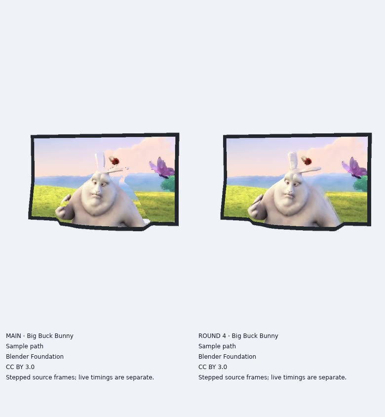](quality/sample-side-by-side.mp4)

[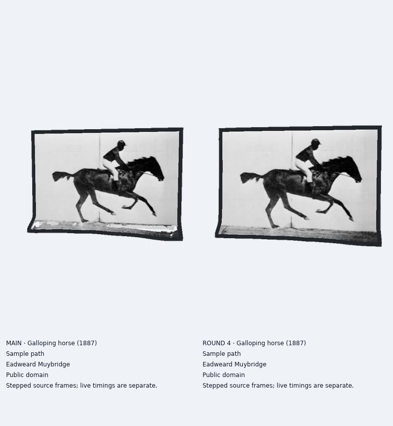](quality/horse-side-by-side.mp4)

[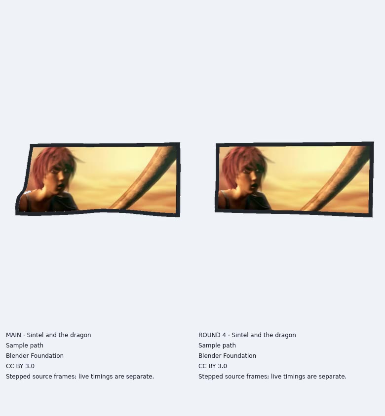](quality/dragon-side-by-side.mp4)

[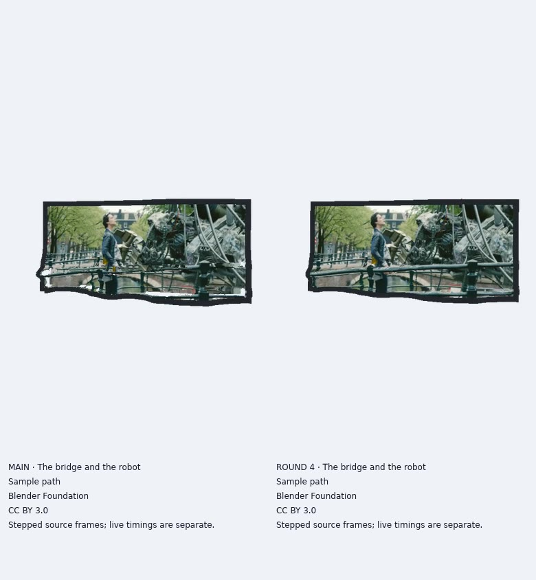](quality/bridge-side-by-side.mp4)

[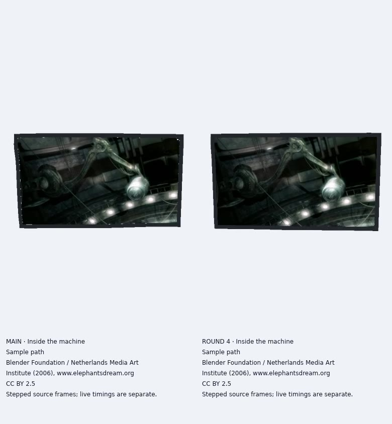](quality/machine-side-by-side.mp4)

[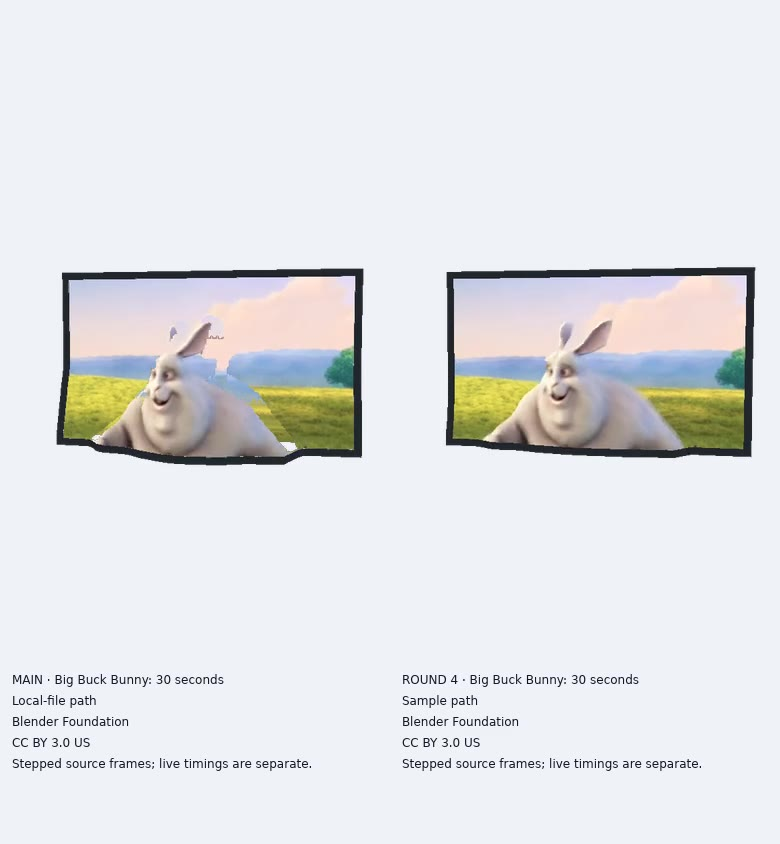](quality/sample-long-side-by-side.mp4)

[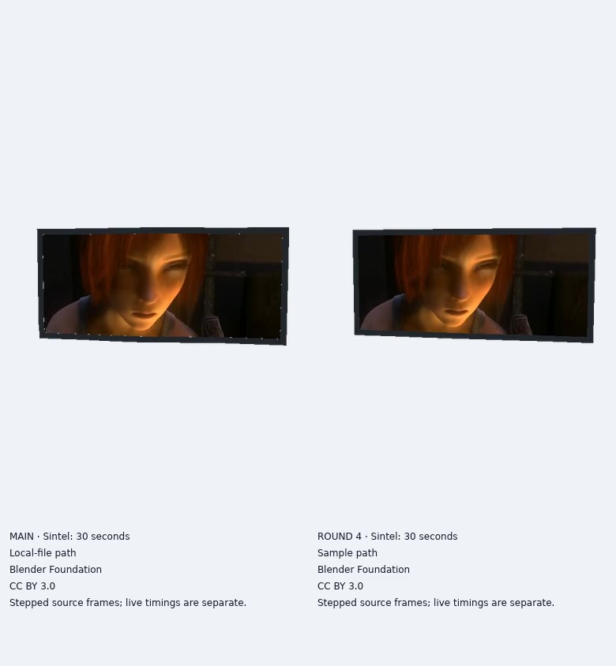](quality/dragon-long-side-by-side.mp4)

[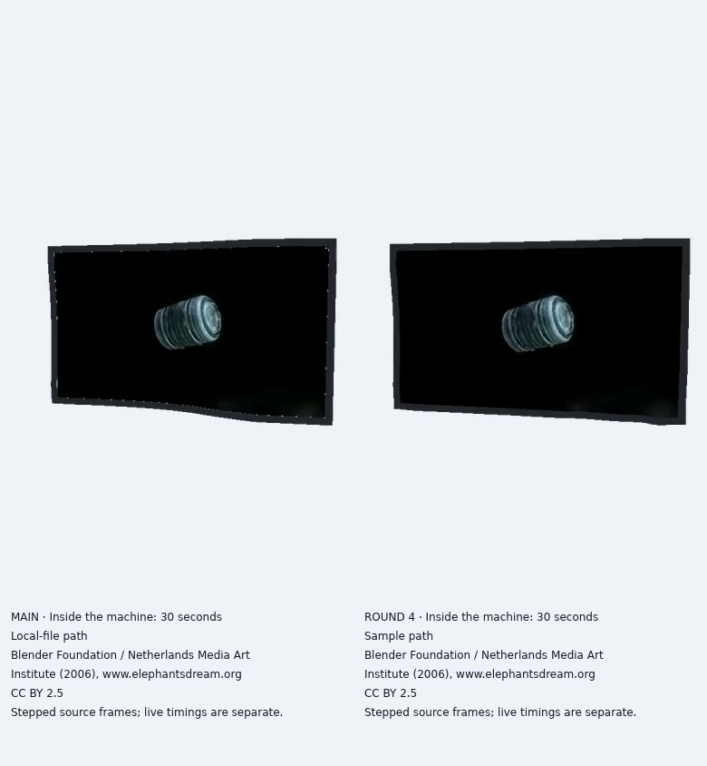](quality/machine-long-side-by-side.mp4)

[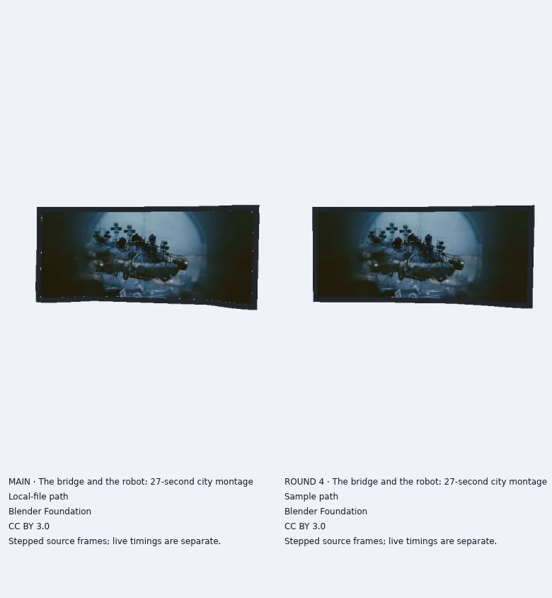](quality/bridge-long-side-by-side.mp4)

[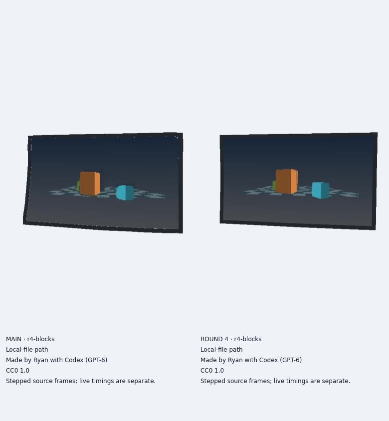](quality/r4-blocks-side-by-side.mp4)

[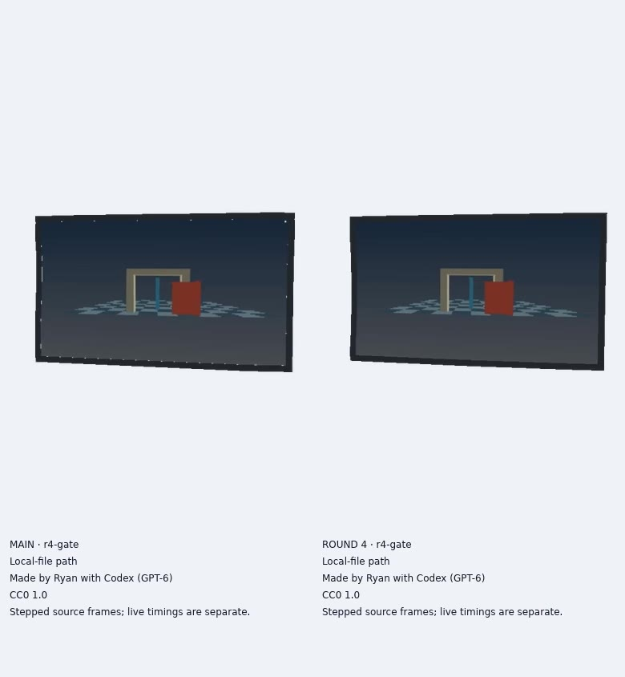](quality/r4-gate-side-by-side.mp4)

[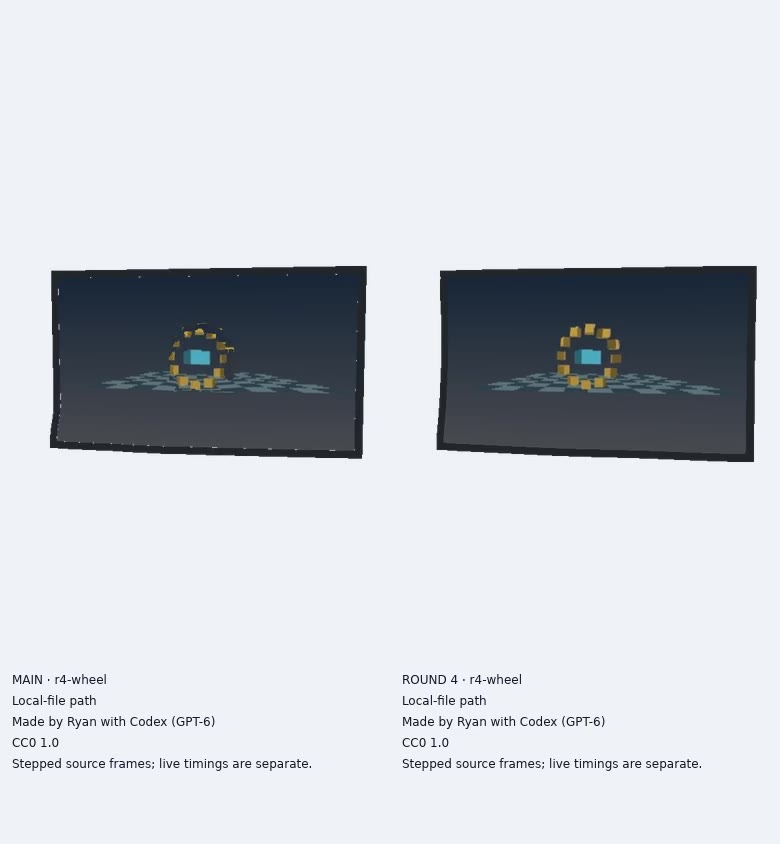](quality/r4-wheel-side-by-side.mp4)

[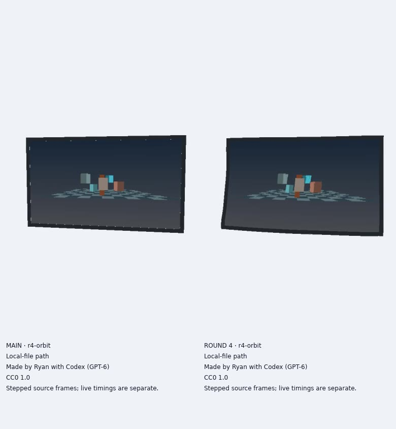](quality/r4-orbit-side-by-side.mp4)

[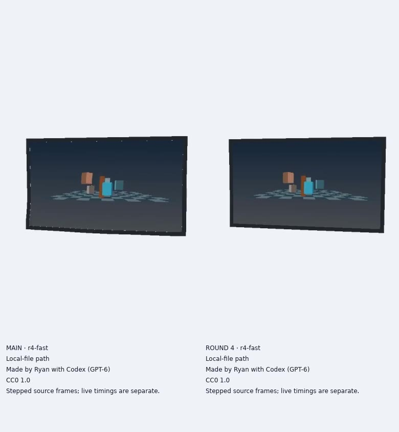](quality/r4-fast-side-by-side.mp4)

- [bridge-long-main.mp4](quality/bridge-long-main.mp4)
- [bridge-long-r4.mp4](quality/bridge-long-r4.mp4)
- [bridge-long-side-by-side.mp4](quality/bridge-long-side-by-side.mp4)
- [bridge-main.mp4](quality/bridge-main.mp4)
- [bridge-r4.mp4](quality/bridge-r4.mp4)
- [bridge-side-by-side.mp4](quality/bridge-side-by-side.mp4)
- [dragon-long-main.mp4](quality/dragon-long-main.mp4)
- [dragon-long-r4.mp4](quality/dragon-long-r4.mp4)
- [dragon-long-side-by-side.mp4](quality/dragon-long-side-by-side.mp4)
- [dragon-main.mp4](quality/dragon-main.mp4)
- [dragon-r4.mp4](quality/dragon-r4.mp4)
- [dragon-side-by-side.mp4](quality/dragon-side-by-side.mp4)
- [horse-main.mp4](quality/horse-main.mp4)
- [horse-r4.mp4](quality/horse-r4.mp4)
- [horse-side-by-side.mp4](quality/horse-side-by-side.mp4)
- [machine-long-main.mp4](quality/machine-long-main.mp4)
- [machine-long-r4.mp4](quality/machine-long-r4.mp4)
- [machine-long-side-by-side.mp4](quality/machine-long-side-by-side.mp4)
- [machine-main.mp4](quality/machine-main.mp4)
- [machine-r4.mp4](quality/machine-r4.mp4)
- [machine-side-by-side.mp4](quality/machine-side-by-side.mp4)
- [r4-blocks-main.mp4](quality/r4-blocks-main.mp4)
- [r4-blocks-r4.mp4](quality/r4-blocks-r4.mp4)
- [r4-blocks-side-by-side.mp4](quality/r4-blocks-side-by-side.mp4)
- [r4-fast-main.mp4](quality/r4-fast-main.mp4)
- [r4-fast-r4.mp4](quality/r4-fast-r4.mp4)
- [r4-fast-side-by-side.mp4](quality/r4-fast-side-by-side.mp4)
- [r4-gate-main.mp4](quality/r4-gate-main.mp4)
- [r4-gate-r4.mp4](quality/r4-gate-r4.mp4)
- [r4-gate-side-by-side.mp4](quality/r4-gate-side-by-side.mp4)
- [r4-orbit-main.mp4](quality/r4-orbit-main.mp4)
- [r4-orbit-r4.mp4](quality/r4-orbit-r4.mp4)
- [r4-orbit-side-by-side.mp4](quality/r4-orbit-side-by-side.mp4)
- [r4-wheel-main.mp4](quality/r4-wheel-main.mp4)
- [r4-wheel-r4.mp4](quality/r4-wheel-r4.mp4)
- [r4-wheel-side-by-side.mp4](quality/r4-wheel-side-by-side.mp4)
- [sample-long-main.mp4](quality/sample-long-main.mp4)
- [sample-long-r4.mp4](quality/sample-long-r4.mp4)
- [sample-long-side-by-side.mp4](quality/sample-long-side-by-side.mp4)
- [sample-main.mp4](quality/sample-main.mp4)
- [sample-r4.mp4](quality/sample-r4.mp4)
- [sample-side-by-side.mp4](quality/sample-side-by-side.mp4)

[Credits, source hashes, timestamps, and transformations](quality/manifest.json).

## Source-clock picture comparisons: round 3 and round 4

Silent captures at the same source clocks and camera. Videos use native pictures; GIFs and sheet
samples use the app's retained composites. The films show picture quality. Separate live browser
measurements report playback speed.

[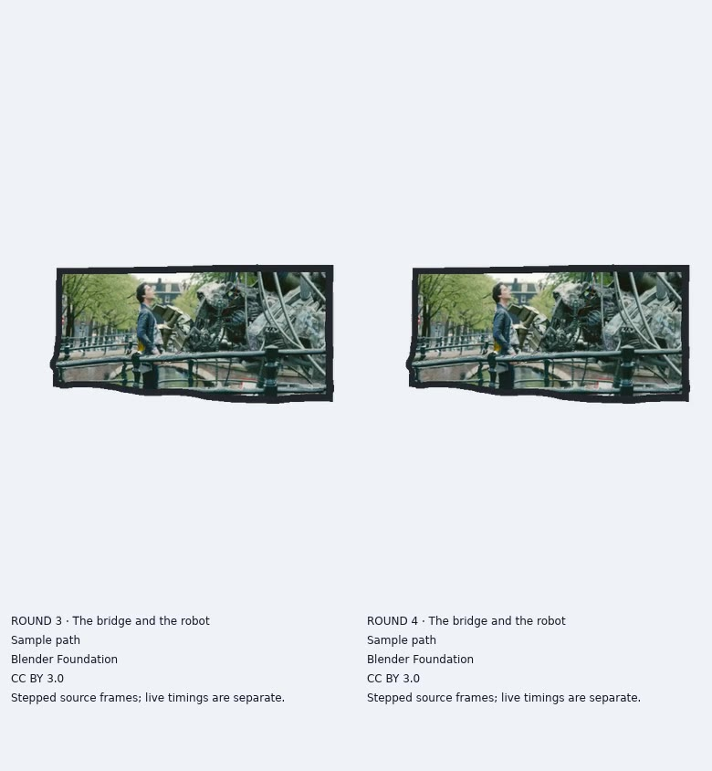](round-3/bridge-side-by-side.mp4)

[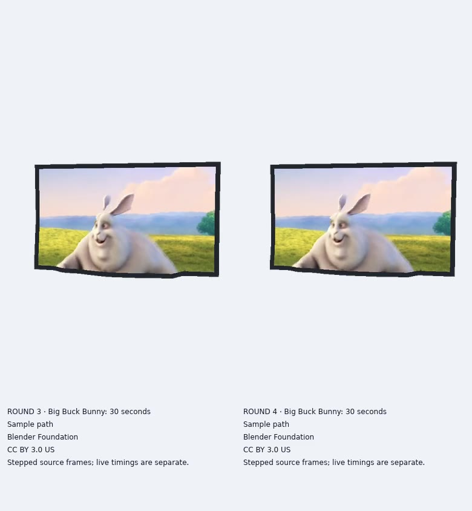](round-3/sample-long-side-by-side.mp4)

- [bridge-r3.mp4](round-3/bridge-r3.mp4)
- [bridge-r4.mp4](round-3/bridge-r4.mp4)
- [bridge-side-by-side.mp4](round-3/bridge-side-by-side.mp4)
- [sample-long-r3.mp4](round-3/sample-long-r3.mp4)
- [sample-long-r4.mp4](round-3/sample-long-r4.mp4)
- [sample-long-side-by-side.mp4](round-3/sample-long-side-by-side.mp4)

[Credits, source hashes, timestamps, and transformations](round-3/manifest.json).

## Round 3 live presentations

Actual CDP screencast presentations at their original wall timestamps; fixed camera; no source-clock
stepping or interpolated pictures

Silent recording with JPEG capture overhead, UI hiding requested before capture, and a fixed camera.
Clean cadence is measured separately with the natural camera and normal UI. Cropping removes only
space outside the stage

The initial native screencast frame can retain the prior UI before the requested visibility change
is composited. It is preserved with its original timestamp. Poster images use the actual recorded
picture at one second.

[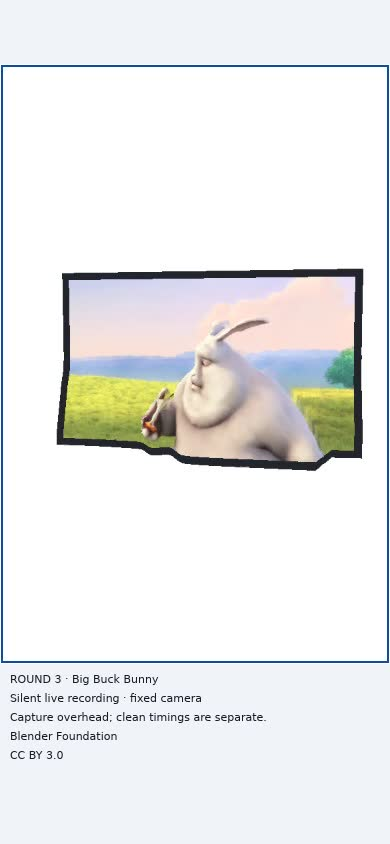](live-r3/sample-live.mp4)

[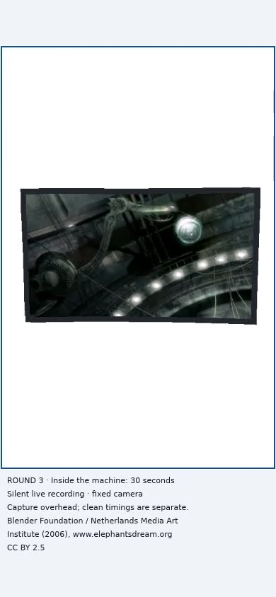](live-r3/machine-long-live.mp4)

- [machine-long-live.mp4](live-r3/machine-long-live.mp4)
- [sample-live.mp4](live-r3/sample-live.mp4)

[Credits, source hashes, timestamps, and transformations](live-r3/manifest.json).

## Round 4 live presentations

Actual CDP screencast presentations at their original wall timestamps; fixed camera; no source-clock
stepping or interpolated pictures

Silent recording with JPEG capture overhead, UI hiding requested before capture, and a fixed camera.
Clean cadence is measured separately with the natural camera and normal UI. Cropping removes only
space outside the stage

The initial native screencast frame can retain the prior UI before the requested visibility change
is composited. It is preserved with its original timestamp. Poster images use the actual recorded
picture at one second.

[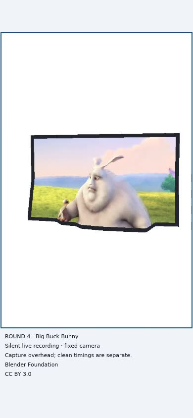](live-r4/sample-live.mp4)

[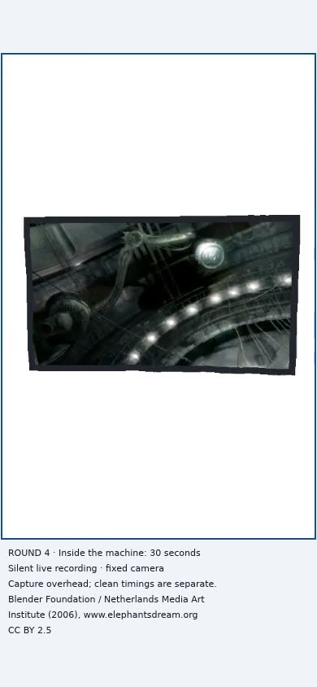](live-r4/machine-long-live.mp4)

- [machine-long-live.mp4](live-r4/machine-long-live.mp4)
- [sample-live.mp4](live-r4/sample-live.mp4)

[Credits, source hashes, timestamps, and transformations](live-r4/manifest.json).

## Live presentations side by side

Two separately recorded live windows, aligned at capture start; 60 fps export duplicates held
pictures without interpolation. Each original presentation is quantized by at most one 16.667 ms
output tick. Individual VFR recordings preserve the exact capture times

CDP JPEG capture adds overhead. Fixed camera and hidden UI. These are presentation evidence, not the
clean natural-camera cadence benchmark

[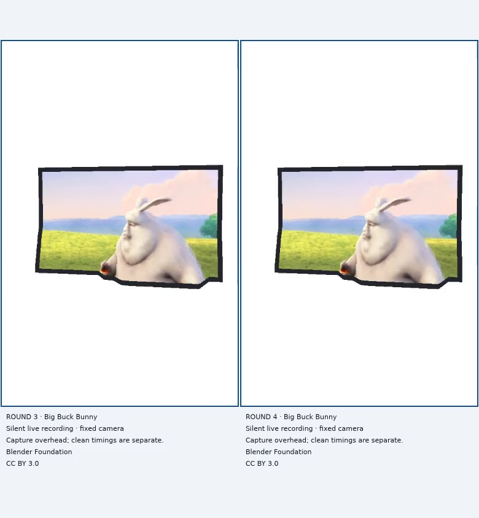](live-pairs/sample-live-side-by-side.mp4)

[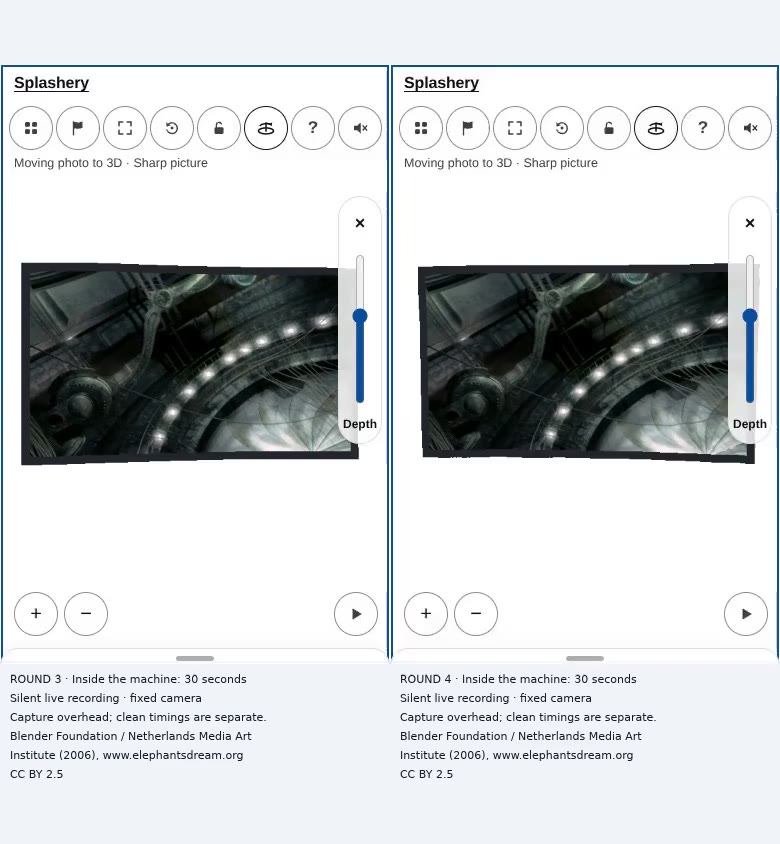](live-pairs/machine-long-live-side-by-side.mp4)

- [machine-long-live-side-by-side.mp4](live-pairs/machine-long-live-side-by-side.mp4)
- [sample-live-side-by-side.mp4](live-pairs/sample-live-side-by-side.mp4)

[Credits, source hashes, timestamps, and transformations](live-pairs/manifest.json).

## Measurement ledgers

- [r4-main-final-quality.json](ledgers/r4-main-final-quality.json)
- [r4-final-quality.json](ledgers/r4-final-quality.json)
- [r4-r3-final-quality.json](ledgers/r4-r3-final-quality.json)
- [r4-final-source.json](ledgers/r4-final-source.json)
- [r4-published-source.json](ledgers/r4-published-source.json)
- [r4-before-active-capture-source.json](ledgers/r4-before-active-capture-source.json)
- [r4-active-capture-guard.json](ledgers/r4-active-capture-guard.json)
- [r4-quality-source.json](ledgers/r4-quality-source.json)
- [r4-source-validation-map.json](ledgers/r4-source-validation-map.json)
- [r4-input-transform-flags.json](ledgers/r4-input-transform-flags.json)
- [r4-orientation-copy-probe.json](ledgers/r4-orientation-copy-probe.json)
- [r4-worker-transform-before-after.json](ledgers/r4-worker-transform-before-after.json)
- [r4-rotated-container-probe.json](ledgers/r4-rotated-container-probe.json)
- [r4-node22-runtime.json](ledgers/r4-node22-runtime.json)
- [r4-publication.json](ledgers/r4-publication.json)
- [r4-public-input-verification.json](ledgers/r4-public-input-verification.json)
- [r4-final-isolation-drain-note.json](ledgers/r4-final-isolation-drain-note.json)
- [r4-final-isolation.json](ledgers/r4-final-isolation.json)
- [r4-prior-phone-main-drain-bug.json](ledgers/r4-prior-phone-main-drain-bug.json)
- [r4-before-cache-source.json](ledgers/r4-before-cache-source.json)
- [r4-phone-r4-before-cache-fix.json](ledgers/r4-phone-r4-before-cache-fix.json)
- [r4-cache-deadline-trials.json](ledgers/r4-cache-deadline-trials.json)
- [r4-cache-deadline-pilot.json](ledgers/r4-cache-deadline-pilot.json)
- [r4-cache-two-pilot.json](ledgers/r4-cache-two-pilot.json)
- [r4-cache-retained-pilot.json](ledgers/r4-cache-retained-pilot.json)
- [r4-measurements.md](ledgers/r4-measurements.md)
- [r4-test-ledger.json](ledgers/r4-test-ledger.json)
- [r4-test-ledger.md](ledgers/r4-test-ledger.md)
- [r4-node-tests.json](ledgers/r4-node-tests.json)
- [r4-photo-equivalence.json](ledgers/r4-photo-equivalence.json)
- [r4-font-environment.json](ledgers/r4-font-environment.json)
- [r4-final-test-summary.json](ledgers/r4-final-test-summary.json)
- [r4-test-immutability.json](ledgers/r4-test-immutability.json)
- [r4-photo-scope.json](ledgers/r4-photo-scope.json)
- [r4-checkpoint-refs.json](ledgers/r4-checkpoint-refs.json)
- [r4-node-tests.tap](ledgers/r4-node-tests.tap)
- [r4-gallery-check.json](ledgers/r4-gallery-check.json)
- [r4-archive-verification.json](ledgers/r4-archive-verification.json)
- [r4-phone-main.json](ledgers/r4-phone-main.json)
- [r4-phone-r3.json](ledgers/r4-phone-r3.json)
- [r4-phone-r4.json](ledgers/r4-phone-r4.json)
- [r4-phone-main-repeat2.json](ledgers/r4-phone-main-repeat2.json)
- [r4-phone-r4-repeat2.json](ledgers/r4-phone-r4-repeat2.json)
- [r4-startup-main.json](ledgers/r4-startup-main.json)
- [r4-startup-r4.json](ledgers/r4-startup-r4.json)
- [r4-final-r3-cpu.json](ledgers/r4-final-r3-cpu.json)
- [r4-final-r4-cpu.json](ledgers/r4-final-r4-cpu.json)

Native traces and CPU profiles are gzip-compressed, with both compressed and original hashes in the
root manifest. Decompress them before loading them in a trace or CPU-profile viewer.

- [r4-final-r3-cpu.json.machine-long.cpuprofile.gz](ledgers/r4-final-r3-cpu.json.machine-long.cpuprofile.gz)
- [r4-final-r3-cpu.json.machine-long.trace.json.gz](ledgers/r4-final-r3-cpu.json.machine-long.trace.json.gz)
- [r4-final-r3-cpu.json.sample.cpuprofile.gz](ledgers/r4-final-r3-cpu.json.sample.cpuprofile.gz)
- [r4-final-r3-cpu.json.sample.trace.json.gz](ledgers/r4-final-r3-cpu.json.sample.trace.json.gz)
- [r4-final-r4-cpu.json.machine-long.cpuprofile.gz](ledgers/r4-final-r4-cpu.json.machine-long.cpuprofile.gz)
- [r4-final-r4-cpu.json.machine-long.trace.json.gz](ledgers/r4-final-r4-cpu.json.machine-long.trace.json.gz)
- [r4-final-r4-cpu.json.sample.cpuprofile.gz](ledgers/r4-final-r4-cpu.json.sample.cpuprofile.gz)
- [r4-final-r4-cpu.json.sample.trace.json.gz](ledgers/r4-final-r4-cpu.json.sample.trace.json.gz)

Every complete-file Playwright JSON report, including failures and superseded runs, is retained
under `ledgers/test-reports/` as a gzip file. Focused and auxiliary invocations are separately
retained under `ledgers/focused-test-reports/` and never replace a complete-file result. The root
manifest records original and compressed hashes; the test ledger identifies each latest whole-file
result. Unknown historical source pins remain unknown.

Incomplete measurements remain explicitly incomplete. Earlier failures are preserved in the test
ledger; latest whole-file reruns do not erase them. These are Chromium software-rendered phone
emulations, not tests on a physical Android phone or Brave.
