# Video to 3D clarity review

October 13, 2026. Made by Ryan with Codex (GPT-6), for task 55 and PR #562. This review branch is
never merged and its media does not ship with the site.

The clips use the actual production phone tier in Walk at 390×844 for eight seconds, with offline
time stepped at 12 fps. This is visual evidence, not a real-phone frame-rate test. The MP4 derives
from the rendered GIF. Stills compare the source photograph, frozen baseline, and compressed desktop
model at one held-out source timestamp, without image alignment. Forest uses independently solved
cameras at that timestamp.

Each derivative retains its source license. Toolse and Põltsamaa are ShareAlike, including every
still, GIF, strip, and MP4 in their sections below. Source pages were checked live on October
13, 2026. Hashes, transformation details, capture spans, and measured tier results are in
[clip records](clip-records.json) and [still records](still-records.json).

## edinburgh

Source:
[POPtravel](<https://commons.wikimedia.org/wiki/File:Walking_in_EDINBURGH_-_Scotland_(UK)_-_4K_60fps_(UHD).webm>).
License: [CC BY 3.0](https://creativecommons.org/licenses/by/3.0/).

[Phone Walk MP4](edinburgh-walk.mp4) · [Phone contact strip](edinburgh-walk-strip.png)

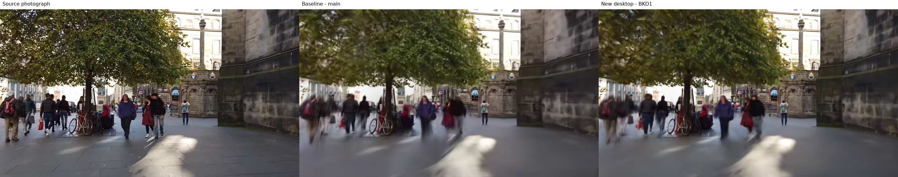

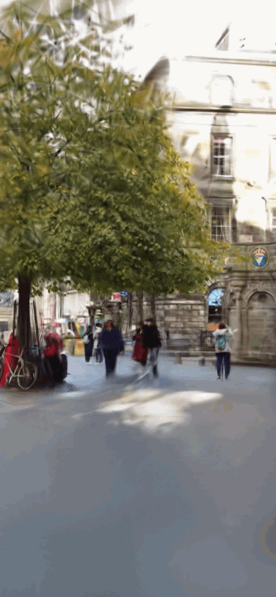

## lihula

Source:
[Sillerkiil](<https://commons.wikimedia.org/wiki/File:Drone_video_of_ruins_of_Lihula_stronghold,_the_manor_and_town_(august_2021).webm>).
License: [CC0 1.0](https://creativecommons.org/publicdomain/zero/1.0/).

[Phone Walk MP4](lihula-walk.mp4) · [Phone contact strip](lihula-walk-strip.png)

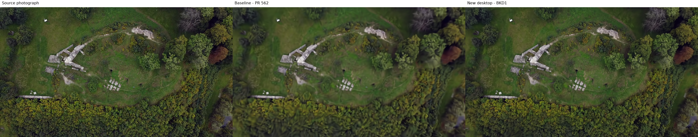

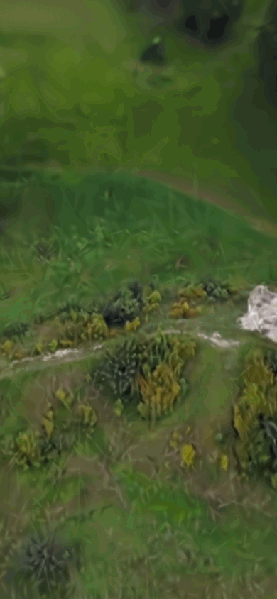

## adjara

Source:
[Vitaly Zdanevich](https://commons.wikimedia.org/wiki/File:Adjara2025walking-summer-forest.webm).
License: [CC BY 4.0](https://creativecommons.org/licenses/by/4.0/).

[Phone Walk MP4](adjara-walk.mp4) · [Phone contact strip](adjara-walk-strip.png)

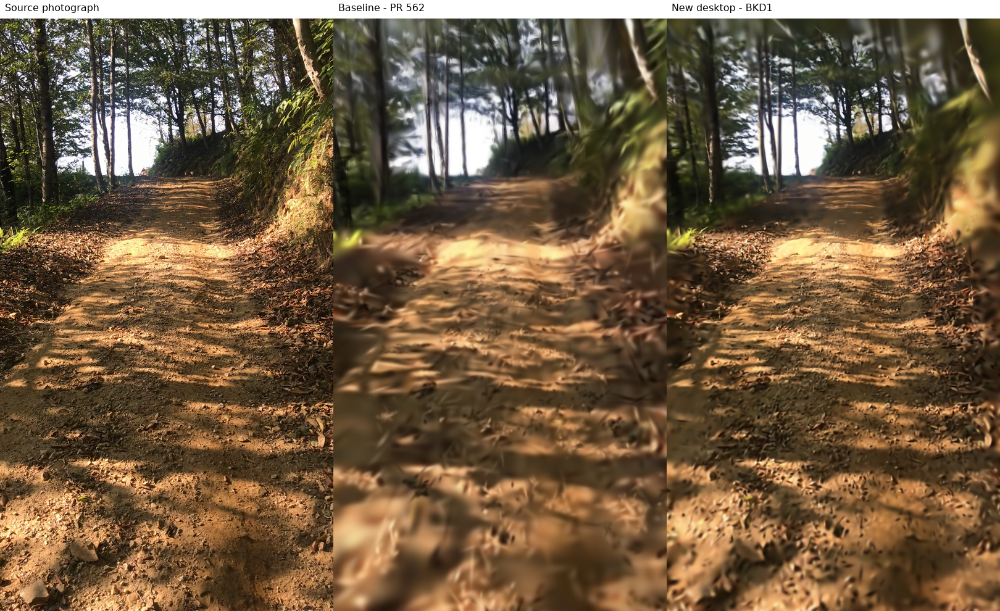

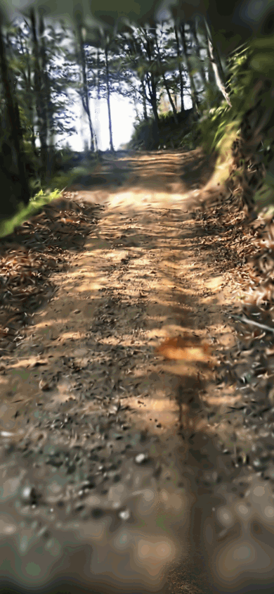

## toolse

Source:
[Sillerkiil](<https://commons.wikimedia.org/wiki/File:Toolse_castle_in_Estonia_(Fall_2021).webm>).
License: [CC BY-SA 4.0](https://creativecommons.org/licenses/by-sa/4.0/).

[Phone Walk MP4](toolse-walk.mp4) · [Phone contact strip](toolse-walk-strip.png)

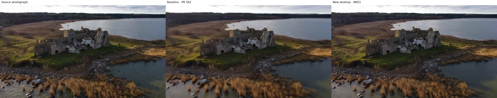

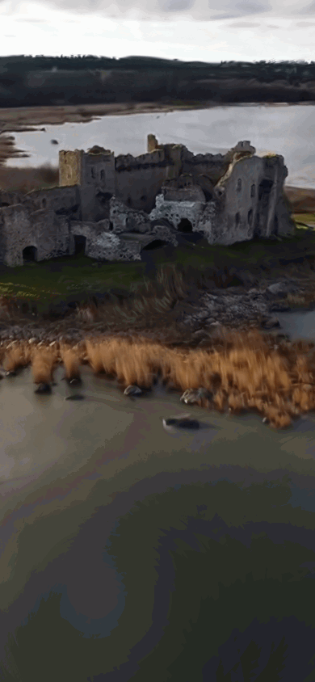

## poltsamaa

Source:
[Sillerkiil](https://commons.wikimedia.org/wiki/File:Drone_video_of_P%C3%B5ltsamaa_river_and_castle_in_Estonia.webm).
License: [CC BY-SA 4.0](https://creativecommons.org/licenses/by-sa/4.0/).

[Phone Walk MP4](poltsamaa-walk.mp4) · [Phone contact strip](poltsamaa-walk-strip.png)

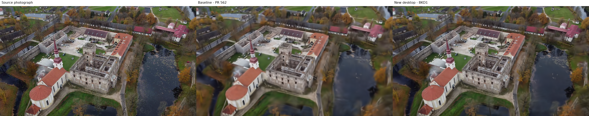

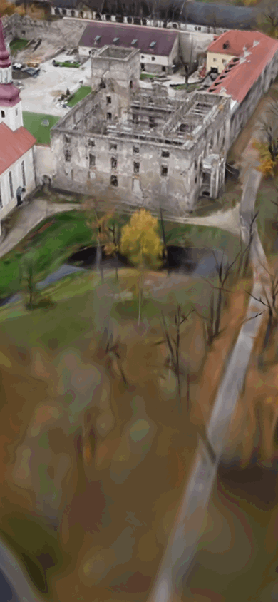

## liberty

Source: [the Dronalist](https://commons.wikimedia.org/wiki/File:Statue_Of_Liberty_4k_Drone.webm).
License: [CC BY 3.0](https://creativecommons.org/licenses/by/3.0/).

[Phone Walk MP4](liberty-walk.mp4) · [Phone contact strip](liberty-walk-strip.png)

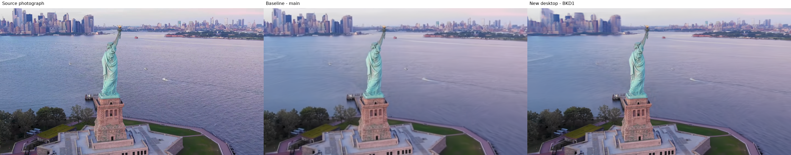

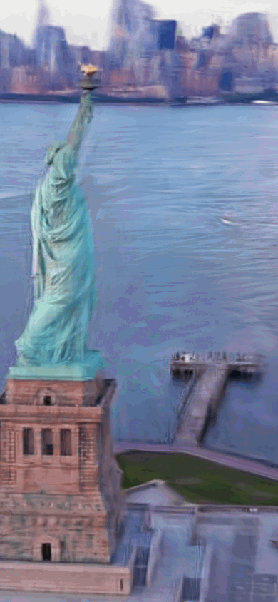

Rule check: none.

## Playground layouts

Actual Auto phone and desktop screenshots, with source credits visible. Each image retains the
source license listed beside that sample above; Toolse and Põltsamaa remain ShareAlike.

- Statue, flown around: [390×844](liberty-390x844.png), [1440×900](liberty-1440x900.png).
- Street, walked: [390×844](edinburgh-390x844.png), [1440×900](edinburgh-1440x900.png).
- Forest path, walked: [390×844](adjara-390x844.png), [1440×900](adjara-1440x900.png).
- Ruined courtyard, flown over: [390×844](lihula-390x844.png), [1440×900](lihula-1440x900.png).
- Coastal ruins, drone pass: [390×844](toolse-390x844.png), [1440×900](toolse-1440x900.png).
- Castle courtyard, orbited: [390×844](poltsamaa-390x844.png), [1440×900](poltsamaa-1440x900.png).

Hashes and source records are in [UI records](ui-records.json).
