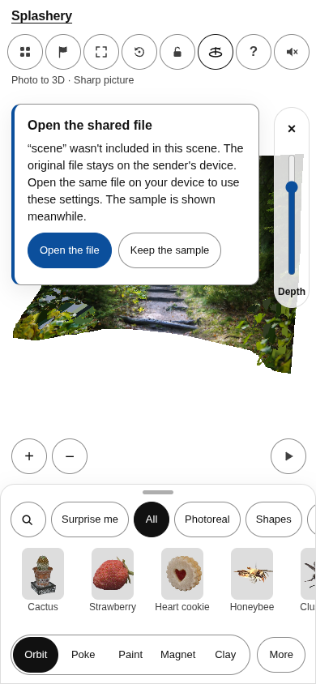
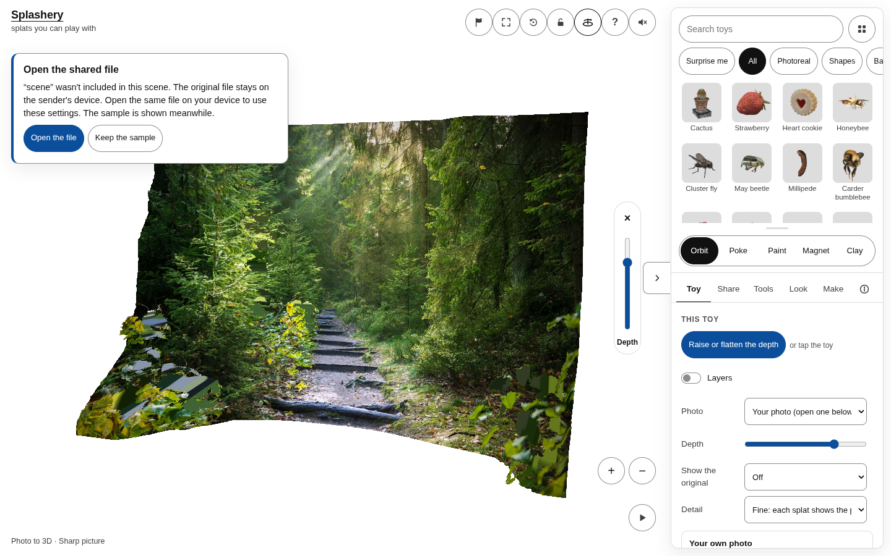
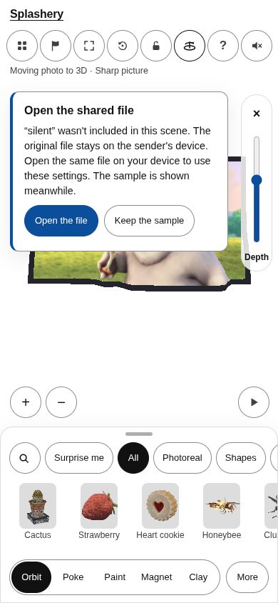
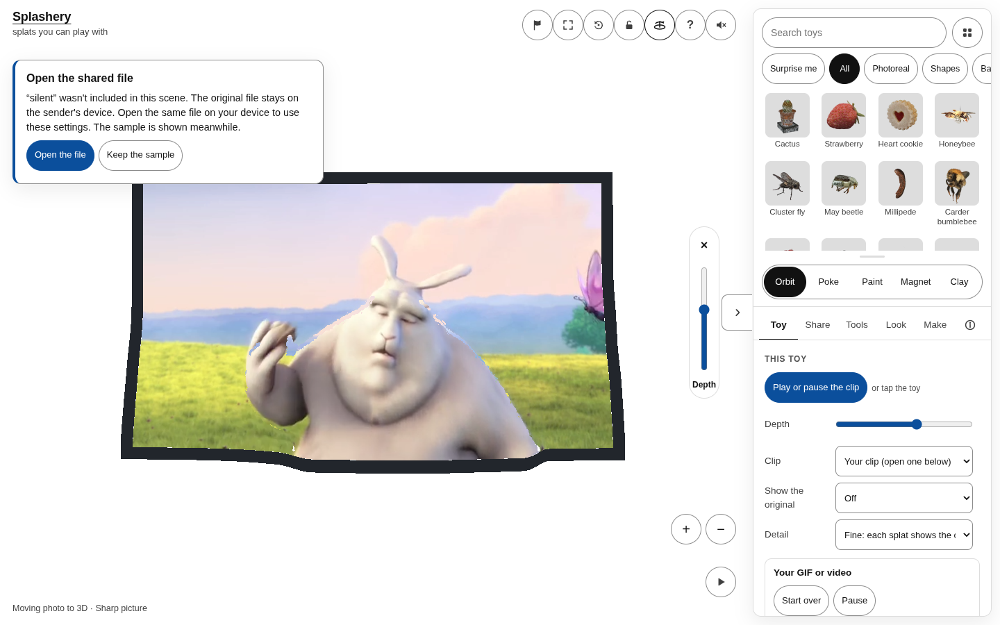

# Advisor route follow-up evidence

**Evidence only. Never merge this branch.**

Application source:
[7805082258dafdf0acd3e84b5f5c0170e2ce71af](https://github.com/ryanjosephkamp/splashery/tree/7805082258dafdf0acd3e84b5f5c0170e2ce71af).
This is one fresh route run, with 62 records, plus the owner's requested phone and desktop
screenshots. [Complete route report](route-report.md), [raw summary](summary.json),
[regression log](regression.txt), and manifest.json retain the results and provenance.

Codex (GPT-6) built the changes. Rule check: none.

## Owner review

### photo-3d, 390 × 844

[Capture metadata](photo-3d-notice-390x844.json) ·
[Accessibility tree](photo-3d-notice-390x844-aria.txt)

### photo-3d, 1440 × 900

[Capture metadata](photo-3d-notice-1440x900.json) ·
[Accessibility tree](photo-3d-notice-1440x900-aria.txt)

### moving-photo-3d, 390 × 844

[Capture metadata](moving-photo-3d-notice-390x844.json) ·
[Accessibility tree](moving-photo-3d-notice-390x844-aria.txt)

### moving-photo-3d, 1440 × 900

[Capture metadata](moving-photo-3d-notice-1440x900.json) ·
[Accessibility tree](moving-photo-3d-notice-1440x900-aria.txt)

## QR counterexample

[Original native PNG](qr-case-0-native.png), [unchanged 390-pixel PNG](qr-case-0-phone.png), and
[exact payload and outcomes](qr-case-0.json). Cases 0–7 retain the actual exports whose scene
documents differ only by their creation timestamps. [Timestamp comparison](qr-timestamp-only.json)
and [20 identical-byte idle/loaded reads](qr-same-bytes-idle-loaded.json) support the local
diagnosis. The generic ZXing finder still has this limitation; the bounded-export pixel decoder
checks the actual image geometry and reads its payload with the vendored ZXing decoder. General
screenshot detection is unchanged. Physical scans and the Operator's full-suite Actions run remain
pending.
