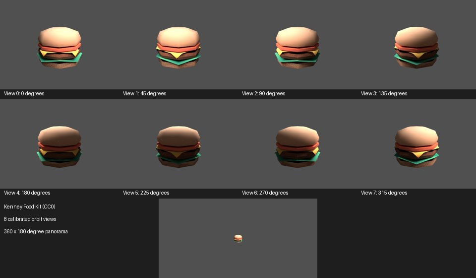
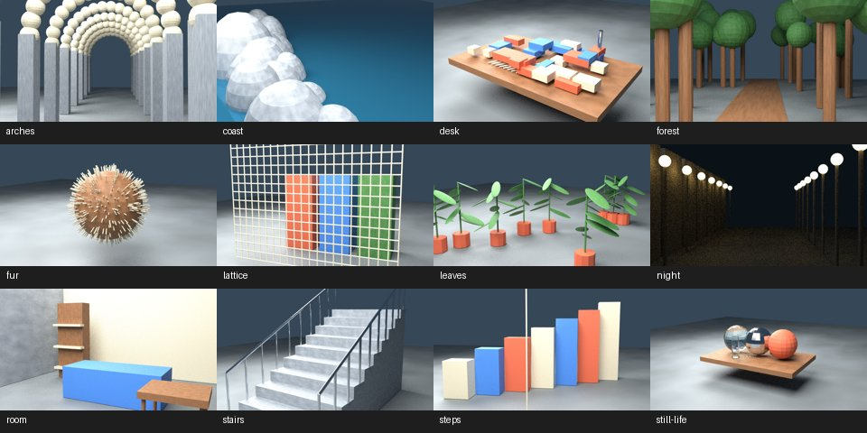

# Blender in Codex cloud

October 17, 2026. Built by Codex (GPT-6).

Blender 4.5.3 LTS installs headlessly from a pinned, SHA-256-checked archive. CPU Cycles renders the
existing truth scenes and a new CC0 GLB pipeline produces calibrated orbit views, geometric depth,
masks, and a full spherical panorama. Fresh-process comparisons cover the complete generated files,
including compressed image/depth bytes and metadata.

The requested `docs/codex/105-blender-cloud.md` was absent from both the checkout and freshly
fetched `origin/main` (`ceb51de7a`). The user's GOAL was used as the spec. Scope: build tools,
tests, licenses, and documentation. No `src/`, `vendor/`, shipped model, or historical truth fixture
changed. PR branch: `codex/blender-cloud-public`. The original local work branch is retained
unchanged.

## Installation

The final installer was run in a fresh cache, downloading and extracting rather than accepting the
system's preinstalled Blender 4.3.2. This cloud exposes five x86-64 virtual CPUs identifying as AMD
EPYC 9V74, Debian 13, glibc 2.41, and no physical GPU device. Rendering uses four CPU threads.

| Measurement                                    | Result                         |
| ---------------------------------------------- | ------------------------------ |
| Cold download, verify, extract, Python startup | 75.31 seconds                  |
| Warm archive/tree verification, Python startup | 3.85 seconds                   |
| Archive                                        | 377,397,328 bytes (359.91 MiB) |
| Installed files                                | 1,530.62 MiB                   |
| Existing-browser cloud setup, warm Blender     | 14 seconds                     |

These are elapsed measurements with other rendering/check jobs active, not an isolated hardware
benchmark. Warm setup deliberately hashes the entire archive and installed file tree each time. The
full setup test used
`SPLASHERY_CHROMIUM=/usr/bin/chromium bash tools/codex-setup.sh --skip-browser`: npm install,
browser launch/WebGL2, and Blender all passed. Browser download/system-package installation was not
rerun.

Archive SHA-256: `975c58fcb244273838534bba771e64ad87739216b0f9b39a888531a49a72d845`. Executable
SHA-256: `5e15447670804c855fef6033ac9b8fd82696b762095becf0df79b1c2f8034397`. Blender build hash:
`67807e1800cc`.

The official download host returned HTTP 403. The downloaded archive matched the committed pin, and
the same checksum was read from
[Berkeley](https://mirrors.ocf.berkeley.edu/blender/release/Blender4.5/blender-4.5.3.sha256),
[RWTH Aachen](https://ftp.halifax.rwth-aachen.de/blender/release/Blender4.5/blender-4.5.3.sha256),
and [dotsrc](https://mirrors.dotsrc.org/blender/blender-release/Blender4.5/blender-4.5.3.sha256). No
signature verification is claimed. The bundled `license/license.md` identifies Blender as
GPL-3.0-or-later; all Blender binaries, libraries, and license files remain in ignored `.cache/`.

The installer requires Linux x86-64 and Python 3.12 or newer, uses safe tar extraction, serializes
concurrent installs, and fails on corrupt archive bytes or an altered installed tree. It launches
Blender's headless Python and imports bundled NumPy to check runtime dependencies. It never falls
back to another Blender version. The launcher disables auto-run scripts, user startup settings, and
bytecode writes inside Blender. The initial environment flag alone did not prevent Blender from
writing bytecode; the integrity check caught that and the launcher now disables it in Python too.

## Rendering and repeatability

The model example is the repository's existing self-contained `burger.glb` from
[Kenney Food Kit](https://kenney.nl/assets/food-kit), by Kenney. Its live page was opened and
confirmed CC0 on October 17, 2026. Input SHA-256 and provenance are in
[`tools/blender/burger.json`](../../tools/blender/burger.json). No asset download or model
alteration was needed. The procedural truth scenes retain their original CC0 credit: made by Ryan
with Codex (GPT-6). Contact sheets below are render evidence, not real captures or new site samples.



The default model command renders eight 640×480 views and one 1280×640 panorama at 16 samples.
Across two final runs, all **38 files matched byte for byte**, totaling **3,290,488 bytes** per set.
This includes every PNG, gzip depth map, mask, pose JSON, manifest, and checksums file. The SHA-256
of the matching `checksums.json` is
`40c6e0e06fb1b7d3ed4b7d7a2538946fb8bc05febdd6cb274079e51492465939`.

| Model measurement                                | Run A | Run B |
| ------------------------------------------------ | ----: | ----: |
| Median orbit beauty render and save, seconds     | 1.772 | 2.080 |
| Median orbit depth/mask/pose generation, seconds | 1.520 | 2.141 |
| Panorama beauty render and save, seconds         | 2.051 | 3.544 |
| Panorama depth/mask/pose generation, seconds     | 2.703 | 6.514 |
| Sum of nine render/truth operations, seconds     | 33.82 | 43.51 |

The sum excludes installer verification, importing, bounds/BVH construction, and final manifest
hashing. Depth/mask time includes geometric tracing and writing the files. Concurrent jobs affected
speed, but did not change output bytes. These measurements concern a small, low-poly example and are
not a throughput promise for large textured models.

The full 12-scene, 1280×720 truth still set was rendered with CPU Cycles at eight samples. All **51
files matched byte for byte**, totaling **19,934,153 bytes** per set. This includes all stills,
depth, masks, calibration, build settings, manifest, and checksums. The matching `checksums.json`
SHA-256 is `7eb9923f3a37be1bd0782e8780f1382f8203674166dacd9cbb047a0054139435`.

| Truth scene: build, beauty, and geometric truth, seconds | Run A | Run B |
| -------------------------------------------------------- | ----: | ----: |
| arches                                                   |  14.2 |   9.5 |
| coast                                                    |  15.8 |  13.3 |
| desk                                                     |  14.8 |  12.1 |
| forest                                                   |  25.2 |  13.8 |
| fur                                                      |  12.6 |  10.2 |
| lattice                                                  |  13.8 |  10.2 |
| leaves                                                   |  12.0 |   7.7 |
| night                                                    |  14.1 |  12.6 |
| room                                                     |  22.6 |  14.1 |
| stairs                                                   |  17.5 |  12.0 |
| steps                                                    |  10.1 |   8.6 |
| still-life                                               |  13.0 |   9.2 |
| Total                                                    | 185.7 | 133.3 |

Timings are rounded to 0.1 seconds and exclude installer/process startup. Both runs overlapped other
checks, so contention explains much of the variation.



Detailed per-scene timings, file hashes, repeat results, and backend errors are in
[`measurements.json`](blender-cloud-2026-10/measurements.json). Full datasets and verbose logs stay
in ignored cloud cache; the contact sheets and compact measurements are committed. The cache is
local to this workspace and is not a hosted archive. The historical truth archive's hosting problem
was not changed by this task.

Blender writes Date and RenderTime metadata even with the visible stamp disabled. Early runs had
identical pixels but different files. The shared metadata helper now removes PNG text/time chunks
and JPEG comments without decoding or recompressing image pixels. PNG color profiles, resolution,
and compressed image data remain intact. Unit tests verify that encoded image data survives
unchanged. Gzip timestamps are fixed at zero; deterministic manifests contain no runtime timings or
absolute machine paths.

Further full repeats found actual beauty-pixel differences first in the many-light night scene and
later in the forest, while geometry truth matched. Single-thread rendering, disabling the light
tree, and selecting tabulated Sobol sampling did not fix the night case. Three renders of the same
saved scene matched. The pinned 4.5.3 path therefore loads all 12 original scenes from
SHA-256-checked compressed sources in `tools/blender/truth-scenes/` (1,785,089 bytes total). These
preserve the procedural geometry, materials, and lighting; all recipes remain in `build_procedural`.
`truth-scenes.json` records the CC0 provenance, source hashes, seeds, camera targets, and every file
hash. `canonicalize-truth.py` intentionally rebuilds these versioned inputs when a recipe changes.
The repeated night clip regression caught the procedural failure before this fix. This stabilizes
scene inputs; no general Blender determinism fix is claimed.

The truth generator records the canonical source record hash and metadata helper's source hash in
its resume settings, preventing old outputs from being relabeled with the new settings.

## Calibration contract

World coordinates retain the original imported model's Blender coordinates, Z up, in meters. The
orbit fits its bounding sphere and adds only cameras and lighting. Camera coordinates are +X right,
+Y down, and +Z forward; row-major matrices act on column vectors. Perspective K uses the actual
horizontal sensor and square pixels. Pixel centers are `(x+0.5,y+0.5)`.

Perspective depth is optical-axis Z. Panorama depth is radial distance. Both are evaluated-mesh,
first-hit geometry at pixel centers, with explicit near/far clipping, stored as headerless gzip
float32 little endian, top row first, NaN for no hit. Mask red-channel values are 0 for no hit, 1
for opaque geometry, and 3 for appearance-ambiguous geometry. Glass, metal, alpha, and emission are
flagged conservatively; first-hit geometry is not a claim about reflected or transmitted appearance.
Beauty area sampling and pixel-center geometry can differ at edges.

The panorama covers longitude −π to +π left to right and latitude +π/2 to −π/2 top to bottom from a
single camera center, aligned with the first orbit view. It has no pinhole K. A six-color box test
checks actual rendered cardinal directions, top/bottom orientation, and the independently known
radial distance `2/max(abs(ray component))`. A separate known-plane test checks axial depth at
oblique pixels. Existing truth geometry/calibration tests also pass with the installed Blender.

## Without a GPU

Each probe starts the pinned Blender in a separate process. GPU Cycles enables only devices of the
requested type; CPU fallback is explicitly disabled. These are actual backend discovery/render
checks, not mocked capability flags.

| Backend    | Observed result                                                                                                                                                                                                                                                 |
| ---------- | --------------------------------------------------------------------------------------------------------------------------------------------------------------------------------------------------------------------------------------------------------------- |
| CPU Cycles | Rendered the default 64×64 scene at two samples in 0.070 seconds, excluding process/install startup. All dataset renders also use CPU.                                                                                                                          |
| CUDA       | No device; nonzero exit with the explicit unavailable-device error.                                                                                                                                                                                             |
| OptiX      | No device; nonzero exit with the explicit unavailable-device error.                                                                                                                                                                                             |
| HIP        | No device; nonzero exit with the explicit unavailable-device error.                                                                                                                                                                                             |
| oneAPI     | No device; nonzero exit with the explicit unavailable-device error.                                                                                                                                                                                             |
| Metal      | Not available in this Linux build's backend enum; nonzero exit.                                                                                                                                                                                                 |
| Eevee      | Rendered at 64×64 with its default 64 samples using Mesa llvmpipe (LLVM 19.1.7, 256 bits), OpenGL 4.5, Mesa 25.0.7. First run: 35.78 seconds; repeat with shader cache: 11.56 seconds. EGL_BAD_MATCH diagnostics appeared before successful software rendering. |

Thus GPU Cycles is unavailable here. Eevee succeeds through software OpenGL, with startup/shader
cost and diagnostics; it should not be described as categorically impossible without a GPU. The
calibrated pipeline uses CPU Cycles, which also supplies the equirectangular camera. No physical GPU
speedup, GPU beauty reproducibility, denoising benchmark, browser WebGPU training, or phone
performance is claimed.

## Reproduce and verify

See the [tool guide](../../tools/blender/README.md) for the installer, default model command, asset
record format, all options, recovery steps, and the complete camera/depth contract.

```sh
python3 tools/blender/install.py --report .cache/blender-install.json
bash tools/blender-cloud.sh --python tools/studio-truth-generate.py -- \
  --out .cache/blender-truth/run-a --mode still
bash tools/blender-cloud.sh --python tools/blender/render.py -- \
  --model assets/toys/model-splats/burger.glb --asset-record tools/blender/burger.json \
  --out .cache/blender-model/run-a --timings .cache/blender-model/run-a-times.json
python3 tests/blender-cloud-install.py
python3 tests/blender-cloud-metadata.py
bash tools/blender-cloud.sh --python tests/blender-cloud-render.py
python3 tests/blender-cloud-repeat.py
bash tools/blender-cloud.sh --python tests/studio-truth-blender.py
python3 tests/studio-truth-camera.py
node --test --test-concurrency=1 tests/studio-truth*.test.mjs
python3 tests/studio-truth-validation.py
```

Repeat generation into a second empty directory and compare the two `checksums.json` files. The
compact evidence lists all artifact hashes, including the checksums files themselves. Operational
timing JSON deliberately lives outside the deterministic dataset.

The 43 installer, metadata, camera, geometry, rendering, repeat, and existing truth checks passed.
The repository preflight passed all 270 browser tests (10.6 minutes), formatting, American English,
generated-site checks, shared-list parsing, and file sizes after merging `origin/main`. A final
credits-page check and preflight without the already-passed browser suite cover the final report and
canonical source additions. No test was loosened or skipped.

Byte identity is established for repeated runs on this cloud CPU with the same pinned build, source,
input bytes, settings, and libraries. Cross-architecture or cross-version beauty identity is not
established. The renderer accepts embedded GLB only; OBJ, externally referenced glTF, HDR panoramas,
and more complex import formats were cut from this bounded implementation. Full 120/300-frame clips
for all 12 scenes were not regenerated; a two-frame handheld/walk smoke test checks both encoders
without representing itself as a complete dataset.

Rule check: none.
