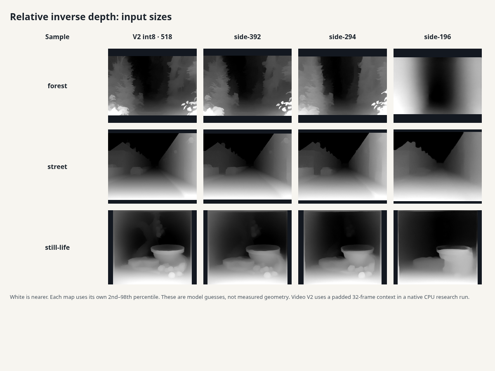
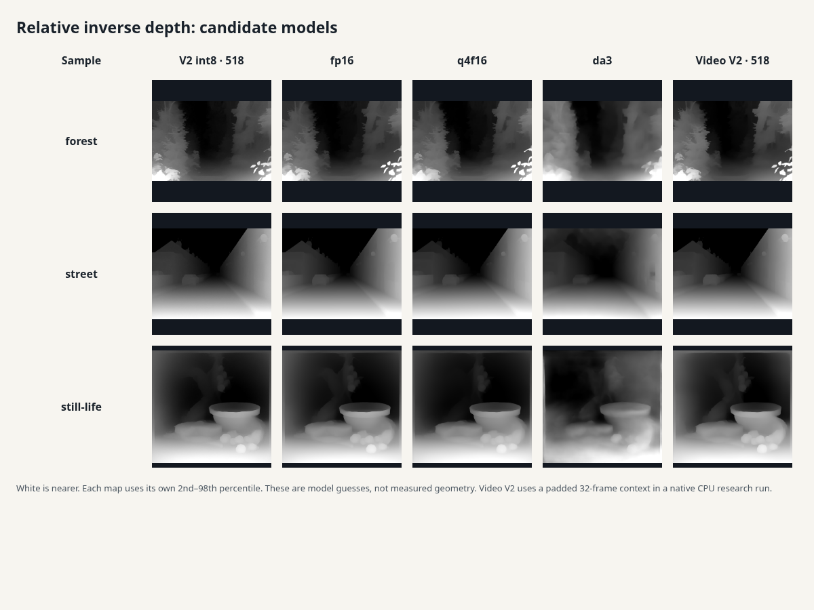

# Depth engine audit: October 12, 2026

Codex (GPT-6) built the shared worker engine on `codex/depth-engine`, from main at `1ecc57dc`. Photo
inference, area resampling, and tensor packing now run in that worker. The default model and input
size remain compatible with every existing caller. All **102** paired depth outputs match the
original code byte for byte: 82 photo-style captures and 20 production clip-frame captures. The
largest observed main-thread task during the photo depth benchmark was 71 ms after the change.

Recommendation: ship the worker and its default int8/WASM path. Offer smaller inputs and sparse clip
guidance as explicit options after reviewing their depth changes. Keep the current weights; none of
the measured replacement candidates gives a clear speed-and-quality win for this browser path. Added
runtime/model weight bytes: **0**.

## What changed

- `estimateDepth(photo, onStatus, options = {})` keeps its original `{ w, h, d, ms }` return. The
  caller keeps its RGBA bytes. The worker owns preprocessing and inference.
- `loadDepthModel(onStatus)` still returns `{ ort, s }`; `s` is a worker facade with real Tensor
  inputs and outputs, input/output metadata, `run()`, and `release()`. Existing warm-up tools keep
  working. `MODEL_URL`, `RUNTIME_URL`, and `fetchBytes` retain their interfaces.
- The existing `frame` → `depth` protocol keeps its IDs, dimensions, relative inverse depth, and
  timings. Camera and clip callers retain their quiet status after loading. Errors now carry the
  request ID. A serial queue protects the reusable session and input Tensor from overlapping
  requests; output Tensors are released after copying their data.
- Photo to 3D's existing progress line shows model download progress and inference status. Its
  current reader does not forward its fifth progress argument, so the depth module bridges that
  existing line. Task 39 should pass the callback directly. No toy-owned file was changed.
- New options: `side` or `tier` (low 294, mid 392, high/max 518). Omitting them keeps 518. Separate
  clients can initialize a same-origin model/runtime and request `webgpu` or `webnn`. Missing
  hardware, initialization failure, and run failure use the independent WASM module; accelerated
  initialization/runs have a 15-second deadline before CPU fallback. The default requests only the
  existing WASM bundle.
- `estimateClipDepth` in `src/depth/client.js` is an optional separate-worker API. It returns
  `{ depths, modelRuns }` plus message metadata. Local color patches guide depth between anchors;
  large appearance changes use full inference. Existing toys continue through their original APIs.

## Measurement method and limits

Chromium `151.0.7922.173` on Linux, AMD EPYC 9V74, with a four-CPU quota. The static server ran on
127.0.0.1:4173. The desktop viewport was 1440×900; the phone profile was 390×844 with CDP
`Emulation.setCPUThrottlingRate({ rate: 4 })`. This is **not a physical phone**.

CDP's page throttle does not impose a four-times-slower worker CPU in this setup. That is visible in
both the original and new clip workers. Consequently the after-phone inference numbers are
host-worker timings, not claimed phone performance. The page's responsiveness is still measured
under the four-times throttle. Real phone thermals, memory pressure, and GPU performance remain
unmeasured.

Every one of the 36 Photo to 3D samples (six CC0 photos and 30 existing AI-made Studio samples), and
the first frame of all five Moving photo samples, was run at the common 518 input for the
before/after comparison. A session loaded once per profile; each input then ran twice. The first run
in a row is the first run for that input/shape, not a fresh model session. Cold `loadMs` includes
runtime import, local model fetch, and session creation. These are local-server load figures, not
Internet download measurements.

The benchmark observes long tasks around load and the two-run burst. Consecutive original
main-thread runs can share one long task, so the before peak is not a single-photo latency. The
strict tests measure the depth call after image decoding/imports have ended their task; image
decoding and later splat construction belong to the callers and remain outside this change. The
numerical timings are small-sample observations, not confidence intervals. Complete candidate sweeps
overlapped browser regressions and are labeled separately below; those timings include CPU
contention.

Raw float maps and research binaries stay in the local `.cache/cdx-depth` folder. The small
[measurement artifact](../../src/depth/evidence/measurements.json) records times, dimensions, and
SHA-256 output hashes; the figures below can be rebuilt with the supplied tools.

## Before and after

All figures below are milliseconds. Warm inference is the median of the repeat run over 41 inputs.

| Profile                        | Cold load before → after | Warm inference before → after | Largest two-run long task before → after | Matching output hashes |
| ------------------------------ | ------------------------ | ----------------------------- | ---------------------------------------- | ---------------------- |
| Desktop, 1440×900              | 552 → 1,559              | 1,778 → 1,833                 | 5,732 → 0                                | 41/41                  |
| Phone profile, 390×844, CDP 4× | 2,325 → 913              | 8,082 → 1,864                 | 26,818 → 71                              | 41/41                  |

The production clip protocol was also measured on each sample's first frame, using the original
`depth-worker.js` at the baseline commit and the new worker. Inputs were the same byte-valued RGBA
from the existing `shrink` helper. Low/mid clips use 196; high/max clips use 294.

| Page throttle / long side | Median repeat inference before → after, ms | Matching hashes |
| ------------------------- | ------------------------------------------ | --------------- |
| 1× / 196                  | 173 → 165                                  | 5/5             |
| 1× / 294                  | 408 → 440                                  | 5/5             |
| 4× / 196                  | 206 → 231                                  | 5/5             |
| 4× / 294                  | 567 → 471                                  | 5/5             |

The extra worker/message overhead does not make the same CPU computation intrinsically faster.
Session reuse and buffer reuse are in place; the reliable gains here are responsiveness and the
optional reduction in inference work.

## Runtime experiments

**SIMD:** the installed browser's WebAssembly SIMD validation probe passed. The existing vendored
`ort-wasm-simd-threaded.wasm` already provides SIMD; this was also the baseline path. No scalar
build is supplied in this checkout, so no non-SIMD speed number is claimed.

**Threads:** the unmodified static page reported `crossOriginIsolated: false` and no shared memory.
A locally scoped service worker adding COOP/COEP response headers, followed by a reload, reported
`crossOriginIsolated: true` and enabled the existing runtime's extra threads. Both the worker
bootstrap and ORT's nested worker scripts needed to live under the controlled scope; the first
outside-scope bootstrap failed. The scope experiment is reproducible with
`tools/cdx-depth-capabilities.mjs`.

| Threads | Forest inference: first / repeat / repeat, ms |
| ------- | --------------------------------------------- |
| 1       | 2,119 / 1,898 / 1,881                         |
| 2       | 1,283 / 1,032 / 999                           |
| 4       | 943 / 713 / 708                               |

This establishes a working service-worker approach locally. It is not enabled on the public GitHub
Pages app. Production needs a root-scope worker or server headers, a controlled reload, and a review
of existing service-worker ownership and cross-origin resources. The allowed file list does not
include those entry points. The engine therefore keeps one thread by default and clamps requested
extra threads back to one without isolation. Background: the opened
[MDN isolation reference](https://developer.mozilla.org/en-US/docs/Web/API/Window/crossOriginIsolated),
[coi-serviceworker implementation](https://raw.githubusercontent.com/gzuidhof/coi-serviceworker/master/coi-serviceworker.js),
and
[ORT environment reference](https://onnxruntime.ai/docs/tutorials/web/env-flags-and-session-options.html).

**WebGPU:** normal Chromium had no adapter; the software-adapter launch flags exposed one. The full
1.30.0 runtime package was downloaded only into the research cache. Its WebGPU path requires the
package's asyncify/JSPI files as well as its JS entry; adding only the older JSEP pair was
insufficient. A software-provider run did not finish within the research tool's 60-second bound.
Hardware GPU speed is unmeasured. GPU failures must not poison the fallback's WASM initialization,
so the engine switches to the independent WASM-only module, not a retry of an already-failed JSEP
instance. Real CPU inference tests cover missing hardware, failed GPU initialization, and a
simulated stalled accelerated run. The final real software-adapter probe also switched from WebGPU
to WASM after the 15-second deadline: the first reply took about 17.5 seconds including recovery,
and the next two inferences took about 1.8 seconds. The shipped engine uses that shorter bound for
the optional accelerated path.

**WebNN:** `navigator.ml` was absent. The request fell back to WASM and produced real depth. No
native WebNN speed is claimed. Opened references:
[WebGPU](https://onnxruntime.ai/docs/tutorials/web/ep-webgpu.html),
[WebNN](https://onnxruntime.ai/docs/tutorials/web/ep-webnn.html), and the
[MIT runtime license](https://raw.githubusercontent.com/microsoft/onnxruntime/v1.30.0/LICENSE). No
new runtime files are shipped, so `LICENSES.md` needs no new bundle entry.

## Input size and clip work

The following eight-input desktop sweep uses the three illustrated photos and all five clip first
frames. Depth differences are relative to the 518 int8 output, after percentile normalization; they
measure agreement, not accuracy. Edge ratios are forest/street/still-life on a common 96×64 grid.
Lower resolution changes the model's guess as well as smoothing edges.

| Long side | Median repeat inference, ms | Median photo depth MAE | Edge-strength ratios |
| --------- | --------------------------- | ---------------------- | -------------------- |
| 196       | 287                         | 8.20%                  | 0.57 / 0.93 / 0.90   |
| 294       | 465                         | 4.89%                  | 0.86 / 1.02 / 0.99   |
| 392       | 787                         | 3.53%                  | 0.92 / 0.95 / 0.89   |
| 518       | 1,652                       | 0.00%                  | 1.00 / 1.00 / 1.00   |



392 is a useful opt-in starting point for photos. 294 trades more detail for speed; 196 loses
substantial forest detail and remains a clip/live starting point rather than the photo default.

For sparse guidance, each clip used its first six consecutive sheet frames at a 196 long side, with
a warmed model. Dense inference uses all six. Anchor spacing two uses four model calls; spacing
three uses three. Time includes preprocessing and color-patch guidance. MAE compares independently
normalized maps with dense inference on the same frames.

| Clip    | Dense time, ms | Spacing 2 time / model calls | Depth MAE | Spacing 3 time / model calls | Depth MAE |
| ------- | -------------- | ---------------------------- | --------- | ---------------------------- | --------- |
| sample  | 1,381          | 1,021 / 4                    | 0.60%     | 1,116 / 3                    | 0.81%     |
| horse   | 1,336          | 1,104 / 4                    | 6.35%     | 1,664 / 3                    | 8.03%     |
| dragon  | 1,194          | 1,029 / 4                    | 5.26%     | 1,025 / 3                    | 9.32%     |
| bridge  | 1,410          | 989 / 4                      | 2.21%     | 934 / 3                      | 3.32%     |
| machine | 1,581          | 1,245 / 4                    | 1.55%     | 1,241 / 3                    | 7.69%     |

Spacing two is the conservative experiment. The horse and dragon show larger changes, and spacing
three reaches about eight to nine percent disagreement on several clips. This is why the helper is
opt-in. The tests also show a translating edge follows its image rather than splitting into two
blended edges, and a skipped scene change receives its own model result.

## Candidate models, licenses, and depth quality

All model licenses below were checked on their **live model pages on October 12, 2026**. Sources and
exact revisions:

- [V2 Small ONNX](https://huggingface.co/onnx-community/depth-anything-v2-small), Apache-2.0,
  revision `4472b7362082ad9968fee890ca0f1e5aca36b93d`: existing int8, fp16, and q4f16 variants.
- [DA3 Small ONNX](https://huggingface.co/onnx-community/depth-anything-v3-small), Apache-2.0,
  revision `0b6a7f3bf5595f9950b91389e0da3a0de130324c`; also checked the
  [upstream DA3 Small page](https://huggingface.co/depth-anything/DA3-SMALL). The ONNX graph is
  640,691 bytes and its external weights are 104,702,464 bytes; counting only the graph would badly
  understate the download. ImageNet normalization was confirmed in the opened
  [upstream input processor](https://raw.githubusercontent.com/ByteDance-Seed/depth-anything-3/main/src/depth_anything_3/utils/io/input_processor.py).
- [Video Depth Anything Small](https://huggingface.co/depth-anything/Video-Depth-Anything-Small),
  Apache-2.0, revision `256875362cff76724b920335dfb4b29dd611f66e`, 116,440,756-byte PyTorch weights.
- [DepthPro ONNX](https://huggingface.co/onnx-community/DepthPro-ONNX), Apple ASCL/custom, excluded
  from shipping and inference. Its int8 file is 1,009,098,595 bytes. The live card's custom license
  is outside this task's allowed weights; it was not downloaded.

The controlled eight-input candidate sweep used a 518 long side. Each model reused one session and
ran each input twice; all ONNX candidates ran in a browser worker using the existing WASM runtime.
DA3 has a five-dimensional input and outputs distance-like depth, which the research worker converts
to inverse depth for the common comparison. These are not interchangeable model files for the
production four-dimensional V2 preprocessing.

| Model/variant                   | Live weight license | File bytes  | Median repeat, ms                 | Backend                                  |
| ------------------------------- | ------------------- | ----------- | --------------------------------- | ---------------------------------------- |
| V2 Small int8                   | Apache-2.0          | 27,258,801  | 1,652                             | Existing WASM, one thread                |
| V2 Small fp16                   | Apache-2.0          | 49,642,442  | 2,972                             | WASM, one thread                         |
| V2 Small q4f16                  | Apache-2.0          | 19,126,267  | 2,992                             | WASM, one thread                         |
| DA3 Small ONNX                  | Apache-2.0          | 105,343,155 | 2,959                             | WASM, one thread; five-dimensional input |
| Video Depth Anything Small, 196 | Apache-2.0          | 116,440,756 | 1,601 per padded 32-frame window  | PyTorch 2.9.0+cpu, two threads           |
| Video Depth Anything Small, 518 | Apache-2.0          | 116,440,756 | 41,206 per padded 32-frame window | Same native CPU research backend         |

Video Depth Anything used its real temporal model, a 32-frame window padded with the final frame,
and the source checkout at `4f5ae23172ba60fd7bc11ef671cca678842c7072`. Static photos were repeated
through that window; clips used their first six frames. The 196 sweep used the same eight source
inputs. The 518 sweep used the three illustrated photos at the same output dimensions as the ONNX
photo sweep. It used PIL BOX resizing, while the ONNX path used the site's exact area resampler. Its
native CPU backend and two threads differ from browser WASM, so these are **not browser speed
claims**. At 518, first/repeat window times were: forest: 39,039 / 33,111; street: 48,062 / 41,206;
still-life: 51,221 / 55,602 ms. No browser export was produced or shipped.



White is nearer. Each image uses its own 2nd–98th percentile range. These images are depth guesses,
not ground-truth geometry. Quantized/half variants preserve the major outlines. DA3 changes the
forest's shape and some still-life details. Video depth's temporal benefit needs to be weighed
against its window cost and model size.

The numerical quality proxies below use percentile-normalized depth on a 96×64 grid. MAE is
agreement with existing int8 depth, not ground-truth error. The edge ratio measures mean depth
gradient magnitude. The street's lower-center road rectangle supplies a horizontal second-
difference curvature proxy: less curvature can mean a flatter surface or excessive smoothing. There
is no metric ground-truth depth for these samples, so no absolute accuracy winner is claimed.

| Model     | Forest MAE | Street MAE | Still-life MAE | Street edge ratio | Street curvature proxy |
| --------- | ---------- | ---------- | -------------- | ----------------- | ---------------------- |
| before    | 0.00%      | 0.00%      | 0.00%          | 1.00              | 0.00294                |
| fp16      | 1.69%      | 0.40%      | 1.14%          | 0.97              | 0.00028                |
| q4f16     | 1.76%      | 1.50%      | 3.24%          | 0.96              | 0.00026                |
| da3       | 7.54%      | 6.76%      | 11.51%         | 0.94              | 0.00056                |
| video-518 | 2.91%      | 0.88%      | 2.64%          | 0.98              | 0.00022                |

For frame-to-frame steadiness, pixels whose adjacent-frame RGB changed by less than 0.01 were
compared over the five frame pairs in each six-frame clip. Both model outputs were independently
percentile-normalized. This is a residual in regions whose colors stayed similar, not optical-flow
ground truth; uniform colors can hide motion, and blur can improve the score. The existing toy's
additional range smoothing and flat-picture attenuation are not included in this proxy.

| Clip    | Qualifying pixel pairs | V2 int8 residual | Video depth residual |
| ------- | ---------------------- | ---------------- | -------------------- |
| sample  | 88,694                 | 1.35%            | 0.27%                |
| horse   | 23,151                 | 15.77%           | 1.54%                |
| dragon  | 29,553                 | 18.92%           | 3.74%                |
| bridge  | 52,682                 | 7.24%            | 0.83%                |
| machine | 31,157                 | 16.00%           | 2.00%                |

Video depth is promising for offline sample preparation and a future measured browser export. It is
not a drop-in replacement for the photo model. The current int8 default wins the measured CPU speed
comparison; fp16 improves the road smoothness proxy but costs more time and bytes. Q4f16 saves
download bytes but is slower on this WASM backend. DA3 adds a much larger download and a different
interface without a demonstrated quality/speed advantage here.

All three ONNX candidates were additionally run on **all 41** inputs. Those sweeps overlapped
browser regression work and have higher wall times, so they verify coverage and output recording
rather than supply an uncontended ranking. Their complete per-input runs and hashes are in the
measurement artifact.

| Full sweep | Inputs | Median repeat, ms (contended) |
| ---------- | ------ | ----------------------------- |
| fp16-all   | 41     | 4,475                         |
| q4f16-all  | 41     | 4,000                         |
| da3-all    | 41     | 3,927                         |

## What tasks 38–41 should do

| Task             | Integration                                                                                                                                                                                                                                                                                                                      |
| ---------------- | -------------------------------------------------------------------------------------------------------------------------------------------------------------------------------------------------------------------------------------------------------------------------------------------------------------------------------- |
| 38, Moving photo | Keep the existing frame API as the compatibility path. Compare `estimateClipDepth(frames, w, h, progress, { side: 196, keyEvery: 2 })` with the current sampling, then pass its `depths` through the existing normalization/backing path. Preserve full inference at cuts and review moving edges.                               |
| 39, Photo to 3D  | Pass the reader's progress callback to `estimateDepth`. Keep the default 518 output; trial `{ side: 392 }` or an explicit tier after checking detail. Guard stale read results if the selection changes while the now-responsive page is converting. Keep image decoding, splat construction, and backing fixes in the toy lane. |
| 40, Video to 3D  | Reuse a persistent worker/session for V2-compatible depth needs. Keep reconstruction and frame-clock work separate from relative depth. Use the same benchmark inputs before adopting a new backend or weight export.                                                                                                            |
| 41, Splat mirror | Existing frame messages work unchanged and remain quiet after model load. Retain one outstanding frame, use the current 196/294 input policy, and reuse the worker for the capture's lifetime. GPU/model changes require real device measurements.                                                                               |

## Verification and handback

The new depth/UI tests use real browser WASM inference. Only hardware absence and accelerated
failure/stall behavior are mocked; no model outputs are mocked in those tests. The numerical
edge/cut fixtures isolate the sparse helper's behavior. UI checks opened a real file through the
panel at 390×844 and 1440×900, saw progress, switched tabs during inference, and verified a custom
photo with no page errors. The strict inference-phase long-task limit stays at 200 ms.

- New engine/UI tests: **12 passed**.
- Required caller files: `p3d`, `phf`, `phf2`, `phf-engine`, `smd-photo`, `smd-moving`, `live`,
  `live3`, `lv7`, `psv`, `psv2`, and `psv3`: **114 passed** (43.4 minutes).
- Embed transfer check: **passed, 9.1 MB** for the captured bee at the strong profile.
- Repository-wide Prettier, American English, and Git whitespace/scope checks: **passed**.
- No physical-phone, hardware-GPU, or native-WebNN run was available. The full repository suite was
  not run; this task specifies the caller files above.

Code is offered under the repository's MIT license. Original audit figures are CC0, made by Ryan
with Codex (GPT-6), from the repository's existing CC0 forest, street, and still-life samples. The
images and measurement JSON live under `src/depth/evidence`, within the task's allowed new-file
directory, and are audit artifacts. Runtime and model binaries remain unchanged.

**Rule check: none.** No merge, public-site deployment, new runtime bundle, or new weight file is
part of this draft handback.

## Reproduce

Start the existing static server and use the installed Chromium; do not install another browser.
Before numbers were captured before editing the production files. To repeat them on this branch,
extract the baseline source into `.cache/cdx-depth/baseline/depth.js` from
`git show 1ecc57dc:src/packs/photo-3d-depth.js`, change its core import to
`/src/packs/photo-3d-core.js`, and adjust its vendor URLs to the new cache directory's depth. The
frame benchmark performs its baseline extraction itself.

`SPLASHERY_CHROMIUM=/usr/bin/chromium` was used for every browser command here:

```sh
node tools/cdx-depth-bench.mjs --label=before --engine=/.cache/cdx-depth/baseline/depth.js
node tools/cdx-depth-bench.mjs --label=after
node tools/cdx-depth-frame-bench.mjs
node tools/cdx-depth-capabilities.mjs
node tools/cdx-depth-clip-bench.mjs
node tools/cdx-depth-temporal.mjs
node tools/cdx-depth-evidence.mjs
node tools/cdx-depth-report.mjs
npx playwright test tests/cdx-depth.spec.mjs tests/cdx-depth-ui.spec.mjs
npx playwright test tests/p3d.spec.mjs tests/phf.spec.mjs tests/phf2.spec.mjs tests/phf-engine.spec.mjs tests/smd-photo.spec.mjs tests/smd-moving.spec.mjs tests/live.spec.mjs tests/live3.spec.mjs tests/lv7.spec.mjs tests/psv.spec.mjs tests/psv2.spec.mjs tests/psv3.spec.mjs
npx playwright test tests/smoke.spec.mjs --grep 'embedded captured toy stays under 30 MB'
npx prettier --check .
node tools/us-english.mjs --diff
```

Research setup: unpack `onnxruntime-web@1.30.0` from its opened
[npm package manifest](https://registry.npmjs.org/onnxruntime-web/1.30.0) into
`.cache/cdx-depth/ort/package`. Download the allowed ONNX files at the exact Hub revisions above;
the benchmark expects `fp16.onnx`, `q4f16.onnx`, `da3.onnx`, and `da3-data.onnx_data` under
`.cache/cdx-depth/models`. The candidate worker mounts the last file as `model.onnx_data`. Run
`cdx-depth-bench.mjs --model=<fp16|q4f16|da3> --rate=1` with a separate label, or add
`--only=forest,street,still-life,clip-sample,clip-horse,clip-dragon,clip-bridge,clip-machine` for
the representative sweep. Input-size sweeps use `--side=196`, `294`, or `392`.

The optional native video research tool expects an isolated Python environment at
`.cache/cdx-depth/python` with PyTorch 2.9.0+cpu, torchvision 0.24.0+cpu, NumPy 2.5.2, Pillow
12.3.0, einops 0.8.2, easydict 1.13, OpenCV 4.13.0.92, and tqdm 4.67.3. Hub downloads used
`huggingface_hub` 1.5.0's `hf` CLI. The upstream Video Depth Anything checkout at the commit above
belongs at `.cache/cdx-depth/video-source`, with its pinned weights in
`checkpoints/video_depth_anything_vits.pth`. Run `node tools/cdx-depth-video-bench.mjs` for 196, or
add `--label=video-518 --side=518 --only=forest,street,still-life` for the full-resolution photo
trial. These packages are local research dependencies, not shipped libraries.

## Per-input before/after timings

### Desktop

| Input              | Output  | Before: first / repeat, ms | After: first / repeat, ms | Largest before / after task, ms |
| ------------------ | ------- | -------------------------- | ------------------------- | ------------------------------- |
| forest             | 518×350 | 2,135 / 1,801              | 2,523 / 2,152             | 4,438 / 0                       |
| street             | 518×392 | 2,065 / 2,052              | 2,252 / 2,287             | 4,164 / 0                       |
| still-life         | 518×490 | 2,839 / 2,835              | 3,226 / 3,216             | 5,732 / 0                       |
| spiral-stairs      | 518×350 | 1,755 / 1,762              | 1,820 / 1,841             | 3,550 / 0                       |
| palace-stairs      | 518×350 | 1,783 / 1,756              | 1,853 / 1,822             | 3,573 / 0                       |
| wildflowers        | 518×350 | 1,782 / 1,763              | 1,786 / 1,819             | 3,575 / 0                       |
| dot-train          | 518×350 | 1,814 / 1,793              | 1,947 / 1,920             | 3,637 / 0                       |
| dot-oasis          | 518×350 | 1,859 / 1,851              | 1,882 / 1,946             | 3,739 / 0                       |
| dot-castle         | 518×350 | 1,779 / 1,814              | 1,909 / 1,817             | 3,623 / 0                       |
| dot-cove           | 518×350 | 1,760 / 1,767              | 1,964 / 1,959             | 3,557 / 0                       |
| dot-harbor         | 518×350 | 1,772 / 1,778              | 1,954 / 1,833             | 3,580 / 0                       |
| dot-paper-valley   | 518×350 | 1,790 / 1,789              | 1,819 / 1,870             | 3,608 / 0                       |
| dot-farm           | 518×350 | 1,880 / 1,789              | 2,028 / 1,966             | 3,710 / 0                       |
| dot-treehouses     | 518×350 | 1,813 / 1,867              | 1,888 / 1,902             | 3,711 / 0                       |
| dot-library        | 518×350 | 1,821 / 1,854              | 1,857 / 1,748             | 3,705 / 0                       |
| dot-workshop       | 518×350 | 1,948 / 1,862              | 1,977 / 1,762             | 3,846 / 0                       |
| dot-cloister       | 518×350 | 1,860 / 1,832              | 1,812 / 1,948             | 3,727 / 0                       |
| dot-greenhouse     | 518×350 | 1,770 / 1,770              | 1,764 / 1,923             | 3,570 / 0                       |
| dot-attic          | 518×350 | 1,761 / 1,782              | 1,864 / 1,812             | 3,573 / 0                       |
| dot-bamboo         | 518×350 | 1,884 / 1,793              | 1,927 / 1,826             | 3,707 / 0                       |
| dot-terraces       | 518×350 | 1,896 / 1,764              | 1,796 / 1,804             | 3,708 / 0                       |
| dot-canyon         | 518×350 | 1,742 / 1,750              | 1,809 / 2,085             | 3,523 / 0                       |
| dot-arch           | 518×350 | 1,750 / 1,749              | 1,804 / 1,789             | 3,528 / 0                       |
| dot-fallen-log     | 518×350 | 1,762 / 1,779              | 1,824 / 1,801             | 3,571 / 0                       |
| dot-alpine-lake    | 518×350 | 1,791 / 1,920              | 1,770 / 1,849             | 3,745 / 0                       |
| dot-ice-falls      | 518×350 | 1,776 / 1,773              | 1,896 / 1,829             | 3,581 / 0                       |
| dot-floating-isles | 518×350 | 1,768 / 1,761              | 1,768 / 1,810             | 3,559 / 0                       |
| dot-wave           | 518×350 | 1,756 / 1,758              | 1,763 / 1,804             | 3,545 / 0                       |
| dot-explorer-desk  | 518×350 | 1,758 / 1,750              | 1,876 / 1,798             | 3,540 / 0                       |
| dot-watchmaker     | 518×350 | 1,772 / 1,784              | 1,870 / 2,027             | 3,589 / 0                       |
| dot-dragonfly      | 518×350 | 1,781 / 1,812              | 1,845 / 1,833             | 3,645 / 0                       |
| dot-mushrooms      | 518×350 | 1,871 / 1,784              | 1,850 / 1,813             | 3,697 / 0                       |
| dot-market         | 518×350 | 1,781 / 1,787              | 1,887 / 1,938             | 3,604 / 0                       |
| dot-gears          | 518×350 | 1,952 / 1,762              | 1,975 / 1,875             | 3,744 / 0                       |
| dot-chess          | 518×350 | 1,771 / 1,773              | 1,905 / 1,919             | 3,577 / 0                       |
| dot-book-city      | 518×350 | 1,779 / 1,746              | 1,924 / 1,875             | 3,555 / 0                       |
| clip-sample        | 518×294 | 1,389 / 1,378              | 1,409 / 1,414             | 2,800 / 0                       |
| clip-horse         | 518×350 | 1,743 / 1,743              | 2,018 / 1,851             | 3,506 / 0                       |
| clip-dragon        | 518×224 | 1,015 / 970                | 994 / 1,019               | 2,008 / 0                       |
| clip-bridge        | 518×210 | 897 / 890                  | 986 / 967                 | 1,818 / 0                       |
| clip-machine       | 518×294 | 1,398 / 1,431              | 1,536 / 1,453             | 2,857 / 0                       |

### Phone profile (CDP 4×)

| Input              | Output  | Before: first / repeat, ms | After: first / repeat, ms | Largest before / after task, ms |
| ------------------ | ------- | -------------------------- | ------------------------- | ------------------------------- |
| forest             | 518×350 | 9,259 / 7,754              | 2,014 / 1,837             | 19,044 / 59                     |
| street             | 518×392 | 9,087 / 9,434              | 2,167 / 2,066             | 19,523 / 64                     |
| still-life         | 518×490 | 13,497 / 13,088            | 2,851 / 2,853             | 26,818 / 0                      |
| spiral-stairs      | 518×350 | 8,457 / 9,240              | 1,755 / 1,773             | 17,880 / 0                      |
| palace-stairs      | 518×350 | 8,090 / 8,201              | 1,796 / 2,310             | 16,566 / 0                      |
| wildflowers        | 518×350 | 8,070 / 8,157              | 2,081 / 1,877             | 16,478 / 0                      |
| dot-train          | 518×350 | 7,912 / 7,898              | 2,222 / 1,948             | 15,976 / 0                      |
| dot-oasis          | 518×350 | 8,165 / 7,854              | 2,090 / 1,777             | 16,188 / 0                      |
| dot-castle         | 518×350 | 8,319 / 7,982              | 1,831 / 1,888             | 16,472 / 0                      |
| dot-cove           | 518×350 | 7,973 / 7,892              | 1,779 / 1,775             | 16,005 / 0                      |
| dot-harbor         | 518×350 | 8,729 / 8,733              | 1,906 / 1,836             | 17,601 / 0                      |
| dot-paper-valley   | 518×350 | 8,219 / 8,329              | 1,867 / 1,916             | 16,702 / 0                      |
| dot-farm           | 518×350 | 8,379 / 8,217              | 1,845 / 1,852             | 16,750 / 0                      |
| dot-treehouses     | 518×350 | 7,962 / 8,054              | 1,903 / 1,832             | 16,217 / 0                      |
| dot-library        | 518×350 | 7,797 / 8,192              | 1,932 / 1,862             | 16,131 / 0                      |
| dot-workshop       | 518×350 | 8,121 / 8,160              | 2,062 / 1,858             | 16,431 / 0                      |
| dot-cloister       | 518×350 | 8,138 / 8,091              | 1,884 / 2,031             | 16,383 / 0                      |
| dot-greenhouse     | 518×350 | 8,219 / 7,905              | 3,278 / 2,454             | 16,277 / 0                      |
| dot-attic          | 518×350 | 7,493 / 7,319              | 2,772 / 2,656             | 14,917 / 0                      |
| dot-bamboo         | 518×350 | 8,404 / 7,778              | 3,131 / 2,313             | 16,332 / 0                      |
| dot-terraces       | 518×350 | 7,948 / 7,977              | 2,464 / 2,245             | 16,064 / 0                      |
| dot-canyon         | 518×350 | 8,509 / 8,567              | 2,486 / 2,170             | 17,215 / 0                      |
| dot-arch           | 518×350 | 8,577 / 8,209              | 2,105 / 2,118             | 16,932 / 0                      |
| dot-fallen-log     | 518×350 | 8,246 / 8,420              | 1,938 / 1,918             | 16,832 / 58                     |
| dot-alpine-lake    | 518×350 | 8,122 / 8,739              | 1,887 / 1,860             | 17,009 / 0                      |
| dot-ice-falls      | 518×350 | 8,450 / 7,935              | 1,818 / 1,776             | 16,596 / 0                      |
| dot-floating-isles | 518×350 | 7,662 / 7,689              | 1,780 / 1,813             | 15,511 / 0                      |
| dot-wave           | 518×350 | 7,932 / 7,735              | 1,928 / 1,777             | 15,826 / 0                      |
| dot-explorer-desk  | 518×350 | 7,390 / 8,174              | 1,766 / 1,829             | 15,696 / 0                      |
| dot-watchmaker     | 518×350 | 8,701 / 8,286              | 1,818 / 1,941             | 17,142 / 0                      |
| dot-dragonfly      | 518×350 | 8,340 / 8,009              | 1,831 / 1,886             | 16,501 / 0                      |
| dot-mushrooms      | 518×350 | 7,989 / 8,377              | 1,804 / 1,933             | 16,504 / 0                      |
| dot-market         | 518×350 | 8,026 / 8,051              | 1,928 / 1,876             | 16,253 / 0                      |
| dot-gears          | 518×350 | 8,208 / 8,395              | 1,812 / 1,799             | 16,749 / 0                      |
| dot-chess          | 518×350 | 7,955 / 8,082              | 1,811 / 1,928             | 16,196 / 0                      |
| dot-book-city      | 518×350 | 8,110 / 8,976              | 1,798 / 1,799             | 17,272 / 0                      |
| clip-sample        | 518×294 | 6,105 / 6,592              | 1,449 / 1,413             | 12,910 / 70                     |
| clip-horse         | 518×350 | 8,074 / 7,880              | 1,783 / 1,864             | 16,029 / 0                      |
| clip-dragon        | 518×224 | 4,229 / 4,787              | 968 / 962                 | 9,141 / 71                      |
| clip-bridge        | 518×210 | 4,077 / 4,171              | 971 / 936                 | 8,360 / 64                      |
| clip-machine       | 518×294 | 6,502 / 6,124              | 1,502 / 1,464             | 12,782 / 61                     |
