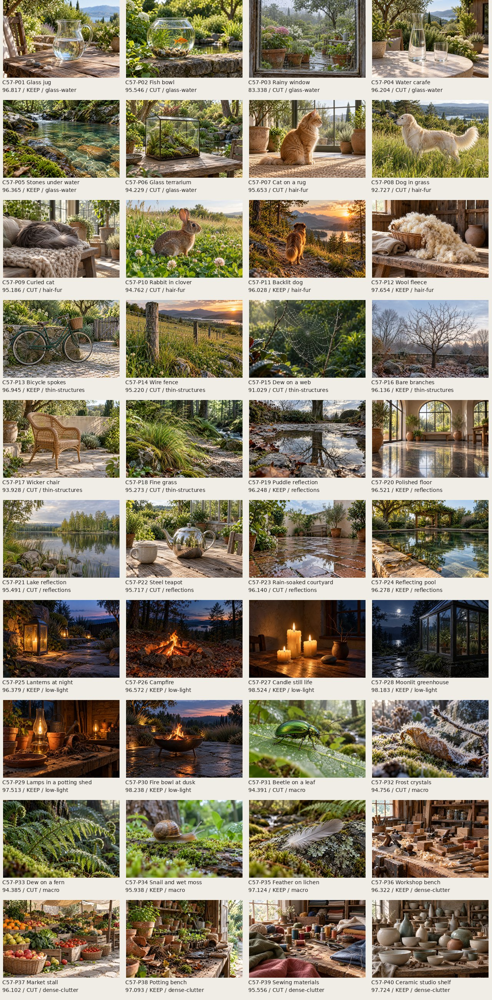
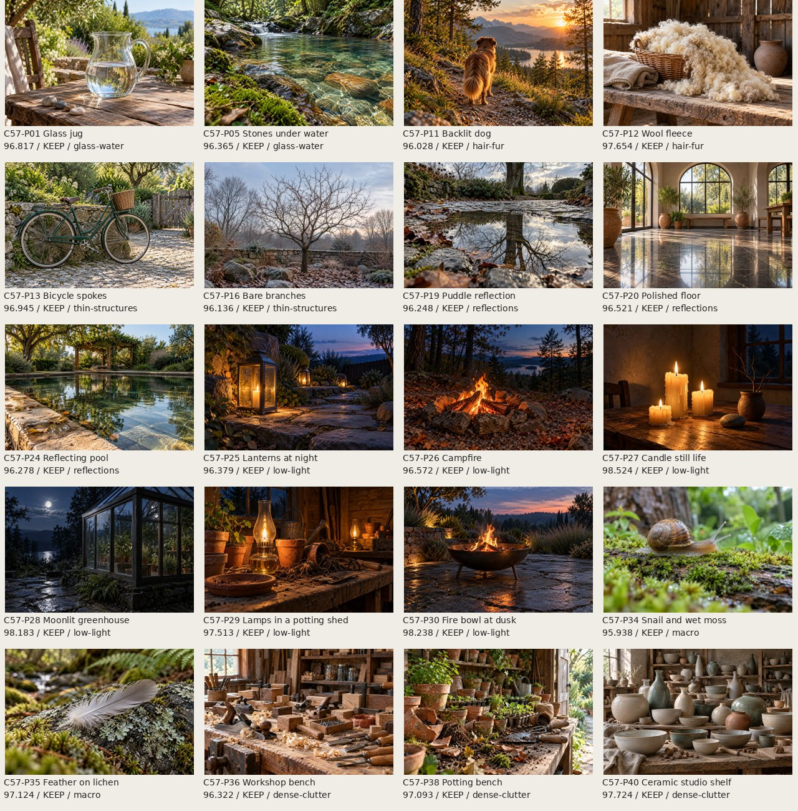
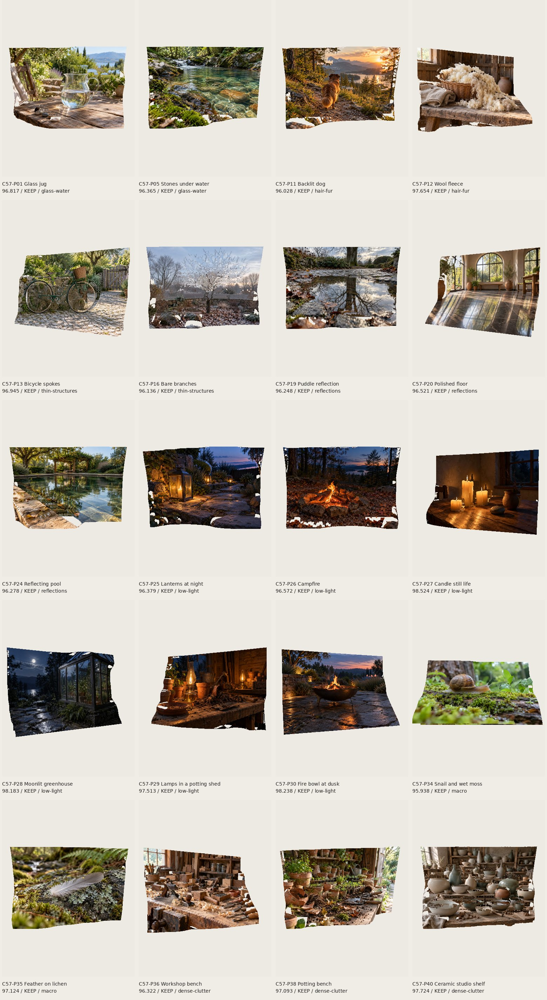
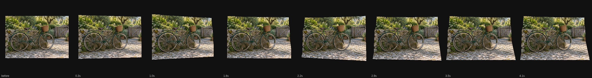

# Hard-case samples: October 13, 2026

Codex (GPT-6) built this for Ryan on `codex/hard-case-samples`, from main commit `a2189958`. 40
original AI-made pictures were generated and visually screened; the best 20 measured pictures are
offered in Photo to 3D's **AI-made by the owner: Hard cases** group. All seven hard cases are
covered. Every option ends with **(AI-made)** and carries the existing **AI-made by the owner**
credit. Nothing is merged.

## Generation, assets, and scope

The [candidate manifest](../../tools/cdx-hard-case-candidates.json) contains all 40 scene prompts,
native source hashes, dimensions, and visual screening notes. Every picture was generated
individually through the OpenAI native image tool; its exact model identity was not returned. The
pictures are fictional, with no people, text, logos, or real landmarks seen during screening.
Animals appear in profile or back view. The prompts deliberately preserve glass, water, fine hair,
thin structures, reflections, dim lighting, macro detail, and clutter as difficult input features.
They do not replace those features with opaque toy materials.

Generation is nondeterministic. Native 1,536×1,024 PNGs were resized to 1,280×853 JPEGs at quality
82 with Pillow. The unchanged `tools/dsm-depth.mjs` ran the actual vendored Depth Anything V2 Small
model through the browser's on-device depth worker. An inference-only page preload skipped rendering
the unrelated opening toy for the later batches; the dsm-depth tool, decoder, model, worker, and
output were unchanged. Each resulting depth map is 518×350 and 362,612 bytes.
[Asset records](hard-case-samples-2026-10/asset-records.json) include JPEG, depth, and source
SHA-256 hashes. Retained files live in `assets/toys/photo-3d/hard-cases/`. Full-size discarded
pictures and their maps stay in the ignored cache; only their contact-sheet previews and scores
enter the report. New images and maps load only when picked, without loading the model.

At the start, PRs #560, #562, #566, #581, and #582 were all open. Their implementation files,
`manual/`, and `tests/taps.spec.mjs` are untouched. Task 54's list is not edited: this round uses
`hard-case-pictures.js` and `hard-case-samples.js`. A small lazy hook in `src/player.js` registers
the choices after the existing Photo to 3D pack loads. Registration preserves every existing choice
and default and avoids duplicates on repeated builds. The task's explicit instruction to record
every retained sample in `CREDITS.md` and `tools/assets.json` is followed with additive entries
only; existing asset records and credits are not rewritten.

## Browser scores and selection

Task 53 remains open, so this uses task 54's documented simple proxies, implemented in
[the scoring tool](../../tools/cdx-hard-case-score.mjs). Each candidate is decoded with its real
depth map, installed as the toy's custom photo, and rendered by the existing Sharp view in Chromium
151 with SwiftShader WebGL2, the mid profile, Depth 0.5, and fully raised relief. The viewport is
390×844; the stage is fixed to 390×520, device scale factor 1. Eight poses are measured: −30°, −20°,
+20°, and +30°, separately in yaw and pitch.

- Holes: exact magenta backdrop pixels inside each rendered row's first/last surface pixels, inset
  eight pixels, excluding the top/bottom eight rows. The fraction omits border losses and does not
  measure every disocclusion.
- Edge halo proxy: identify up to 240 strong depth jumps, project both endpoints, and sample seven
  points between them. Average RGB excursions beyond the two source colors' per-channel range, with
  an eight-byte tolerance, normalized by 255. Texture, shadows, and occlusion can contribute; this
  does not measure blur or establish exact pixel correspondence.
- Score: `100 - max_pose(70 × hole_fraction + 30 × halo_excursion)`. The worst pose sets the score.
  The table reports separate maximum holes and maximum halo across poses; these maxima can occur at
  different poses. All counts and all eight poses are in
  [photo-scores.json](hard-case-samples-2026-10/photo-scores.json).
- Selection retains the highest two eligible scores in each of the seven categories, then the six
  highest remaining scores. This gives every hard case representation without letting an easy
  category fill the picker. All candidates passed visual content screening. Discarded candidates
  were cut for lower measured scores after coverage, rather than content violations.

These relative scores compare this finite set under these settings. They are not ground-truth depth
accuracy or a certification of perfect glass, fur, reflections, or wide-angle geometry. Large-angle
artifacts remain visible, particularly around occlusions and fine silhouettes. The toy and its
renderer were not changed to improve the scores.







## Phone-size motion review

The [320-pixel tap clip](hard-case-samples-2026-10/bicycle-tap-320.mp4) uses the kept bicycle-spokes
sample with the unchanged Photo to 3D tap effect. `tools/effect-clip.mjs` captured the actual
browser animation at eight frames per second, including 0.4 seconds before the tap and 4.5 seconds
after it. The eight-frame strip was inspected: the relief rises and sways, with near surfaces moving
across the background. Existing wide-angle relief losses are also visible in the scored contact
sheet. No new motion or physics was added.



## Every candidate

| Candidate | Name                    | Hard case       |  Score | Worst holes | Worst halo | Decision |
| --------- | ----------------------- | --------------- | -----: | ----------: | ---------: | -------- |
| C57-P01   | Glass jug               | glass-water     | 96.817 |     0.4362% |     0.0974 | Keep     |
| C57-P02   | Fish bowl               | glass-water     | 95.546 |     1.3522% |     0.1174 | Cut      |
| C57-P03   | Rainy window            | glass-water     | 83.338 |    18.8827% |     0.1273 | Cut      |
| C57-P04   | Water carafe            | glass-water     | 96.204 |     1.1628% |     0.1209 | Cut      |
| C57-P05   | Stones under water      | glass-water     | 96.365 |     1.4474% |     0.1094 | Keep     |
| C57-P06   | Glass terrarium         | glass-water     | 94.229 |     3.1552% |     0.1187 | Cut      |
| C57-P07   | Cat on a rug            | hair-fur        | 95.653 |     1.1206% |     0.1217 | Cut      |
| C57-P08   | Dog in grass            | hair-fur        | 92.727 |     6.0592% |     0.1103 | Cut      |
| C57-P09   | Curled cat              | hair-fur        | 95.186 |     0.5494% |     0.1593 | Cut      |
| C57-P10   | Rabbit in clover        | hair-fur        | 94.762 |     4.2612% |     0.1002 | Cut      |
| C57-P11   | Backlit dog             | hair-fur        | 96.028 |     2.7176% |     0.0875 | Keep     |
| C57-P12   | Wool fleece             | hair-fur        | 97.654 |     1.5919% |     0.0621 | Keep     |
| C57-P13   | Bicycle spokes          | thin-structures | 96.945 |     0.2754% |     0.0954 | Keep     |
| C57-P14   | Wire fence              | thin-structures | 95.220 |     2.9248% |     0.0985 | Cut      |
| C57-P15   | Dew on a web            | thin-structures | 91.029 |     9.2896% |     0.0865 | Cut      |
| C57-P16   | Bare branches           | thin-structures | 96.136 |     2.2096% |     0.0839 | Keep     |
| C57-P17   | Wicker chair            | thin-structures | 93.928 |     4.0027% |     0.1338 | Cut      |
| C57-P18   | Fine grass              | thin-structures | 95.273 |     4.0951% |     0.0703 | Cut      |
| C57-P19   | Puddle reflection       | reflections     | 96.248 |     1.2239% |     0.0967 | Keep     |
| C57-P20   | Polished floor          | reflections     | 96.521 |     0.9178% |     0.1041 | Keep     |
| C57-P21   | Lake reflection         | reflections     | 95.491 |     3.0863% |     0.0983 | Cut      |
| C57-P22   | Steel teapot            | reflections     | 95.717 |     0.8033% |     0.1271 | Cut      |
| C57-P23   | Rain-soaked courtyard   | reflections     | 96.140 |     2.7656% |     0.0776 | Cut      |
| C57-P24   | Reflecting pool         | reflections     | 96.278 |     1.2360% |     0.0985 | Keep     |
| C57-P25   | Lanterns at night       | low-light       | 96.379 |     1.9331% |     0.0848 | Keep     |
| C57-P26   | Campfire                | low-light       | 96.572 |     2.8188% |     0.0559 | Keep     |
| C57-P27   | Candle still life       | low-light       | 98.524 |     0.0985% |     0.0482 | Keep     |
| C57-P28   | Moonlit greenhouse      | low-light       | 98.183 |     0.6457% |     0.0524 | Keep     |
| C57-P29   | Lamps in a potting shed | low-light       | 97.513 |     0.8843% |     0.0623 | Keep     |
| C57-P30   | Fire bowl at dusk       | low-light       | 98.238 |     0.0778% |     0.0584 | Keep     |
| C57-P31   | Beetle on a leaf        | macro           | 94.391 |     4.1029% |     0.1013 | Cut      |
| C57-P32   | Frost crystals          | macro           | 94.756 |     1.5388% |     0.1572 | Cut      |
| C57-P33   | Dew on a fern           | macro           | 94.385 |     4.2576% |     0.0901 | Cut      |
| C57-P34   | Snail and wet moss      | macro           | 95.938 |     1.2668% |     0.1328 | Keep     |
| C57-P35   | Feather on lichen       | macro           | 97.124 |     0.2914% |     0.0913 | Keep     |
| C57-P36   | Workshop bench          | dense-clutter   | 96.322 |     1.0440% |     0.1007 | Keep     |
| C57-P37   | Market stall            | dense-clutter   | 96.102 |     1.2841% |     0.1000 | Cut      |
| C57-P38   | Potting bench           | dense-clutter   | 97.093 |     1.2869% |     0.0793 | Keep     |
| C57-P39   | Sewing materials        | dense-clutter   | 95.556 |     2.7374% |     0.1245 | Cut      |
| C57-P40   | Ceramic studio shelf    | dense-clutter   | 97.724 |     1.3372% |     0.0649 | Keep     |

## Kept 20 and coverage

| Hard case       | Kept pictures                                                                                                                                                              |
| --------------- | -------------------------------------------------------------------------------------------------------------------------------------------------------------------------- |
| glass-water     | Glass jug (C57-P01), Stones under water (C57-P05)                                                                                                                          |
| hair-fur        | Backlit dog (C57-P11), Wool fleece (C57-P12)                                                                                                                               |
| thin-structures | Bicycle spokes (C57-P13), Bare branches (C57-P16)                                                                                                                          |
| reflections     | Puddle reflection (C57-P19), Polished floor (C57-P20), Reflecting pool (C57-P24)                                                                                           |
| low-light       | Lanterns at night (C57-P25), Campfire (C57-P26), Candle still life (C57-P27), Moonlit greenhouse (C57-P28), Lamps in a potting shed (C57-P29), Fire bowl at dusk (C57-P30) |
| macro           | Snail and wet moss (C57-P34), Feather on lichen (C57-P35)                                                                                                                  |
| dense-clutter   | Workshop bench (C57-P36), Potting bench (C57-P38), Ceramic studio shelf (C57-P40)                                                                                          |

## Reproduction

Generate the 40 manifest prompts individually through the native image tool. Preserve local receipts
as `.cache/hard-case-samples/generation.json` with `file` and `nativePath`; the public manifest
records hashes and screening, without local absolute paths.

```sh
python3 -m http.server 4173 --bind 127.0.0.1
python3 tools/cdx-hard-case-prepare.py
# Pass all 40 manifest file IDs to the unchanged depth tool:
SPLASHERY_CHROMIUM=/usr/bin/chromium node --import ./tools/cdx-hard-case-depth-page.mjs tools/dsm-depth.mjs cdx-hard-glass-jug ...
SPLASHERY_CHROMIUM=/usr/bin/chromium node tools/cdx-hard-case-score.mjs
node tools/cdx-hard-case-select.mjs
# On a fresh branch, before the entries have been registered:
node tools/cdx-hard-case-records.mjs
python3 tools/cdx-hard-case-report.py
```

The scoring tool resumes from complete candidate rows in `photo-scores.json`; remove that file to
remeasure. Selection moves full-size candidate copies out of the shipped AI directory and retains
only the chosen 20 in `hard-cases/`. Registry generation refuses duplicate entries.

## Verification and limits

The [verification record](hard-case-samples-2026-10/verification.md) lists exact browser checks,
results, and any failures. The task-specific spec verifies all 20 pictures decode at 1,280 px, their
source/depth hashes match, all seven categories are represented, labels and credits are present,
registration is idempotent, files load only when selected, and each selected picture changes from
flat to raised in the actual browser without downloading the depth runtime.

No physical phone, camera, or ground-truth depth capture was tested. No renderer pixels or model
outputs were mocked. No Effect review publishing tool is available in this environment; the
phone-size worst-pose contact sheet is included for review. Rule check: none.
