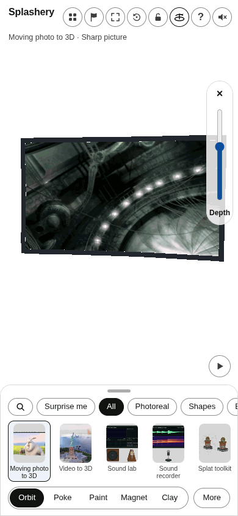

# Task 38: phone motion review

Made by Ryan with Codex (GPT-6), October 12, 2026. These are controlled 390 by 844 renders through
the real app and renderer, with actual model depths and decoded pictures. Presentation clocks are
stepped; GIFs are silent. Playback timing and sound have separate browser tests. Per-file
attribution, license, size, and SHA-256 are in assets/toys/moving-photo-3d/review/credits.json.

This evidence branch is never merged. The implementation and full audit are on
codex/moving-photo-r2-public. The legacy bridge review GIF is withheld under A2 because it depicts
an identifiable live-action actor; the permitted city montage is included.

The review follow-up, rendered before task 37 entered main (task 38 code `9ad9a3a9`), replaces the
Bunny upload capture and adds a machine upload. The wrapper now waits for the actual selected upload
and completed refinement, then records clip identity and refinement state with each frame. These
uploads use the original Bunny video and a reconstructed machine video made from the shipped JPEG
sheets. The existing bridge sample and the longer films are retained per the Operator's follow-up.
Elephants Dream's short and long review records agree with its own film notice: CC BY 2.5, © 2006
Blender Foundation / Netherlands Media Art Institute / www.elephantsdream.org.

## bunny

## horse

## sintel

## machine

## bunny-long

## sintel-long

## machine-long

## bridge-long

## upload

## machine-upload

