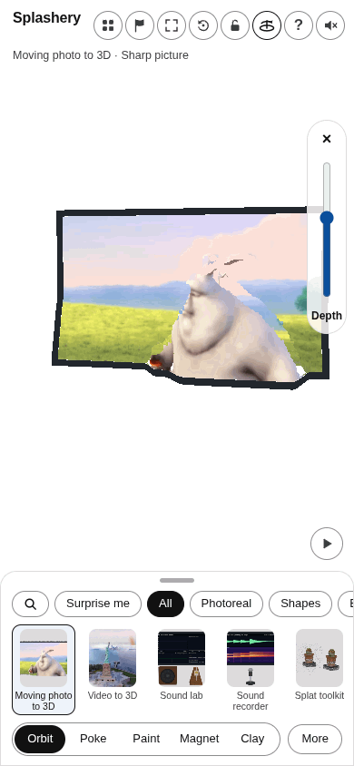
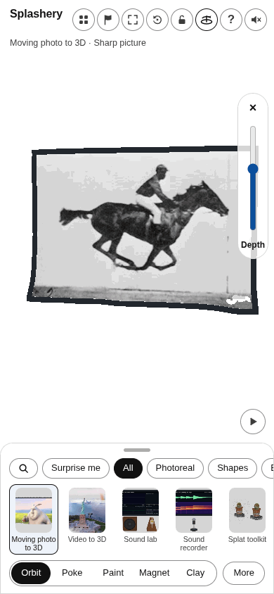
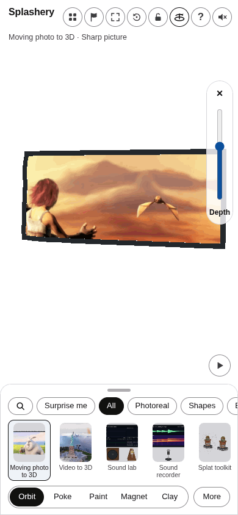
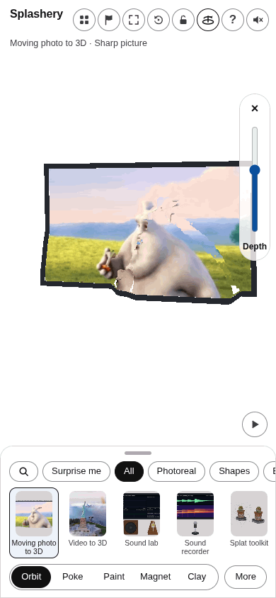
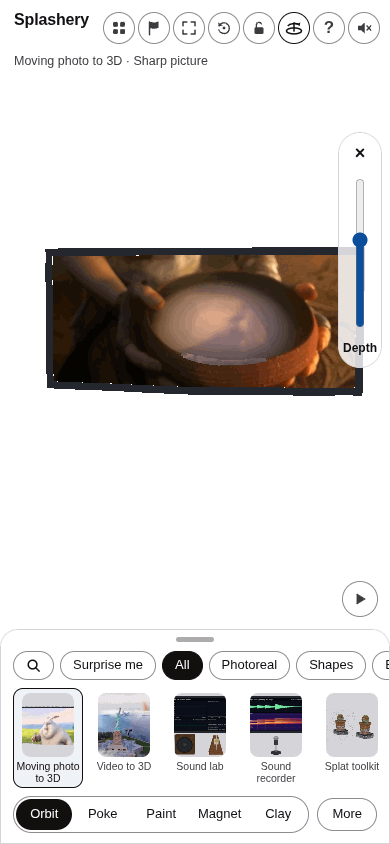
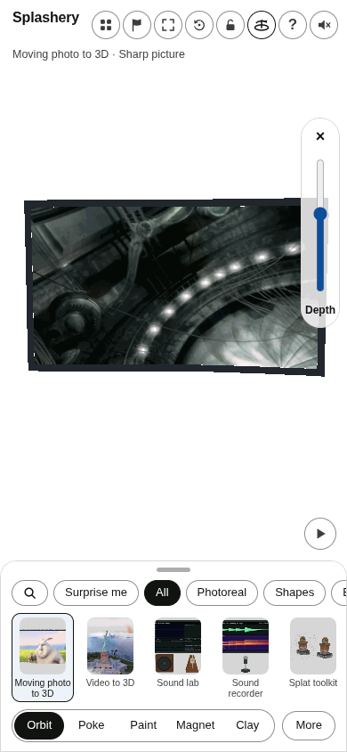
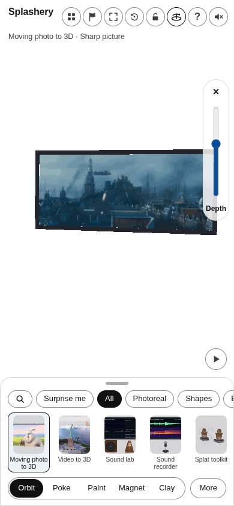
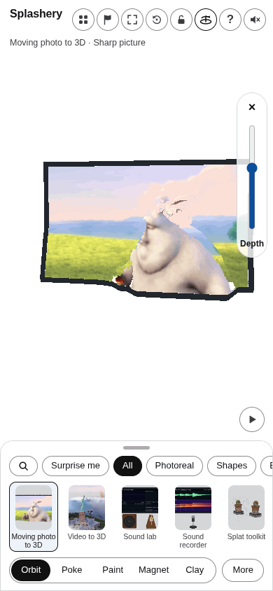

# Task 38: phone motion review

Made by Ryan with Codex (GPT-6), October 12, 2026. These are controlled 390 by 844 renders through the real app and renderer, with actual model depths and decoded pictures. Presentation clocks are stepped; GIFs are silent. Playback timing and sound have separate browser tests. Per-file attribution, license, size, and SHA-256 are in assets/toys/moving-photo-3d/review/credits.json.

This evidence branch is never merged. The implementation and full audit are on codex/moving-photo-r2-public. The legacy bridge review GIF is withheld under A2 because it depicts an identifiable live-action actor; the permitted city montage is included.

## bunny

## horse

## sintel

## machine

## bunny-long

## sintel-long

## machine-long

## bridge-long

## upload

