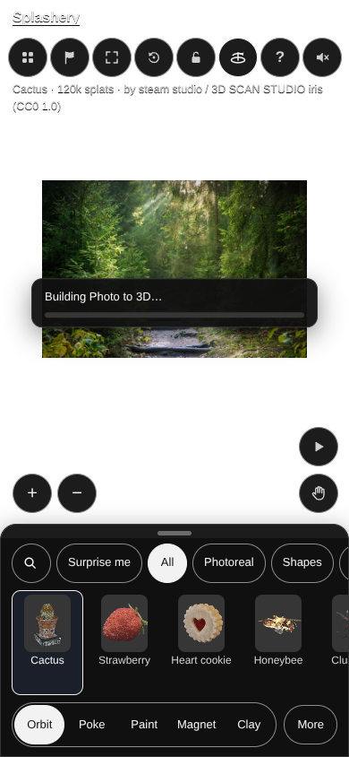
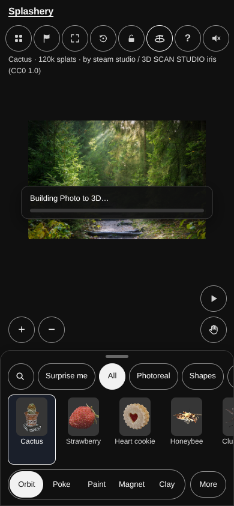

# Photo to 3D: loading color and Hybrid status

Codex (GPT-6) built this follow-up to the
[Operator's newest comment on PR #622](https://github.com/ryanjosephkamp/splashery/pull/622#issuecomment-6185607509).
The loading picture now uses the stage camera's current clear color, including transparent
backgrounds. Its existing 50 ms watcher follows look changes while construction is pending. The
cover's padding, render hold, timing, and removal logic are unchanged.

In Splats with a hybrid background, an absent or empty earlier status label falls back to the same
formatted total splat count that `App.updateStatus()` uses. The line ends with `· Hybrid`. The Sharp
label and ordinary fallback remain intact. Moving photo's source is unchanged; its shared status
behavior was checked in the existing browser spec.

## Fail first on main, then pass with the fixes

The same three regression tests ran first against unmodified main
`d33f94216e78ff034c08fc6c9ae2bbeae4b98cb6` on October 15, 2026:

| Check                                          | Main result                                               | Fixed result                                               |
| ---------------------------------------------- | --------------------------------------------------------- | ---------------------------------------------------------- |
| Dark loading cover                             | Cover `rgb(255, 255, 255)`; camera `rgb(16, 16, 16)`      | Equal                                                      |
| Light cover, then change to dark while covered | Initial light matches; cover stays white after the change | Equal through theme, custom color, and transparent changes |
| Splats with hybrid backing                     | `Photo to 3D · undefined · Hybrid`                        | Ordinary splat count followed by `· Hybrid`                |

All three failed on main for those product defects. All three pass with the fixes. The test file's
SHA-256 is identical between the red and green runs; source hashes and receipts are in
[verification.json](photo-3d-status-2026-10/verification.json).

The tests open the real app with labs enabled. For cover inspection, they temporarily withhold the
geometry worker's input, then release it to finish the real build. They cover opening Photo to 3D,
depth changes, photo changes, dark and light themes, a custom color, transparency, and handoff to
the completed relief. No worker output is fabricated.

```sh
DISPLAY=:98 SPLASHERY_GL=llvmpipe SPLASHERY_CHROMIUM=/usr/bin/chromium \
  SPLASHERY_PORT=4391 npx playwright test \
  tests/cdx-p3d-status.spec.mjs tests/cdx-p3d4-render-hold.spec.mjs

DISPLAY=:98 SPLASHERY_GL=llvmpipe SPLASHERY_CHROMIUM=/usr/bin/chromium \
  SPLASHERY_PORT=4391 npx playwright test tests/psv.spec.mjs \
  -g 'Sharp picture takes its color straight from the video'
```

Results: **6 passed** in the combined regression/render-hold run, and **1 passed** in the Moving
photo run. Receipts: [main red](photo-3d-status-2026-10/main-red.log),
[fixed green](photo-3d-status-2026-10/fixed-green.log), and
[Moving photo](photo-3d-status-2026-10/moving-status.log). ANSI color escapes were removed from the
text logs, along with HTTP server request lines. The `.raw.log.gz` files preserve the complete
original output.

## Phone evidence

Both PNGs are unchanged captures at CSS 390×844, from a DPR 3 context. They show the real cover
while its build is pending.

Before:



After:



A [1440×900 Hybrid status preview](photo-3d-status-2026-10/cdx-p3d-status-hybrid-1440x900.jpg) is a
JPEG quality 90 copy of the original PNG, with unchanged dimensions. Every published image is under
1 MB; original and published hashes are recorded in the verification file.

Chromium 151.0.7922.173 rendered through Mesa llvmpipe in a real browser. These are viewport checks,
not physical-phone or Safari tests. The full repository suite was not run for this small follow-up.
No reconstruction, model, budget, or existing test threshold changed.

Code is MIT. Original capture contributions are CC0 1.0; the existing source assets retain their
recorded terms and credits.

Rule check: none.
