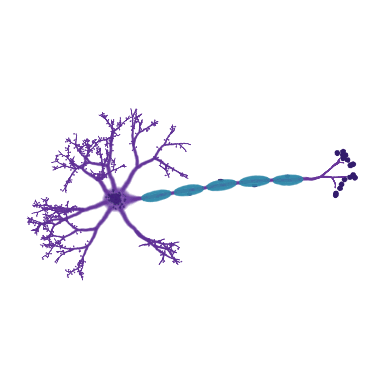
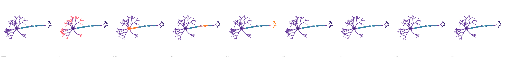

# Codex task 78b: Neuron specimen review

October 14, 2026. Made by Ryan with Codex (GPT-6).

This branch holds review media and verification notes only and must never be merged. The
implementation is on `codex/portfolio-b`.

The [port and verification report](portfolio-b.md) is kept on this review branch, outside the
implementation PR.

The updated About panel explains the stored and drawn counts on [phone](counts-390x844.png) and
[desktop](counts-1440x900.png). These screenshots were refreshed after synchronizing with main on
October 15, 2026.





The five-second clip shows the resting cell, dendrite input, soma activation, the axon's traveling
wave, terminal activation, and the return to rest. It was rendered with the real Kit and PlayCanvas
WebGL2 path, with labs enabled, at 390×390 pixels and 15 frames per second. The tool steps the
animation clock to preserve playback speed on the cloud renderer; this is a motion review, not a
measurement of hardware frame rate.

```sh
SPLASHERY_CHROMIUM=/usr/bin/chromium \
  SPLASHERY_URL='http://127.0.0.1:4173/?labs=1&renderer=webgl2&' \
  node tools/effect-clip.mjs /tmp/portfolio-b-clips \
  --size=390 --secs=5 --fps=15 --strip=9 --bg=#ffffff specimen-neuron
```

The query prefix enables labs in the existing clip tool. No reference page, font, or renderer was
copied into the site. Geometry is schematic; the spike waveform is computed from the concept's
Hodgkin-Huxley membrane equations. Clip, strip, and count screenshots: original procedural renders,
CC0.

Rule check: none.
