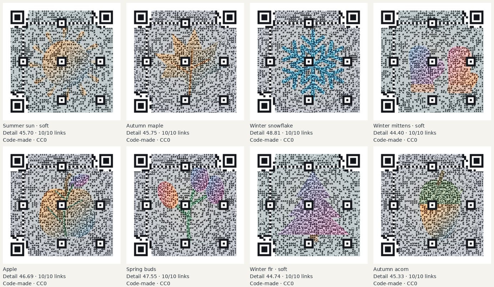
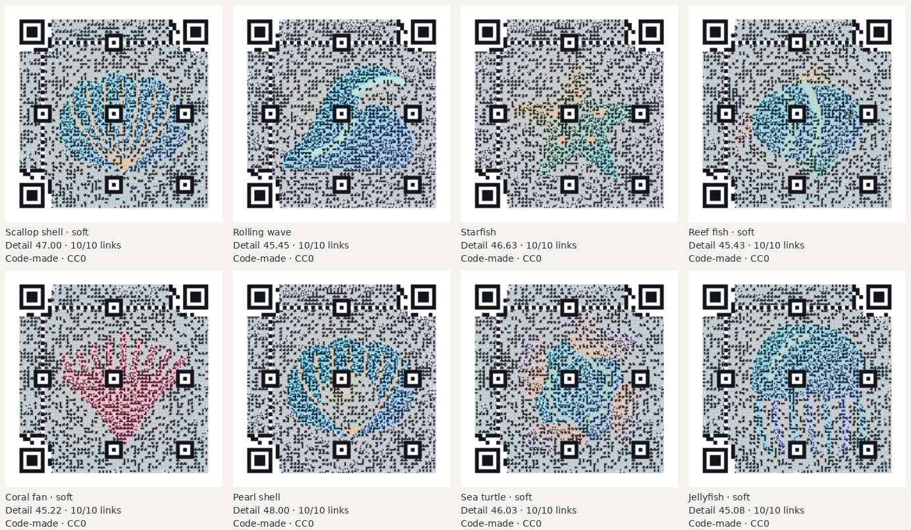
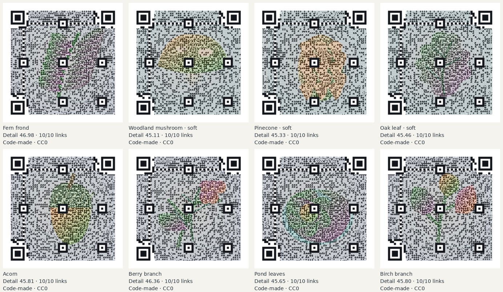
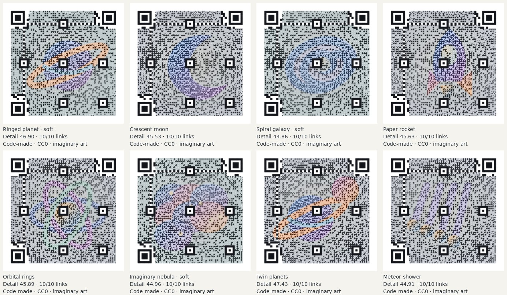
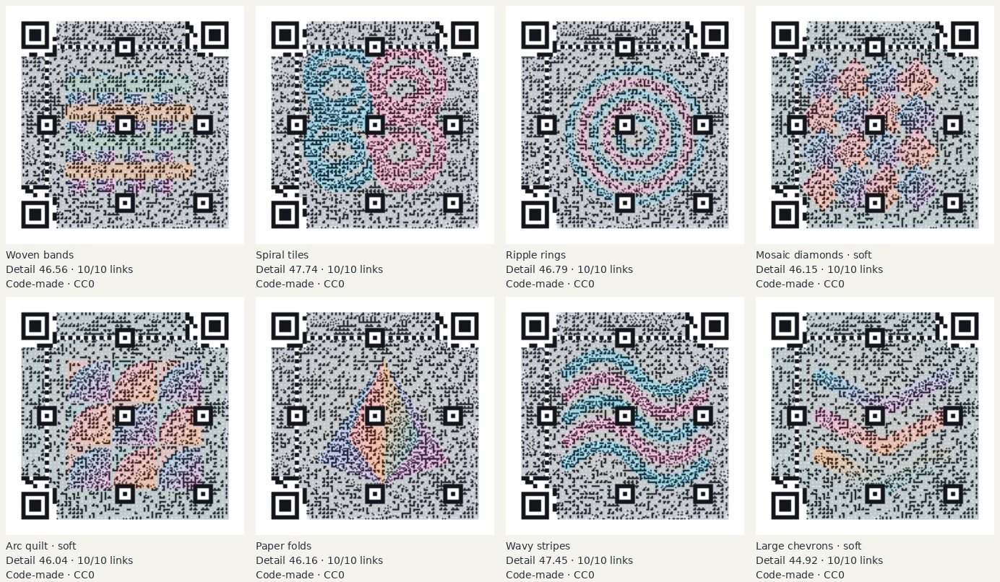
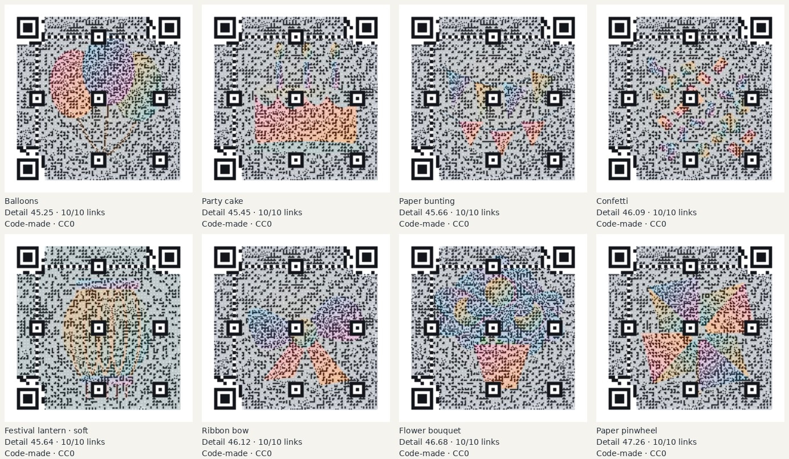

# Picture QR theme packs: October 14, 2026

Made by Ryan with Codex (GPT-6), on `codex/qr-theme-packs`; work started from main `e404cf36` after
[task 54, PR #582](https://github.com/ryanjosephkamp/splashery/pull/582) merged. **48 original
code-made backgrounds: eight distinct subjects in each of six themes, selected from 138
candidates.** Every retained background passed all ten links and all 60 qualifying checks at the
toy's default settings. Rule check: none.

## Artwork, credit, and loading

The initial 120 candidates are ten different illustrations per theme in two paper/contrast
treatments. Seasons initially yielded only seven passing subjects, so six additional independent
warm/dusk treatments of Spring blossom, Tulip, and Pumpkin, followed by two treatments each of
Winter fir and Autumn acorn, were screened with the same ten links and unchanged acceptance
criteria. Patterns received two additional original geometric motifs, Large chevrons and Nested
squares, in two treatments each, after its initial set also yielded only seven passing subjects.
Forest likewise had seven passing subjects; two original leaf illustrations, Ginkgo fan and Birch
branch, were added in two treatments each and tested with the same unchanged criteria. The original
SVG source is [cdx-qr-themes-art.mjs](../../tools/cdx-qr-themes-art.mjs). The generator takes a
theme, motif, and variant; it never receives a URL, QR mask, or module grid. The subjects have broad
shapes, quiet corners, and restrained detail, following
[task 54's findings](sample-pictures-2026-10.md). Pattern backgrounds are made by code. Space-art is
fictional illustration, labeled “imaginary art” in each choice; it is never a sky capture or
scientific data. Celebrations have no text, logos, people, or real-country flags. All six source
contact sheets and all six final phone sheets were visually inspected.

All new assets are offered under [CC0 1.0](https://creativecommons.org/publicdomain/zero/1.0/) (deed
opened October 14, 2026), credited “Made by Ryan with Codex (GPT-6).” No AI-made image was used.
Each selected option says “code-made, CC0”; the About credit names the maker, source, and license.
Full records, hashes, generation notes, and tested links are in
[tools/assets.json](../../tools/assets.json), under `pictureQrSamples`, and
[CREDITS.md](../../CREDITS.md).

The existing Picture select uses one native option group per theme. Existing choices and the Felt
farm default keep their IDs and order. The manifest contains only metadata; a JPEG is fetched only
after selecting it. Each 960×960 shipping JPEG is produced by Chromium 151.0.7922.173 at quality 88.
Contact sheets use the repository's licensed Pillow 12.3.0. The shipped assets total 0.97 MiB; none
is loaded on the initial page or when opening Picture QR with its default picture.

## Ten-link scan protocol

The synthetic links below are encoded, never fetched. They include HTTP, HTTPS, query strings,
fragments, escaped characters, and short and long payloads.

- 19 characters: `http://example.org/`
- 20 characters: `https://example.org/`
- 30 characters: `http://example.net/a?x=1&y=two`
- 43 characters: `https://ryanjosephkamp.github.io/splashery/`
- 41 characters: `https://example.com/gallery/summer-leaves`
- 59 characters: `https://example.net/exhibits/ceramics?view=phone&color=blue`
- 78 characters: `http://example.com/invitations/celebration?date=2026-10-14&guests=8&view=print`
- 82 characters:
  `https://example.net/search?q=forest%20art&filter=green&sort=newest&page=12#gallery`
- 130 characters:
  `https://example.org/collections/botanical-studies/2026/autumn/large-format-print?item=fern-frond&edition=public&ref=mobile-preview`
- 168 characters:
  `http://example.org/collections/imaginary-space-art/2026/autumn/large-format-print?item=ringed-planet&edition=public&ref=mobile-preview&palette=blue&size=phone&copies=10`

Every trial uses the production encoder and vendored jsQR: H error correction, contrast 0.5, small
center, color style, square shape, and More detail. The production adaptive nudge remains enabled;
each link's actual margin is recorded. No setting is changed to rescue a candidate.

All 138 candidates have ten-link layout measurements at the production check's 8 and 4 pixels/module
with 0.2-module focus blur (20 checks per candidate). The worst-link detail score ranks candidates.
Score-ranked candidates then load through the toy's actual local-file decoder and real Chromium
151.0.7922.173/WebGL2 splat renderer (ANGLE/Mesa llvmpipe) at a 390×844 viewport, with the mid
profile and automatic performance adaptation disabled. Each link is captured with the production
export camera at 900×900, with task 54's two full-size render frames and 80 ms sort wait. The
[capture helper](../../tools/cdx-qr-themes-capture.mjs) transfers the same PNG as base64 instead of
a per-number array. Its RGBA is byte-identical to the original helper for a short HTTP URL, an HTTP
query, and the longest link; see [the protocol check](qr-theme-packs-2026-10/capture-protocol.json).
Four qualifying rendered decodes follow: the unblurred 330-pixel phone reduction, the 900-pixel
print-focus simulation (0.2-module Gaussian blur), and reductions to 8 and 4 pixels/module. A
candidate must pass all 40 rendered checks as well as all 20 layout checks. Selection retains the
top eight passing distinct subjects per theme, using only the best eligible variant of a subject.
Lower-ranked candidates need no browser screening once eight distinct higher-ranked ones pass.

**Print focus is a simulation on real rendered pixels, not a physical print or camera test.** The
raw 900-pixel decode is a separate diagnostic in every rendered trial and in the table below.
Unresolved halftone dots at that resolution can confuse jsQR, as task 54 documented; raw exports are
not claimed to scan perfectly. No failed qualifying trial is omitted or replaced. The finite
ten-link benchmark does not guarantee every possible link, angle, camera, or lighting condition.
Long payloads can exceed practical phone resolution.

The detail score is task 54's metric, measured against the actual stored JPEG with the production
woven colors averaged per module: `100 × (0.55 × (1 − RGB_MAE) + 0.45 × max(0, gradient_cosine))`.
The reported score is the minimum over all ten links, including forced finder areas. It measures
color and edge preservation, not semantic recognition; the phone sheets provide the visual check.

## Kept backgrounds and phone contact sheets

The full per-link [scan table](qr-theme-packs-2026-10/scan-table.csv) has all 480
retained-background link trials. The JSON evidence also contains source hashes, versions, adaptive
margins, image properties, per-link detail scores, scan results, and hashes of the actual rendered
RGBA.

### Seasons



| Background            | Worst-link detail | Layout checks | Rendered checks | Raw 900px diagnostic |
| --------------------- | ----------------: | ------------: | --------------: | -------------------: |
| Summer sun · soft     |            45.700 |         20/20 |           40/40 |                 9/10 |
| Autumn maple          |            45.750 |         20/20 |           40/40 |                 7/10 |
| Winter snowflake      |            48.807 |         20/20 |           40/40 |                 8/10 |
| Winter mittens · soft |            44.403 |         20/20 |           40/40 |                 8/10 |
| Apple                 |            46.686 |         20/20 |           40/40 |                 6/10 |
| Spring buds           |            47.554 |         20/20 |           40/40 |                 8/10 |
| Winter fir · soft     |            44.738 |         20/20 |           40/40 |                 8/10 |
| Autumn acorn          |            45.331 |         20/20 |           40/40 |                 7/10 |

[All 30 source candidates](qr-theme-packs-2026-10/seasons-candidates.jpg),
[layout measurements](qr-theme-packs-2026-10/layout-seasons.json), and
[rendered measurements](qr-theme-packs-2026-10/browser-seasons.json).

### Ocean



| Background           | Worst-link detail | Layout checks | Rendered checks | Raw 900px diagnostic |
| -------------------- | ----------------: | ------------: | --------------: | -------------------: |
| Scallop shell · soft |            46.996 |         20/20 |           40/40 |                 8/10 |
| Rolling wave         |            45.453 |         20/20 |           40/40 |                 6/10 |
| Starfish             |            46.629 |         20/20 |           40/40 |                 7/10 |
| Reef fish · soft     |            45.429 |         20/20 |           40/40 |                 8/10 |
| Coral fan · soft     |            45.215 |         20/20 |           40/40 |                 8/10 |
| Pearl shell          |            47.999 |         20/20 |           40/40 |                 8/10 |
| Sea turtle · soft    |            46.029 |         20/20 |           40/40 |                 9/10 |
| Jellyfish · soft     |            45.081 |         20/20 |           40/40 |                 7/10 |

[All 20 source candidates](qr-theme-packs-2026-10/ocean-candidates.jpg),
[layout measurements](qr-theme-packs-2026-10/layout-ocean.json), and
[rendered measurements](qr-theme-packs-2026-10/browser-ocean.json).

### Forest



| Background               | Worst-link detail | Layout checks | Rendered checks | Raw 900px diagnostic |
| ------------------------ | ----------------: | ------------: | --------------: | -------------------: |
| Fern frond               |            46.980 |         20/20 |           40/40 |                 7/10 |
| Woodland mushroom · soft |            45.109 |         20/20 |           40/40 |                 8/10 |
| Pinecone · soft          |            45.330 |         20/20 |           40/40 |                 8/10 |
| Oak leaf · soft          |            45.457 |         20/20 |           40/40 |                 6/10 |
| Acorn                    |            45.807 |         20/20 |           40/40 |                 7/10 |
| Berry branch             |            46.358 |         20/20 |           40/40 |                 6/10 |
| Pond leaves              |            45.650 |         20/20 |           40/40 |                 6/10 |
| Birch branch             |            45.799 |         20/20 |           40/40 |                 8/10 |

[All 24 source candidates](qr-theme-packs-2026-10/forest-candidates.jpg),
[layout measurements](qr-theme-packs-2026-10/layout-forest.json), and
[rendered measurements](qr-theme-packs-2026-10/browser-forest.json).

### Space-art



| Background                              | Worst-link detail | Layout checks | Rendered checks | Raw 900px diagnostic |
| --------------------------------------- | ----------------: | ------------: | --------------: | -------------------: |
| Ringed planet · soft (imaginary art)    |            46.901 |         20/20 |           40/40 |                 8/10 |
| Crescent moon (imaginary art)           |            45.534 |         20/20 |           40/40 |                 7/10 |
| Spiral galaxy · soft (imaginary art)    |            44.861 |         20/20 |           40/40 |                 8/10 |
| Paper rocket (imaginary art)            |            45.628 |         20/20 |           40/40 |                 8/10 |
| Orbital rings (imaginary art)           |            45.886 |         20/20 |           40/40 |                 9/10 |
| Imaginary nebula · soft (imaginary art) |            44.960 |         20/20 |           40/40 |                 8/10 |
| Twin planets (imaginary art)            |            47.431 |         20/20 |           40/40 |                 7/10 |
| Meteor shower (imaginary art)           |            44.905 |         20/20 |           40/40 |                 8/10 |

[All 20 source candidates](qr-theme-packs-2026-10/space-art-candidates.jpg),
[layout measurements](qr-theme-packs-2026-10/layout-space-art.json), and
[rendered measurements](qr-theme-packs-2026-10/browser-space-art.json).

### Patterns



| Background             | Worst-link detail | Layout checks | Rendered checks | Raw 900px diagnostic |
| ---------------------- | ----------------: | ------------: | --------------: | -------------------: |
| Woven bands            |            46.558 |         20/20 |           40/40 |                 7/10 |
| Spiral tiles           |            47.739 |         20/20 |           40/40 |                 7/10 |
| Ripple rings           |            46.790 |         20/20 |           40/40 |                 7/10 |
| Mosaic diamonds · soft |            46.152 |         20/20 |           40/40 |                 7/10 |
| Arc quilt · soft       |            46.045 |         20/20 |           40/40 |                 6/10 |
| Paper folds            |            46.164 |         20/20 |           40/40 |                 7/10 |
| Wavy stripes           |            47.448 |         20/20 |           40/40 |                 7/10 |
| Large chevrons · soft  |            44.922 |         20/20 |           40/40 |                 8/10 |

[All 24 source candidates](qr-theme-packs-2026-10/patterns-candidates.jpg),
[layout measurements](qr-theme-packs-2026-10/layout-patterns.json), and
[rendered measurements](qr-theme-packs-2026-10/browser-patterns.json).

### Celebrations



| Background              | Worst-link detail | Layout checks | Rendered checks | Raw 900px diagnostic |
| ----------------------- | ----------------: | ------------: | --------------: | -------------------: |
| Balloons                |            45.248 |         20/20 |           40/40 |                 7/10 |
| Party cake              |            45.447 |         20/20 |           40/40 |                 8/10 |
| Paper bunting           |            45.656 |         20/20 |           40/40 |                 8/10 |
| Confetti                |            46.088 |         20/20 |           40/40 |                 8/10 |
| Festival lantern · soft |            45.644 |         20/20 |           40/40 |                 8/10 |
| Ribbon bow              |            46.118 |         20/20 |           40/40 |                 7/10 |
| Flower bouquet          |            46.678 |         20/20 |           40/40 |                 6/10 |
| Paper pinwheel          |            47.258 |         20/20 |           40/40 |                 7/10 |

[All 20 source candidates](qr-theme-packs-2026-10/celebrations-candidates.jpg),
[layout measurements](qr-theme-packs-2026-10/layout-celebrations.json), and
[rendered measurements](qr-theme-packs-2026-10/browser-celebrations.json).

## All 138 candidate decisions

[Machine-readable selection](qr-theme-packs-2026-10/selection.json). Every cut has a reason.

| ID                          | Subject                                 | Worst-link detail | Decision                                                                                             |
| --------------------------- | --------------------------------------- | ----------------: | ---------------------------------------------------------------------------------------------------- |
| cdx-theme-seasons-1-1       | Spring blossom                          |            45.590 | Cut: Rendered scan failed.                                                                           |
| cdx-theme-seasons-1-2       | Spring blossom · soft                   |            44.942 | Cut: Rendered scan failed.                                                                           |
| cdx-theme-seasons-2-1       | Summer sun                              |            46.480 | Cut: Rendered scan failed.                                                                           |
| cdx-theme-seasons-2-2       | Summer sun · soft                       |            45.700 | Keep: Passed every qualifying scan; highest worst-link detail among distinct subjects.               |
| cdx-theme-seasons-3-1       | Autumn maple                            |            45.750 | Keep: Passed every qualifying scan; highest worst-link detail among distinct subjects.               |
| cdx-theme-seasons-3-2       | Autumn maple · soft                     |            45.209 | Cut: Not rendered: higher-ranked variant cdx-theme-seasons-3-1 of this subject already passed.       |
| cdx-theme-seasons-4-1       | Winter snowflake                        |            48.807 | Keep: Passed every qualifying scan; highest worst-link detail among distinct subjects.               |
| cdx-theme-seasons-4-2       | Winter snowflake · soft                 |            48.059 | Cut: Not rendered: higher-ranked variant cdx-theme-seasons-4-1 of this subject already passed.       |
| cdx-theme-seasons-5-1       | Tulip                                   |            47.031 | Cut: Rendered scan failed.                                                                           |
| cdx-theme-seasons-5-2       | Tulip · soft                            |            46.406 | Cut: Rendered scan failed.                                                                           |
| cdx-theme-seasons-6-1       | Pumpkin                                 |            46.784 | Cut: Rendered scan failed.                                                                           |
| cdx-theme-seasons-6-2       | Pumpkin · soft                          |            46.079 | Cut: Rendered scan failed.                                                                           |
| cdx-theme-seasons-7-1       | Rain umbrella                           |            44.735 | Cut: Rendered scan failed.                                                                           |
| cdx-theme-seasons-7-2       | Rain umbrella · soft                    |            44.359 | Cut: Passed scanning, but lower worst-link detail or another variant of the same subject retained.   |
| cdx-theme-seasons-8-1       | Winter mittens                          |            45.262 | Cut: Rendered scan failed.                                                                           |
| cdx-theme-seasons-8-2       | Winter mittens · soft                   |            44.403 | Keep: Passed every qualifying scan; highest worst-link detail among distinct subjects.               |
| cdx-theme-seasons-9-1       | Apple                                   |            46.686 | Keep: Passed every qualifying scan; highest worst-link detail among distinct subjects.               |
| cdx-theme-seasons-9-2       | Apple · soft                            |            46.165 | Cut: Not rendered: higher-ranked variant cdx-theme-seasons-9-1 of this subject already passed.       |
| cdx-theme-seasons-10-1      | Spring buds                             |            47.554 | Keep: Passed every qualifying scan; highest worst-link detail among distinct subjects.               |
| cdx-theme-seasons-10-2      | Spring buds · soft                      |            46.853 | Cut: Not rendered: higher-ranked variant cdx-theme-seasons-10-1 of this subject already passed.      |
| cdx-theme-seasons-1-3       | Spring blossom · warm                   |            45.574 | Cut: Rendered scan failed.                                                                           |
| cdx-theme-seasons-1-4       | Spring blossom · dusk                   |            45.301 | Cut: Rendered scan failed.                                                                           |
| cdx-theme-seasons-5-3       | Tulip · warm                            |            46.795 | Cut: Rendered scan failed.                                                                           |
| cdx-theme-seasons-5-4       | Tulip · dusk                            |            47.562 | Cut: Rendered scan failed.                                                                           |
| cdx-theme-seasons-6-3       | Pumpkin · warm                          |            46.666 | Cut: Rendered scan failed.                                                                           |
| cdx-theme-seasons-6-4       | Pumpkin · dusk                          |            47.885 | Cut: Rendered scan failed.                                                                           |
| cdx-theme-seasons-11-1      | Winter fir                              |            45.103 | Cut: Rendered scan failed.                                                                           |
| cdx-theme-seasons-11-2      | Winter fir · soft                       |            44.738 | Keep: Passed every qualifying scan; highest worst-link detail among distinct subjects.               |
| cdx-theme-seasons-12-1      | Autumn acorn                            |            45.331 | Keep: Passed every qualifying scan; highest worst-link detail among distinct subjects.               |
| cdx-theme-seasons-12-2      | Autumn acorn · soft                     |            44.958 | Cut: Not rendered: higher-ranked variant cdx-theme-seasons-12-1 of this subject already passed.      |
| cdx-theme-ocean-1-1         | Scallop shell                           |            47.845 | Cut: Rendered scan failed.                                                                           |
| cdx-theme-ocean-1-2         | Scallop shell · soft                    |            46.996 | Keep: Passed every qualifying scan; highest worst-link detail among distinct subjects.               |
| cdx-theme-ocean-2-1         | Spiral shell                            |            48.222 | Cut: Rendered scan failed.                                                                           |
| cdx-theme-ocean-2-2         | Spiral shell · soft                     |            47.365 | Cut: Rendered scan failed.                                                                           |
| cdx-theme-ocean-3-1         | Rolling wave                            |            45.453 | Keep: Passed every qualifying scan; highest worst-link detail among distinct subjects.               |
| cdx-theme-ocean-3-2         | Rolling wave · soft                     |            45.011 | Cut: Not rendered: higher-ranked variant cdx-theme-ocean-3-1 of this subject already passed.         |
| cdx-theme-ocean-4-1         | Starfish                                |            46.629 | Keep: Passed every qualifying scan; highest worst-link detail among distinct subjects.               |
| cdx-theme-ocean-4-2         | Starfish · soft                         |            45.875 | Cut: Not rendered: higher-ranked variant cdx-theme-ocean-4-1 of this subject already passed.         |
| cdx-theme-ocean-5-1         | Reef fish                               |            45.864 | Cut: Rendered scan failed.                                                                           |
| cdx-theme-ocean-5-2         | Reef fish · soft                        |            45.429 | Keep: Passed every qualifying scan; highest worst-link detail among distinct subjects.               |
| cdx-theme-ocean-6-1         | Coral fan                               |            46.026 | Cut: Rendered scan failed.                                                                           |
| cdx-theme-ocean-6-2         | Coral fan · soft                        |            45.215 | Keep: Passed every qualifying scan; highest worst-link detail among distinct subjects.               |
| cdx-theme-ocean-7-1         | Seaweed                                 |            46.925 | Cut: Rendered scan failed.                                                                           |
| cdx-theme-ocean-7-2         | Seaweed · soft                          |            46.056 | Cut: Rendered scan failed.                                                                           |
| cdx-theme-ocean-8-1         | Pearl shell                             |            47.999 | Keep: Passed every qualifying scan; highest worst-link detail among distinct subjects.               |
| cdx-theme-ocean-8-2         | Pearl shell · soft                      |            47.101 | Cut: Not rendered: higher-ranked variant cdx-theme-ocean-8-1 of this subject already passed.         |
| cdx-theme-ocean-9-1         | Sea turtle                              |            46.912 | Cut: Rendered scan failed.                                                                           |
| cdx-theme-ocean-9-2         | Sea turtle · soft                       |            46.029 | Keep: Passed every qualifying scan; highest worst-link detail among distinct subjects.               |
| cdx-theme-ocean-10-1        | Jellyfish                               |            46.139 | Cut: Rendered scan failed.                                                                           |
| cdx-theme-ocean-10-2        | Jellyfish · soft                        |            45.081 | Keep: Passed every qualifying scan; highest worst-link detail among distinct subjects.               |
| cdx-theme-forest-1-1        | Fern frond                              |            46.980 | Keep: Passed every qualifying scan; highest worst-link detail among distinct subjects.               |
| cdx-theme-forest-1-2        | Fern frond · soft                       |            46.360 | Cut: Not rendered: higher-ranked variant cdx-theme-forest-1-1 of this subject already passed.        |
| cdx-theme-forest-2-1        | Woodland mushroom                       |            45.880 | Cut: Rendered scan failed.                                                                           |
| cdx-theme-forest-2-2        | Woodland mushroom · soft                |            45.109 | Keep: Passed every qualifying scan; highest worst-link detail among distinct subjects.               |
| cdx-theme-forest-3-1        | Pinecone                                |            46.134 | Cut: Rendered scan failed.                                                                           |
| cdx-theme-forest-3-2        | Pinecone · soft                         |            45.330 | Keep: Passed every qualifying scan; highest worst-link detail among distinct subjects.               |
| cdx-theme-forest-4-1        | Fir tree                                |            45.686 | Cut: Rendered scan failed.                                                                           |
| cdx-theme-forest-4-2        | Fir tree · soft                         |            45.018 | Cut: Rendered scan failed.                                                                           |
| cdx-theme-forest-5-1        | Oak leaf                                |            46.189 | Cut: Rendered scan failed.                                                                           |
| cdx-theme-forest-5-2        | Oak leaf · soft                         |            45.457 | Keep: Passed every qualifying scan; highest worst-link detail among distinct subjects.               |
| cdx-theme-forest-6-1        | Acorn                                   |            45.807 | Keep: Passed every qualifying scan; highest worst-link detail among distinct subjects.               |
| cdx-theme-forest-6-2        | Acorn · soft                            |            45.323 | Cut: Not rendered: higher-ranked variant cdx-theme-forest-6-1 of this subject already passed.        |
| cdx-theme-forest-7-1        | Butterfly                               |            47.184 | Cut: Rendered scan failed.                                                                           |
| cdx-theme-forest-7-2        | Butterfly · soft                        |            46.476 | Cut: Rendered scan failed.                                                                           |
| cdx-theme-forest-8-1        | Woodland logs                           |            46.042 | Cut: Rendered scan failed.                                                                           |
| cdx-theme-forest-8-2        | Woodland logs · soft                    |            45.025 | Cut: Rendered scan failed.                                                                           |
| cdx-theme-forest-9-1        | Berry branch                            |            46.358 | Keep: Passed every qualifying scan; highest worst-link detail among distinct subjects.               |
| cdx-theme-forest-9-2        | Berry branch · soft                     |            45.539 | Cut: Not rendered: higher-ranked variant cdx-theme-forest-9-1 of this subject already passed.        |
| cdx-theme-forest-10-1       | Pond leaves                             |            45.650 | Keep: Passed every qualifying scan; highest worst-link detail among distinct subjects.               |
| cdx-theme-forest-10-2       | Pond leaves · soft                      |            44.755 | Cut: Not rendered: higher-ranked variant cdx-theme-forest-10-1 of this subject already passed.       |
| cdx-theme-forest-11-1       | Ginkgo fan                              |            46.809 | Cut: Rendered scan failed.                                                                           |
| cdx-theme-forest-11-2       | Ginkgo fan · soft                       |            45.921 | Cut: Rendered scan failed.                                                                           |
| cdx-theme-forest-12-1       | Birch branch                            |            45.799 | Keep: Passed every qualifying scan; highest worst-link detail among distinct subjects.               |
| cdx-theme-forest-12-2       | Birch branch · soft                     |            45.097 | Cut: Not rendered: higher-ranked variant cdx-theme-forest-12-1 of this subject already passed.       |
| cdx-theme-space-art-1-1     | Ringed planet (imaginary art)           |            47.758 | Cut: Rendered scan failed.                                                                           |
| cdx-theme-space-art-1-2     | Ringed planet · soft (imaginary art)    |            46.901 | Keep: Passed every qualifying scan; highest worst-link detail among distinct subjects.               |
| cdx-theme-space-art-2-1     | Crescent moon (imaginary art)           |            45.534 | Keep: Passed every qualifying scan; highest worst-link detail among distinct subjects.               |
| cdx-theme-space-art-2-2     | Crescent moon · soft (imaginary art)    |            44.827 | Cut: Not rendered: higher-ranked variant cdx-theme-space-art-2-1 of this subject already passed.     |
| cdx-theme-space-art-3-1     | Comet (imaginary art)                   |            44.780 | Cut: Not rendered: eight higher-ranked distinct subjects already passed.                             |
| cdx-theme-space-art-3-2     | Comet · soft (imaginary art)            |            44.440 | Cut: Not rendered: eight higher-ranked distinct subjects already passed.                             |
| cdx-theme-space-art-4-1     | Spiral galaxy (imaginary art)           |            45.911 | Cut: Rendered scan failed.                                                                           |
| cdx-theme-space-art-4-2     | Spiral galaxy · soft (imaginary art)    |            44.861 | Keep: Passed every qualifying scan; highest worst-link detail among distinct subjects.               |
| cdx-theme-space-art-5-1     | Paper rocket (imaginary art)            |            45.628 | Keep: Passed every qualifying scan; highest worst-link detail among distinct subjects.               |
| cdx-theme-space-art-5-2     | Paper rocket · soft (imaginary art)     |            45.066 | Cut: Not rendered: higher-ranked variant cdx-theme-space-art-5-1 of this subject already passed.     |
| cdx-theme-space-art-6-1     | Orbital rings (imaginary art)           |            45.886 | Keep: Passed every qualifying scan; highest worst-link detail among distinct subjects.               |
| cdx-theme-space-art-6-2     | Orbital rings · soft (imaginary art)    |            44.354 | Cut: Not rendered: higher-ranked variant cdx-theme-space-art-6-1 of this subject already passed.     |
| cdx-theme-space-art-7-1     | Starburst (imaginary art)               |            44.554 | Cut: Not rendered: eight higher-ranked distinct subjects already passed.                             |
| cdx-theme-space-art-7-2     | Starburst · soft (imaginary art)        |            44.257 | Cut: Not rendered: eight higher-ranked distinct subjects already passed.                             |
| cdx-theme-space-art-8-1     | Imaginary nebula (imaginary art)        |            45.588 | Cut: Rendered scan failed.                                                                           |
| cdx-theme-space-art-8-2     | Imaginary nebula · soft (imaginary art) |            44.960 | Keep: Passed every qualifying scan; highest worst-link detail among distinct subjects.               |
| cdx-theme-space-art-9-1     | Twin planets (imaginary art)            |            47.431 | Keep: Passed every qualifying scan; highest worst-link detail among distinct subjects.               |
| cdx-theme-space-art-9-2     | Twin planets · soft (imaginary art)     |            46.516 | Cut: Not rendered: higher-ranked variant cdx-theme-space-art-9-1 of this subject already passed.     |
| cdx-theme-space-art-10-1    | Meteor shower (imaginary art)           |            44.905 | Keep: Passed every qualifying scan; highest worst-link detail among distinct subjects.               |
| cdx-theme-space-art-10-2    | Meteor shower · soft (imaginary art)    |            44.072 | Cut: Not rendered: higher-ranked variant cdx-theme-space-art-10-1 of this subject already passed.    |
| cdx-theme-patterns-1-1      | Scalloped fans                          |            47.774 | Cut: Rendered scan failed.                                                                           |
| cdx-theme-patterns-1-2      | Scalloped fans · soft                   |            47.229 | Cut: Rendered scan failed.                                                                           |
| cdx-theme-patterns-2-1      | Woven bands                             |            46.558 | Keep: Passed every qualifying scan; highest worst-link detail among distinct subjects.               |
| cdx-theme-patterns-2-2      | Woven bands · soft                      |            45.612 | Cut: Not rendered: higher-ranked variant cdx-theme-patterns-2-1 of this subject already passed.      |
| cdx-theme-patterns-3-1      | Folded ribbons                          |            46.037 | Cut: Rendered scan failed.                                                                           |
| cdx-theme-patterns-3-2      | Folded ribbons · soft                   |            45.538 | Cut: Rendered scan failed.                                                                           |
| cdx-theme-patterns-4-1      | Spiral tiles                            |            47.739 | Keep: Passed every qualifying scan; highest worst-link detail among distinct subjects.               |
| cdx-theme-patterns-4-2      | Spiral tiles · soft                     |            46.702 | Cut: Not rendered: higher-ranked variant cdx-theme-patterns-4-1 of this subject already passed.      |
| cdx-theme-patterns-5-1      | Petal rosette                           |            45.681 | Cut: Rendered scan failed.                                                                           |
| cdx-theme-patterns-5-2      | Petal rosette · soft                    |            44.985 | Cut: Rendered scan failed.                                                                           |
| cdx-theme-patterns-6-1      | Ripple rings                            |            46.790 | Keep: Passed every qualifying scan; highest worst-link detail among distinct subjects.               |
| cdx-theme-patterns-6-2      | Ripple rings · soft                     |            45.777 | Cut: Not rendered: higher-ranked variant cdx-theme-patterns-6-1 of this subject already passed.      |
| cdx-theme-patterns-7-1      | Mosaic diamonds                         |            47.223 | Cut: Rendered scan failed.                                                                           |
| cdx-theme-patterns-7-2      | Mosaic diamonds · soft                  |            46.152 | Keep: Passed every qualifying scan; highest worst-link detail among distinct subjects.               |
| cdx-theme-patterns-8-1      | Arc quilt                               |            46.606 | Cut: Rendered scan failed.                                                                           |
| cdx-theme-patterns-8-2      | Arc quilt · soft                        |            46.045 | Keep: Passed every qualifying scan; highest worst-link detail among distinct subjects.               |
| cdx-theme-patterns-9-1      | Paper folds                             |            46.164 | Keep: Passed every qualifying scan; highest worst-link detail among distinct subjects.               |
| cdx-theme-patterns-9-2      | Paper folds · soft                      |            45.518 | Cut: Not rendered: higher-ranked variant cdx-theme-patterns-9-1 of this subject already passed.      |
| cdx-theme-patterns-10-1     | Wavy stripes                            |            47.448 | Keep: Passed every qualifying scan; highest worst-link detail among distinct subjects.               |
| cdx-theme-patterns-10-2     | Wavy stripes · soft                     |            46.386 | Cut: Not rendered: higher-ranked variant cdx-theme-patterns-10-1 of this subject already passed.     |
| cdx-theme-patterns-11-1     | Large chevrons                          |            45.940 | Cut: Rendered scan failed.                                                                           |
| cdx-theme-patterns-11-2     | Large chevrons · soft                   |            44.922 | Keep: Passed every qualifying scan; highest worst-link detail among distinct subjects.               |
| cdx-theme-patterns-12-1     | Nested squares                          |            46.874 | Cut: Rendered scan failed.                                                                           |
| cdx-theme-patterns-12-2     | Nested squares · soft                   |            45.787 | Cut: Rendered scan failed.                                                                           |
| cdx-theme-celebrations-1-1  | Balloons                                |            45.248 | Keep: Passed every qualifying scan; highest worst-link detail among distinct subjects.               |
| cdx-theme-celebrations-1-2  | Balloons · soft                         |            44.397 | Cut: Not rendered: higher-ranked variant cdx-theme-celebrations-1-1 of this subject already passed.  |
| cdx-theme-celebrations-2-1  | Wrapped gift                            |            46.455 | Cut: Rendered scan failed.                                                                           |
| cdx-theme-celebrations-2-2  | Wrapped gift · soft                     |            45.413 | Cut: Rendered scan failed.                                                                           |
| cdx-theme-celebrations-3-1  | Party cake                              |            45.447 | Keep: Passed every qualifying scan; highest worst-link detail among distinct subjects.               |
| cdx-theme-celebrations-3-2  | Party cake · soft                       |            44.749 | Cut: Not rendered: higher-ranked variant cdx-theme-celebrations-3-1 of this subject already passed.  |
| cdx-theme-celebrations-4-1  | Paper bunting                           |            45.656 | Keep: Passed every qualifying scan; highest worst-link detail among distinct subjects.               |
| cdx-theme-celebrations-4-2  | Paper bunting · soft                    |            44.691 | Cut: Not rendered: higher-ranked variant cdx-theme-celebrations-4-1 of this subject already passed.  |
| cdx-theme-celebrations-5-1  | Confetti                                |            46.088 | Keep: Passed every qualifying scan; highest worst-link detail among distinct subjects.               |
| cdx-theme-celebrations-5-2  | Confetti · soft                         |            45.208 | Cut: Not rendered: higher-ranked variant cdx-theme-celebrations-5-1 of this subject already passed.  |
| cdx-theme-celebrations-6-1  | Festival lantern                        |            46.580 | Cut: Rendered scan failed.                                                                           |
| cdx-theme-celebrations-6-2  | Festival lantern · soft                 |            45.644 | Keep: Passed every qualifying scan; highest worst-link detail among distinct subjects.               |
| cdx-theme-celebrations-7-1  | Ribbon bow                              |            46.118 | Keep: Passed every qualifying scan; highest worst-link detail among distinct subjects.               |
| cdx-theme-celebrations-7-2  | Ribbon bow · soft                       |            45.391 | Cut: Not rendered: higher-ranked variant cdx-theme-celebrations-7-1 of this subject already passed.  |
| cdx-theme-celebrations-8-1  | Flower bouquet                          |            46.678 | Keep: Passed every qualifying scan; highest worst-link detail among distinct subjects.               |
| cdx-theme-celebrations-8-2  | Flower bouquet · soft                   |            45.896 | Cut: Not rendered: higher-ranked variant cdx-theme-celebrations-8-1 of this subject already passed.  |
| cdx-theme-celebrations-9-1  | Celebration wreath                      |            45.601 | Cut: Rendered scan failed.                                                                           |
| cdx-theme-celebrations-9-2  | Celebration wreath · soft               |            44.590 | Cut: Not rendered: eight higher-ranked distinct subjects already passed.                             |
| cdx-theme-celebrations-10-1 | Paper pinwheel                          |            47.258 | Keep: Passed every qualifying scan; highest worst-link detail among distinct subjects.               |
| cdx-theme-celebrations-10-2 | Paper pinwheel · soft                   |            46.286 | Cut: Not rendered: higher-ranked variant cdx-theme-celebrations-10-1 of this subject already passed. |

## Reproduction and verification

From the repository root, with its devDependencies and Chromium already installed:

```sh
SPLASHERY_CHROMIUM=/usr/bin/chromium node tools/cdx-qr-themes.mjs --generate
node tools/cdx-qr-themes.mjs --screen
# In another terminal: python3 -m http.server 4173 --bind 127.0.0.1
# For the measured Mesa path, start Xvfb on :88, then set:
# DISPLAY=:88 LIBGL_ALWAYS_SOFTWARE=1 LP_NUM_THREADS=1 SPLASHERY_GL=llvmpipe
SPLASHERY_CHROMIUM=/usr/bin/chromium node tools/cdx-qr-themes-browser.mjs
node tools/cdx-qr-themes.mjs --select
node tools/cdx-qr-themes-report.mjs
SPLASHERY_CHROMIUM=/usr/bin/chromium npx playwright test tests/cdx-qr-themes.spec.mjs
SPLASHERY_CHROMIUM=/usr/bin/chromium npx playwright test tests/qr*.spec.mjs tests/{smoke,kit,help,hta,unit,taps}.spec.mjs
npx prettier --check .
node tools/us-english.mjs --diff
```

Screening resumes only when a candidate's recorded JPEG hash, current payload list, default options,
and exact scan matrix match. Passing records require all ten links and every expected trial. Delete
this task's layout and browser JSON to force a complete remeasurement. The generator regenerates all
138 sources in `.cache/qr-themes`; only the 48 kept JPEGs ship. Run Prettier on generated text files
after selection/reporting. The artwork regression checks deterministic, payload-independent SVG
output. Browser regressions exercise all 48 selected backgrounds with HTTP, the default HTTPS link,
and the longest query-string link, the actual picker, production scan check, and production PNG
export. Each theme also compares the screening helper's RGBA exactly with the production PNG export.

| Check                                 | Method                                                                          | Result                                                                                                                                                   |
| ------------------------------------- | ------------------------------------------------------------------------------- | -------------------------------------------------------------------------------------------------------------------------------------------------------- |
| Candidate layout screening            | Production CPU weave and jsQR; no mocks                                         | 138 candidates × 10 links × 2 checks: 2,760 passed.                                                                                                      |
| Retained phone and print-focus matrix | Real Chromium/WebGL2 renders, decoded by jsQR                                   | 48 backgrounds × 10 links × 4 checks: 1,920 passed. Raw 900px diagnostic: 356/480.                                                                       |
| Capture protocol                      | Real Chromium; compare decoded RGBA                                             | Three payloads byte-identical to the original task-54 helper; all six theme regressions also match the production PNG export.                            |
| New theme regressions                 | Playwright: tests/cdx-qr-themes.spec.mjs; production CPU and real browser       | 59 passed, 0 failed (44.5 minutes). Includes all 48 backgrounds with three browser payloads, lazy requests, credits, and two viewport screenshots.       |
| Existing regressions                  | Playwright: qr\*, smoke, help, unit, taps, kit, and hta; one worker             | 225 passed, 4 failed (1.4 hours). All four failing assertions also reproduce on the isolated main baseline; see details below.                           |
| Isolated browser rechecks             | Exact unchanged qrc-picture and smoke cases, separately on baseline and feature | Baseline: 2 failed. Feature: Reset passed; Wildflowers post-flip scan failed. The reset outcome was inconsistent between runs.                           |
| Picture QR build                      | node tools/check-packs.mjs qr-picture, after browser runs stopped               | Passed: 122,602 finite splats in 1,038 ms. Earlier concurrent runs exceeded the 1,500 ms timing threshold.                                               |
| Asset licenses                        | node tools/nc-assets.mjs --check                                                | Passed: four existing NC assets remain tagged; no ND license. New backgrounds are original CC0.                                                          |
| Formatting                            | npx prettier --check .                                                          | Clean.                                                                                                                                                   |
| American English                      | node tools/us-english.mjs --diff, with all task files staged                    | No British spellings found.                                                                                                                              |
| Artifact and code review              | Read-only independent code review, plus direct image inspection                 | Cache-matrix validation and skipped-variant reasons fixed. All 48 hashes/records, 480 CSV rows, six phone sheets, and both viewport screenshots checked. |

The existing-suite failures were checked against an isolated archive of main's sources at `c044dc9d`
(documentation merge `d40261ee` has identical runtime sources):

- The broad kit test hits the existing circular Picture QR guard at its 8,000-splat budget, using
  the unchanged Felt farm default.
  [Narrow CPU reproduction](qr-theme-packs-2026-10/baseline-circle.json).
- The standard QR shared-builder hash is `d98ad9f6…`, rather than its recorded `b3918a78…`, on both
  baseline and feature under Node 24.19.0.
  [Hash reproduction](qr-theme-packs-2026-10/baseline-shared-builder.json).
- The legacy Wildflowers test reads `null` at both stage scales after its flip, on baseline, full
  feature run, and isolated feature rerun. Its initial stage and PNG checks pass.
- Reset everything leaves the France pattern on Jelly blob in the baseline and full feature run; its
  isolated feature rerun passes. This result is inconsistent between runs.
  [Both browser reproductions](qr-theme-packs-2026-10/baseline-browser.json).

These failures remain visible; no existing assertion was changed or skipped. All 59 new theme tests
pass. Physical phone-camera and print measurements remain unmeasured.

Main updates through `11d83626` were merged after the full runs, as required by the handback rules.
Those upstream runtime edits only version the notebook's manual PDF reference and update its
showcase byte estimate. QR encoding, rendering, controls, and scan inputs are unchanged. The task's
diff against main contains no manual or existing-test edits.

## Scope, deviations, and cuts

No renderer, encoder, manual, existing test, Photo to 3D, Moving photo, or Video to 3D source was
edited. `tests/taps.spec.mjs` is unchanged. The only shared-list edits are the new task-58 credit
block and 48 new `pictureQrSamples` records, explicitly required by this task. Existing records and
credit text are preserved, including those touched by open PRs #560 and #562; no files owned by #581
are changed. PR #566 was already merged when this task started.

All artwork is code-made, a permitted choice in the brief. Unselected subjects and unused palette
variants are cut by the score/diversity rule or scan results above. There is no new runtime library,
thumbnail prefetch, server call, or payload-derived background. The generated `site/` copy is left
to the Operator's normal rebuild after merge.

## Task record

- Identity: task 58, Picture QR theme packs; toy `qr-picture`; branch `codex/qr-theme-packs`; status
  implemented. Made by Ryan with Codex (GPT-6), October 14, 2026.
- Recipe contract: existing Picture QR build, prepare, controls, local-file input, scan check,
  credit, and PNG export hooks are reused. This task adds sample metadata and option groups; recipe
  units, axes, pivots, part IDs, quaternion order, and host APIs remain those of
  `src/packs/qr-craft.js`. No new moving parts or quaternion code.
- Generation: the commands above run in the Linux x86-64 cloud workspace, using Node 24.19.0,
  Chromium 151.0.7922.173, Python 3.12.14, and Pillow 12.3.0. Deterministic geometry; no random
  seed. All generation and test libraries already appear in `LICENSES.md`; no runtime library is
  added.
- Assets: the 48 file-by-file source, maker, CC0, check-date, SHA-256, and change records are in
  `tools/assets.json` and `CREDITS.md`. The change is original SVG rasterization, with no
  third-party image input. Sources are never a scientific or photographic capture.
- Boundaries: production encoder, reliability nudge, picture decoder, renderer, UI select, credits,
  and export are reused. New artwork, lazy metadata, generation/screening tools, evidence, and
  regressions are added. Print focus is simulated; physical printing is unmeasured.
- Executed evidence: browser scans are real Chromium renders decoded by jsQR; layout scans are
  production CPU rasterizations. Neither uses mocked decode results. The verification table records
  the regression and pre-push results. Static pictures have no new motion effect.
- Performance: total shipped JPEG bytes are recorded above; all 48 lazy requests are checked in the
  browser regressions. Per-tier splat bytes, device load time, memory, and frame rate are
  unmeasured. There is no renderer or encoder change; no comparative performance claim is made.
