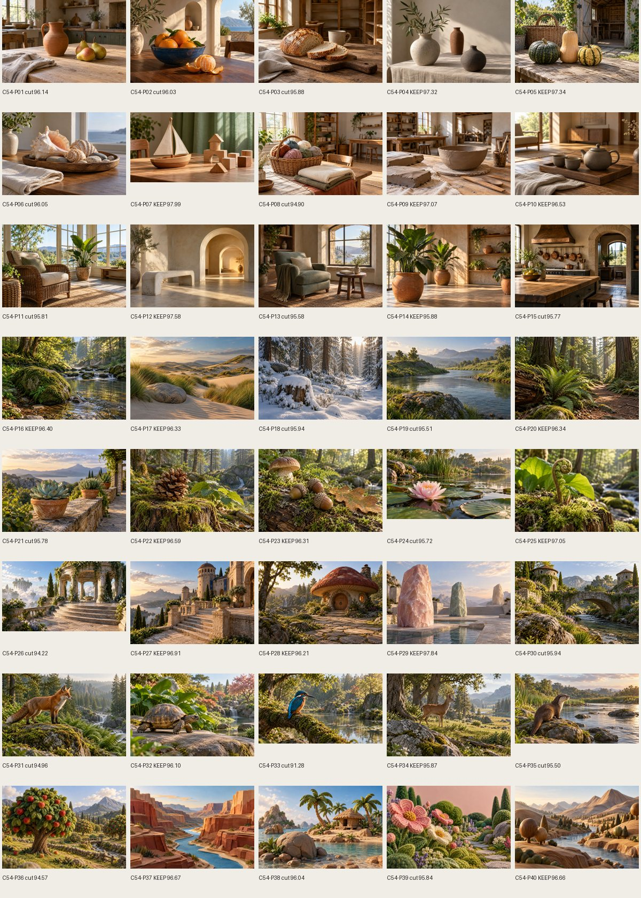
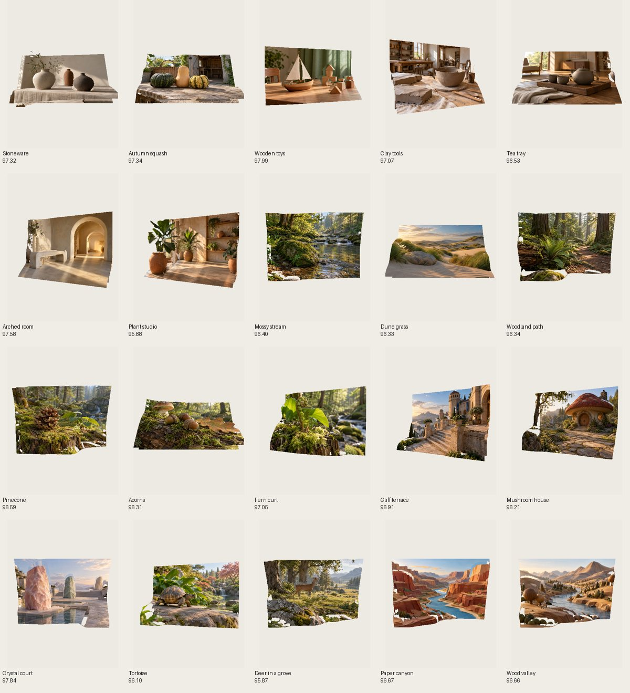
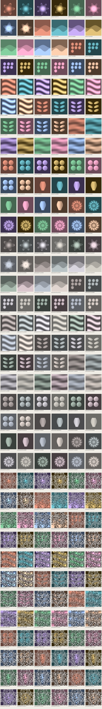
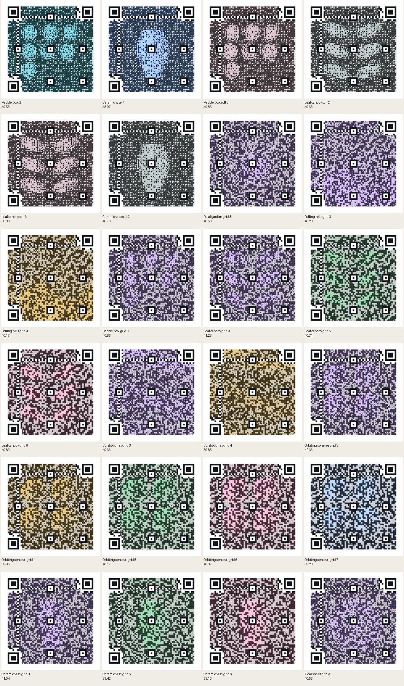
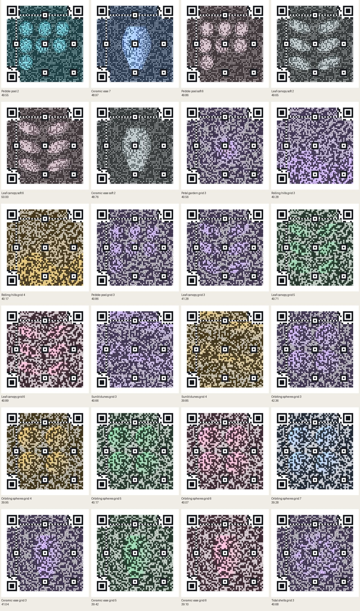

# Sample pictures: October 13, 2026

Codex (GPT-6) built this for Ryan. Status: implemented on `codex/sample-pictures`, based on `main`
commit `555e8f5c`. Nothing is merged.

40 original AI-made Photo to 3D candidates were generated; 20 were retained. A 16-image controlled
QR study preceded 216 original procedural backgrounds in three batches; 24 were retained. Samples
load only when picked; neither toy’s default sample changed.

## Scope and rules

The October 13 version of CLAUDE.md on main permits AI-made Picture QR backgrounds, but this task
uses its default: original made-by-code CC0 pictures for QR. Photo to 3D pictures use the existing
“AI-made by the owner” credit and picker labels. No people, readable text, logos, or real landmarks
were seen in the full candidate contact sheet. All scenes are fictional; the animal subjects are
shown in profile.

Open PRs #560, #562, #566, and #570 were inspected before editing. Renderer files, `manual/`, and
`tests/taps.spec.mjs` are untouched. The owner authorized additive asset records in `CREDITS.md` and
`tools/assets.json`, resolving the task’s conflicting protected-file restriction for those two
files. Their existing content is preserved. The added records are also available as
[asset-credits.md](sample-pictures-2026-10/asset-credits.md) and
[asset-records.json](sample-pictures-2026-10/asset-records.json).

## Photo to 3D method and limits

All 40 candidates were made through the image generation tool, individually, from
[the scene manifest](../../tools/cdx-pics-candidates.json). Each prompt also required a fictional
landscape composition, distinct near/middle/far layers, clean silhouettes, restrained texture,
gentle side lighting, opaque objects, and no people, human faces, text, logos, brands, signs, or
real landmarks. Generation is nondeterministic. Native images were reduced to 1,280-pixel-wide JPEGs
at quality 80. Depth maps came from the actual `tools/dsm-depth.mjs`, the vendored Depth Anything V2
Small model, and the vendored WASM runtime. A local wrapper disabled rendering of the unrelated
opening toy during the remaining inference runs; the model, input, output, and dsm-depth code were
unchanged.

Task 53 has not landed: #566 remains open. [The measurement tool](../../tools/cdx-pics-photo.mjs)
therefore uses explicit simple proxies, in Chromium 151, SwiftShader WebGL2, the mid profile, Sharp
view, Depth 0.5, and fully raised relief. It uses a 390×844 viewport and a fixed 390×520 stage,
device scale factor 1. Each image is measured at ±20° and ±30° separately in yaw and pitch, eight
poses total.

- Hole fraction: exact magenta backdrop pixels within each rendered row’s first/last visible surface
  pixels, inset eight pixels, excluding the top/bottom eight rows. This detects interior tears. It
  omits border losses and does not certify all disocclusions.
- Edge excursion: at up to 240 strong depth jumps, project the two surface endpoints and sample
  seven points between them. Average RGB excursions beyond the two source colors’ per-channel range,
  with an eight-byte tolerance, normalized by 255. This is a halo proxy; shadows, occlusion, and
  source texture can contribute. It does not measure blur, establish exact correspondence, or
  implement task 53’s future aligned halo metric.
- Score: `100 - max_pose(70 × hole_fraction + 30 × edge_excursion)`. The worst pose, rather than an
  average pose, sets the score. All raw pose counts and hashes are retained in
  [photo-scores.json](sample-pictures-2026-10/photo-scores.json).

Selection keeps the best two in each of eight subject categories, then the four highest remaining
scores. That diversity floor prevents one low-texture category from filling the entire picker. No
renderer was changed or claimed to be perfected. The worst-pose contact sheet was visually
inspected; relief artifacts remain visible at large angles.

| Candidate | Name                 |  Score | Worst holes | Worst edge excursion | Decision |
| --------- | -------------------- | -----: | ----------: | -------------------: | -------- |
| C54-P01   | Terracotta and pears | 96.137 |     0.3476% |               0.1286 | Cut      |
| C54-P02   | Citrus bowl          | 96.028 |     0.7765% |               0.1248 | Cut      |
| C54-P03   | Bread board          | 95.877 |     0.5354% |               0.1249 | Cut      |
| C54-P04   | Stoneware            | 97.317 |     0.2154% |               0.0860 | Keep     |
| C54-P05   | Autumn squash        | 97.341 |     0.3761% |               0.0832 | Keep     |
| C54-P06   | Shell tray           | 96.050 |     0.6455% |               0.1296 | Cut      |
| C54-P07   | Wooden toys          | 97.991 |     0.1099% |               0.0663 | Keep     |
| C54-P08   | Sewing basket        | 94.904 |     2.3070% |               0.1316 | Cut      |
| C54-P09   | Clay tools           | 97.072 |     0.5246% |               0.0916 | Keep     |
| C54-P10   | Tea tray             | 96.529 |     1.2119% |               0.1036 | Keep     |
| C54-P11   | Quiet sunroom        | 95.805 |     1.7885% |               0.1043 | Cut      |
| C54-P12   | Arched room          | 97.581 |     0.6267% |               0.0683 | Keep     |
| C54-P13   | Reading nook         | 95.583 |     2.4266% |               0.0906 | Cut      |
| C54-P14   | Plant studio         | 95.877 |     1.7921% |               0.0997 | Keep     |
| C54-P15   | Copper kitchen       | 95.773 |     0.4457% |               0.1377 | Cut      |
| C54-P16   | Mossy stream         | 96.403 |     1.8884% |               0.0968 | Keep     |
| C54-P17   | Dune grass           | 96.334 |     0.4322% |               0.1205 | Keep     |
| C54-P18   | Snow and pines       | 95.941 |     2.3352% |               0.0945 | Cut      |
| C54-P19   | River bend           | 95.508 |     1.2602% |               0.1241 | Cut      |
| C54-P20   | Woodland path        | 96.341 |     2.6039% |               0.0639 | Keep     |
| C54-P21   | Succulent            | 95.779 |     2.8907% |               0.0791 | Cut      |
| C54-P22   | Pinecone             | 96.592 |     1.4521% |               0.0903 | Keep     |
| C54-P23   | Acorns               | 96.307 |     0.4177% |               0.1192 | Keep     |
| C54-P24   | Water lily           | 95.721 |     2.0009% |               0.1011 | Cut      |
| C54-P25   | Fern curl            | 97.052 |     0.5400% |               0.0974 | Keep     |
| C54-P26   | Moon garden          | 94.218 |     2.9832% |               0.1389 | Cut      |
| C54-P27   | Cliff terrace        | 96.909 |     1.0051% |               0.0937 | Keep     |
| C54-P28   | Mushroom house       | 96.206 |     2.1553% |               0.0788 | Keep     |
| C54-P29   | Crystal court        | 97.835 |     1.1652% |               0.0640 | Keep     |
| C54-P30   | Garden bridge        | 95.939 |     1.5404% |               0.1267 | Cut      |
| C54-P31   | Fox in a clearing    | 94.957 |     4.4741% |               0.0791 | Cut      |
| C54-P32   | Tortoise             | 96.100 |     2.7250% |               0.0741 | Keep     |
| C54-P33   | Kingfisher           | 91.278 |     7.0133% |               0.1297 | Cut      |
| C54-P34   | Deer in a grove      | 95.872 |     2.7013% |               0.0825 | Keep     |
| C54-P35   | Otter on a bank      | 95.501 |     3.5265% |               0.0749 | Cut      |
| C54-P36   | Felt orchard         | 94.570 |     3.7593% |               0.1152 | Cut      |
| C54-P37   | Paper canyon         | 96.673 |     1.6668% |               0.1040 | Keep     |
| C54-P38   | Clay island          | 96.042 |     2.3120% |               0.0900 | Cut      |
| C54-P39   | Wool garden          | 95.844 |     2.3297% |               0.0993 | Cut      |
| C54-P40   | Wood valley          | 96.664 |     2.5059% |               0.0696 | Keep     |

## QR experiment and selection

[The deterministic generator and scorer](../../tools/cdx-pics-qr.mjs) uses the actual
`src/qr-craft/picture.js`, not a replacement QR layout. The decoder is vendored jsQR, using the same
inversion setting as the production tests. Scan numbers from this generator are CPU raster
simulations in Node, not physical camera or paper tests. The browser checks below exercise the toy’s
own stage check and PNG export as well.

The exploratory study crosses wide/narrow tone range, center/corner detail placement, sparse/dense
edges, and color/grayscale, 16 candidates. Each uses four correction levels (L/M/Q/H), three code
sizes (fit/more/most), and the toy’s two blurred scan sizes (4 and 8 pixels/module), 384 trials.
[qr-probes.json](sample-pictures-2026-10/qr-probes.json) contains every factor, measured property,
scan, and detail score. This small study gives no population-level guarantee.

| Factor               | Off: passes / trials | On: passes / trials | Interpretation in this sweep                                                   |
| -------------------- | -------------------: | ------------------: | ------------------------------------------------------------------------------ |
| Wide tone range      |              190/192 |             192/192 | The fuller table records the payload, correction level, and size interactions. |
| Detail near a corner |              190/192 |             192/192 | The fuller table records the payload, correction level, and size interactions. |
| Dense edges          |              190/192 |             192/192 | The fuller table records the payload, correction level, and size interactions. |
| Color                |              191/192 |             191/192 | Color alone had no scan effect.                                                |

Three deterministic batches have 72 candidates each (nine families, eight variants):

1. Original macro shapes: petals, hills, pebbles, ribbons, leaves, dunes, spheres, a vase, and
   shells.
2. [Balanced midtones and lower chroma](../../tools/cdx-pics-qr-print.mjs), preserving those broad
   shapes.
3. [A default-URL luminance carrier](../../tools/cdx-pics-qr-grid.mjs), under the original colors.
   It conditions only data modules, excluding finder and timing patterns, with alternating target
   luminance based on the default H/more code. This is a visible grid and a payload-specific
   background. Eighteen selected samples use it, and their picker names say “default link.” Changing
   the link can remove its scan advantage.

The measured properties use a 96×96 square: luminance p95−p05 range, horizontal/vertical edge energy
in the center and outside it, mean channel spread, and fraction of midtones between 0.3 and 0.7.
Every candidate’s properties and scans are in
[qr-scores.json](sample-pictures-2026-10/qr-scores.json). Broad shapes and balanced tones passed the
blurred raster checks frequently, but many failed the stronger unfiltered browser export. The final
carrier batch targets that measured failure without changing the encoder or renderer.

Detail score compares the source macro picture with the halftone averaged to one color per module:
`100 × (0.55 × (1 − RGB_MAE) + 0.45 × max(0, gradient_cosine))`. It includes forced finder areas.
For the carrier batch, the reference is its original first-batch picture (`baseReference`), so the
carrier cannot inflate its rank through self-similarity. `storedImageDetail` separately records that
diagnostic comparison. This ranks color and edge preservation; it is not a perceptual percentage or
a measure of semantic recognizability.

The qualifying settings are the toy’s actual default URL, H correction, Contrast 0.5, small center,
color style, and “Bigger (more detail).” Raster phone trials use the toy’s check at 4 and 8
pixels/module with 0.2-module blur, plus an exact 330-pixel square with 0.3-module blur. Raster
printed-size trials use an exact 900-pixel square with 0.2-module blur. Qualification also requires
every equivalent “fit” trial to pass and module contrast above 3, as the existing QR tests require.
No automatic contrast rescue is used in this raster study.

[The browser screening tool](../../tools/cdx-pics-browser.mjs) then tests every raster-qualified
candidate with the actual production stage scan, both layout checks, a 330-pixel reduction of the
production render, and the raw, unfiltered 900-pixel render. The browser renderer follows the
production capture camera, two render frames, and sort wait. Its RGBA output was byte-identical to
`savePNG(900)` on the recorded
[reference comparison](sample-pictures-2026-10/print-protocol-check.json). Final selected-sample
tests call `savePNG(900)` directly for every kept sample. These are real Chromium/WebGL2
measurements, not mock pixels. The production toy’s existing adaptive rendering is unchanged; all
candidates use the same default controls.

Raw export decoding exposed failures that the blurred CPU simulations missed. Two first-batch and
four second-batch backgrounds passed every check. The carrier batch added 52 passing candidates.
Candidate screening records every failure rather than retrying only favorable renders. The short
alternate payload “Splashery picture QR” is an additional nondefault raster stress condition, not
part of default qualification.

“100%” refers to these finite default trials. Physical phone cameras and printed paper are
unmeasured; changing payload, size, focus, or correction level can change the mask and result.

Raster-qualified candidates: 174/216. All 174 received browser checks; 58 passed all qualifying
conditions. The 24 highest detail scores among those fully qualified candidates were kept (two
original, four balanced-midtone, and eighteen carrier backgrounds). The kept set passed 192/192
default raster scans, 48/48 production layout checks, 48/48 stage checks, 24/24 phone reductions,
and 24/24 raw 900-pixel captures.

| Candidate        | Name                    | Detail score | Default raster scans | Alternate scans | Browser phone / print | Decision                       |
| ---------------- | ----------------------- | -----------: | -------------------: | --------------: | --------------------- | ------------------------------ |
| cdx-qr-1-1       | Petal garden 1          |       47.379 |                  8/8 |             3/4 | pass / fail           | Cut: browser scan failure      |
| cdx-qr-1-2       | Petal garden 2          |       47.195 |                  8/8 |             4/4 | pass / fail           | Cut: browser scan failure      |
| cdx-qr-1-3       | Petal garden 3          |       47.742 |                  7/8 |             2/4 | not qualified         | Cut: raster scan failure       |
| cdx-qr-1-4       | Petal garden 4          |       47.127 |                  7/8 |             3/4 | not qualified         | Cut: raster scan failure       |
| cdx-qr-1-5       | Petal garden 5          |       47.483 |                  8/8 |             2/4 | pass / fail           | Cut: browser scan failure      |
| cdx-qr-1-6       | Petal garden 6          |       48.307 |                  8/8 |             3/4 | pass / fail           | Cut: browser scan failure      |
| cdx-qr-1-7       | Petal garden 7          |       48.058 |                  8/8 |             2/4 | pass / fail           | Cut: browser scan failure      |
| cdx-qr-1-8       | Petal garden 8          |       47.775 |                  7/8 |             2/4 | not qualified         | Cut: raster scan failure       |
| cdx-qr-2-1       | Rolling hills 1         |       47.807 |                  8/8 |             3/4 | not qualified         | Cut: raster scan failure       |
| cdx-qr-2-2       | Rolling hills 2         |       47.854 |                  8/8 |             3/4 | not qualified         | Cut: raster scan failure       |
| cdx-qr-2-3       | Rolling hills 3         |       48.020 |                  8/8 |             3/4 | pass / fail           | Cut: browser scan failure      |
| cdx-qr-2-4       | Rolling hills 4         |       48.195 |                  8/8 |             4/4 | pass / fail           | Cut: browser scan failure      |
| cdx-qr-2-5       | Rolling hills 5         |       47.158 |                  8/8 |             3/4 | not qualified         | Cut: raster scan failure       |
| cdx-qr-2-6       | Rolling hills 6         |       46.683 |                  8/8 |             4/4 | not qualified         | Cut: raster scan failure       |
| cdx-qr-2-7       | Rolling hills 7         |       47.114 |                  8/8 |             3/4 | not qualified         | Cut: raster scan failure       |
| cdx-qr-2-8       | Rolling hills 8         |       47.573 |                  8/8 |             3/4 | not qualified         | Cut: raster scan failure       |
| cdx-qr-3-1       | Pebble pool 1           |       49.859 |                  8/8 |             3/4 | pass / fail           | Cut: browser scan failure      |
| cdx-qr-3-2       | Pebble pool 2           |       49.551 |                  8/8 |             3/4 | pass / pass           | Keep: highest qualified detail |
| cdx-qr-3-3       | Pebble pool 3           |       50.472 |                  8/8 |             3/4 | pass / fail           | Cut: browser scan failure      |
| cdx-qr-3-4       | Pebble pool 4           |       49.524 |                  7/8 |             2/4 | not qualified         | Cut: raster scan failure       |
| cdx-qr-3-5       | Pebble pool 5           |       48.786 |                  8/8 |             2/4 | pass / fail           | Cut: browser scan failure      |
| cdx-qr-3-6       | Pebble pool 6           |       50.214 |                  7/8 |             4/4 | not qualified         | Cut: raster scan failure       |
| cdx-qr-3-7       | Pebble pool 7           |       50.291 |                  8/8 |             3/4 | pass / fail           | Cut: browser scan failure      |
| cdx-qr-3-8       | Pebble pool 8           |       49.977 |                  8/8 |             2/4 | pass / fail           | Cut: browser scan failure      |
| cdx-qr-4-1       | Folded ribbons 1        |       49.633 |                  8/8 |             3/4 | pass / fail           | Cut: browser scan failure      |
| cdx-qr-4-2       | Folded ribbons 2        |       49.380 |                  8/8 |             4/4 | pass / fail           | Cut: browser scan failure      |
| cdx-qr-4-3       | Folded ribbons 3        |       49.832 |                  8/8 |             4/4 | pass / fail           | Cut: browser scan failure      |
| cdx-qr-4-4       | Folded ribbons 4        |       49.458 |                  8/8 |             3/4 | pass / fail           | Cut: browser scan failure      |
| cdx-qr-4-5       | Folded ribbons 5        |       48.272 |                  8/8 |             3/4 | pass / fail           | Cut: browser scan failure      |
| cdx-qr-4-6       | Folded ribbons 6        |       49.073 |                  7/8 |             4/4 | not qualified         | Cut: raster scan failure       |
| cdx-qr-4-7       | Folded ribbons 7        |       48.925 |                  8/8 |             4/4 | pass / fail           | Cut: browser scan failure      |
| cdx-qr-4-8       | Folded ribbons 8        |       48.988 |                  8/8 |             4/4 | pass / fail           | Cut: browser scan failure      |
| cdx-qr-5-1       | Leaf canopy 1           |       50.049 |                  8/8 |             3/4 | pass / fail           | Cut: browser scan failure      |
| cdx-qr-5-2       | Leaf canopy 2           |       49.782 |                  8/8 |             3/4 | pass / fail           | Cut: browser scan failure      |
| cdx-qr-5-3       | Leaf canopy 3           |       50.638 |                  8/8 |             3/4 | pass / fail           | Cut: browser scan failure      |
| cdx-qr-5-4       | Leaf canopy 4           |       49.542 |                  7/8 |             3/4 | not qualified         | Cut: raster scan failure       |
| cdx-qr-5-5       | Leaf canopy 5           |       50.315 |                  8/8 |             2/4 | pass / fail           | Cut: browser scan failure      |
| cdx-qr-5-6       | Leaf canopy 6           |       51.850 |                  7/8 |             3/4 | not qualified         | Cut: raster scan failure       |
| cdx-qr-5-7       | Leaf canopy 7           |       51.537 |                  8/8 |             3/4 | pass / fail           | Cut: browser scan failure      |
| cdx-qr-5-8       | Leaf canopy 8           |       50.062 |                  8/8 |             3/4 | pass / fail           | Cut: browser scan failure      |
| cdx-qr-6-1       | Sunlit dunes 1          |       48.886 |                  8/8 |             3/4 | not qualified         | Cut: raster scan failure       |
| cdx-qr-6-2       | Sunlit dunes 2          |       48.846 |                  8/8 |             3/4 | pass / fail           | Cut: browser scan failure      |
| cdx-qr-6-3       | Sunlit dunes 3          |       49.272 |                  7/8 |             3/4 | not qualified         | Cut: raster scan failure       |
| cdx-qr-6-4       | Sunlit dunes 4          |       49.061 |                  7/8 |             4/4 | not qualified         | Cut: raster scan failure       |
| cdx-qr-6-5       | Sunlit dunes 5          |       48.541 |                  8/8 |             3/4 | not qualified         | Cut: raster scan failure       |
| cdx-qr-6-6       | Sunlit dunes 6          |       49.166 |                  8/8 |             3/4 | not qualified         | Cut: raster scan failure       |
| cdx-qr-6-7       | Sunlit dunes 7          |       49.118 |                  7/8 |             4/4 | not qualified         | Cut: raster scan failure       |
| cdx-qr-6-8       | Sunlit dunes 8          |       49.068 |                  8/8 |             4/4 | pass / fail           | Cut: browser scan failure      |
| cdx-qr-7-1       | Orbiting spheres 1      |       50.444 |                  8/8 |             3/4 | pass / fail           | Cut: browser scan failure      |
| cdx-qr-7-2       | Orbiting spheres 2      |       50.566 |                  7/8 |             3/4 | not qualified         | Cut: raster scan failure       |
| cdx-qr-7-3       | Orbiting spheres 3      |       51.457 |                  8/8 |             3/4 | pass / fail           | Cut: browser scan failure      |
| cdx-qr-7-4       | Orbiting spheres 4      |       50.626 |                  8/8 |             2/4 | pass / fail           | Cut: browser scan failure      |
| cdx-qr-7-5       | Orbiting spheres 5      |       49.815 |                  8/8 |             3/4 | pass / fail           | Cut: browser scan failure      |
| cdx-qr-7-6       | Orbiting spheres 6      |       51.507 |                  7/8 |             3/4 | not qualified         | Cut: raster scan failure       |
| cdx-qr-7-7       | Orbiting spheres 7      |       51.329 |                  7/8 |             3/4 | not qualified         | Cut: raster scan failure       |
| cdx-qr-7-8       | Orbiting spheres 8      |       51.244 |                  7/8 |             3/4 | not qualified         | Cut: raster scan failure       |
| cdx-qr-8-1       | Ceramic vase 1          |       48.749 |                  8/8 |             2/4 | pass / fail           | Cut: browser scan failure      |
| cdx-qr-8-2       | Ceramic vase 2          |       48.691 |                  8/8 |             2/4 | pass / fail           | Cut: browser scan failure      |
| cdx-qr-8-3       | Ceramic vase 3          |       49.216 |                  8/8 |             3/4 | pass / fail           | Cut: browser scan failure      |
| cdx-qr-8-4       | Ceramic vase 4          |       48.295 |                  7/8 |             3/4 | not qualified         | Cut: raster scan failure       |
| cdx-qr-8-5       | Ceramic vase 5          |       48.298 |                  8/8 |             2/4 | pass / fail           | Cut: browser scan failure      |
| cdx-qr-8-6       | Ceramic vase 6          |       49.083 |                  8/8 |             2/4 | pass / fail           | Cut: browser scan failure      |
| cdx-qr-8-7       | Ceramic vase 7          |       48.971 |                  8/8 |             2/4 | pass / pass           | Keep: highest qualified detail |
| cdx-qr-8-8       | Ceramic vase 8          |       48.882 |                  8/8 |             2/4 | pass / fail           | Cut: browser scan failure      |
| cdx-qr-9-1       | Tidal shells 1          |       48.795 |                  8/8 |             2/4 | pass / fail           | Cut: browser scan failure      |
| cdx-qr-9-2       | Tidal shells 2          |       48.794 |                  8/8 |             2/4 | pass / fail           | Cut: browser scan failure      |
| cdx-qr-9-3       | Tidal shells 3          |       49.457 |                  8/8 |             2/4 | pass / fail           | Cut: browser scan failure      |
| cdx-qr-9-4       | Tidal shells 4          |       48.582 |                  7/8 |             2/4 | not qualified         | Cut: raster scan failure       |
| cdx-qr-9-5       | Tidal shells 5          |       48.374 |                  7/8 |             2/4 | not qualified         | Cut: raster scan failure       |
| cdx-qr-9-6       | Tidal shells 6          |       49.343 |                  8/8 |             3/4 | pass / fail           | Cut: browser scan failure      |
| cdx-qr-9-7       | Tidal shells 7          |       49.208 |                  8/8 |             3/4 | pass / fail           | Cut: browser scan failure      |
| cdx-qr-9-8       | Tidal shells 8          |       49.020 |                  8/8 |             3/4 | pass / fail           | Cut: browser scan failure      |
| cdx-qr-print-1-1 | Petal garden soft 1     |       47.279 |                  8/8 |             3/4 | pass / fail           | Cut: browser scan failure      |
| cdx-qr-print-1-2 | Petal garden soft 2     |       47.690 |                  8/8 |             2/4 | pass / fail           | Cut: browser scan failure      |
| cdx-qr-print-1-3 | Petal garden soft 3     |       47.986 |                  8/8 |             3/4 | pass / fail           | Cut: browser scan failure      |
| cdx-qr-print-1-4 | Petal garden soft 4     |       48.188 |                  8/8 |             3/4 | pass / fail           | Cut: browser scan failure      |
| cdx-qr-print-1-5 | Petal garden soft 5     |       46.966 |                  8/8 |             4/4 | pass / fail           | Cut: browser scan failure      |
| cdx-qr-print-1-6 | Petal garden soft 6     |       47.969 |                  8/8 |             4/4 | pass / fail           | Cut: browser scan failure      |
| cdx-qr-print-1-7 | Petal garden soft 7     |       48.337 |                  8/8 |             2/4 | pass / fail           | Cut: browser scan failure      |
| cdx-qr-print-1-8 | Petal garden soft 8     |       48.516 |                  8/8 |             2/4 | pass / fail           | Cut: browser scan failure      |
| cdx-qr-print-2-1 | Rolling hills soft 1    |       47.597 |                  8/8 |             4/4 | not qualified         | Cut: raster scan failure       |
| cdx-qr-print-2-2 | Rolling hills soft 2    |       47.500 |                  8/8 |             4/4 | not qualified         | Cut: raster scan failure       |
| cdx-qr-print-2-3 | Rolling hills soft 3    |       47.139 |                  8/8 |             4/4 | not qualified         | Cut: raster scan failure       |
| cdx-qr-print-2-4 | Rolling hills soft 4    |       47.320 |                  8/8 |             4/4 | not qualified         | Cut: raster scan failure       |
| cdx-qr-print-2-5 | Rolling hills soft 5    |       47.438 |                  8/8 |             3/4 | pass / fail           | Cut: browser scan failure      |
| cdx-qr-print-2-6 | Rolling hills soft 6    |       46.709 |                  8/8 |             3/4 | not qualified         | Cut: raster scan failure       |
| cdx-qr-print-2-7 | Rolling hills soft 7    |       47.079 |                  8/8 |             3/4 | not qualified         | Cut: raster scan failure       |
| cdx-qr-print-2-8 | Rolling hills soft 8    |       47.387 |                  8/8 |             3/4 | not qualified         | Cut: raster scan failure       |
| cdx-qr-print-3-1 | Pebble pool soft 1      |       49.495 |                  8/8 |             2/4 | pass / fail           | Cut: browser scan failure      |
| cdx-qr-print-3-2 | Pebble pool soft 2      |       49.855 |                  8/8 |             4/4 | pass / fail           | Cut: browser scan failure      |
| cdx-qr-print-3-3 | Pebble pool soft 3      |       49.999 |                  8/8 |             4/4 | pass / fail           | Cut: browser scan failure      |
| cdx-qr-print-3-4 | Pebble pool soft 4      |       49.552 |                  8/8 |             3/4 | pass / fail           | Cut: browser scan failure      |
| cdx-qr-print-3-5 | Pebble pool soft 5      |       49.155 |                  8/8 |             3/4 | pass / fail           | Cut: browser scan failure      |
| cdx-qr-print-3-6 | Pebble pool soft 6      |       49.856 |                  8/8 |             4/4 | pass / pass           | Keep: highest qualified detail |
| cdx-qr-print-3-7 | Pebble pool soft 7      |       49.585 |                  8/8 |             2/4 | pass / fail           | Cut: browser scan failure      |
| cdx-qr-print-3-8 | Pebble pool soft 8      |       49.577 |                  8/8 |             2/4 | pass / fail           | Cut: browser scan failure      |
| cdx-qr-print-4-1 | Folded ribbons soft 1   |       49.380 |                  8/8 |             4/4 | pass / fail           | Cut: browser scan failure      |
| cdx-qr-print-4-2 | Folded ribbons soft 2   |       49.296 |                  8/8 |             3/4 | pass / fail           | Cut: browser scan failure      |
| cdx-qr-print-4-3 | Folded ribbons soft 3   |       48.969 |                  8/8 |             4/4 | pass / fail           | Cut: browser scan failure      |
| cdx-qr-print-4-4 | Folded ribbons soft 4   |       48.146 |                  8/8 |             3/4 | pass / fail           | Cut: browser scan failure      |
| cdx-qr-print-4-5 | Folded ribbons soft 5   |       48.937 |                  8/8 |             4/4 | pass / fail           | Cut: browser scan failure      |
| cdx-qr-print-4-6 | Folded ribbons soft 6   |       49.008 |                  8/8 |             4/4 | pass / fail           | Cut: browser scan failure      |
| cdx-qr-print-4-7 | Folded ribbons soft 7   |       48.241 |                  8/8 |             3/4 | pass / fail           | Cut: browser scan failure      |
| cdx-qr-print-4-8 | Folded ribbons soft 8   |       47.994 |                  8/8 |             3/4 | pass / fail           | Cut: browser scan failure      |
| cdx-qr-print-5-1 | Leaf canopy soft 1      |       49.675 |                  8/8 |             3/4 | pass / fail           | Cut: browser scan failure      |
| cdx-qr-print-5-2 | Leaf canopy soft 2      |       49.653 |                  8/8 |             3/4 | pass / pass           | Keep: highest qualified detail |
| cdx-qr-print-5-3 | Leaf canopy soft 3      |       51.430 |                  7/8 |             4/4 | not qualified         | Cut: raster scan failure       |
| cdx-qr-print-5-4 | Leaf canopy soft 4      |       51.154 |                  8/8 |             2/4 | pass / fail           | Cut: browser scan failure      |
| cdx-qr-print-5-5 | Leaf canopy soft 5      |       49.427 |                  8/8 |             3/4 | pass / fail           | Cut: browser scan failure      |
| cdx-qr-print-5-6 | Leaf canopy soft 6      |       50.001 |                  8/8 |             3/4 | pass / pass           | Keep: highest qualified detail |
| cdx-qr-print-5-7 | Leaf canopy soft 7      |       51.178 |                  8/8 |             2/4 | pass / fail           | Cut: browser scan failure      |
| cdx-qr-print-5-8 | Leaf canopy soft 8      |       51.357 |                  8/8 |             2/4 | pass / fail           | Cut: browser scan failure      |
| cdx-qr-print-6-1 | Sunlit dunes soft 1     |       48.738 |                  8/8 |             3/4 | pass / fail           | Cut: browser scan failure      |
| cdx-qr-print-6-2 | Sunlit dunes soft 2     |       48.955 |                  8/8 |             3/4 | not qualified         | Cut: raster scan failure       |
| cdx-qr-print-6-3 | Sunlit dunes soft 3     |       48.930 |                  8/8 |             4/4 | pass / fail           | Cut: browser scan failure      |
| cdx-qr-print-6-4 | Sunlit dunes soft 4     |       48.254 |                  8/8 |             3/4 | not qualified         | Cut: raster scan failure       |
| cdx-qr-print-6-5 | Sunlit dunes soft 5     |       48.732 |                  8/8 |             3/4 | pass / fail           | Cut: browser scan failure      |
| cdx-qr-print-6-6 | Sunlit dunes soft 6     |       49.007 |                  8/8 |             3/4 | pass / fail           | Cut: browser scan failure      |
| cdx-qr-print-6-7 | Sunlit dunes soft 7     |       48.517 |                  8/8 |             3/4 | not qualified         | Cut: raster scan failure       |
| cdx-qr-print-6-8 | Sunlit dunes soft 8     |       48.348 |                  8/8 |             3/4 | not qualified         | Cut: raster scan failure       |
| cdx-qr-print-7-1 | Orbiting spheres soft 1 |       50.237 |                  8/8 |             3/4 | pass / fail           | Cut: browser scan failure      |
| cdx-qr-print-7-2 | Orbiting spheres soft 2 |       50.646 |                  6/8 |             3/4 | not qualified         | Cut: raster scan failure       |
| cdx-qr-print-7-3 | Orbiting spheres soft 3 |       51.352 |                  7/8 |             3/4 | not qualified         | Cut: raster scan failure       |
| cdx-qr-print-7-4 | Orbiting spheres soft 4 |       50.874 |                  8/8 |             3/4 | pass / fail           | Cut: browser scan failure      |
| cdx-qr-print-7-5 | Orbiting spheres soft 5 |       50.125 |                  8/8 |             3/4 | pass / fail           | Cut: browser scan failure      |
| cdx-qr-print-7-6 | Orbiting spheres soft 6 |       51.094 |                  7/8 |             3/4 | not qualified         | Cut: raster scan failure       |
| cdx-qr-print-7-7 | Orbiting spheres soft 7 |       50.715 |                  8/8 |             2/4 | pass / fail           | Cut: browser scan failure      |
| cdx-qr-print-7-8 | Orbiting spheres soft 8 |       51.229 |                  8/8 |             2/4 | pass / fail           | Cut: browser scan failure      |
| cdx-qr-print-8-1 | Ceramic vase soft 1     |       48.474 |                  8/8 |             2/4 | pass / fail           | Cut: browser scan failure      |
| cdx-qr-print-8-2 | Ceramic vase soft 2     |       48.757 |                  8/8 |             3/4 | pass / pass           | Keep: highest qualified detail |
| cdx-qr-print-8-3 | Ceramic vase soft 3     |       49.042 |                  8/8 |             3/4 | pass / fail           | Cut: browser scan failure      |
| cdx-qr-print-8-4 | Ceramic vase soft 4     |       49.459 |                  8/8 |             3/4 | pass / fail           | Cut: browser scan failure      |
| cdx-qr-print-8-5 | Ceramic vase soft 5     |       48.483 |                  8/8 |             2/4 | pass / fail           | Cut: browser scan failure      |
| cdx-qr-print-8-6 | Ceramic vase soft 6     |       48.906 |                  8/8 |             3/4 | pass / fail           | Cut: browser scan failure      |
| cdx-qr-print-8-7 | Ceramic vase soft 7     |       48.986 |                  8/8 |             2/4 | pass / fail           | Cut: browser scan failure      |
| cdx-qr-print-8-8 | Ceramic vase soft 8     |       49.287 |                  8/8 |             2/4 | pass / fail           | Cut: browser scan failure      |
| cdx-qr-print-9-1 | Tidal shells soft 1     |       48.490 |                  8/8 |             2/4 | pass / fail           | Cut: browser scan failure      |
| cdx-qr-print-9-2 | Tidal shells soft 2     |       48.866 |                  8/8 |             3/4 | pass / fail           | Cut: browser scan failure      |
| cdx-qr-print-9-3 | Tidal shells soft 3     |       49.180 |                  8/8 |             3/4 | pass / fail           | Cut: browser scan failure      |
| cdx-qr-print-9-4 | Tidal shells soft 4     |       48.672 |                  8/8 |             3/4 | pass / fail           | Cut: browser scan failure      |
| cdx-qr-print-9-5 | Tidal shells soft 5     |       48.391 |                  8/8 |             2/4 | pass / fail           | Cut: browser scan failure      |
| cdx-qr-print-9-6 | Tidal shells soft 6     |       49.018 |                  8/8 |             2/4 | pass / fail           | Cut: browser scan failure      |
| cdx-qr-print-9-7 | Tidal shells soft 7     |       48.529 |                  8/8 |             2/4 | pass / fail           | Cut: browser scan failure      |
| cdx-qr-print-9-8 | Tidal shells soft 8     |       48.606 |                  8/8 |             3/4 | pass / fail           | Cut: browser scan failure      |
| cdx-qr-grid-1-1  | Petal garden grid 1     |       42.318 |                  8/8 |             3/4 | pass / fail           | Cut: browser scan failure      |
| cdx-qr-grid-1-2  | Petal garden grid 2     |       40.995 |                  8/8 |             4/4 | pass / fail           | Cut: browser scan failure      |
| cdx-qr-grid-1-3  | Petal garden grid 3     |       40.557 |                  8/8 |             4/4 | pass / pass           | Keep: highest qualified detail |
| cdx-qr-grid-1-4  | Petal garden grid 4     |       38.139 |                  8/8 |             4/4 | pass / pass           | Cut: lower qualified detail    |
| cdx-qr-grid-1-5  | Petal garden grid 5     |       38.760 |                  8/8 |             4/4 | pass / pass           | Cut: lower qualified detail    |
| cdx-qr-grid-1-6  | Petal garden grid 6     |       38.795 |                  8/8 |             4/4 | pass / pass           | Cut: lower qualified detail    |
| cdx-qr-grid-1-7  | Petal garden grid 7     |       37.595 |                  8/8 |             3/4 | pass / pass           | Cut: lower qualified detail    |
| cdx-qr-grid-1-8  | Petal garden grid 8     |       36.728 |                  8/8 |             3/4 | pass / pass           | Cut: lower qualified detail    |
| cdx-qr-grid-2-1  | Rolling hills grid 1    |       42.081 |                  8/8 |             3/4 | pass / fail           | Cut: browser scan failure      |
| cdx-qr-grid-2-2  | Rolling hills grid 2    |       41.350 |                  8/8 |             3/4 | pass / fail           | Cut: browser scan failure      |
| cdx-qr-grid-2-3  | Rolling hills grid 3    |       40.278 |                  8/8 |             3/4 | pass / pass           | Keep: highest qualified detail |
| cdx-qr-grid-2-4  | Rolling hills grid 4    |       40.169 |                  8/8 |             4/4 | pass / pass           | Keep: highest qualified detail |
| cdx-qr-grid-2-5  | Rolling hills grid 5    |       38.847 |                  8/8 |             3/4 | pass / pass           | Cut: lower qualified detail    |
| cdx-qr-grid-2-6  | Rolling hills grid 6    |       37.239 |                  8/8 |             4/4 | pass / pass           | Cut: lower qualified detail    |
| cdx-qr-grid-2-7  | Rolling hills grid 7    |       36.658 |                  8/8 |             3/4 | pass / pass           | Cut: lower qualified detail    |
| cdx-qr-grid-2-8  | Rolling hills grid 8    |       36.920 |                  8/8 |             4/4 | pass / pass           | Cut: lower qualified detail    |
| cdx-qr-grid-3-1  | Pebble pool grid 1      |       42.782 |                  8/8 |             3/4 | pass / fail           | Cut: browser scan failure      |
| cdx-qr-grid-3-2  | Pebble pool grid 2      |       41.297 |                  8/8 |             3/4 | pass / fail           | Cut: browser scan failure      |
| cdx-qr-grid-3-3  | Pebble pool grid 3      |       40.857 |                  8/8 |             4/4 | pass / pass           | Keep: highest qualified detail |
| cdx-qr-grid-3-4  | Pebble pool grid 4      |       38.275 |                  8/8 |             2/4 | pass / fail           | Cut: browser scan failure      |
| cdx-qr-grid-3-5  | Pebble pool grid 5      |       38.961 |                  8/8 |             4/4 | pass / pass           | Cut: lower qualified detail    |
| cdx-qr-grid-3-6  | Pebble pool grid 6      |       38.938 |                  8/8 |             3/4 | pass / pass           | Cut: lower qualified detail    |
| cdx-qr-grid-3-7  | Pebble pool grid 7      |       38.174 |                  8/8 |             3/4 | pass / pass           | Cut: lower qualified detail    |
| cdx-qr-grid-3-8  | Pebble pool grid 8      |       37.473 |                  8/8 |             3/4 | pass / pass           | Cut: lower qualified detail    |
| cdx-qr-grid-4-1  | Folded ribbons grid 1   |       42.056 |                  8/8 |             4/4 | pass / fail           | Cut: browser scan failure      |
| cdx-qr-grid-4-2  | Folded ribbons grid 2   |       40.715 |                  8/8 |             3/4 | pass / fail           | Cut: browser scan failure      |
| cdx-qr-grid-4-3  | Folded ribbons grid 3   |       39.417 |                  8/8 |             4/4 | pass / fail           | Cut: browser scan failure      |
| cdx-qr-grid-4-4  | Folded ribbons grid 4   |       38.248 |                  8/8 |             4/4 | pass / pass           | Cut: lower qualified detail    |
| cdx-qr-grid-4-5  | Folded ribbons grid 5   |       38.735 |                  8/8 |             3/4 | pass / pass           | Cut: lower qualified detail    |
| cdx-qr-grid-4-6  | Folded ribbons grid 6   |       37.213 |                  8/8 |             4/4 | pass / pass           | Cut: lower qualified detail    |
| cdx-qr-grid-4-7  | Folded ribbons grid 7   |       36.410 |                  8/8 |             3/4 | pass / pass           | Cut: lower qualified detail    |
| cdx-qr-grid-4-8  | Folded ribbons grid 8   |       35.746 |                  8/8 |             4/4 | pass / pass           | Cut: lower qualified detail    |
| cdx-qr-grid-5-1  | Leaf canopy grid 1      |       43.016 |                  8/8 |             4/4 | pass / fail           | Cut: browser scan failure      |
| cdx-qr-grid-5-2  | Leaf canopy grid 2      |       41.676 |                  8/8 |             3/4 | pass / fail           | Cut: browser scan failure      |
| cdx-qr-grid-5-3  | Leaf canopy grid 3      |       41.279 |                  8/8 |             4/4 | pass / pass           | Keep: highest qualified detail |
| cdx-qr-grid-5-4  | Leaf canopy grid 4      |       38.604 |                  8/8 |             2/4 | pass / pass           | Cut: lower qualified detail    |
| cdx-qr-grid-5-5  | Leaf canopy grid 5      |       40.705 |                  8/8 |             4/4 | pass / pass           | Keep: highest qualified detail |
| cdx-qr-grid-5-6  | Leaf canopy grid 6      |       40.895 |                  8/8 |             4/4 | pass / pass           | Keep: highest qualified detail |
| cdx-qr-grid-5-7  | Leaf canopy grid 7      |       38.116 |                  8/8 |             3/4 | pass / pass           | Cut: lower qualified detail    |
| cdx-qr-grid-5-8  | Leaf canopy grid 8      |       37.438 |                  8/8 |             2/4 | pass / pass           | Cut: lower qualified detail    |
| cdx-qr-grid-6-1  | Sunlit dunes grid 1     |       42.699 |                  8/8 |             3/4 | pass / fail           | Cut: browser scan failure      |
| cdx-qr-grid-6-2  | Sunlit dunes grid 2     |       41.546 |                  8/8 |             4/4 | pass / fail           | Cut: browser scan failure      |
| cdx-qr-grid-6-3  | Sunlit dunes grid 3     |       40.657 |                  8/8 |             3/4 | pass / pass           | Keep: highest qualified detail |
| cdx-qr-grid-6-4  | Sunlit dunes grid 4     |       39.850 |                  8/8 |             3/4 | pass / pass           | Keep: highest qualified detail |
| cdx-qr-grid-6-5  | Sunlit dunes grid 5     |       39.085 |                  8/8 |             3/4 | pass / pass           | Cut: lower qualified detail    |
| cdx-qr-grid-6-6  | Sunlit dunes grid 6     |       38.090 |                  8/8 |             4/4 | pass / pass           | Cut: lower qualified detail    |
| cdx-qr-grid-6-7  | Sunlit dunes grid 7     |       37.359 |                  8/8 |             3/4 | pass / pass           | Cut: lower qualified detail    |
| cdx-qr-grid-6-8  | Sunlit dunes grid 8     |       36.806 |                  8/8 |             4/4 | pass / pass           | Cut: lower qualified detail    |
| cdx-qr-grid-7-1  | Orbiting spheres grid 1 |       43.957 |                  8/8 |             4/4 | pass / fail           | Cut: browser scan failure      |
| cdx-qr-grid-7-2  | Orbiting spheres grid 2 |       42.761 |                  8/8 |             4/4 | pass / fail           | Cut: browser scan failure      |
| cdx-qr-grid-7-3  | Orbiting spheres grid 3 |       42.363 |                  8/8 |             4/4 | pass / pass           | Keep: highest qualified detail |
| cdx-qr-grid-7-4  | Orbiting spheres grid 4 |       39.952 |                  8/8 |             3/4 | pass / pass           | Keep: highest qualified detail |
| cdx-qr-grid-7-5  | Orbiting spheres grid 5 |       40.173 |                  8/8 |             3/4 | pass / pass           | Keep: highest qualified detail |
| cdx-qr-grid-7-6  | Orbiting spheres grid 6 |       40.074 |                  8/8 |             4/4 | pass / pass           | Keep: highest qualified detail |
| cdx-qr-grid-7-7  | Orbiting spheres grid 7 |       39.284 |                  8/8 |             3/4 | pass / pass           | Keep: highest qualified detail |
| cdx-qr-grid-7-8  | Orbiting spheres grid 8 |       38.647 |                  8/8 |             4/4 | pass / pass           | Cut: lower qualified detail    |
| cdx-qr-grid-8-1  | Ceramic vase grid 1     |       42.951 |                  8/8 |             4/4 | pass / fail           | Cut: browser scan failure      |
| cdx-qr-grid-8-2  | Ceramic vase grid 2     |       41.441 |                  8/8 |             4/4 | pass / fail           | Cut: browser scan failure      |
| cdx-qr-grid-8-3  | Ceramic vase grid 3     |       41.037 |                  8/8 |             3/4 | pass / pass           | Keep: highest qualified detail |
| cdx-qr-grid-8-4  | Ceramic vase grid 4     |       38.368 |                  8/8 |             4/4 | pass / pass           | Cut: lower qualified detail    |
| cdx-qr-grid-8-5  | Ceramic vase grid 5     |       39.420 |                  8/8 |             4/4 | pass / pass           | Keep: highest qualified detail |
| cdx-qr-grid-8-6  | Ceramic vase grid 6     |       39.100 |                  8/8 |             4/4 | pass / pass           | Keep: highest qualified detail |
| cdx-qr-grid-8-7  | Ceramic vase grid 7     |       38.291 |                  8/8 |             3/4 | pass / pass           | Cut: lower qualified detail    |
| cdx-qr-grid-8-8  | Ceramic vase grid 8     |       37.615 |                  8/8 |             3/4 | pass / pass           | Cut: lower qualified detail    |
| cdx-qr-grid-9-1  | Tidal shells grid 1     |       42.648 |                  8/8 |             4/4 | pass / fail           | Cut: browser scan failure      |
| cdx-qr-grid-9-2  | Tidal shells grid 2     |       41.152 |                  8/8 |             3/4 | pass / fail           | Cut: browser scan failure      |
| cdx-qr-grid-9-3  | Tidal shells grid 3     |       40.676 |                  8/8 |             3/4 | pass / pass           | Keep: highest qualified detail |
| cdx-qr-grid-9-4  | Tidal shells grid 4     |       38.123 |                  8/8 |             4/4 | pass / pass           | Cut: lower qualified detail    |
| cdx-qr-grid-9-5  | Tidal shells grid 5     |       38.859 |                  8/8 |             3/4 | pass / pass           | Cut: lower qualified detail    |
| cdx-qr-grid-9-6  | Tidal shells grid 6     |       38.110 |                  8/8 |             4/4 | pass / pass           | Cut: lower qualified detail    |
| cdx-qr-grid-9-7  | Tidal shells grid 7     |       37.326 |                  8/8 |             3/4 | pass / pass           | Cut: lower qualified detail    |
| cdx-qr-grid-9-8  | Tidal shells grid 8     |       36.695 |                  8/8 |             3/4 | pass / pass           | Cut: lower qualified detail    |

## Reproduction and verification

1. Generate the 40 individual pictures from the scene manifest with the image tool; record local
   `{id,path}` mappings in `.cache/cdx-pics/generation-base.json` and/or
   `.cache/cdx-pics/photo/*.json`.
2. Run `python3 tools/cdx-pics-prepare.py`, then
   `SPLASHERY_CHROMIUM=/usr/bin/chromium node tools/dsm-depth.mjs cdx-<id> ...` for the prepared
   IDs, with the local HTTP server on port 4173.
3. Run `SPLASHERY_CHROMIUM=/usr/bin/chromium node tools/cdx-pics-photo.mjs`; it resumes completed
   rows. Delete the score file for a fresh measurement. Restore all 40 prepared candidates to the
   temporary picker list before remeasuring.
4. Run `node tools/cdx-pics-qr.mjs`, `node tools/cdx-pics-qr-print.mjs`, and
   `node tools/cdx-pics-qr-grid.mjs`, in that order. This resets the candidate scores. Procedural
   candidates are deterministic; scores use the generated JPEGs.
5. Run `SPLASHERY_CHROMIUM=/usr/bin/chromium node tools/cdx-pics-browser.mjs`. Delete its browser
   score file first for a complete new screening. Run `node tools/cdx-pics-select.mjs`, then
   `node tools/cdx-pics-sheets.mjs`.
6. Run `python3 tools/cdx-pics-report.py` after all measurements. It keeps selected files, moves
   rejected full-size Photo to 3D candidates into the ignored cache, and writes records and contact
   sheets with the repository’s existing Pillow 12.3.0. The registry entries match
   asset-records.json; credit text is in asset-credits.md.
7. Run the task’s Playwright files with the installed Chromium at `/usr/bin/chromium`; no browser
   install is needed. Formatting and American English checks must pass before pushing.

Verification results are in [verification.md](sample-pictures-2026-10/verification.md). All
full-size rejected assets stay out of Git. The report folder is below 8 MB.

## Record

### Identity and status

Task 54, sample pictures; toy IDs `photo-3d` and `qr-picture`. Branch `codex/sample-pictures`, one
draft PR against main. Made by Ryan with Codex (GPT-6), October 13, 2026. Status: implemented; not
merged. The PR link is in the handback.

### Recipe contract and boundaries

Only sample data and picker imports changed. Existing recipe hooks, controls, host APIs, axes,
units, part IDs, pivots, and quaternion order are unchanged. The vendored model, encoder, jsQR, and
WebGL2 renderer were reused as is. New work consists of 20 AI-made JPEG/depth pairs, 24 procedural
JPEGs, data lists, verification tools, and this evidence. Depth is a baked monocular estimate; its
relief is not a physical reconstruction. No new effect or simulated physics was introduced.

### Generation and assets

The steps above are the generation commands. Environment: managed Linux container, Node 24.19.0,
Python 3, Chromium 151, pinned Playwright, jpeg-js 0.4.4, the vendored depth model/WASM runtime, and
Pillow 12.3.0. Procedural generation is deterministic by family/variant; AI generation has no
reproducible seed. No new dependency was installed or added. Code is MIT; procedural QR assets are
CC0 1.0; AI pictures use the existing owner sample policy.

Every retained file has a SHA-256 hash, source page, author, license, checked date, and
transformations in [asset-records.json](sample-pictures-2026-10/asset-records.json). The
[jpeg-js source](https://github.com/eugeneware/jpeg-js),
[Pillow page](https://pillow.readthedocs.io/en/stable/about.html), and
[CC0 deed](https://creativecommons.org/publicdomain/zero/1.0/) were opened on October 13, 2026.

### Executed evidence and performance

The linked verification record distinguishes real-browser measurements and CPU simulations; none use
mock render pixels. Photo scores record splat counts and all measured poses. Candidate file and
depth sizes are reported there. Default first load is unchanged and new assets are fetched only when
selected, verified by browser requests. Real-phone load time, memory, frame rate, physical scans,
and printed-paper performance are unmeasured. Task 53’s future halo metric is also unmeasured. The
PNG export comparison used the same browser renderer as the selected-sample regression; it is not a
physical-print benchmark.

Rule check: none. The owner authorized additive entries in the two asset registries; their existing
records and all other protected files are unchanged.
