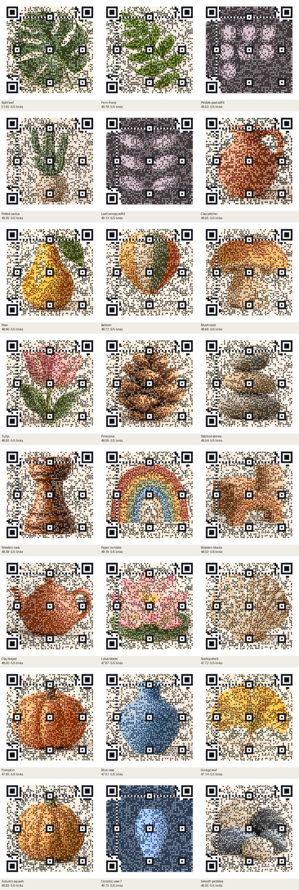
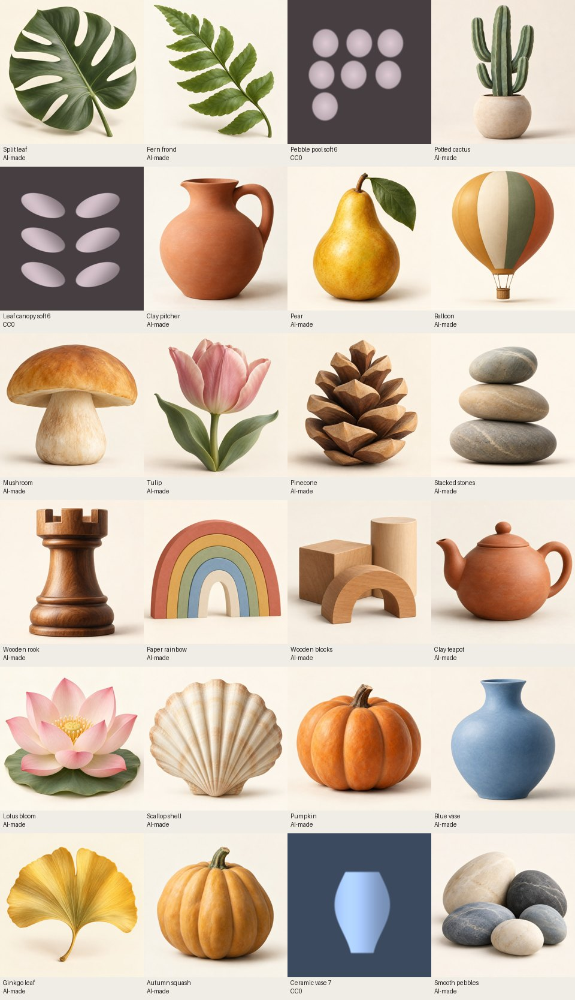
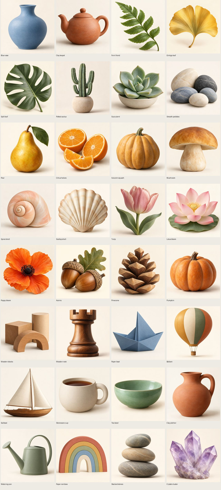

# Sample pictures: October 13, 2026

Made by Ryan with Codex (GPT-6). Implemented on `codex/sample-pictures`, draft
[PR #582](https://github.com/ryanjosephkamp/splashery/pull/582). Main `574a68d3`, then `a2189958`,
was merged into the branch, without rebasing. The latter adds task documents only; application and
test code are identical to the clean-main failure baseline. Nothing is merged into main.

The accepted Photo to 3D set is unchanged: 20 AI-made samples from 40 measured candidates, with
their original JPEGs, depth maps, labels, and records. The revised Picture QR set has **24
recognizable subjects**, 21 AI-made and 3 procedural CC0, chosen from 32 new AI candidates and six
earlier subject pictures. All 18 URL-specific carriers from the first selection are removed from the
picker, asset records, and shipping folder. Neither toy's default picture changed; new pictures load
only when selected.

## Scope and rules

Main's AI-sample policy explicitly permits labeled AI-made Picture QR backgrounds (A3, #580). The
new AI pictures are fictional still lifes with no people, faces, logos, readable text, or real
landmarks. The complete native-candidate contact sheet was visually inspected. The Photo to 3D
images remain under their accepted owner AI policy. The owner authorized registry additions in the
first round; this review replaces only this task's QR entries and credit block, preserving all main
and accepted Studio records. No renderer, encoder, depth model, manual page, or existing test
assertion was edited. `tests/taps.spec.mjs` is untouched.

## Revised QR selection and five-link protocol

The Operator's review called for subjects that remain recognizable at phone size and backgrounds
that do not encode the default URL. The new 32 AI candidates use large, distinct silhouettes,
restrained colors, quiet corners, and broad surfaces. The source pictures contain no QR pattern,
grid, or payload-derived luminance carrier. Their prompts are recorded in
[the scene manifest](../../tools/cdx-pics-qr-ai-prompts.json). Native images are retained locally;
the shipping JPEGs are 960×960 at quality 88, made with the repository's licensed Pillow.

Five unrelated links, from 20 to 130 characters, are fixed in
[cdx-pics-links.mjs](../../tools/cdx-pics-links.mjs). Every candidate uses H correction, Contrast
0.5, small center, color style, and More detail. The production encoder's built-in adaptive
reliability nudge remains enabled, as in the toy; its resulting margin is recorded per link. No
source image is conditioned on any payload.

- 43 characters: `https://ryanjosephkamp.github.io/splashery/`
- 20 characters: `https://example.org/`
- 41 characters: `https://example.com/gallery/summer-leaves`
- 59 characters: `https://example.net/exhibits/ceramics?view=phone&color=blue`
- 130 characters:
  `https://example.org/collections/botanical-studies/2026/autumn/large-format-print?item=fern-frond&edition=public&ref=mobile-preview`

The two standard production layout checks (4 and 8 pixels/module) are checked for each link.
Screening then loads each JPEG through the toy's actual local-file decoder and builds its actual
splats in Chromium/WebGL2. The front-camera capture follows `savePNG(900)` with two render frames
and an 80 ms sort wait. Only the private measurement page's visible cover screenshot is omitted. The
screening RGBA was byte-identical to `savePNG(900)` for the blue-vase default and 130-character
cases; see [review-protocol-check.json](sample-pictures-2026-10/review-protocol-check.json). Final
tests call the production scan check and `savePNG` as well.

Each link has four rendered qualifying checks: the raw 330-pixel phone reduction, rendered
reductions at 4 and 8 pixels/module, and the 900-pixel printed-size **camera simulation with
0.2-module Gaussian focus blur**. The last is a simulation applied to real rendered pixels, not a
physical print or camera measurement. The raw, unfiltered 900-pixel decode is separately reported
below. It does not achieve 100% across links; a source can pass phone and focused-camera checks
while its unresolved high-resolution halftone dots confuse jsQR. Standalone fixed-pixel CPU rasters
at 330/900 and softer focus are also retained as diagnostics, including their failures. They are not
substituted for the actual splat render.

All retained backgrounds pass 5/5 links and 20/20 rendered qualifying checks. That is a finite test
result, not a guarantee for every possible link, size, lighting condition, or physical camera.
Arbitrarily long links can exceed practical phone resolution. Raw-export rates are not hidden or
claimed to be perfect.

The detail measure is the original RGB-fidelity/gradient-cosine metric applied to the production
woven layout, averaged to one color per module:
`100 × (0.55 × (1 − RGB_MAE) + 0.45 × max(0, gradient_cosine))`. **The minimum of the five link
scores** ranks a candidate. It includes forced finder areas and is not a semantic-recognition
percentage. Separately, the actual 330-pixel render is visually reviewed for a clear subject.
Selection keeps the highest worst-link scores among fully scan-qualified, visually clear pictures,
with one procedural variant per subject family. Every cut has a reason.
[qr-review-scores.json](sample-pictures-2026-10/qr-review-scores.json),
[qr-review-browser.json](sample-pictures-2026-10/qr-review-browser.json), and
[qr-subject-review.json](sample-pictures-2026-10/qr-subject-review.json) contain the complete
measurements and visual dispositions.

| Candidate                 | Subject             | Origin  | Worst-link detail | Rendered links | Raw 900px links | Decision                                                                   |
| ------------------------- | ------------------- | ------- | ----------------: | -------------: | --------------: | -------------------------------------------------------------------------- |
| cdx-qr-3-2                | Pebble pool 2       | CC0     |            48.940 |            5/5 |             4/5 | Lower worst-link detail score or a repeated subject.                       |
| cdx-qr-8-7                | Ceramic vase 7      | CC0     |            46.754 |            5/5 |             4/5 | Keep                                                                       |
| cdx-qr-print-3-6          | Pebble pool soft 6  | CC0     |            49.532 |            5/5 |             4/5 | Keep                                                                       |
| cdx-qr-print-5-2          | Leaf canopy soft 2  | CC0     |            49.001 |            5/5 |             4/5 | Lower worst-link detail score or a repeated subject.                       |
| cdx-qr-print-5-6          | Leaf canopy soft 6  | CC0     |            49.129 |            5/5 |             4/5 | Keep                                                                       |
| cdx-qr-print-8-2          | Ceramic vase soft 2 | CC0     |            46.271 |            5/5 |             4/5 | Lower worst-link detail score or a repeated subject.                       |
| cdx-qr-ai-blue-vase       | Blue vase           | AI-made |            47.570 |            5/5 |             3/5 | Keep                                                                       |
| cdx-qr-ai-teapot          | Clay teapot         | AI-made |            47.996 |            5/5 |             3/5 | Keep                                                                       |
| cdx-qr-ai-fern            | Fern frond          | AI-made |            49.785 |            5/5 |             3/5 | Keep                                                                       |
| cdx-qr-ai-ginkgo          | Ginkgo leaf         | AI-made |            47.144 |            5/5 |             3/5 | Keep                                                                       |
| cdx-qr-ai-monstera        | Split leaf          | AI-made |            51.648 |            5/5 |             3/5 | Keep                                                                       |
| cdx-qr-ai-cactus          | Potted cactus       | AI-made |            49.351 |            5/5 |             3/5 | Keep                                                                       |
| cdx-qr-ai-succulent       | Succulent           | AI-made |            49.138 |            4/5 |             3/5 | Rendered link scan failure.                                                |
| cdx-qr-ai-pebbles         | Smooth pebbles      | AI-made |            46.046 |            5/5 |             3/5 | Keep                                                                       |
| cdx-qr-ai-pear            | Pear                | AI-made |            48.862 |            5/5 |             3/5 | Keep                                                                       |
| cdx-qr-ai-citrus          | Citrus halves       | AI-made |            49.505 |            3/5 |             3/5 | Rendered link scan failure.                                                |
| cdx-qr-ai-squash          | Autumn squash       | AI-made |            46.834 |            5/5 |             3/5 | Keep                                                                       |
| cdx-qr-ai-mushroom        | Mushroom            | AI-made |            48.682 |            5/5 |             3/5 | Keep                                                                       |
| cdx-qr-ai-shell           | Spiral shell        | AI-made |            45.966 |            4/5 |             3/5 | Rendered link scan failure.                                                |
| cdx-qr-ai-scallop         | Scallop shell       | AI-made |            47.719 |            5/5 |             3/5 | Keep                                                                       |
| cdx-qr-ai-tulip           | Tulip               | AI-made |            48.648 |            5/5 |             3/5 | Keep                                                                       |
| cdx-qr-ai-lotus           | Lotus bloom         | AI-made |            47.875 |            5/5 |             3/5 | Keep                                                                       |
| cdx-qr-ai-poppy           | Poppy bloom         | AI-made |            46.955 |            4/5 |             3/5 | Rendered link scan failure.                                                |
| cdx-qr-ai-acorns          | Acorns              | AI-made |            48.117 |            4/5 |             3/5 | Rendered link scan failure.                                                |
| cdx-qr-ai-pinecone        | Pinecone            | AI-made |            48.564 |            5/5 |             3/5 | Keep                                                                       |
| cdx-qr-ai-pumpkin         | Pumpkin             | AI-made |            47.647 |            5/5 |             3/5 | Keep                                                                       |
| cdx-qr-ai-wood-blocks     | Wooden blocks       | AI-made |            48.019 |            5/5 |             3/5 | Keep                                                                       |
| cdx-qr-ai-rook            | Wooden rook         | AI-made |            48.380 |            5/5 |             4/5 | Keep                                                                       |
| cdx-qr-ai-paper-boat      | Paper boat          | AI-made |            45.336 |            5/5 |             3/5 | Lower worst-link detail score or a repeated subject.                       |
| cdx-qr-ai-hot-air-balloon | Balloon             | AI-made |            48.720 |            5/5 |             3/5 | Keep                                                                       |
| cdx-qr-ai-sailboat        | Sailboat            | AI-made |            47.095 |            5/5 |             4/5 | The pale main structure is too faint against the background at 330 pixels. |
| cdx-qr-ai-cup             | Stoneware cup       | AI-made |            45.229 |            5/5 |             3/5 | The pale main structure is too faint against the background at 330 pixels. |
| cdx-qr-ai-tea-bowl        | Tea bowl            | AI-made |            47.734 |            4/5 |             3/5 | Rendered link scan failure.                                                |
| cdx-qr-ai-pitcher         | Clay pitcher        | AI-made |            49.054 |            5/5 |             3/5 | Keep                                                                       |
| cdx-qr-ai-watering-can    | Watering can        | AI-made |            45.794 |            5/5 |             3/5 | Lower worst-link detail score or a repeated subject.                       |
| cdx-qr-ai-rainbow         | Paper rainbow       | AI-made |            48.178 |            5/5 |             3/5 | Keep                                                                       |
| cdx-qr-ai-stacked-stones  | Stacked stones      | AI-made |            48.542 |            5/5 |             3/5 | Keep                                                                       |
| cdx-qr-ai-crystal         | Crystal cluster     | AI-made |            45.390 |            5/5 |             3/5 | Crystal facets merge into a faint purple mass in the phone halftone.       |

## Photo to 3D method and limits

All 40 candidates were made through the image generation tool, individually, from
[the scene manifest](../../tools/cdx-pics-candidates.json). Each prompt also required a fictional
landscape composition, distinct near/middle/far layers, clean silhouettes, restrained texture,
gentle side lighting, opaque objects, and no people, human faces, text, logos, brands, signs, or
real landmarks. Generation is nondeterministic. Native images were reduced to 1,280-pixel-wide JPEGs
at quality 80. Depth maps came from the actual `tools/dsm-depth.mjs`, the vendored Depth Anything V2
Small model, and the vendored WASM runtime. A local wrapper disabled rendering of the unrelated
opening toy during the remaining inference runs; the model, input, output, and dsm-depth code were
unchanged.

Task 53 has not landed: #566 remains open. [The measurement tool](../../tools/cdx-pics-photo.mjs)
therefore uses explicit simple proxies, in Chromium 151, SwiftShader WebGL2, the mid profile, Sharp
view, Depth 0.5, and fully raised relief. It uses a 390×844 viewport and a fixed 390×520 stage,
device scale factor 1. Each image is measured at ±20° and ±30° separately in yaw and pitch, eight
poses total.

- Hole fraction: exact magenta backdrop pixels within each rendered row’s first/last visible surface
  pixels, inset eight pixels, excluding the top/bottom eight rows. This detects interior tears. It
  omits border losses and does not certify all disocclusions.
- Edge excursion: at up to 240 strong depth jumps, project the two surface endpoints and sample
  seven points between them. Average RGB excursions beyond the two source colors’ per-channel range,
  with an eight-byte tolerance, normalized by 255. This is a halo proxy; shadows, occlusion, and
  source texture can contribute. It does not measure blur, establish exact correspondence, or
  implement task 53’s future aligned halo metric.
- Score: `100 - max_pose(70 × hole_fraction + 30 × edge_excursion)`. The worst pose, rather than an
  average pose, sets the score. All raw pose counts and hashes are retained in
  [photo-scores.json](sample-pictures-2026-10/photo-scores.json).

Selection keeps the best two in each of eight subject categories, then the four highest remaining
scores. That diversity floor prevents one low-texture category from filling the entire picker. No
renderer was changed or claimed to be perfected. The worst-pose contact sheet was visually
inspected; relief artifacts remain visible at large angles.

| Candidate | Name                 |  Score | Worst holes | Worst edge excursion | Decision |
| --------- | -------------------- | -----: | ----------: | -------------------: | -------- |
| C54-P01   | Terracotta and pears | 96.137 |     0.3476% |               0.1286 | Cut      |
| C54-P02   | Citrus bowl          | 96.028 |     0.7765% |               0.1248 | Cut      |
| C54-P03   | Bread board          | 95.877 |     0.5354% |               0.1249 | Cut      |
| C54-P04   | Stoneware            | 97.317 |     0.2154% |               0.0860 | Keep     |
| C54-P05   | Autumn squash        | 97.341 |     0.3761% |               0.0832 | Keep     |
| C54-P06   | Shell tray           | 96.050 |     0.6455% |               0.1296 | Cut      |
| C54-P07   | Wooden toys          | 97.991 |     0.1099% |               0.0663 | Keep     |
| C54-P08   | Sewing basket        | 94.904 |     2.3070% |               0.1316 | Cut      |
| C54-P09   | Clay tools           | 97.072 |     0.5246% |               0.0916 | Keep     |
| C54-P10   | Tea tray             | 96.529 |     1.2119% |               0.1036 | Keep     |
| C54-P11   | Quiet sunroom        | 95.805 |     1.7885% |               0.1043 | Cut      |
| C54-P12   | Arched room          | 97.581 |     0.6267% |               0.0683 | Keep     |
| C54-P13   | Reading nook         | 95.583 |     2.4266% |               0.0906 | Cut      |
| C54-P14   | Plant studio         | 95.877 |     1.7921% |               0.0997 | Keep     |
| C54-P15   | Copper kitchen       | 95.773 |     0.4457% |               0.1377 | Cut      |
| C54-P16   | Mossy stream         | 96.403 |     1.8884% |               0.0968 | Keep     |
| C54-P17   | Dune grass           | 96.334 |     0.4322% |               0.1205 | Keep     |
| C54-P18   | Snow and pines       | 95.941 |     2.3352% |               0.0945 | Cut      |
| C54-P19   | River bend           | 95.508 |     1.2602% |               0.1241 | Cut      |
| C54-P20   | Woodland path        | 96.341 |     2.6039% |               0.0639 | Keep     |
| C54-P21   | Succulent            | 95.779 |     2.8907% |               0.0791 | Cut      |
| C54-P22   | Pinecone             | 96.592 |     1.4521% |               0.0903 | Keep     |
| C54-P23   | Acorns               | 96.307 |     0.4177% |               0.1192 | Keep     |
| C54-P24   | Water lily           | 95.721 |     2.0009% |               0.1011 | Cut      |
| C54-P25   | Fern curl            | 97.052 |     0.5400% |               0.0974 | Keep     |
| C54-P26   | Moon garden          | 94.218 |     2.9832% |               0.1389 | Cut      |
| C54-P27   | Cliff terrace        | 96.909 |     1.0051% |               0.0937 | Keep     |
| C54-P28   | Mushroom house       | 96.206 |     2.1553% |               0.0788 | Keep     |
| C54-P29   | Crystal court        | 97.835 |     1.1652% |               0.0640 | Keep     |
| C54-P30   | Garden bridge        | 95.939 |     1.5404% |               0.1267 | Cut      |
| C54-P31   | Fox in a clearing    | 94.957 |     4.4741% |               0.0791 | Cut      |
| C54-P32   | Tortoise             | 96.100 |     2.7250% |               0.0741 | Keep     |
| C54-P33   | Kingfisher           | 91.278 |     7.0133% |               0.1297 | Cut      |
| C54-P34   | Deer in a grove      | 95.872 |     2.7013% |               0.0825 | Keep     |
| C54-P35   | Otter on a bank      | 95.501 |     3.5265% |               0.0749 | Cut      |
| C54-P36   | Felt orchard         | 94.570 |     3.7593% |               0.1152 | Cut      |
| C54-P37   | Paper canyon         | 96.673 |     1.6668% |               0.1040 | Keep     |
| C54-P38   | Clay island          | 96.042 |     2.3120% |               0.0900 | Cut      |
| C54-P39   | Wool garden          | 95.844 |     2.3297% |               0.0993 | Cut      |
| C54-P40   | Wood valley          | 96.664 |     2.5059% |               0.0696 | Keep     |

## Original QR experiment: retained as rejected-candidate history

Before the review, a 16-picture controlled study crossed tone range, detail location, edge density,
and color, at L/M/Q/H and Fit/More/Most (384 trials).
[qr-probes.json](sample-pictures-2026-10/qr-probes.json) retains all factors, properties, scans, and
scores. This is a small exploratory sweep, not a population-level claim. It led to 216 procedural
candidates in three 72-picture batches. The first-round CPU and browser scan histories remain in
[qr-scores.json](sample-pictures-2026-10/qr-scores.json) and
[qr-browser-scores.json](sample-pictures-2026-10/qr-browser-scores.json).

The third batch encoded a default-URL luminance carrier. Every carrier is now rejected. Its
source-reference detail metric excluded the carrier, but that did not ensure recognizable subjects
in the final phone render. The revised selection therefore adds a visual subject gate and five-link
checks. The original default-URL selection and contact sheets below are **superseded**, not the
shipping set.

| Original candidate | Original detail score | Current decision                                               |
| ------------------ | --------------------: | -------------------------------------------------------------- |
| cdx-qr-1-1         |                47.379 | Cut: no clear-subject/five-link advantage over final selection |
| cdx-qr-1-2         |                47.195 | Cut: no clear-subject/five-link advantage over final selection |
| cdx-qr-1-3         |                47.742 | Cut: first-round scan failure                                  |
| cdx-qr-1-4         |                47.127 | Cut: first-round scan failure                                  |
| cdx-qr-1-5         |                47.483 | Cut: no clear-subject/five-link advantage over final selection |
| cdx-qr-1-6         |                48.307 | Cut: no clear-subject/five-link advantage over final selection |
| cdx-qr-1-7         |                48.058 | Cut: no clear-subject/five-link advantage over final selection |
| cdx-qr-1-8         |                47.775 | Cut: first-round scan failure                                  |
| cdx-qr-2-1         |                47.807 | Cut: first-round scan failure                                  |
| cdx-qr-2-2         |                47.854 | Cut: first-round scan failure                                  |
| cdx-qr-2-3         |                48.020 | Cut: no clear-subject/five-link advantage over final selection |
| cdx-qr-2-4         |                48.195 | Cut: no clear-subject/five-link advantage over final selection |
| cdx-qr-2-5         |                47.158 | Cut: first-round scan failure                                  |
| cdx-qr-2-6         |                46.683 | Cut: first-round scan failure                                  |
| cdx-qr-2-7         |                47.114 | Cut: first-round scan failure                                  |
| cdx-qr-2-8         |                47.573 | Cut: first-round scan failure                                  |
| cdx-qr-3-1         |                49.859 | Cut: no clear-subject/five-link advantage over final selection |
| cdx-qr-3-2         |                49.551 | Cut: no clear-subject/five-link advantage over final selection |
| cdx-qr-3-3         |                50.472 | Cut: no clear-subject/five-link advantage over final selection |
| cdx-qr-3-4         |                49.524 | Cut: first-round scan failure                                  |
| cdx-qr-3-5         |                48.786 | Cut: no clear-subject/five-link advantage over final selection |
| cdx-qr-3-6         |                50.214 | Cut: first-round scan failure                                  |
| cdx-qr-3-7         |                50.291 | Cut: no clear-subject/five-link advantage over final selection |
| cdx-qr-3-8         |                49.977 | Cut: no clear-subject/five-link advantage over final selection |
| cdx-qr-4-1         |                49.633 | Cut: no clear-subject/five-link advantage over final selection |
| cdx-qr-4-2         |                49.380 | Cut: no clear-subject/five-link advantage over final selection |
| cdx-qr-4-3         |                49.832 | Cut: no clear-subject/five-link advantage over final selection |
| cdx-qr-4-4         |                49.458 | Cut: no clear-subject/five-link advantage over final selection |
| cdx-qr-4-5         |                48.272 | Cut: no clear-subject/five-link advantage over final selection |
| cdx-qr-4-6         |                49.073 | Cut: first-round scan failure                                  |
| cdx-qr-4-7         |                48.925 | Cut: no clear-subject/five-link advantage over final selection |
| cdx-qr-4-8         |                48.988 | Cut: no clear-subject/five-link advantage over final selection |
| cdx-qr-5-1         |                50.049 | Cut: no clear-subject/five-link advantage over final selection |
| cdx-qr-5-2         |                49.782 | Cut: no clear-subject/five-link advantage over final selection |
| cdx-qr-5-3         |                50.638 | Cut: no clear-subject/five-link advantage over final selection |
| cdx-qr-5-4         |                49.542 | Cut: first-round scan failure                                  |
| cdx-qr-5-5         |                50.315 | Cut: no clear-subject/five-link advantage over final selection |
| cdx-qr-5-6         |                51.850 | Cut: first-round scan failure                                  |
| cdx-qr-5-7         |                51.537 | Cut: no clear-subject/five-link advantage over final selection |
| cdx-qr-5-8         |                50.062 | Cut: no clear-subject/five-link advantage over final selection |
| cdx-qr-6-1         |                48.886 | Cut: first-round scan failure                                  |
| cdx-qr-6-2         |                48.846 | Cut: no clear-subject/five-link advantage over final selection |
| cdx-qr-6-3         |                49.272 | Cut: first-round scan failure                                  |
| cdx-qr-6-4         |                49.061 | Cut: first-round scan failure                                  |
| cdx-qr-6-5         |                48.541 | Cut: first-round scan failure                                  |
| cdx-qr-6-6         |                49.166 | Cut: first-round scan failure                                  |
| cdx-qr-6-7         |                49.118 | Cut: first-round scan failure                                  |
| cdx-qr-6-8         |                49.068 | Cut: no clear-subject/five-link advantage over final selection |
| cdx-qr-7-1         |                50.444 | Cut: no clear-subject/five-link advantage over final selection |
| cdx-qr-7-2         |                50.566 | Cut: first-round scan failure                                  |
| cdx-qr-7-3         |                51.457 | Cut: no clear-subject/five-link advantage over final selection |
| cdx-qr-7-4         |                50.626 | Cut: no clear-subject/five-link advantage over final selection |
| cdx-qr-7-5         |                49.815 | Cut: no clear-subject/five-link advantage over final selection |
| cdx-qr-7-6         |                51.507 | Cut: first-round scan failure                                  |
| cdx-qr-7-7         |                51.329 | Cut: first-round scan failure                                  |
| cdx-qr-7-8         |                51.244 | Cut: first-round scan failure                                  |
| cdx-qr-8-1         |                48.749 | Cut: no clear-subject/five-link advantage over final selection |
| cdx-qr-8-2         |                48.691 | Cut: no clear-subject/five-link advantage over final selection |
| cdx-qr-8-3         |                49.216 | Cut: no clear-subject/five-link advantage over final selection |
| cdx-qr-8-4         |                48.295 | Cut: first-round scan failure                                  |
| cdx-qr-8-5         |                48.298 | Cut: no clear-subject/five-link advantage over final selection |
| cdx-qr-8-6         |                49.083 | Cut: no clear-subject/five-link advantage over final selection |
| cdx-qr-8-7         |                48.971 | Kept after five-link/subject review                            |
| cdx-qr-8-8         |                48.882 | Cut: no clear-subject/five-link advantage over final selection |
| cdx-qr-9-1         |                48.795 | Cut: no clear-subject/five-link advantage over final selection |
| cdx-qr-9-2         |                48.794 | Cut: no clear-subject/five-link advantage over final selection |
| cdx-qr-9-3         |                49.457 | Cut: no clear-subject/five-link advantage over final selection |
| cdx-qr-9-4         |                48.582 | Cut: first-round scan failure                                  |
| cdx-qr-9-5         |                48.374 | Cut: first-round scan failure                                  |
| cdx-qr-9-6         |                49.343 | Cut: no clear-subject/five-link advantage over final selection |
| cdx-qr-9-7         |                49.208 | Cut: no clear-subject/five-link advantage over final selection |
| cdx-qr-9-8         |                49.020 | Cut: no clear-subject/five-link advantage over final selection |
| cdx-qr-print-1-1   |                47.279 | Cut: no clear-subject/five-link advantage over final selection |
| cdx-qr-print-1-2   |                47.690 | Cut: no clear-subject/five-link advantage over final selection |
| cdx-qr-print-1-3   |                47.986 | Cut: no clear-subject/five-link advantage over final selection |
| cdx-qr-print-1-4   |                48.188 | Cut: no clear-subject/five-link advantage over final selection |
| cdx-qr-print-1-5   |                46.966 | Cut: no clear-subject/five-link advantage over final selection |
| cdx-qr-print-1-6   |                47.969 | Cut: no clear-subject/five-link advantage over final selection |
| cdx-qr-print-1-7   |                48.337 | Cut: no clear-subject/five-link advantage over final selection |
| cdx-qr-print-1-8   |                48.516 | Cut: no clear-subject/five-link advantage over final selection |
| cdx-qr-print-2-1   |                47.597 | Cut: first-round scan failure                                  |
| cdx-qr-print-2-2   |                47.500 | Cut: first-round scan failure                                  |
| cdx-qr-print-2-3   |                47.139 | Cut: first-round scan failure                                  |
| cdx-qr-print-2-4   |                47.320 | Cut: first-round scan failure                                  |
| cdx-qr-print-2-5   |                47.438 | Cut: no clear-subject/five-link advantage over final selection |
| cdx-qr-print-2-6   |                46.709 | Cut: first-round scan failure                                  |
| cdx-qr-print-2-7   |                47.079 | Cut: first-round scan failure                                  |
| cdx-qr-print-2-8   |                47.387 | Cut: first-round scan failure                                  |
| cdx-qr-print-3-1   |                49.495 | Cut: no clear-subject/five-link advantage over final selection |
| cdx-qr-print-3-2   |                49.855 | Cut: no clear-subject/five-link advantage over final selection |
| cdx-qr-print-3-3   |                49.999 | Cut: no clear-subject/five-link advantage over final selection |
| cdx-qr-print-3-4   |                49.552 | Cut: no clear-subject/five-link advantage over final selection |
| cdx-qr-print-3-5   |                49.155 | Cut: no clear-subject/five-link advantage over final selection |
| cdx-qr-print-3-6   |                49.856 | Kept after five-link/subject review                            |
| cdx-qr-print-3-7   |                49.585 | Cut: no clear-subject/five-link advantage over final selection |
| cdx-qr-print-3-8   |                49.577 | Cut: no clear-subject/five-link advantage over final selection |
| cdx-qr-print-4-1   |                49.380 | Cut: no clear-subject/five-link advantage over final selection |
| cdx-qr-print-4-2   |                49.296 | Cut: no clear-subject/five-link advantage over final selection |
| cdx-qr-print-4-3   |                48.969 | Cut: no clear-subject/five-link advantage over final selection |
| cdx-qr-print-4-4   |                48.146 | Cut: no clear-subject/five-link advantage over final selection |
| cdx-qr-print-4-5   |                48.937 | Cut: no clear-subject/five-link advantage over final selection |
| cdx-qr-print-4-6   |                49.008 | Cut: no clear-subject/five-link advantage over final selection |
| cdx-qr-print-4-7   |                48.241 | Cut: no clear-subject/five-link advantage over final selection |
| cdx-qr-print-4-8   |                47.994 | Cut: no clear-subject/five-link advantage over final selection |
| cdx-qr-print-5-1   |                49.675 | Cut: no clear-subject/five-link advantage over final selection |
| cdx-qr-print-5-2   |                49.653 | Cut: no clear-subject/five-link advantage over final selection |
| cdx-qr-print-5-3   |                51.430 | Cut: first-round scan failure                                  |
| cdx-qr-print-5-4   |                51.154 | Cut: no clear-subject/five-link advantage over final selection |
| cdx-qr-print-5-5   |                49.427 | Cut: no clear-subject/five-link advantage over final selection |
| cdx-qr-print-5-6   |                50.001 | Kept after five-link/subject review                            |
| cdx-qr-print-5-7   |                51.178 | Cut: no clear-subject/five-link advantage over final selection |
| cdx-qr-print-5-8   |                51.357 | Cut: no clear-subject/five-link advantage over final selection |
| cdx-qr-print-6-1   |                48.738 | Cut: no clear-subject/five-link advantage over final selection |
| cdx-qr-print-6-2   |                48.955 | Cut: first-round scan failure                                  |
| cdx-qr-print-6-3   |                48.930 | Cut: no clear-subject/five-link advantage over final selection |
| cdx-qr-print-6-4   |                48.254 | Cut: first-round scan failure                                  |
| cdx-qr-print-6-5   |                48.732 | Cut: no clear-subject/five-link advantage over final selection |
| cdx-qr-print-6-6   |                49.007 | Cut: no clear-subject/five-link advantage over final selection |
| cdx-qr-print-6-7   |                48.517 | Cut: first-round scan failure                                  |
| cdx-qr-print-6-8   |                48.348 | Cut: first-round scan failure                                  |
| cdx-qr-print-7-1   |                50.237 | Cut: no clear-subject/five-link advantage over final selection |
| cdx-qr-print-7-2   |                50.646 | Cut: first-round scan failure                                  |
| cdx-qr-print-7-3   |                51.352 | Cut: first-round scan failure                                  |
| cdx-qr-print-7-4   |                50.874 | Cut: no clear-subject/five-link advantage over final selection |
| cdx-qr-print-7-5   |                50.125 | Cut: no clear-subject/five-link advantage over final selection |
| cdx-qr-print-7-6   |                51.094 | Cut: first-round scan failure                                  |
| cdx-qr-print-7-7   |                50.715 | Cut: no clear-subject/five-link advantage over final selection |
| cdx-qr-print-7-8   |                51.229 | Cut: no clear-subject/five-link advantage over final selection |
| cdx-qr-print-8-1   |                48.474 | Cut: no clear-subject/five-link advantage over final selection |
| cdx-qr-print-8-2   |                48.757 | Cut: no clear-subject/five-link advantage over final selection |
| cdx-qr-print-8-3   |                49.042 | Cut: no clear-subject/five-link advantage over final selection |
| cdx-qr-print-8-4   |                49.459 | Cut: no clear-subject/five-link advantage over final selection |
| cdx-qr-print-8-5   |                48.483 | Cut: no clear-subject/five-link advantage over final selection |
| cdx-qr-print-8-6   |                48.906 | Cut: no clear-subject/five-link advantage over final selection |
| cdx-qr-print-8-7   |                48.986 | Cut: no clear-subject/five-link advantage over final selection |
| cdx-qr-print-8-8   |                49.287 | Cut: no clear-subject/five-link advantage over final selection |
| cdx-qr-print-9-1   |                48.490 | Cut: no clear-subject/five-link advantage over final selection |
| cdx-qr-print-9-2   |                48.866 | Cut: no clear-subject/five-link advantage over final selection |
| cdx-qr-print-9-3   |                49.180 | Cut: no clear-subject/five-link advantage over final selection |
| cdx-qr-print-9-4   |                48.672 | Cut: no clear-subject/five-link advantage over final selection |
| cdx-qr-print-9-5   |                48.391 | Cut: no clear-subject/five-link advantage over final selection |
| cdx-qr-print-9-6   |                49.018 | Cut: no clear-subject/five-link advantage over final selection |
| cdx-qr-print-9-7   |                48.529 | Cut: no clear-subject/five-link advantage over final selection |
| cdx-qr-print-9-8   |                48.606 | Cut: no clear-subject/five-link advantage over final selection |
| cdx-qr-grid-1-1    |                42.318 | Rejected: payload-specific carrier                             |
| cdx-qr-grid-1-2    |                40.995 | Rejected: payload-specific carrier                             |
| cdx-qr-grid-1-3    |                40.557 | Rejected: payload-specific carrier                             |
| cdx-qr-grid-1-4    |                38.139 | Rejected: payload-specific carrier                             |
| cdx-qr-grid-1-5    |                38.760 | Rejected: payload-specific carrier                             |
| cdx-qr-grid-1-6    |                38.795 | Rejected: payload-specific carrier                             |
| cdx-qr-grid-1-7    |                37.595 | Rejected: payload-specific carrier                             |
| cdx-qr-grid-1-8    |                36.728 | Rejected: payload-specific carrier                             |
| cdx-qr-grid-2-1    |                42.081 | Rejected: payload-specific carrier                             |
| cdx-qr-grid-2-2    |                41.350 | Rejected: payload-specific carrier                             |
| cdx-qr-grid-2-3    |                40.278 | Rejected: payload-specific carrier                             |
| cdx-qr-grid-2-4    |                40.169 | Rejected: payload-specific carrier                             |
| cdx-qr-grid-2-5    |                38.847 | Rejected: payload-specific carrier                             |
| cdx-qr-grid-2-6    |                37.239 | Rejected: payload-specific carrier                             |
| cdx-qr-grid-2-7    |                36.658 | Rejected: payload-specific carrier                             |
| cdx-qr-grid-2-8    |                36.920 | Rejected: payload-specific carrier                             |
| cdx-qr-grid-3-1    |                42.782 | Rejected: payload-specific carrier                             |
| cdx-qr-grid-3-2    |                41.297 | Rejected: payload-specific carrier                             |
| cdx-qr-grid-3-3    |                40.857 | Rejected: payload-specific carrier                             |
| cdx-qr-grid-3-4    |                38.275 | Rejected: payload-specific carrier                             |
| cdx-qr-grid-3-5    |                38.961 | Rejected: payload-specific carrier                             |
| cdx-qr-grid-3-6    |                38.938 | Rejected: payload-specific carrier                             |
| cdx-qr-grid-3-7    |                38.174 | Rejected: payload-specific carrier                             |
| cdx-qr-grid-3-8    |                37.473 | Rejected: payload-specific carrier                             |
| cdx-qr-grid-4-1    |                42.056 | Rejected: payload-specific carrier                             |
| cdx-qr-grid-4-2    |                40.715 | Rejected: payload-specific carrier                             |
| cdx-qr-grid-4-3    |                39.417 | Rejected: payload-specific carrier                             |
| cdx-qr-grid-4-4    |                38.248 | Rejected: payload-specific carrier                             |
| cdx-qr-grid-4-5    |                38.735 | Rejected: payload-specific carrier                             |
| cdx-qr-grid-4-6    |                37.213 | Rejected: payload-specific carrier                             |
| cdx-qr-grid-4-7    |                36.410 | Rejected: payload-specific carrier                             |
| cdx-qr-grid-4-8    |                35.746 | Rejected: payload-specific carrier                             |
| cdx-qr-grid-5-1    |                43.016 | Rejected: payload-specific carrier                             |
| cdx-qr-grid-5-2    |                41.676 | Rejected: payload-specific carrier                             |
| cdx-qr-grid-5-3    |                41.279 | Rejected: payload-specific carrier                             |
| cdx-qr-grid-5-4    |                38.604 | Rejected: payload-specific carrier                             |
| cdx-qr-grid-5-5    |                40.705 | Rejected: payload-specific carrier                             |
| cdx-qr-grid-5-6    |                40.895 | Rejected: payload-specific carrier                             |
| cdx-qr-grid-5-7    |                38.116 | Rejected: payload-specific carrier                             |
| cdx-qr-grid-5-8    |                37.438 | Rejected: payload-specific carrier                             |
| cdx-qr-grid-6-1    |                42.699 | Rejected: payload-specific carrier                             |
| cdx-qr-grid-6-2    |                41.546 | Rejected: payload-specific carrier                             |
| cdx-qr-grid-6-3    |                40.657 | Rejected: payload-specific carrier                             |
| cdx-qr-grid-6-4    |                39.850 | Rejected: payload-specific carrier                             |
| cdx-qr-grid-6-5    |                39.085 | Rejected: payload-specific carrier                             |
| cdx-qr-grid-6-6    |                38.090 | Rejected: payload-specific carrier                             |
| cdx-qr-grid-6-7    |                37.359 | Rejected: payload-specific carrier                             |
| cdx-qr-grid-6-8    |                36.806 | Rejected: payload-specific carrier                             |
| cdx-qr-grid-7-1    |                43.957 | Rejected: payload-specific carrier                             |
| cdx-qr-grid-7-2    |                42.761 | Rejected: payload-specific carrier                             |
| cdx-qr-grid-7-3    |                42.363 | Rejected: payload-specific carrier                             |
| cdx-qr-grid-7-4    |                39.952 | Rejected: payload-specific carrier                             |
| cdx-qr-grid-7-5    |                40.173 | Rejected: payload-specific carrier                             |
| cdx-qr-grid-7-6    |                40.074 | Rejected: payload-specific carrier                             |
| cdx-qr-grid-7-7    |                39.284 | Rejected: payload-specific carrier                             |
| cdx-qr-grid-7-8    |                38.647 | Rejected: payload-specific carrier                             |
| cdx-qr-grid-8-1    |                42.951 | Rejected: payload-specific carrier                             |
| cdx-qr-grid-8-2    |                41.441 | Rejected: payload-specific carrier                             |
| cdx-qr-grid-8-3    |                41.037 | Rejected: payload-specific carrier                             |
| cdx-qr-grid-8-4    |                38.368 | Rejected: payload-specific carrier                             |
| cdx-qr-grid-8-5    |                39.420 | Rejected: payload-specific carrier                             |
| cdx-qr-grid-8-6    |                39.100 | Rejected: payload-specific carrier                             |
| cdx-qr-grid-8-7    |                38.291 | Rejected: payload-specific carrier                             |
| cdx-qr-grid-8-8    |                37.615 | Rejected: payload-specific carrier                             |
| cdx-qr-grid-9-1    |                42.648 | Rejected: payload-specific carrier                             |
| cdx-qr-grid-9-2    |                41.152 | Rejected: payload-specific carrier                             |
| cdx-qr-grid-9-3    |                40.676 | Rejected: payload-specific carrier                             |
| cdx-qr-grid-9-4    |                38.123 | Rejected: payload-specific carrier                             |
| cdx-qr-grid-9-5    |                38.859 | Rejected: payload-specific carrier                             |
| cdx-qr-grid-9-6    |                38.110 | Rejected: payload-specific carrier                             |
| cdx-qr-grid-9-7    |                37.326 | Rejected: payload-specific carrier                             |
| cdx-qr-grid-9-8    |                36.695 | Rejected: payload-specific carrier                             |

## Clean-main failures and verification

The assertions are [`tests/qr4-craft.spec.mjs:153`](../../tests/qr4-craft.spec.mjs) and
[`tests/p3d.spec.mjs:194`](../../tests/p3d.spec.mjs). Both were reproduced in a clean, detached
checkout of main `574a68d3125c6ef8f0f5951b53a7da7b6124a341`, with the same pinned dependencies and
Chromium. The hash failed 3/3 fresh runs; the warning failed 3/8 valid repeated runs and passed 5/8.
No production or test code was altered in that checkout. See
[main-hash-failure.txt](sample-pictures-2026-10/main-hash-failure.txt),
[main-warning-failure.txt](sample-pictures-2026-10/main-warning-failure.txt), and
[the failure screenshot](sample-pictures-2026-10/main-warning-failure.jpg). The warning is a
panel-refresh race: its error appears after upload, then a rebuilt panel replaces it with a hidden
warning. The hash expected/actual strings are in the attached log. The original clean-main
`555e8f5c` observations also remain in the first verification record.

Current run results and required checks are recorded in
[review-verification.md](sample-pictures-2026-10/review-verification.md). The original
[verification.md](sample-pictures-2026-10/verification.md) describes the first-round checks only.
Neither existing assertion was weakened, and `tests/taps.spec.mjs` is untouched.

## Reproduction and record

Made by Ryan with Codex (GPT-6), October 13, 2026. Status: implemented; one draft PR, not merged.
Toy IDs: `photo-3d` and `qr-picture`. Existing recipe hooks, units, axes, pivots, part IDs, host
APIs, and quaternion order are unchanged. Only selected picture data/imports and this task's
evidence/tests/tools changed beyond the requested main merge.

1. Generate the 32 individual square QR pictures from their complete manifest prompts with the image
   tool. Keep `{id,path,prompt}` local mappings in `.cache/cdx-pics/round2/ai/*.json`; preserve
   native originals.
2. Run `python3 tools/cdx-pics-qr-prepare.py`, then `node tools/cdx-pics-review.mjs`. The six
   earlier procedural subjects are reused as recorded in the first-round generation tools.
3. With the local server on 4173, run
   `SPLASHERY_CHROMIUM=/usr/bin/chromium node tools/cdx-pics-review-browser.mjs`; it resumes
   completed subjects. Delete the review browser score file for a complete new measurement.
4. Inspect all actual phone renders and record each subject decision in qr-subject-review.json. Run
   `node tools/cdx-pics-review-select.mjs`, then `python3 tools/cdx-pics-review-report.py`. Format
   the resulting code, JSON, and Markdown with Prettier.
5. Run the tests and pre-push checks listed in review-verification.md. The accepted Studio assets
   and scores need no regeneration.

AI generation is nondeterministic; procedural families/variants are deterministic. Shipping asset
SHA-256 hashes, source pages, owner/agent credits, licenses, dates, and transformations are in
[asset-records.json](sample-pictures-2026-10/asset-records.json) and tools/assets.json. Code is MIT;
procedural pictures are CC0 1.0; AI pictures follow the owner's A3 sample policy. Node 24.19.0,
Python 3, jpeg-js 0.4.4, Pillow 12.3.0, pinned Playwright, Chromium 151, the vendored depth
model/WASM, and vendored jsQR are reused; no dependency was added. The
[jpeg-js source](https://github.com/eugeneware/jpeg-js),
[Pillow page](https://pillow.readthedocs.io/en/stable/about.html), and
[CC0 deed](https://creativecommons.org/publicdomain/zero/1.0/) were opened in the original round.

The depth maps remain baked monocular estimates, not physical reconstructions. Camera-focus effects
above are mathematical simulations on actual browser pixels, not paper or hardware measurements.
Real-phone memory, frame rate, load time, physical scanning, and printed-paper performance are
unmeasured. The report folder remains below 8 MB; rejected full-size pictures stay in ignored local
cache.

Rule check: none. The owner's registry exception remains limited to this task's records. All other
protected open-PR files, manual/, and tests/taps.spec.mjs are unchanged relative to main.
