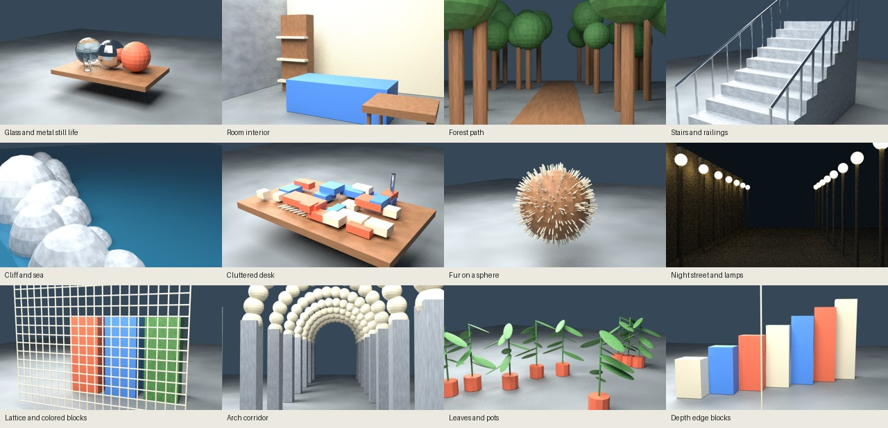

# Studio ground truth, October 2026

Codex (GPT-6) reconstructed this implementation from task 56's repository brief. All evidence in
this report comes from this implementation's Linux cloud runs. The baseline is unmodified `main` at
`58f3d8ede13714bf4b3d1f99fbf3b29d7f60e492`; no product source or vendor files are changed.

This checkpoint contains 12 validated still fixtures, the seeded Blender generator, independent
camera checks, the browser scorer, and the fixture validator. Full sequence generation and all-scene
baseline measurements are still in progress. This is not a completed baseline.

| Scene                      | Construction and stress case                                              |
| -------------------------- | ------------------------------------------------------------------------- |
| Glass and metal still life | Spheres, cylinders, and a wooden table; transmission and reflection masks |
| Room interior              | Walls, furniture, and shelves; corners and overlapping depth planes       |
| Forest path                | Seeded trunks and polygonal crowns; repetition and distant occlusion      |
| Stairs and railings        | Ten steps and thin rails; repeated edges and narrow parts                 |
| Cliff and sea              | Scaled rock spheres and reflective water; rough geometry and invalid sky  |
| Cluttered desk             | Overlapping blocks and narrow rods; small objects and gaps                |
| Fur on a sphere            | 650 cylinder fibers; fine geometry and silhouettes                        |
| Night street and lamps     | Lamps, emission, and dark walls; low contrast and non-diffuse appearance  |
| Lattice and colored blocks | Thin bars and separated blocks; disocclusion and subpixel geometry        |
| Arch corridor              | Nested arches and pillars; depth range and repetition                     |
| Leaves and pots            | Flattened ellipsoids and cylinders; thin leaves and foreground cuts       |
| Depth edge blocks          | Alternating boxes and a foreground rod; abrupt planar depth steps         |

Each scene has a fixed seed (5600–5611), original materials, and no external assets. Contact-sheet
review found an occluded water plane in the initial build; it was corrected before these fixtures
were rebuilt. The compact set is about 20.14 MB, below the 40 MB Git limit. File hashes are in
`tests/fixtures/truth/assets.json`.

The [fixture guide](../../tests/fixtures/truth/README.md) defines units, intrinsics, extrinsics,
invalid pixels, and appearance masks. Glass and reflections have first-hit geometry depth, which is
not universal appearance truth. The stills are 1280×720; the four-second and ten-second videos are
640×360 at 30 fps. The videos' lower resolution is an explicit deviation from a full-resolution
video dataset.

Fresh checkpoint verification:

- `python3 tests/studio-truth-camera.py`: 3 passed.
- `node --test tests/studio-truth*.test.mjs`: 10 passed.
- `blender -b --factory-startup --threads 4 --python-exit-code 1 --python tests/studio-truth-blender.py`:
  3 passed against real BVH geometry.
- Sandboxed Chromium 151.0.7922.173 launches with no graphics overrides; its initial probe offers
  WebGL2 but no WebGPU. The real toy probe measured Photo to 3D depth and captured an actual flat
  front-view image. All-scene baseline scoring is in progress.
- Pip exposes no compatible `bpy` wheel for Python 3.12 in this environment; the generator uses the
  installed native Linux Blender 4.3.2 instead.

Full clip data and archives belong in the ignored `.cache/studio-truth/` directory. The clean run is
`.cache/studio-truth/full-v1`; its first scenes have completed 120-frame handheld and 300-frame walk
sequences. No full archive is hosted at this checkpoint.

Rule check: none. Procedural assets are CC0, made by Ryan with Codex (GPT-6). There is no phone
hardware evidence. Desktop browser viewports are not phone testing.

## Measurement contract and limits

The scorer imports real product entry points in sandboxed Chromium, blocks outside-origin requests,
and opens one page at a time. It verifies that `src/` and `vendor/` match the baseline. Model output
is relative inverse depth. A positive affine inverse-depth calibration is fitted to a fixed
one-eighth of valid diffuse pixels; the other seven-eighths are scored. This is a calibrated
geometric benchmark, not a claim of metric-depth inference. Nonpositive or nonfinite predictions are
counted separately as missing depth.

Temporal jitter follows the same world point through camera poses and rejects occlusion. It measures
changes in signed depth error, not movement of a fixed screen pixel. The first frame's calibration
is kept for later frames. Color references are area-averaged to avoid comparing antialiased renders
with aliased source noise. SSIM uses valid 7×7 windows; sharpness is the ratio of Laplacian
variances.

Flat front-view diagnostics use the toy's actual projected source rectangle. Photo uses its flat
control, and Moving photo uses depth zero. Alpha holes and source color error in a depth-edge band
are measured in this view. These do not establish turned-view holes, disocclusion, or held-out
sharpness. Held-out results stay null. Video to 3D's capability probe reports no WebGPU graphics
adapter. Training and held-out rendering are unavailable; a solved-camera alignment and a
training-frame exclusion adapter are also still needed.

## Preserved failures

The initial camera check encountered its not-yet-created module. Six metric checks failed for
missing functionality before implementation. A full-frame jitter regression failed with a stack
overflow (8 passed, 1 failed); the reduction was fixed, and the regression passed unchanged. The
area-sampling check also failed before implementation. Early compact validation rejected an
incomplete manifest; clean 12-scene validation passed after generation finished. Logs stay in
`.cache/studio-truth/`.

The first browser probe timed out on Photo to 3D after 180 seconds and reported Video to 3D blocked
by the missing adapter. A 600-second probe completed Photo to 3D inference and captured a real
front-view image. The failed probe is preserved separately.

No product assertions or thresholds were changed. The repository's default Playwright launcher uses
unsafe graphics flags and bypasses the GPU blocklist; it is not used. The added safe config replaces
those options with sandboxed Chromium defaults. A safe regression attempt and the required
formatting and English checks will be reported at handback.
