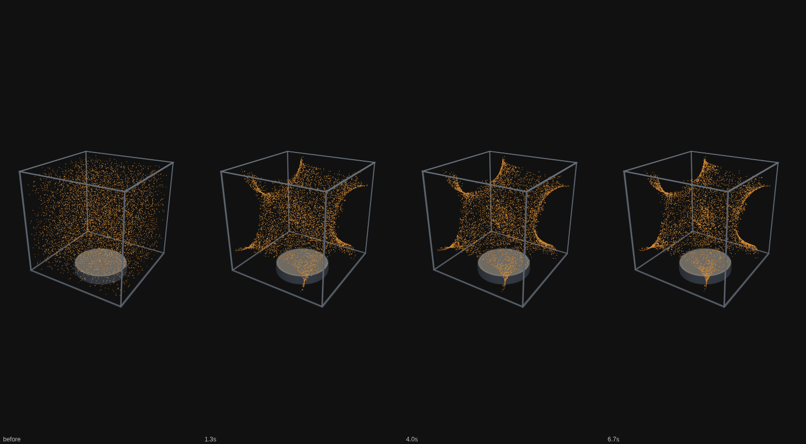
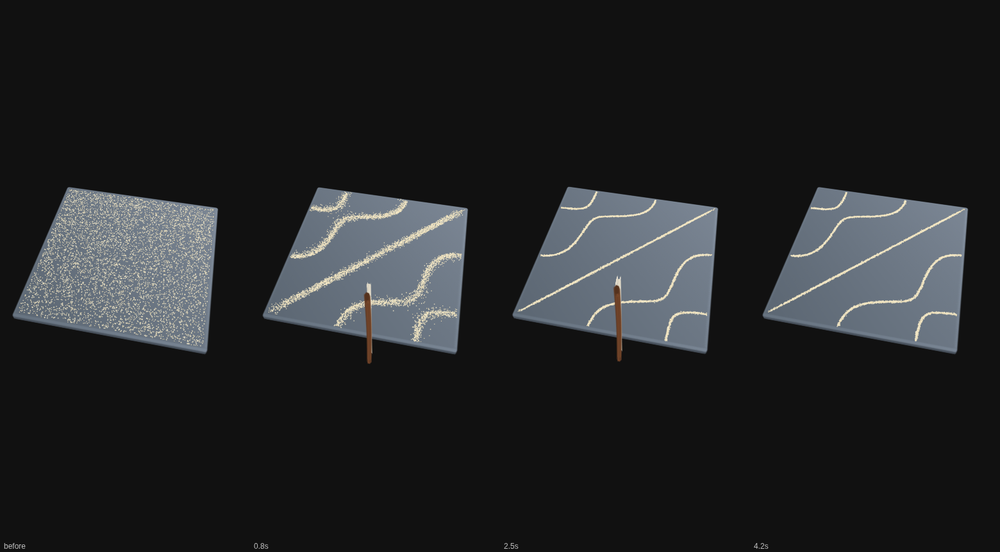
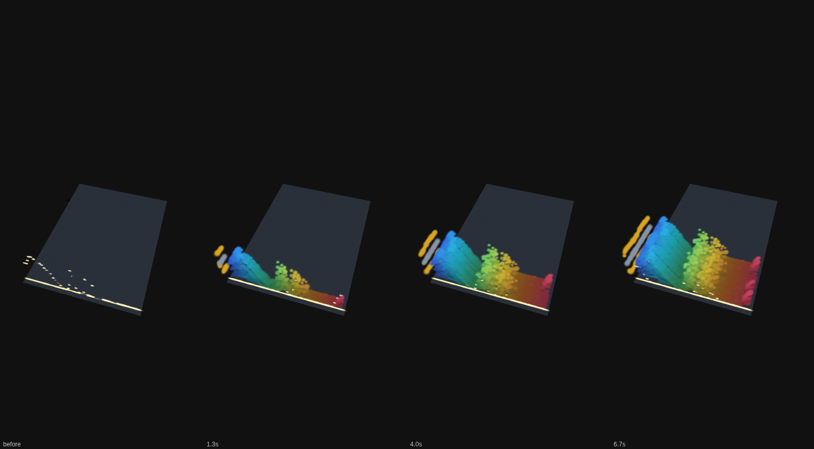

# Toy checkpoints, part c: evidence

Codex (GPT-6) prepared this evidence on October 14, 2026, from
`41b21e74e04ccca178b95ac02b4e5dc0e51b4b45`, the saved `claude/checkpoint-toys-2026-10-14`
repository. This branch, `codex/toy-checkpoints-c-clips`, is never merged. The documentation PR
contains only `docs/studio/chladni-cell-checkpoint.md`, `chladni-plate-checkpoint.md`, and
`song-landscape-checkpoint.md`.

The original evidence renders are CC0: made by Ryan with Codex (GPT-6), using the existing Splashery
procedural toys. Capture and measurement code is MIT, following the repository license. The sample
tune is the existing generated CC0 tune; it was neither changed nor redistributed here. No visitor
file, actual microphone recording, external image, or third-party model was used.

## Clips

| Toy            | File                                     | Size (bytes) | Duration | Dimensions / rate |
| -------------- | ---------------------------------------- | ------------ | -------- | ----------------- |
| Sound in a box | [chladni-cell.mp4](chladni-cell.mp4)     | 600,042      | 8.4 s    | 390×844 / 10 fps  |
| Chladni plate  | [chladni-plate.mp4](chladni-plate.mp4)   | 217,347      | 5.4 s    | 390×844 / 10 fps  |
| Song landscape | [song-landscape.mp4](song-landscape.mp4) | 94,057       | 8.4 s    | 390×844 / 10 fps  |

The clips are silent, with default toy settings, the home camera, and a dark background. Each has
0.4 s of lead-in followed by one action. The box rings its `cube-012` mode, the plate bows its
`2-3+` mode, and Song landscape plays its default sample in Live. No file upload or microphone
capture was substituted for those defaults. Filmstrips show before and three later states:







`capture.mjs` is the checkpoint's `tools/lv8-clip.mjs` with only two changes: forced `profile=low`
instead of mid, and a 390×844 browser viewport instead of 1000×700. It calls the actual recipe and
renderer, advances update handlers in 0.1 s steps, and captures the stage at 390×844. Song landscape
uses its muted short-player simulation clock. The full-height stage capture omits the page controls
and is distinct from the normal UI's 390×645 canvas. It shows modeled motion at a controlled rate,
not real-time render speed or audible synchronization. `ffprobe` verified dimensions, durations,
frame counts, and rate after MP4 conversion. The four-frame strips were visually inspected for the
default scatter-to-figure and empty-plain-to-landscape transitions.

From a checkout of the saved SHA with its existing npm dependencies and Chromium:

```sh
python3 -m http.server 4173 --bind 127.0.0.1
```

In another shell, copy `capture.mjs` from this evidence branch into the saved checkout's `.cache/`
(so Node can resolve its dependencies), and run:

```sh
SPLASHERY_CHROMIUM=/usr/bin/chromium node .cache/capture.mjs .cache/toy-checkpoints-c \
  --fps=10 --strip=4 --sweep=0 chladni-cell:8 chladni-plate:5 song-landscape:8
```

Convert each GIF without changing its timing:

```sh
ffmpeg -loglevel error -y -i .cache/toy-checkpoints-c/chladni-cell.gif \
  -an -c:v libx264 -pix_fmt yuv420p -movflags +faststart .cache/toy-checkpoints-c/chladni-cell.mp4
ffmpeg -loglevel error -y -i .cache/toy-checkpoints-c/chladni-plate.gif \
  -an -c:v libx264 -pix_fmt yuv420p -movflags +faststart .cache/toy-checkpoints-c/chladni-plate.mp4
ffmpeg -loglevel error -y -i .cache/toy-checkpoints-c/song-landscape.gif \
  -an -c:v libx264 -pix_fmt yuv420p -movflags +faststart .cache/toy-checkpoints-c/song-landscape.mp4
```

Change the executable path when Chromium is installed elsewhere. No browser installation is part of
this evidence.

## Measurements

`measurements.json` is the accepted completed run of `measure.mjs`. An earlier run was stopped
because it overlapped clip rendering; its partial numbers were discarded. The completed run used
Chromium 151.0.7922.173, software WebGL2/ANGLE SwiftShader, no CPU throttle, low detail, adaptation
off, device pixel ratio 1, and a 390×844 viewport. No other capture or test browser was running
during its selection/action windows. MP4 conversion finished before the first toy selection.

Each toy used a fresh browser context. The script timed navigation until `body[data-ready]`, then
timed `app.chooseToy()`. The starter page loads a different toy first, so selection timing is not a
cold direct-to-toy load. Drawing used the normal UI's 390×645 canvas. It counted completed
`stage.frames` over roughly three wall-clock seconds after an action, with sound disabled and the
default input. Resource totals sum encoded response bodies whose requests began after selection,
including shared modules and overlapping page requests. They are not exclusive toy payloads,
whole-page transfer budgets, or an Internet connection test.

| Toy            | Starter ready | Selection | Draw rate | Emitted splats |
| -------------- | ------------- | --------- | --------- | -------------- |
| Sound in a box | 3.117 s       | 1.041 s   | 17.7 fps  | 19,115         |
| Chladni plate  | 2.843 s       | 0.488 s   | 6.0 fps   | 51,398         |
| Song landscape | 2.881 s       | 0.738 s   | 8.6 fps   | 49,297         |

These are single cloud observations, not phone benchmarks. The JSON retains the exact windows, frame
counts, particle states, resources, errors, and worker state. It records no page errors. Sound
output and a real microphone were not measured. To reproduce, copy `measure.mjs` into the saved
checkout's `.cache/`, keep the server running, stop other browser work, and run:

```sh
SPLASHERY_CHROMIUM=/usr/bin/chromium node .cache/measure.mjs
```

## Verification

`numerical-tests.txt` records 24 passing existing tests: spectrum, frequency bands, chirp, silence,
budgets, the sample, all eight plate figures, frame-level features, chunk ordering, MP3 header
recognition, cell potential, cell frequencies, all menu-mode settling, pitch mapping, and
note-change/silence behavior. These checks execute numerical code without a renderer.
`browser-tests.txt` records five selected existing browser checks: the box's tap and settling, the
landscape's play/pause, both Studio toys building and responding to a tap, and opening a custom
sound file in Song landscape. Test commands are recorded in the documentation PR. The full suite,
all optional looks/colors/tunes in a browser, real audio output, and real microphone hardware were
not tested for this documentation-only task.

The physics references linked in the documents were opened: the Bruus PubMed abstract,
Skrodzki/Reitebuch/Polthier's paper, Mehl's NIST paper, Smith's STFT chapter, and the YIN PubMed
abstract. The publisher's Bruus page returned 403, and the author's PDF returned 502; the documents
use the accessible abstract for the general radiation-force fact and identify the implemented
potential constants and timings as code assumptions.

Rule check: none.
