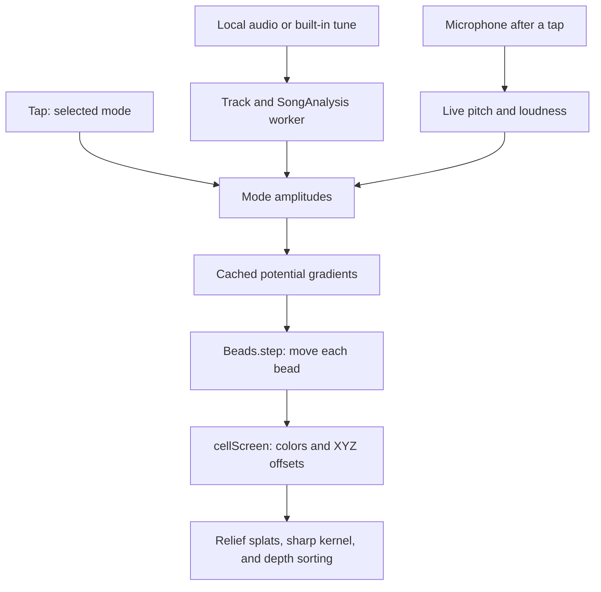

# Sound in a box checkpoint, October 14, 2026

This preserves `chladni-cell`, the labs toy called Sound in a box, for Codex task 82c. The code,
measurements, and clips describe the saved version below. Codex (GPT-6) prepared this documentation;
the toy's implementation is unchanged.

## Where the checkpoint lives

| What                                | Where                               | Commit                                     |
| ----------------------------------- | ----------------------------------- | ------------------------------------------ |
| Whole repository                    | `claude/checkpoint-toys-2026-10-14` | `41b21e74e04ccca178b95ac02b4e5dc0e51b4b45` |
| Phone clips and measurement records | `codex/toy-checkpoints-c-clips`     | `b7c044e9c7da9d3481a8fa59b46a0a8dbd977fd8` |

Never push to, rebase, or delete the Operator's checkpoint branch. The clips branch is evidence only
and must never be merged.
[Saved source](https://github.com/ryanjosephkamp/splashery/tree/41b21e74e04ccca178b95ac02b4e5dc0e51b4b45).

[390×844 clip](https://github.com/ryanjosephkamp/splashery/blob/b7c044e9c7da9d3481a8fa59b46a0a8dbd977fd8/docs/audits/toy-checkpoints-c/chladni-cell.mp4)
shows the default mixed cube mode collecting scattered beads after a tap. It is a silent,
stepped-clock rendering at 10 frames per second, not a phone performance measurement. The
[evidence record](https://github.com/ryanjosephkamp/splashery/blob/b7c044e9c7da9d3481a8fa59b46a0a8dbd977fd8/docs/audits/toy-checkpoints-c/README.md)
explains capture, timing, and reproduction.

## How it works

In plain words, sound in a small water-filled cell has places where its pressure does not swing. The
toy moves each bead toward those surfaces. This represents acoustic particle manipulation: Bruus's
[Acoustofluidics 7](https://pubmed.ncbi.nlm.nih.gov/22349937/) describes the time-averaged radiation
force on small particles in ultrasound. The toy accelerates that process and maps music to
ultrasound; its displayed motion is a model, not a measured laboratory experiment.

The recipe is `CHLADNI_CELL` in `src/packs/chladni-3d.js`, exported as `RECIPES["chladni-cell"]` by
`src/packs/studio.js`. `src/toys.js` supplies its labs gate and home camera (yaw 0.55, pitch 0.42,
and distance 4.6). There is no camera or image input.



### Modes, force, and motion

`cellMode()` chooses one of `CELL_MODES`; `modeShape()` computes its spatial pressure function φ.
The cube uses products of cosines, with integer indices, summed for mixed modes:

```text
φ = Σ sign · cos(lπx/L) cos(mπy/L) cos(nπz/L)
f = (1497 / (2L)) √(l² + m² + n²), L = 0.01 m
```

Coordinates in `modeShape()` run from −1 to 1 and are mapped into the cosine domain. Cosine products
with Neumann conditions are also the mathematical construction discussed in
[Skrodzki, Reitebuch, and Polthier](https://www.mi.fu-berlin.de/en/math/groups/ag-geom/publications/db/2016_SRP_ChladniFiguresRevisited_APeekIntoTheThirdDimension.pdf).
The flask is an ideal sphere of radius 0.005 m, despite its drawn neck:

```text
φ = j_l(kr) P_l(cos θ), j_l′(ka) = 0, f = 1497 · ka / (2πa)
```

The rigid sphere's Bessel functions and derivative-root condition are described in
[Mehl's NIST paper](https://nvlpubs.nist.gov/nistpubs/jres/112/3/V112.N03.A04.pdf), equations 1 and
2 and the following eigenvalue definition. The toy uses only axisymmetric l = 0, 1, and 2 functions,
with θ measured from the upright axis.

`potentialGrid()` evaluates the toy's dimensionless Gor'kov potential and finite-difference
gradients on 41³ points (`G = 40`):

```text
U = 0.44 φ² − 1.5 · 0.034 |∇φ|² / k²
force direction = −∇U
```

These constants are `F1` and `F2`, the recipe's polystyrene-in-water assumptions. `gridFor()` caches
each mode's grid; `sample()` interpolates its vectors. `Beads.step()` adds gradients weighted by
squared mode amplitudes, scales each by its maximum gradient, and moves each bead down the
potential. It subdivides time into steps no larger than 0.02 s, caps movement per step at 0.03 cell
units, and confines beads inside 97% of the cube or sphere.

A tap rings the selected mode for seven simulated seconds. If its settled score exceeds 0.6, the tap
first stirs for one second. The tap's relaxation scale is 1.1 s. Music and the microphone use
`LIVE = { secs: 0.35, follow: 0.08, drift: 0.15 }`: faster relaxation, amplitude smoothing, and a
random walk projected along the leading mode's nodal surface. That walk represents streaming
approximately; it is not a fluid solver. `Beads.settled()` estimates proximity to nodes, rather than
measuring physical energy or a dimensional settling time.

### Local audio, tunes, and microphone

`openCellAudio()` accepts browser-readable audio up to 400,000,000 bytes. It makes a local object
URL and starts `Track` (`src/packs/song-stream.js`) for playback, plus a separate `SongAnalysis` for
measurements. `SongAnalysis.start()` decodes a copy at 44,100 Hz; MP3 is decoded in roughly
30-second pieces, while other formats are decoded whole. `src/packs/song-worker.js` analyzes 50
frames per chunk, prioritizing the playhead. The feature interval is 40 ms, and the spectrum uses a
4,096-sample Hann window (`src/packs/song-analysis.js`).

`strongest()` takes YIN fundamental frequency when detected, otherwise the loudest of 104
logarithmic bands from 40 to 16,000 Hz. YIN is the pitch-estimation method introduced by
[de Cheveigné and Kawahara](https://pubmed.ncbi.nlm.nih.gov/12002874/). `heardDrive()` maps RMS
loudness from −54 to −24 dBFS into 0 to 1. `foldCell()` moves pitch by octaves into the shape's
audible range (approximately 268–957 Hz for the cube or 355–1,568 Hz for the flask), and
`cellDrive()` multiplies it by 256.

The resonance response is `1 / (1 + (cents / 100)²)`, normalized so the nearest mode receives
`sqrt(loudness)` amplitude. Squaring this amplitude makes force follow the mapped loudness.
Contributions with amplitude at most 0.1 are dropped. `ladder()` adds six modes beyond the menu:
cube 010, 020, and 022, and flask 1-1, 0-1, and 1-2. Music can therefore excite a mode that is not a
menu choice. A paused file stops movement; a microphone takes priority and pauses the file.

`tuneSamples()`, `wavBytes()`, and `playTune()` synthesize the five built-in choices into an
in-memory WAV: Rising scale, Broken chord, Two voices, Ode to Joy, and Twinkle, Twinkle, Little
Star. They follow the same file playback and analysis path. Tune names, note lists, and credits live
in `TUNES`; they are not downloaded recordings.

The Use my microphone button calls `start()` in `src/live/live.js` only after a tap.
`startAnalyser()` in `src/live/mic.js` uses an `AnalyserNode` plus `src/live/capture-worklet.js`,
with a silenced output. `detectPitch()` in `src/live/analysis.js` supplies live YIN pitch. Neither
the box nor the plate retains a recording; [Song landscape](song-landscape-checkpoint.md) has a
separate recording path. There is no upload.

### From bead positions to the screen

`CHLADNI_CELL.build()` makes a frame, a transducer puck, and
`max(5000, min(16000, floor(k.count × 0.07)))` bead splats, using the Kit's seeded randomness. The
walls are represented by edges or hoops so they do not obscure beads. `cellScreen.draw()` writes RGB
colors in the left half of a canvas atlas and signed XYZ offsets in the right half. Each bead is a
`kind: "relief"` splat with axis 3; the GPU moves that splat from its rest position. `drive()`
updates the atlas version and requests `out.resortPose` about every 0.15 s during motion, and again
when motion stops. `src/player.js`, `src/motion.js`, `src/effects.js`, and `src/stage.js` provide
the shared drive, offset shader, sorting, and rendering path. The recipe uses density 1.5 and the
`sharp` kernel in `src/kernels.js`.

### Every toy setting and control

| Setting or control                 | Default and effect                                                                                                                                                              |
| ---------------------------------- | ------------------------------------------------------------------------------------------------------------------------------------------------------------------------------- |
| Mode (`mode`)                      | `cube-012`. Chooses the tap's standing wave; with audio, chooses cube versus flask and its mode ladder. Changing the mode rebuilds and scatters beads.                          |
| Bead colors (`colors`)             | `amber`. Alternatives: `one`, `few`, `flag`, `height`, and `center`. Physics does not depend on color. A color-only rebuild preserves positions when mode and bead count match. |
| Color (`color`)                    | `#2f7fd8`; visible only for One color.                                                                                                                                          |
| Palette (`palette`)                | `viridis`; used by A few colors, By height, and By distance from the center. Choices: viridis, sunset, ocean, forest, candy, and rainbow.                                       |
| Flag (`flag`)                      | `fr`; visible only for A flag's colors. `flagColors()` samples the local flag image, keeps up to six colors covering at least 3%, and uses their proportions.                   |
| Tap / Switch on the sound (`ring`) | Rings or stirs the selected mode without input; plays or pauses an opened track instead. With a microphone, the input drives the cell.                                          |
| Tune buttons                       | Synthesize and open one of the five tunes, replacing the current file.                                                                                                          |
| Start over, Play/Pause, and seek   | `cellTransport` moves the audio clock; `songTransport()` draws its controls. The shared Live/Whole button is hidden for this transport.                                         |
| Close audio / microphone button    | Releases the file and worker, or stops microphone capture. Leaving the toy pauses its file.                                                                                     |
| What are these modes?              | `modesPanel()` displays `modesInfo()`; an explanation, not a physics setting.                                                                                                   |

| Menu mode   | Ultrasound (kHz) | Played eight octaves lower (Hz) |
| ----------- | ---------------- | ------------------------------- |
| `cube-110`  | 105.854          | 413.492                         |
| `cube-111`  | 129.644          | 506.422                         |
| `cube-012`  | 167.370          | 653.788                         |
| `cube-112`  | 183.344          | 716.189                         |
| `cube-122`  | 224.550          | 877.148                         |
| `flask-0-2` | 368.118          | 1437.962                        |
| `flask-2-1` | 159.254          | 622.087                         |
| `flask-2-2` | 347.371          | 1356.918                        |

Global speaker and volume controls affect output, not analysis or force. Orbit and zoom change the
view. Auto/High/Max detail and the labs Detail slider change the splat budget. At forced low tier,
density 1.5 requests 90,000 splats; the explicit clouds can emit fewer. Display pixel ratio is
capped at 1.5 on low tier (`src/player.js`), subject to the device pixel ratio and adaptation.

## The files that make it up

- Implementation: `src/packs/chladni-3d.js` and its export in `src/packs/studio.js`.
- Shared audio: `src/packs/song-stream.js`, `song-mp3.js`, `song-analysis.js`, `song-worker.js`,
  `song-record.js`, and `studio-audio.js` in the same directory.
- Shared colors: `src/packs/chladni-colors.js`; optional flag lookup through `src/patterns.js`,
  `src/toys.js`, `assets/flags/flags.json`, and the chosen file under `assets/flags/`.
- Live input: `src/live/live.js`, `src/live/mic.js`, `src/live/analysis.js`,
  `src/live/capture-worklet.js`, and `src/live/panel.js`.
- Rendering and controls: `src/kit.js`, `src/noise.js`, `src/generators.js`, `src/player.js`,
  `src/motion.js`, `src/effects.js`, `src/stage.js`, `src/kernels.js`, `src/pc.js`, and
  `vendor/playcanvas/`; UI entry points are `src/app.js`, `src/ui.js`. Sound cues use
  `src/sound.js`, `src/voices.js`, and the toy's entry in `src/toy-sounds.js`.
- Identity and explanation: the `chladni-cell` entries in `src/toys.js`, `src/toy-help.js`, and
  `tools/toy-plan.json`, plus `CREDITS.md`. There is no required downloaded bead model or tune.

Behavior is defined by `tests/lv8.spec.mjs` (potential, frequencies, all modes, and tap),
`tests/lv9.spec.mjs` (mode ladder, pitch mapping, file playback, microphone, pause, and settling),
`tests/lv9-2.spec.mjs` (tune synthesis and live analysis), and `tests/lv10.spec.mjs` (response
speed, energy scaling, mode explanations, color choices, and position preservation). Shared audio
contracts are in `tests/sts.spec.mjs`, `tests/live2.spec.mjs`, and `tests/live2-engine.spec.mjs`.
Several microphone tests use generated audio and fake capture devices; those establish plumbing and
numerical behavior, not real microphone quality.

## How to restore it

Start a new restore branch from current main. Restore the box and its audio/color helpers first:

```sh
git fetch origin main claude/checkpoint-toys-2026-10-14
git switch -c restore-chladni-cell origin/main
git checkout origin/claude/checkpoint-toys-2026-10-14 -- \
  src/packs/chladni-3d.js src/packs/chladni-colors.js \
  src/packs/song-stream.js src/packs/song-mp3.js src/packs/song-analysis.js \
  src/packs/song-worker.js src/packs/song-record.js src/packs/studio-audio.js
```

Verify the saved SHA with `git rev-parse origin/claude/checkpoint-toys-2026-10-14`; it must equal
the commit above. The same checkout can use that immutable SHA if the remote name ever moves. Review
`git diff` before committing. If the export or metadata changed, restore only the box's entries from
the checkpoint's `src/packs/studio.js`, `src/toys.js`, and `src/toy-help.js`; a whole `studio.js`
restore also replaces Song landscape and Chladni plate.

Run the listed specs, and compare a tap, held file notes, a tune, pause, microphone input,
cube/flask modes, and colors with the saved clips. Check **Chladni plate and Song landscape** after
any shared helper restore. Restore `src/live/` files only if the regression is there, then also
check Room echo meter, Splat mirror, Moving photo to 3D, and live-input permission and stop
behavior. A renderer or Kit restore affects every kit toy; test the full suite before proposing one.
Optional flag restoration also requires checking flag and patterned toys. Keep PlayCanvas at the
saved version; inspect rather than overwrite the entire vendor tree. Open a draft restore PR, and
never merge this checkpoint or its clips branch into main.

## What it does best, measurements, and known limits

The strong behavior to preserve is separately moving beads forming sheets, cones, and shells; music
changes their destination without rebuilding the cell. A pause holds their positions, and colors can
change without destroying a figure.

One observation on October 14, 2026: Chromium 151.0.7922.173 on cloud Linux, WebGL2 with ANGLE
SwiftShader, 390×844 viewport, device pixel ratio 1, `profile=low`, and `adapt=off`. The normal UI
left a 390×645 drawing canvas. The browser context was fresh; the starter toy loaded before
selecting this toy. Sound was off, input was the default, and there was no CPU throttling. Load
figures are local-server timings, not Internet load times. Frame rate counts `stage.frames` during
roughly three wall-clock seconds after the action, rather than scheduled animation callbacks. This
single sample has no statistical or physical-phone claim.

| Measure                                                                | Observed value            |
| ---------------------------------------------------------------------- | ------------------------- |
| Starter page ready                                                     | 3.117 s                   |
| Selection through `app.chooseToy()`                                    | 1.041 s                   |
| Requested low-tier budget / emitted splats                             | 90,000 / 19,115           |
| Drawn frames / wall-clock window                                       | 54 / 3.053 s              |
| Draw rate during the action                                            | 17.7 frames/s             |
| Encoded response bodies beginning after selection, through observation | 619,675 bytes (605.2 KiB) |
| Page errors during the measurement                                     | None                      |

The response total includes shared pack modules and any overlapping page requests; it is not an
exclusive toy download size. Full resource names and states are in the
[measurement JSON](https://github.com/ryanjosephkamp/splashery/blob/b7c044e9c7da9d3481a8fa59b46a0a8dbd977fd8/docs/audits/toy-checkpoints-c/measurements.json).

The low-tier build had 6,300 beads. A full `potentialGrid()` holds eight floats per grid point (U,
gradient, normal, and temporary φ), about 2.10 MiB while building; cached `gridFor()` keeps the two
vector fields, about 1.58 MiB per mode. These are array sizes, not measured total heap.

Limits are visible in the code: ideal rigid walls and equal mixed-mode weights; no gravity, bead
collisions, fluid velocity field, or calibrated particle radius; a coarse gradient grid; 8-bit atlas
offsets; and deliberately accelerated motion. Mapping music by octaves and a factor of 256 is an
educational choice. A polyphonic song produces one leading pitch estimate and a resonance-weighted
mode mix, rather than separately tracking every instrument. Browser codec support and autoplay
policy still apply. The 400 MB file cap is not a memory guarantee: `song-worker.js` reserves a
full-length mono array even when MP3 decoding happens in pieces.

Later rounds could improve gradient resolution, streaming, and polyphonic driving, and measure real
phones. Keep the present nodal figures, pause behavior, input privacy, default amber look, and
color-only position preservation. Compare every menu mode and several held/change/silence sequences
against this checkpoint, with clips beside each other, before keeping a change.

Every later task must compare itself with this checkpoint, keep every protected behavior at least as
good, and improve its target measure. Revert a change that makes a checkpoint behavior worse;
compare the clips beside each other before keeping it.

Rule check: none.
