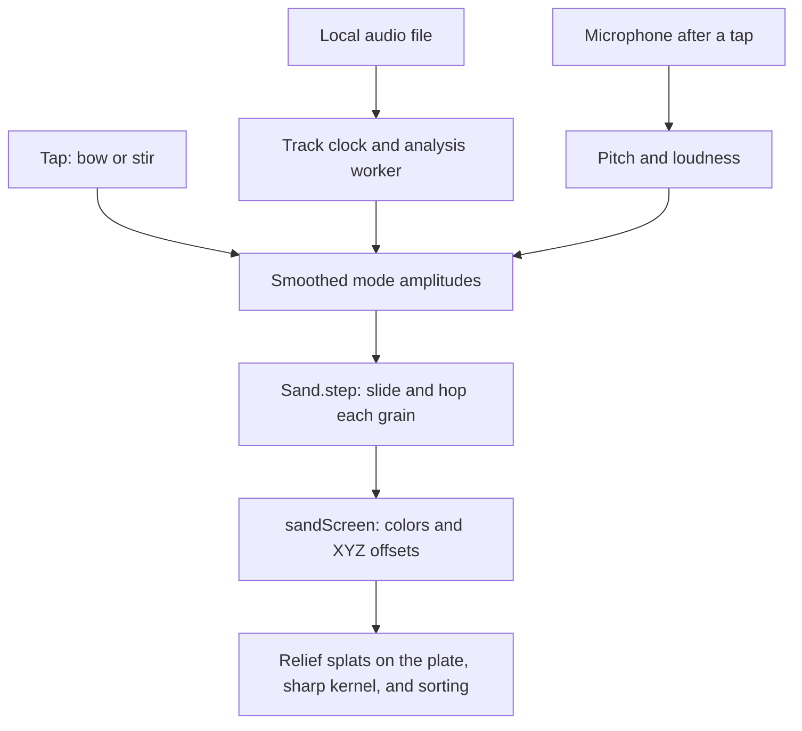

# Chladni plate checkpoint, October 14, 2026

This preserves the labs toy `chladni-plate` for Codex task 82c. Codex (GPT-6) prepared the
documentation and evidence without changing the toy.

## Where the checkpoint lives

| What                                | Where                               | Commit                                     |
| ----------------------------------- | ----------------------------------- | ------------------------------------------ |
| Whole repository                    | `claude/checkpoint-toys-2026-10-14` | `41b21e74e04ccca178b95ac02b4e5dc0e51b4b45` |
| Phone clips and measurement records | `codex/toy-checkpoints-c-clips`     | `b7c044e9c7da9d3481a8fa59b46a0a8dbd977fd8` |

Never push to, rebase, or delete the Operator's checkpoint branch. The clips branch must never be
merged.
[Saved source](https://github.com/ryanjosephkamp/splashery/tree/41b21e74e04ccca178b95ac02b4e5dc0e51b4b45).

[390×844 clip](https://github.com/ryanjosephkamp/splashery/blob/b7c044e9c7da9d3481a8fa59b46a0a8dbd977fd8/docs/audits/toy-checkpoints-c/chladni-plate.mp4)
shows scattered sand moving into the default 2, 3 (+) figure after a tap. The silent clip advances
the simulation at 10 frames per second; it does not measure phone speed. The
[evidence record](https://github.com/ryanjosephkamp/splashery/blob/b7c044e9c7da9d3481a8fa59b46a0a8dbd977fd8/docs/audits/toy-checkpoints-c/README.md)
includes capture instructions and the separate real-time measurements.

## How it works

A bowed plate vibrates, and sand gathers on its still lines. This is the physical experiment
described by
[Skrodzki, Reitebuch, and Polthier](https://www.mi.fu-berlin.de/en/math/groups/ag-geom/publications/db/2016_SRP_ChladniFiguresRevisited_APeekIntoTheThirdDimension.pdf).
Splashery computes idealized standing-wave patterns and moves grains toward their nodes. Its
particle motion is a numerical illustration, not a full elastic-plate or contact-mechanics solver.

The recipe is `CHLADNI`, exported by `RECIPES["chladni-plate"]` in `src/packs/studio.js`.
`src/toys.js` puts it behind labs and supplies yaw 0.2, pitch 0.95, and distance 4.1.
`tiltLock: false` and `pitchRange: [0.05, 1.35]` allow side and overhead views. There is no camera,
image, or remote-data input.



### Standing waves and moving sand

For normalized plate coordinates x and y from 0 to 1, `displacement()` evaluates:

```text
w(x,y) = cos(nπx) cos(mπy) + s cos(mπx) cos(nπy)
f_bow = 60 (n² + m²) Hz
f_voice = 15 (n² + m²) Hz
```

`s` is +1 or −1. The ideal nodal lines satisfy `w = 0`; `nodalDistance()` estimates distance as
`|w| / |∇w|`. The cosine construction is consistent with the Neumann standing-wave family in the
paper above. The factors 60 and 15 are the toy's choices, rather than a calibration to a specified
metal, plate dimensions, thickness, or clamp.

`CHLADNI.build()` makes the stand, post, plate, rim, bow, and one relief splat per grain. `Sand` in
`src/packs/chladni-sand.js` scatters `max(2500, min(10000, floor(k.count × 0.06)))` grains using the
Kit's seeded random generator. Each frame, `followDrive()` smooths mode amplitudes with an 80 ms
time constant, and `Sand.step()` moves the same grains from their current positions. It does not
rebuild the plate for each note.

The sand uses mean vibration energy `E = Σ a_m² w_m²`: it takes a short gradient/Newton-style step
toward lower E and a random hop whose size increases with vibration. The implementation uses
2,049-entry sine/cosine tables for indices through 4, a 40-step-per-second motion scale, bounded
movement, a small shaking floor, and edge clamps at 0.012 and 0.988. This is not a collision
simulation. Silence leaves the grains where they are.

With no audio or microphone, a tap bows for 3.6 simulated seconds; if `Sand.settled()` exceeds 0.6,
it instead stirs for 1.2 s. `chladniCue()` emits the selected mode's sine tone, an octave component,
and a sliding-sand sound, or a stirring hiss. `drive()` shows the bow only during that tap action
and moves the plate slightly while a mode rings. `settle()` and its twelve stored snapshots remain
for pure numerical tests; live rendering uses `Sand.step()`, not those snapshots.

### Files and microphone drive the modes

`openChladniAudio()` makes an object URL for a local file, starts `Track` and `SongAnalysis`, and
stops any active microphone. It accepts browser-readable audio up to 400,000,000 bytes. `Track`
plays the original file through an HTML audio element and the site's speaker control. Its `time()`
smooths the element clock and subtracts reported output latency. A muted speaker still allows the
picture to run.

`SongAnalysis.start()` measures a decoded mono copy at 44,100 Hz. MP3 decoding proceeds in roughly
30-second pieces; other formats decode whole. `song-worker.js` computes chunks of 50 frames,
prioritizing the playhead. `song-analysis.js` uses 40 ms feature intervals and a 4,096-sample Hann
FFT window, collecting 104 logarithmic bands, RMS loudness, and YIN pitch. The spectrum and pitch
methods are grounded in
[Smith's STFT explanation](https://ccrma.stanford.edu/~jos/sasp/Short_Time_Fourier_Transform.html)
and [de Cheveigné and Kawahara's YIN paper](https://pubmed.ncbi.nlm.nih.gov/12002874/).

`strongest()` chooses the fundamental when voiced, otherwise the loudest spectral band.
`fileDrive()` folds that frequency by whole octaves into 60–400 Hz with `foldHz()`. It maps RMS from
−54 to −24 dBFS to loudness 0 to 1. `modesFor()` weights each distinct mode frequency with
`loudness / (1 + (cents / 150)²)`, and discards amplitudes at or below 0.02. The chosen Mode
resolves the +/− pattern for its own n,m pair; other degenerate pairs use + when available. The
resonance is not normalized to full strength as it is in Sound in a box.

Use my microphone requests permission only on a tap through `start()` in `src/live/live.js`.
`startAnalyser()` in `src/live/mic.js` uses an `AnalyserNode`, a silenced capture worklet, and live
YIN `detectPitch()` from `src/live/analysis.js`. `singDrive()` uses the same pitch folding,
resonance, and loudness mapping. A microphone takes priority and pauses an opened file. Opening or
singing never displays the bow. A tap with an opened file plays or pauses it; without a file,
microphone input continues to drive the sand. Unlike Song landscape, the plate does not retain a
recording. No file or capture is uploaded.

### From grain positions to splats

`sandScreen.draw()` writes grain colors into the left half of a canvas atlas and RGB-encoded signed
XYZ offsets into the right half. X and Z are the grain's plate position; Y includes a
phase-dependent visible hop. The shader's relief axis 3 moves one splat per grain from a small rest
offset near the plate center. Grains are fully opaque. `drive()` asks for pose sorting roughly every
0.15 s during motion, and once when motion stops. `src/player.js`, `src/motion.js`,
`src/effects.js`, and `src/stage.js` connect recipe motion to the screen texture and rendering. The
density multiplier is 2, and the kernel is `sharp` (`src/kernels.js`).

### Every toy setting and control

| Setting or control                                | Default and effect                                                                                                                          |
| ------------------------------------------------- | ------------------------------------------------------------------------------------------------------------------------------------------- |
| Mode (`mode`)                                     | `2-3+`. Selects the bowed figure and its tone, and the sign for that pair during audio input. Changing it rebuilds with scattered sand.     |
| Sand colors (`colors`)                            | `sand`. Alternatives: `one`, `few`, and `flag`. A color-only rebuild preserves grain positions and steps when mode and count match.         |
| Color (`color`)                                   | `#2f7fd8`; used only for One color.                                                                                                         |
| Palette (`palette`)                               | `viridis`; used for A few colors. Choices: viridis, sunset, ocean, forest, candy, and rainbow.                                              |
| Flag (`flag`)                                     | `fr`; used only for A flag's colors. Colors and proportions come from the local flag image, not from drawing its symbols.                   |
| Tap / Bow the plate (`bow`)                       | Bows or stirs without input; plays or pauses an opened file. The microphone drives continuously while enabled.                              |
| Open your own audio                               | Replaces the input and analyzes it locally; accepted extensions include MP3, WAV, OGG, M4A, FLAC, AAC, and Opus, subject to browser codecs. |
| Start over, Play/Pause, seek, and Close the audio | `chladniTransport` controls the file, with controls drawn by `songTransport()`. Live/Whole is hidden for the plate.                         |
| Use / Stop my microphone                          | Starts or releases live capture; the status names the heard note and nearest voice-range mode.                                              |

| Mode id        | Bowed frequency (Hz) | Audio/microphone resonance (Hz) |
| -------------- | -------------------- | ------------------------------- |
| `1-2-`, `1-2+` | 300                  | 75                              |
| `1-3-`, `1-3+` | 600                  | 150                             |
| `2-3-`, `2-3+` | 780                  | 195                             |
| `1-4-`         | 1020                 | 255                             |
| `3-4+`         | 1500                 | 375                             |

`colorOptions()`, `paint()`, and `flagColors()` in `src/packs/chladni-colors.js` implement colors;
the plate has no height or center color option. Global speaker/volume controls affect sound, and
orbit, tilt, and zoom affect the view. Auto/High/Max detail and the labs Detail slider affect the
splat budget. Forced low tier requests 120,000 splats after density and tier clamping; explicit
clouds may emit fewer. Low-tier pixel ratio is capped at 1.5.

## The files that make it up

- Recipe and audio integration: `src/packs/studio.js`.
- Grain motion and colors: `src/packs/chladni-sand.js` and `src/packs/chladni-colors.js`.
- Shared audio: `src/packs/studio-audio.js`, `song-analysis.js`, `song-worker.js`, `song-stream.js`,
  `song-mp3.js`, and `song-record.js` in that directory.
- Other imports of `studio.js`: `src/packs/chladni-3d.js` and `src/packs/song-looks.js`; the pack
  also imports `src/live/relief.js` for Song landscape.
- Live input: `src/live/live.js`, `mic.js`, `analysis.js`, `capture-worklet.js`, and `panel.js` in
  that directory. Flag colors use `src/patterns.js`, `assets/flags/flags.json`, and the chosen SVG
  under `assets/flags/`.
- Shared rendering: `src/kit.js`, `src/noise.js`, `src/generators.js`, `src/player.js`,
  `src/motion.js`, `src/effects.js`, `src/stage.js`, `src/kernels.js`, `src/pc.js`, and
  `vendor/playcanvas/`. Shared UI and sound: `src/app.js`, `src/ui.js`, `src/sound.js`, and
  `src/voices.js`.
- Registry and explanation: its entries in `src/toys.js`, `src/toy-help.js`, `src/toy-sounds.js`,
  and `tools/toy-plan.json`, plus `CREDITS.md`. There is no required plate scan, external model, or
  pre-recorded audio asset.

`tests/sts.spec.mjs` checks mode frequency scaling, all eight nodal figures, build, and tap.
`tests/live.spec.mjs` and `tests/live3.spec.mjs` cover microphone motion and voice following;
`tests/live4.spec.mjs` covers file notes and transport. `tests/lv7.spec.mjs` defines the current
live-grain contract: no rebuild per note, bow only on tap, immediate note response, and held
positions on pause. `tests/lv8.spec.mjs` checks stand/rim geometry. `tests/lv10.spec.mjs` checks
colors and grain preservation. Shared contracts are also in `tests/live-engine.spec.mjs`,
`tests/live2-engine.spec.mjs`, and `tests/live2.spec.mjs`. Some historical test titles still mention
switching plates or re-sorting; read their assertions alongside the current live-grain tests.
Generated or fake microphone inputs are not recordings from a physical phone microphone.

## How to restore it

`studio.js` contains Song landscape too, so restoring this recipe restores that implementation at
the same time. Start from current main and restore its matching pack helpers:

```sh
git fetch origin main claude/checkpoint-toys-2026-10-14
git switch -c restore-chladni-plate origin/main
git checkout origin/claude/checkpoint-toys-2026-10-14 -- \
  src/packs/studio.js src/packs/chladni-sand.js src/packs/chladni-colors.js \
  src/packs/chladni-3d.js src/packs/song-looks.js src/packs/studio-audio.js \
  src/packs/song-analysis.js src/packs/song-worker.js src/packs/song-stream.js \
  src/packs/song-mp3.js src/packs/song-record.js
```

Confirm `git rev-parse origin/claude/checkpoint-toys-2026-10-14` matches the SHA above. The SHA can
replace the branch name in the checkout for an immutable restore. Review the resulting diff, and
recover only this toy's shared-list entries if its metadata or help changed.

Check **Song landscape and Sound in a box** after the restore, including their file clocks,
transport, tunes, and colors. Run the listed specs, compare the saved tap clip, and exercise note
changes, held notes, silence, microphone input, and all eight modes. If restoring `src/live/` to
resolve a capture regression, also check Room echo meter, Splat mirror, Moving photo to 3D, and
shared live-input permission/stop behavior. If a regression is in the Kit, renderer, or shaders,
restoring those shared files affects every kit toy and needs the full suite. Optional flag restores
affect flag and patterned toys too. Restore the Song landscape sample WAV if it changed along with
that recipe. Open a draft restore PR; never merge the saved checkpoint or evidence branch itself.

## What it does best, measurements, and known limits

Preserve the sharp nodal lines, each grain moving separately, a held note forming a figure, and a
new note moving those same grains onward. Silence and pause should hold the sand, and the bow should
appear only for a manual bow/stir action.

One observation on October 14, 2026: Chromium 151.0.7922.173 on cloud Linux, WebGL2 with ANGLE
SwiftShader, 390×844 viewport, device pixel ratio 1, `profile=low`, and `adapt=off`. The normal UI
left a 390×645 drawing canvas. The browser context was fresh; the starter toy loaded before
selecting this toy. Sound was off, input was the default, and there was no CPU throttling. Load
figures are local-server timings, not Internet load times. Frame rate counts `stage.frames` during
roughly three wall-clock seconds after the action, rather than scheduled animation callbacks. This
single sample has no statistical or physical-phone claim.

| Measure                                                                | Observed value            |
| ---------------------------------------------------------------------- | ------------------------- |
| Starter page ready                                                     | 2.843 s                   |
| Selection through `app.chooseToy()`                                    | 0.488 s                   |
| Requested low-tier budget / emitted splats                             | 120,000 / 51,398          |
| Drawn frames / wall-clock window                                       | 18 / 3.009 s              |
| Draw rate during the action                                            | 6.0 frames/s              |
| Encoded response bodies beginning after selection, through observation | 612,191 bytes (597.8 KiB) |
| Page errors during the measurement                                     | None                      |

The response total includes shared pack modules and any overlapping page requests; it is not an
exclusive toy download size. Full resource names and states are in the
[measurement JSON](https://github.com/ryanjosephkamp/splashery/blob/b7c044e9c7da9d3481a8fa59b46a0a8dbd977fd8/docs/audits/toy-checkpoints-c/measurements.json).

The low-tier build had 7,200 moving grains; emitted count includes the stand, plate, rim, and bow.
The code clamps simulation dt, so drawn frames per second and modeled settling speed should be
compared separately.

The displacement field is idealized, the frequency constants are selected, and the sand is a
gradient-and-random-hop model. It omits elastic boundary/clamp details, individual collisions, grain
friction, and a physical bow force. Atlas offsets have 8-bit precision. `drive()` caps dt at 0.1 s;
on a very slow renderer, visual settling can take longer than the modeled timeline. Pitch following
reduces polyphonic audio to one pitch or loudest band, and its octave folding does not retain the
original register. File decoding depends on the browser, and a 400 MB file can require much more
decoded memory. A real microphone in a noisy room was not measured here.

Later work could offer calibrated plate materials and boundaries, more accurate grain contacts, and
better polyphonic or low-SNR input. Keep the current default figure, color behavior, and
pause/no-rebuild contracts. Compare every mode and the input transitions against this checkpoint,
with side-by-side phone clips, before keeping a change.

Every later task must compare itself with this checkpoint, keep every protected behavior at least as
good, and improve its target measure. Revert a change that makes a checkpoint behavior worse;
compare the clips beside each other before keeping it.

Rule check: none.
