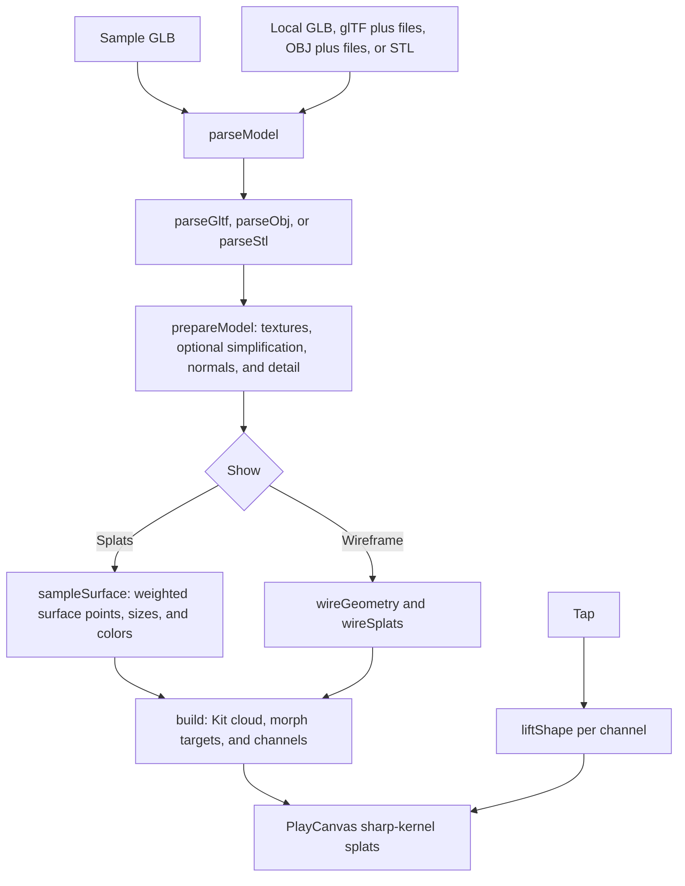

# Model to splats checkpoint, October 14, 2026

This preserves `model-splats` at the shared toy checkpoint. It converts a triangle mesh into
surface-aligned splats on the device, with texture/material colors, detail-aware sampling, a
wireframe view, and a tap that lifts and restores each splat. It is a deterministic surface
conversion, with no learned depth or training.

## Where the checkpoint lives

| What                                          | Where                                                                                                                                                                   | Commit                                     |
| --------------------------------------------- | ----------------------------------------------------------------------------------------------------------------------------------------------------------------------- | ------------------------------------------ |
| Whole repository                              | `claude/checkpoint-toys-2026-10-14`                                                                                                                                     | `41b21e74e04ccca178b95ac02b4e5dc0e51b4b45` |
| Phone clips, measurements, and capture script | [`codex/toy-checkpoints-b-clips`](https://github.com/ryanjosephkamp/splashery/tree/64ac873c03d84c05c10a8e291682d002282e7ba7/docs/evidence/toy-checkpoints-b-2026-10-14) | `64ac873c03d84c05c10a8e291682d002282e7ba7` |

Never push to, rebase, or delete the shared checkpoint branch. The clips branch is evidence only and
must never be merged.
[Phone clip](https://github.com/ryanjosephkamp/splashery/blob/64ac873c03d84c05c10a8e291682d002282e7ba7/docs/evidence/toy-checkpoints-b-2026-10-14/model-splats-390x844.mp4)
shows the Burger sample, Lift off, settling, and a small turn. The sample's
[Food Kit source](https://kenney.nl/assets/food-kit) was opened for this task; the other sample
credits remain the repository's existing records.

## How it works

The recipe is `MODEL_SPLATS`, exported as `RECIPES["model-splats"]` in
[`src/packs/studio-models.js`](../../src/packs/studio-models.js). The parser and converter are in
[`src/packs/studio-models-core.js`](../../src/packs/studio-models-core.js), also used by the
build-time `tools/model-to-splats.mjs`.



1. **Pick files.** The multiple-file input accepts GLB, glTF, OBJ, STL, and supporting BIN, MTL, and
   image files. It selects the main model in priority order GLB/glTF/OBJ/STL and supplies the other
   bytes by file name. `openModel()` calls `parseModel()` and `prepareModel()`; no camera,
   microphone, inference model, or upload is involved. `loadSample()` follows the same path for a
   bundled GLB and caches prepared samples.
2. **Read triangles and attributes.** `modelFormat()` dispatches to `parseGltf()`, `parseObj()`, or
   `parseStl()`. glTF 2.0/GLB parsing applies node transforms and normal transforms, reads indexed
   or unindexed triangles, strips, and fans, UV sets, vertex colors, and supported base-color
   material data. OBJ reads polygons, normals, UVs, MTL colors, and textures; STL accepts binary or
   ASCII triangles. Missing glTF dependencies produce `NeedsFilesError`; missing OBJ material data
   can fall back with notes. The
   [glTF 2.0 specification](https://raw.githubusercontent.com/KhronosGroup/glTF/main/specification/2.0/Specification.adoc)
   defines the input's transforms, attributes, color spaces, materials, and samplers. This custom
   reader supports a subset, not every glTF feature.
3. **Prepare geometry and textures.** `decodeImage()` uses browser decoding and caps the longest
   texture side at 2,048. `mipChain()` and `sampleMip()` provide filtered texture color with wrap
   modes and supported texture transforms. `prepareModel()` drops degenerate and sufficiently
   transparent faces, calculates triangle areas and normals, and builds detail weights. Above 1.25
   times the simplification target, `simplifyMesh()` uses vertex clustering and bakes texture color
   into vertices. This can lose geometric and texture detail; the target is not a fidelity guarantee
   or strict final triangle count.
4. **Detail and creases.** For at most 450,000 prepared triangles, `weld()` connects coincident
   vertices and adjacency identifies creases. The hard crease threshold is 32 degrees;
   open/nonmanifold edges are also marked hard. Weight increases with bending and with triangles
   small relative to the median. Normals use supplied data or smoothing across suitable neighbors.
   Above the adjacency cap, the detailed adjacency/crease pass is omitted.
5. **Surface samples.** `sampleSurface()` allocates points by triangle area times detail weight,
   with seeded fractional rounding. Within a triangle, shifted low-discrepancy `(u,v)` pairs are
   reflected if `u+v>1`, then placed at `(1−u−v)A + uB + vC`. These are
   [barycentric coordinates](https://mathworld.wolfram.com/BarycentricCoordinates.html). The point
   stays on its triangle; this is not volumetric reconstruction. `neighborSizes()` estimates spacing
   to nearby same-surface points through a spatial grid. `FILL = 1.05` promotes overlap, and points
   beside crease edges shrink to at least 80% of their original size.
6. **Color and placement.** Color comes from the sampled base-color texture, vertex colors, and
   material factor, respecting supported alpha masks. sRGB/linear conversions are handled
   explicitly. Optional soft lighting is baked from the normal, with `LIGHT_SOFT = 0.22`, rather
   than a live physical lighting model. `placement()` rotates Z-up to Y-up with `(x,y,z)→(x,z,−y)`,
   centers the bounds, and scales by their enclosing sphere radius. Surface splats use opacity 0.97
   and flatness 0.14, oriented along the normals.
7. **Wireframe.** `wireGeometry()` derives mesh edges and can cluster a dense mesh to a maximum of
   1,800 edges. `wireSplats()` distributes elongated splats along edges plus corner marks; hard
   edges are gold and other edges cyan. It is a simplified splat visualization of the mesh's edges,
   not a triangle mesh renderer.
8. **Rendering and motion.** `build()` uses about 98% of the Kit budget, cached by prepared model,
   count, up axis, and lighting. `k.cloud()` emits the splats for PlayCanvas, using density 1.5 and
   the sharp kernel. Every sample gets its own deterministic loose-cloud target, primarily outward
   along its normal, and a channel based on height. `drive()` applies `liftShape()` to four
   channels: smooth rise, brief hold, and smooth return, with 0.05 channel staggering. Each point
   returns to its original position; no joints, skinning, or model animation is reconstructed.

### Every toy setting

| Control or saved key         | Default       | What changes                                                                                    |
| ---------------------------- | ------------- | ----------------------------------------------------------------------------------------------- |
| Model, `source`              | `burger`      | Burger, vase, camera, boombox, lantern, whale statue, rocking chair, or a local `custom` model. |
| Show, `show`                 | `splats`      | Surface splats or simplified wireframe splats.                                                  |
| Up is, `up`                  | `auto`        | Automatic chooses Z for STL and Y otherwise; explicit Y or Z changes rotation and fit.          |
| Soft light baked in, `light` | `true`        | Toggles normal-based shading during surface conversion; does not add live lighting.             |
| Lift off, `lift`             | Pulse at rest | Tap starts the four-channel lift-and-settle morph, with easing 3.2.                             |
| `modelName`                  | Empty, hidden | Local model display name; does not hold the model bytes.                                        |

Shared Detail/profile changes the splat budget: low/mid/high/max recipe budgets are
90,000/210,000/300,000/400,000, before the recipe's 98% allocation and sampling rounding/cuts.
Shared Speed changes motion timing, and orbit/zoom changes the view. Scene JSON saves choices, not a
custom model; reopen the same model and supporting files. Saving splats exports the converted cloud,
not the original mesh, texture files, or its unsupported animation.

### File and geometry limits

`modelLimits()` tests coarse pointer, screen size, and reported device memory. The limits below are
decimal bytes and triangle counts, not promised memory use:

| Detected device                 | Input cap | Triangle cap | Simplification target |
| ------------------------------- | --------: | -----------: | --------------------: |
| Phone reporting at most 3 GB    |    120 MB |    6,000,000 |               400,000 |
| Other phone                     |    250 MB |   12,000,000 |               400,000 |
| Computer reporting at most 4 GB |    300 MB |   15,000,000 |             1,200,000 |
| Other computer                  |    600 MB |   40,000,000 |             1,200,000 |

Unknown device memory uses the ordinary branch. The input panel in `src/ui.js` uses the `maxBytes`
callback to check the sum of all selected file sizes, and parsing enforces the triangle limit. The
progress line reports summed selected bytes; that is not a measurement of peak tab memory. Large
parsing/preparation steps still run on the main thread, despite `breathe()` yielding between major
steps.

## The files that make it up

| Layer                 | Files at the checkpoint                                                                                                                                                                                                     |
| --------------------- | --------------------------------------------------------------------------------------------------------------------------------------------------------------------------------------------------------------------------- |
| Recipe and conversion | `src/packs/studio-models.js` and `src/packs/studio-models-core.js`                                                                                                                                                          |
| Sample GLBs           | Entire `assets/toys/model-splats/`; filenames and credits in `SAMPLES`, `tools/assets.json`, and `CREDITS.md`                                                                                                               |
| Registration and help | This toy's entries in `src/toys.js`, `src/toy-help.js`, and `src/toy-sounds.js`                                                                                                                                             |
| Shared engine/input   | `src/app.js`, `src/ui.js`, `src/player.js`, `src/kit.js`, `src/generators.js`, `src/motion.js`, `src/effects.js`, `src/kernels.js`, `src/stage.js`, `src/camera.js`, `src/exports.js`, `src/pc.js`, and vendored PlayCanvas |
| Build tools           | `tools/model-to-splats.mjs`, `tools/stm-samples.mjs`, and `tools/stm-fixtures.mjs`; Node image decoders from pinned devDependencies, not page dependencies                                                                  |

Tests: `tests/stm.spec.mjs` checks formats, missing files, surface coverage, texture/material
colors, budgets, creases, up axis, wireframe, CLI export, tap targets, and browser file opening.
`tests/stm-engine.spec.mjs` checks multiple-file input. `tests/smd-models.spec.mjs` covers the finer
model display. `tests/ui5.spec.mjs` checks large-model limits, phone caps, simplification, and
progress; `tests/ui5-engine.spec.mjs` checks the recipe's own file cap. Fixtures live under
`tests/fixtures/stm/`. Shared Space recipes also use this converter and decoder through
`src/packs/space-r2.js`.

## How to restore it

From a clean checkout, verify the fetched hash against the full checkpoint above:

```sh
git fetch origin main
git fetch origin refs/heads/claude/checkpoint-toys-2026-10-14:refs/remotes/origin/claude/checkpoint-toys-2026-10-14
git rev-parse origin/claude/checkpoint-toys-2026-10-14
git switch -c restore-model-splats origin/main
git checkout origin/claude/checkpoint-toys-2026-10-14 -- \
  src/packs/studio-models.js src/packs/studio-models-core.js assets/toys/model-splats \
  tools/model-to-splats.mjs tools/stm-samples.mjs tools/stm-fixtures.mjs \
  tests/stm.spec.mjs tests/ui5.spec.mjs tests/ui5-engine.spec.mjs \
  tests/stm-engine.spec.mjs tests/smd-models.spec.mjs tests/fixtures/stm
git diff --cached --stat
```

The restore is a future procedure; this documentation task does not change tests or tools. Check
**Space toys using `src/packs/space-r2.js`** after converter or decoder changes: **Saturn V
(`saturn-v`), SLS (`sls`), and Space shuttle (`space-shuttle`)** share these helpers. Find the exact
current callers with `rg 'studio-models' src`, and run `tests/sp2.spec.mjs` plus their applicable
Space specs too. Shared input/renderer changes require checking other file-opening and Kit toys; do
not reset those engine files automatically. Copy only this toy's entries from shared catalogs and
credit records. For a complete exact reproduction, use
`git worktree add --detach /tmp/splashery-model-checkpoint 41b21e74e04ccca178b95ac02b4e5dc0e51b4b45`.

Run the five named model and UI test files with `SPLASHERY_CHROMIUM=<existing Chromium>`. Compare
all seven samples, all three formats, loose multi-file models, both Show modes, both up axes,
lighting on/off, file rejection, and the full lift/return at phone and desktop sizes before opening
a draft PR.

## What it does best, measured limits, and later rounds

The strong point is conversion of known mesh geometry with fine surface color, crisp creases, and a
deterministic reversible tap. It does not need a large model download, a trainer, or WebGPU.
Unsupported features include Draco and meshopt compression, morph targets, skinning, animation,
lights, cameras, emissive color, and textures other than supported base color. A skinned model shows
unanimated mesh geometry. Very transparent material is omitted, not rendered as glass.
Simplification and the wireframe edge cap lose detail; surface splats can still show gaps or
overlaps under close inspection.

| Measure                                 | Observed result                |
| --------------------------------------- | ------------------------------ |
| Toy selection to ready                  | 4.93 s                         |
| Rendered frames in measured window      | 15 in 6.003 s                  |
| Rendered rate                           | 2.50 fps                       |
| Median / 95th-percentile frame interval | 376.9 / 452.9 ms               |
| Viewport / stage drawing buffer         | 390×844 / 390×645              |
| Sample mesh / displayed splats          | 294 triangles / 202,712 splats |
| Sample GLB size                         | 42,364 bytes                   |
| Page-script errors in capture           | 0                              |

This is one unthrottled cloud run at 390×844 with touch/mobile browser identity, DPR 1, forced mid
profile, and WebGL2/SwiftShader. Readiness starts at `chooseToy()` after the shell is ready. Render
rate counts `postrender` events over six seconds before clip capture, with a forced render window
for the resting sample. It measures software rendering, not physical-phone performance. Resource
body totals include main-document page-shell entries and are not total wire transfer. Large-file
conversion time, peak memory, and every sample's performance were not measured; the published caps
are code limits, not successful stress tests.

Later rounds should measure real-phone conversion pauses and memory, close-up coverage across folds,
large-mesh simplification losses, and wireframe readability. A worker-based converter could improve
responsiveness without changing the supported formats. Every later change must compare all samples
and fixture formats with this checkpoint, preserve stable colors and return targets, and keep a
change only when it is at least as good on every measure.
