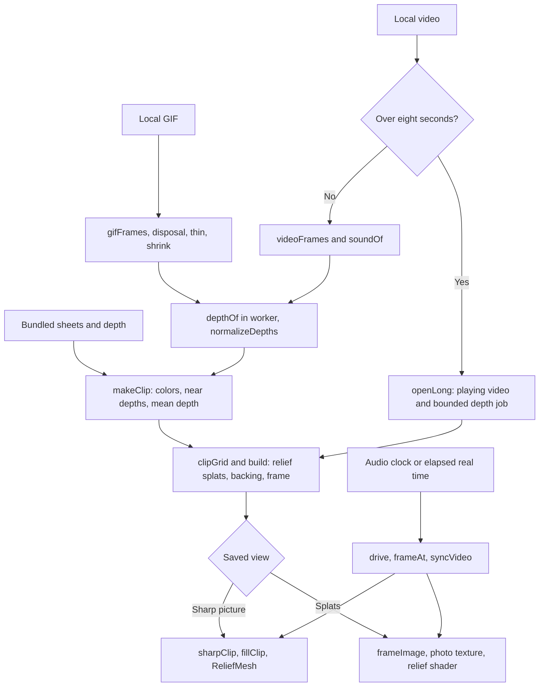

# Moving photo to 3D checkpoint, October 14, 2026

This preserves `moving-photo-3d` as it exists at the shared toy checkpoint. It plays a GIF or video
on a changing relief, with estimated relative depth. The default **Sharp picture** view is a
textured mesh; **Splats** is the alternate rendering. It does not reconstruct the back of objects or
a navigable room from the clip.

## Where the checkpoint lives

| What                                          | Where                                                                                                                                                                   | Commit                                     |
| --------------------------------------------- | ----------------------------------------------------------------------------------------------------------------------------------------------------------------------- | ------------------------------------------ |
| Whole repository                              | `claude/checkpoint-toys-2026-10-14`                                                                                                                                     | `41b21e74e04ccca178b95ac02b4e5dc0e51b4b45` |
| Phone clips, measurements, and capture script | [`codex/toy-checkpoints-b-clips`](https://github.com/ryanjosephkamp/splashery/tree/64ac873c03d84c05c10a8e291682d002282e7ba7/docs/evidence/toy-checkpoints-b-2026-10-14) | `64ac873c03d84c05c10a8e291682d002282e7ba7` |

Never push to, rebase, or delete the shared checkpoint branch. The clips branch is evidence only and
must never be merged.
[Phone clip](https://github.com/ryanjosephkamp/splashery/blob/64ac873c03d84c05c10a8e291682d002282e7ba7/docs/evidence/toy-checkpoints-b-2026-10-14/moving-photo-3d-390x844.mp4)
shows the default six-second sample playing in Sharp picture, then a small turn.

## How it works

The recipe is `MOVING_PHOTO` in [`src/packs/moving-photo.js`](../../src/packs/moving-photo.js),
exported by `RECIPES` in [`src/packs/live.js`](../../src/packs/live.js).



1. **Bundled input.** `loadSample()` decodes JPEG contact sheets with `photo-3d.js::decodePhoto()`,
   slices them with `sheetFrames()`, and reads the packed depth with `unpackDepths()` and
   `photo-3d.js::unpackDepth()`. The current bunny sample is **96 frames at 16 fps**, across
   **seven** sheets, at 640×360; low and mid profiles use 480×270 color/depth frames. Older comments
   mentioning 48 frames or four sheets do not describe this checkpoint. The other sample IDs are
   `horse`, `dragon`, `bridge`, and `machine`. Credits and source records are in `SAMPLES`,
   `CREDITS.md`, and `tools/assets.json`; they were not independently revalidated for this
   documentation task.
2. **Short local files.** `openClip()` accepts a GIF or browser-playable video, capped by the input
   panel at 200,000,000 bytes. `gifFrames()` lazy-loads vendored omggif, composites disposal modes 2
   and 3, and treats a zero- or one-hundredth-second delay as 100 ms. A GIF keeps its first eight
   seconds; `thin()` adds skipped delays so thinning preserves elapsed time. Short videos use
   `videoFrames()` and keep sound plus a muted video copy. `shrink()` averages pixel boxes,
   composites transparent GIF pixels over white, and preserves aspect.
3. **Estimated depth.** `depthOf()` sends evenly spaced frames, including both ends, to
   `src/live/depth-worker.js`. Missing frames linearly blend their two estimated neighbors.
   `createDepthEngine()` in `src/depth/engine.js` loads the quantized Depth Anything V2 Small model
   and ONNX Runtime WASM from this site, packs normalized RGB into a `[1,3,h,w]` tensor, and returns
   relative depth. The frame dimensions are multiples of 14. This checkpoint uses **WASM**, not a
   WebGPU depth provider. [Depth Anything V2](https://depth-anything-v2.github.io/) explains the
   model family; the percentile normalization, sampling, and display filters here are Splashery's
   own code.
4. **Depth to relief.** `normalizeDepths()` maps the second and 98th percentiles to far/near,
   averaging ranges over up to five neighboring frames. Its optional `guidedDepth()` path is not
   enabled by the normal short-clip callers. `makeClip()` calls `sharpenEdges()` to choose one side
   of a depth jump in a 5×5 neighborhood, quantizes nearness to bytes, and stores each pixel's mean
   depth. For a normalized depth `d`, the picture rises by `0.9 × depth × d` recipe units; it has no
   calibration in meters.
5. **Splats.** `clipGrid()` limits foreground cells to the smaller of the frame's pixel count and
   roughly 80% of the recipe budget. `build()` places each splat at its mean depth; `frameImage()`
   encodes the current signed difference from that mean in the screen texture. Relief axis 3 in
   `src/effects.js` applies it. `splatSizes()` sizes discs from same-surface neighbors, with a
   1.7-cell cap and smaller discs beside cuts. A coarser backing and a dark frame close the sides.
   Fine Detail uses `src/photo-splats.js` to sample the clip's own pixels across each splat, while
   one-color Detail uses the sharpened grid colors (`SHARPEN = 0.6`). The recipe uses density 1.5
   and the sharp kernel.
6. **Sharp picture.** `sharpClip()`, `sharpDrive()`, and `fillClip()` in `src/packs/photo-sharp.js`
   feed `ReliefMesh` in `src/live/relief-mesh.js`. It uploads color directly from a playing video
   when available and depth from the same clip. The mesh has a backing and frame, with depth-edge
   guards; the splat entity is hidden while the mesh is visible. Grid-cell budgets are
   60,000/120,000/200,000/300,000 for low/mid/high/max. Splat-editing tools, Hands-on, and Look
   effects temporarily require the splat view.
7. **Long local videos.** `openLong()` plays the entire video after its first four depth results.
   `longDepth()` continues seeking a second copy and filling a bounded array; `longFrame()` and
   `nearAt()` interpolate available depth, while color follows the playing copy. Depth memory
   budgets are 24/48/96/160 million bytes, with target depth rates of 1/2/3/4 per second and color
   areas of 72,000/168,000/240,000/320,000 pixels. Cancel stops further depth work and keeps the
   depth already available. These budgets do not include video decoder, model, splat, color, or mesh
   memory.
8. **Playback.** `drive()` follows `Track`'s audio clock when sound plays, or elapsed real time when
   silent. `frameAt()` honors individual frame delays; `syncVideo()` keeps the muted copy in step.
   `movingTransport` handles pause, resume, seek, and start over. Changing toys pauses the old sound
   and video; replacing a custom clip calls `closeClip()` to cancel its job and release URLs. No
   camera or microphone is requested by this toy, and no file is uploaded.

### Every toy setting

| Control or saved key           | Default                     | What changes                                                                                |
| ------------------------------ | --------------------------- | ------------------------------------------------------------------------------------------- |
| Depth, `depth`                 | 0.6                         | 0–1 in steps of 0.05; relief height, also controlled over the stage.                        |
| Clip, `clip`                   | `sample`                    | One of the five bundled clips or `custom`; selects the data rebuilt.                        |
| Show the original, `original`  | `off`                       | Adds a synchronized flat comparison card.                                                   |
| Detail, `detail`               | `photo`                     | Fine photo-textured splats or `splats`, one color per splat; separate from the view switch. |
| Sharp picture / Splats, `view` | `sharp` when absent         | Changes the renderer without rebuilding; saved in scene JSON and share links.               |
| Play, `play`                   | 1                           | Tap or transport pauses/resumes picture and sound together.                                 |
| Speed, `scene.motion.speed`    | 0.5                         | `speedRate(s) = 0.25 + 1.5s`: 0.25× to 1.75×, with sound in step.                           |
| Transport                      | Current position            | Scrub or Start over updates picture and audio time.                                         |
| Cancel the depth               | Only during long-video work | Cancels additional estimates; does not discard the playing video.                           |
| `clipName`                     | Empty, hidden               | Display name for a local clip; does not contain the file.                                   |

Shared Detail/profile selection changes splat and mesh budgets. The speaker controls audibility, and
orbit/zoom changes the view. For short **custom** clips, the limits are:

| Profile | Color area, pixels | Maximum color fps | Maximum estimated depth frames | Depth long side |
| ------- | -----------------: | ----------------: | -----------------------------: | --------------: |
| Low     |             60,000 |                12 |                             24 |             196 |
| Mid     |            140,000 |                15 |                             32 |             196 |
| High    |            200,000 |                24 |                             48 |             294 |
| Max     |            230,400 |                24 |                             48 |             294 |

Bundled samples keep their own frame timing. Scene saves retain settings, not a custom GIF/video;
reopen that file. Splat exports capture the cloud, without its video texture, playback, audio, or
Sharp picture mesh. Picture/video exports capture the displayed view.

## The files that make it up

| Layer                      | Files at the checkpoint                                                                                                                                                                                                     |
| -------------------------- | --------------------------------------------------------------------------------------------------------------------------------------------------------------------------------------------------------------------------- |
| Recipe and registration    | `src/packs/moving-photo.js`, its entry in `src/packs/live.js`, and its entries in `src/toys.js`, `src/toy-help.js`, and `src/toy-sounds.js`                                                                                 |
| Playback and comparison    | `src/packs/song-record.js`, `src/packs/song-stream.js`, `src/packs/song-analysis.js`, `src/packs/song-mp3.js`, and `src/compare.js`                                                                                         |
| Photo/relief support       | `src/packs/photo-3d.js`, `src/packs/photo-3d-core.js`, `src/packs/photo-sharp.js`, `src/photo3d/`, `src/photo-splats.js`, and `src/live/relief*.js`                                                                         |
| Inference and GIF decoding | `src/live/depth-worker.js`, `src/depth/`, `vendor/depth-anything-v2-small/`, `vendor/onnxruntime-web/`, and `vendor/omggif/`                                                                                                |
| Samples                    | `assets/toys/moving-photo-3d/`, `assets/toys/screen/bunny.mp4`, `assets/toys/screen/bunny.webm`, and `assets/toys/screen/horse.gif`; records in `tools/assets.json` and `CREDITS.md`                                        |
| Shared engine              | `src/app.js`, `src/ui.js`, `src/player.js`, `src/kit.js`, `src/generators.js`, `src/motion.js`, `src/effects.js`, `src/kernels.js`, `src/stage.js`, `src/camera.js`, `src/exports.js`, `src/pc.js`, and vendored PlayCanvas |

Behavior is defined by `tests/live3.spec.mjs` (sample and custom GIF), `tests/live5.spec.mjs` and
`tests/live6.spec.mjs` (sound clock, timing, pause, and scrub), `tests/lv7-long.spec.mjs`
(long-video budget, playback, and cancellation), `tests/phf*.spec.mjs` (photo-textured splats),
`tests/psv*.spec.mjs` (Sharp view, saved view, rebuilds, and loops), `tests/smd-moving.spec.mjs`
(detail and speed), `tests/lv8-dial.spec.mjs` (stage Depth), and `tests/cdx-depth*.spec.mjs` (shared
depth engine). `tools/live3-depth.mjs` generates sample depth; it is a build tool.

## How to restore it

Start from a clean checkout. Fetch the saved branch into an explicit remote ref, verify the full
hash above, and restore on a new review branch:

```sh
git fetch origin main
git fetch origin refs/heads/claude/checkpoint-toys-2026-10-14:refs/remotes/origin/claude/checkpoint-toys-2026-10-14
git rev-parse origin/claude/checkpoint-toys-2026-10-14
git switch -c restore-moving-photo-3d origin/main
git checkout origin/claude/checkpoint-toys-2026-10-14 -- \
  src/packs/moving-photo.js src/packs/live.js \
  src/packs/photo-3d.js src/packs/photo-3d-core.js src/packs/photo-sharp.js \
  src/packs/song-record.js src/packs/song-stream.js src/packs/song-analysis.js src/packs/song-mp3.js \
  src/live/relief.js src/live/relief-mesh.js src/live/relief-height.js \
  src/live/depth-worker.js src/depth src/photo3d src/photo-splats.js src/compare.js \
  assets/toys/moving-photo-3d assets/toys/screen/bunny.mp4 assets/toys/screen/bunny.webm \
  assets/toys/screen/horse.gif vendor/omggif vendor/depth-anything-v2-small vendor/onnxruntime-web
git diff --cached --stat
```

This also rolls back shared photo, audio, comparison, and live-pack modules. Check **Photo to 3D,
Splat mirror, Room echo, Song landscape, the Chladni audio inputs, Screen, and other toys using
Compare**. Copy only this toy's changed entries from shared catalogs and credit records, preserving
other toys' later entries. Do not reset the whole engine or shared catalogs as part of a targeted
restore. If their interfaces have changed, compare the checkpoint copies listed above and review the
needed changes separately. For an exact complete reproduction, use
`git worktree add --detach /tmp/splashery-moving-checkpoint 41b21e74e04ccca178b95ac02b4e5dc0e51b4b45`.

Run the behavior tests listed above using `SPLASHERY_CHROMIUM=<existing Chromium>`; compare their
checkpoint copies if assertions changed. Check every bundled clip, a short GIF, a short video with
sound, a long video, both views, pause/resume, scrubbing, speed extremes, cancellation, and saved
scenes before opening a draft PR.

## What it does best, measured limits, and later rounds

The strongest feature is the sharp, synchronized picture on a turnable relief: bundled clips open
without loading the depth model, and long local videos begin before all their depth is ready. Colors
can move at video speed even when depth updates less often. Hidden surfaces are approximated by
backing colors; fast motion, scene cuts, thin shapes, and large side views can expose guessed depth
or stretched color. A long video's depth can lag playback. Model and decoder memory remain outside
the long-depth budget.

| Measure                                 | Observed result                            |
| --------------------------------------- | ------------------------------------------ |
| Toy selection to ready                  | 10.38 s                                    |
| Rendered frames in measured window      | 41 in 6.000 s                              |
| Rendered rate                           | 6.83 fps                                   |
| Median / 95th-percentile frame interval | 143.4 / 184.7 ms                           |
| Viewport / stage drawing buffer         | 390×844 / 390×645                          |
| Clip depth/color frames                 | 96 at 480×270; color video texture 640×360 |
| Sharp mesh grid / triangles             | 462×260 / 250,608 including backing        |
| Estimated mesh/texture GPU cost         | 5,879,832 bytes (5.88 MB)                  |

The measurement is one unthrottled cloud run at a 390×844 touch/mobile viewport, DPR 1, forced mid
profile, and WebGL2 with SwiftShader. It is not a physical-phone benchmark. Readiness starts at
`chooseToy()` after the page shell is ready; the render rate counts `postrender` events over six
seconds before capture. Resource body sizes in the evidence cover main-document resource timing
entries, including the page shell; they are not total wire transfer and omit worker downloads. The
mesh cost is `ReliefMesh.cost()`'s estimate, not total tab or GPU memory. Only the default sample's
display was measured; custom inference and long-video completion time were not measured.

Later rounds should measure temporal depth errors on moving edges and scene cuts, reduce duplicate
short-clip color storage, and compare video-texture versus per-frame splat cost on actual phones.
Every later change must compare all samples and the behavior checklist with this checkpoint,
preserve saved-view and audio timing behavior, and keep a change only when it is at least as good on
every measure.
