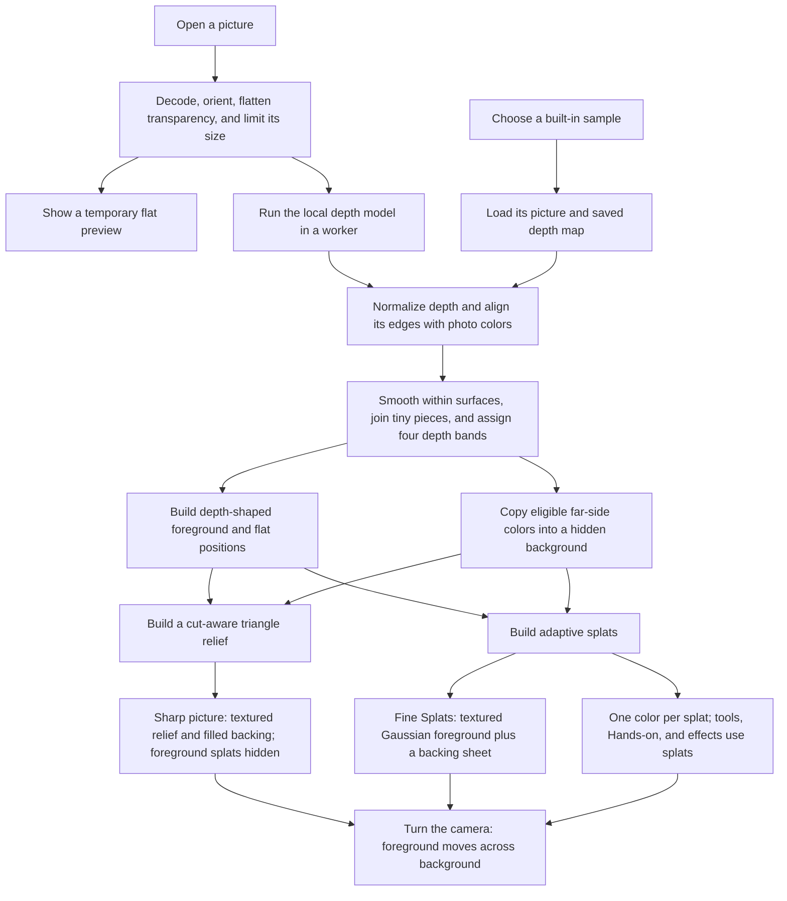
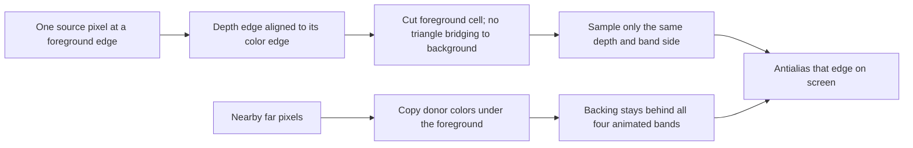

# Photo to 3D, explained from the code

Written by Codex (GPT-6) for task 74, October 14, 2026. Rule check: none. This is a report; no
application code, model, setting, or sample changed. Code citations refer to repository commit
`e404cf36b60e7509f2cabc21dcd0f9f076fa8ef4`. The protected
[Photo to 3D checkpoint](photo-3d-checkpoint.md) remains the restoration reference.

Photo to 3D makes a photograph into a shallow, movable relief: each part of the picture is placed
nearer or farther away according to an estimated depth. Its default **Sharp picture** view puts the
photo itself on a triangle surface. It also builds an editable splat version. Sharp picture hides
that splat entity while drawing the relief; the two foregrounds are not drawn on top of each other.
This distinction explains much of the crisp appearance.
([src/packs/photo-3d-core.js:435](../../src/packs/photo-3d-core.js#L435),
[src/packs/photo-sharp.js:203](../../src/packs/photo-sharp.js#L203),
[src/packs/photo-sharp.js:345](../../src/packs/photo-sharp.js#L345))

## The words, without prerequisites

**Depth** here is a guess about which picture pixels are nearer. The model returns relative inverse
depth, also called disparity: larger values mean nearer. The converter stretches that guess into a
useful range and maps it to a height above or below the picture. It does not recover distances in
feet or meters. **A mesh** is a surface made from triangles. **A splat** is a small colored patch
with a position, size, opacity, and orientation. This converter places splats algorithmically; it
does not train a new Gaussian scene from the photograph.
([src/packs/photo-3d-core.js:8](../../src/packs/photo-3d-core.js#L8),
[src/packs/photo-3d-core.js:153](../../src/packs/photo-3d-core.js#L153),
[src/photo3d/surface.js:3](../../src/photo3d/surface.js#L3),
[src/packs/photo-3d.js:836](../../src/packs/photo-3d.js#L836))

## The complete route

The arrows are explained and sourced in the numbered steps below. A sample bypasses inference, but
uses the same conversion afterward. ([src/packs/photo-3d.js:514](../../src/packs/photo-3d.js#L514),
[src/packs/photo-3d.js:751](../../src/packs/photo-3d.js#L751))

1. **Read the picture locally.** The browser decodes the image and honors its orientation tag. The
   long side is capped at 2,048 pixels, keeping its aspect ratio, and transparent pixels are
   composited onto white. Where supported, an OffscreenCanvas worker does that work; a window
   decoder is the fallback. The preview is a temporary image over the stage, not evidence that depth
   inference has finished. ([src/packs/photo-3d.js:412](../../src/packs/photo-3d.js#L412),
   [src/packs/photo-3d.js:416](../../src/packs/photo-3d.js#L416),
   [src/photo3d/decode-worker.js:28](../../src/photo3d/decode-worker.js#L28),
   [src/photo3d/preview.js:5](../../src/photo3d/preview.js#L5))
2. **Obtain depth.** A custom upload lazily imports the depth wrapper and sends RGBA pixels to a
   reusable worker. A sample instead loads its JPEG and binary `.depth` file together; that file
   stores dimensions, a value range, and 16-bit samples. Thus opening a sample does not download the
   neural model merely to display it.
   ([src/packs/photo-3d.js:471](../../src/packs/photo-3d.js#L471),
   [src/packs/photo-3d.js:514](../../src/packs/photo-3d.js#L514),
   [src/packs/photo-3d.js:542](../../src/packs/photo-3d.js#L542),
   [src/depth/client.js:13](../../src/depth/client.js#L13))
3. **Prepare the model input.** Area resampling shrinks the RGB picture to a 518-pixel long side;
   both dimensions round to multiples of 14. RGB channels are converted to floats, normalized with
   the model's mean and standard deviation, and packed into a tensor shaped `[1, 3, height, width]`.
   Alpha is not an input channel. ([src/depth/engine.js:80](../../src/depth/engine.js#L80),
   [src/depth/engine.js:88](../../src/depth/engine.js#L88),
   [src/packs/photo-3d-core.js:71](../../src/packs/photo-3d-core.js#L71))
4. **Clean up the depth guess.** The converter normalizes between the approximate 2nd and 98th
   percentiles, enlarges depth with a color-guided filter, and refines eligible depth transitions
   toward the source photo's edges. A color edge alone is insufficient: the two interior depth
   continuations must disagree, and the transition must be a jump or sufficiently steeper than the
   neighboring slopes. This guard helps keep a painted stripe from becoming a false step.
   ([src/packs/photo-3d-core.js:153](../../src/packs/photo-3d-core.js#L153),
   [src/packs/photo-3d-core.js:207](../../src/packs/photo-3d-core.js#L207),
   [src/packs/photo-3d-core.js:408](../../src/packs/photo-3d-core.js#L408),
   [src/photo3d/depth-edges.js:118](../../src/photo3d/depth-edges.js#L118))
5. **Separate surfaces and stabilize them.** Neighboring cells are linked only when their depth
   change is below the cut threshold. Smoothing uses those links, avoiding averaging directly across
   cuts. Small pieces borrow depth from nearby larger, similar-colored pieces. Connected pieces
   receive one of four depth bands. An upload detected as planar gets a fitted affine plane and one
   band, protecting text from amplified depth noise. Built-in samples do not receive that
   upload-only planar classification.
   ([src/packs/photo-3d-core.js:250](../../src/packs/photo-3d-core.js#L250),
   [src/packs/photo-3d-core.js:266](../../src/packs/photo-3d-core.js#L266),
   [src/packs/photo-3d-core.js:323](../../src/packs/photo-3d-core.js#L323),
   [src/packs/photo-3d-core.js:409](../../src/packs/photo-3d-core.js#L409),
   [src/packs/photo-3d-core.js:440](../../src/packs/photo-3d-core.js#L440),
   [src/packs/photo-3d.js:757](../../src/packs/photo-3d.js#L757))
6. **Make the relief and splats.** Picture height becomes one recipe unit. With Depth `D`, the
   relief range is `R = 0.08 + 0.7D`, and a depth value `d` becomes approximately `z = R(d - 0.5)`.
   Adaptive blocks split first at depth cuts, then according to color-detail gain and nearness,
   spending the foreground budget where detail needs it. Flat positions are retained for the tap
   animation. Geometry preparation runs in another worker; splat emission then yields between clouds
   of at most 4,096 entries.
   ([src/packs/photo-3d-core.js:435](../../src/packs/photo-3d-core.js#L435),
   [src/packs/photo-3d-core.js:525](../../src/packs/photo-3d-core.js#L525),
   [src/packs/photo-3d-core.js:682](../../src/packs/photo-3d-core.js#L682),
   [src/photo3d/build-worker.js:9](../../src/photo3d/build-worker.js#L9),
   [src/packs/photo-3d.js:836](../../src/packs/photo-3d.js#L836))
7. **Prepare something behind foreground objects.** At a smaller resolution, a rectangular minimum
   filter extends far depth beneath near objects. A search copies actual pixels from the closest
   eligible far-side donor; when possible, a nearby far interior replaces an antialiased boundary
   donor. The copied colors are inferred hidden content, not recovered evidence of the unseen scene.
   Coarse backing splats, a farther splat floor, and a continuous filled mesh backing cover
   different gaps. The mesh backing uses each band's local minimum depth to remain behind the
   foreground during its staggered animation.
   ([src/photo3d/background.js:126](../../src/photo3d/background.js#L126),
   [src/photo3d/background.js:179](../../src/photo3d/background.js#L179),
   [src/photo3d/background.js:219](../../src/photo3d/background.js#L219),
   [src/packs/photo-3d.js:883](../../src/packs/photo-3d.js#L883),
   [src/packs/photo-3d.js:904](../../src/packs/photo-3d.js#L904),
   [src/live/relief-height.js:28](../../src/live/relief-height.js#L28))
8. **Draw the selected view.** Sharp picture uses a full-photo texture on a relief with two
   triangles per cell. Continuous cells can share vertices; cells at cuts or uncertain boundaries
   remain isolated. Fine Splats samples photo pixels across each Gaussian patch and also uses the
   filled mesh backing. One color per splat uses its stored RGB. Tools, Hands-on, or any active Look
   effect bring the splat foreground back and suspend the hybrid sheet.
   ([src/packs/photo-sharp.js:194](../../src/packs/photo-sharp.js#L194),
   [src/packs/photo-sharp.js:288](../../src/packs/photo-sharp.js#L288),
   [src/packs/photo-sharp.js:345](../../src/packs/photo-sharp.js#L345),
   [src/photo3d/surface.js:74](../../src/photo3d/surface.js#L74),
   [src/photo3d/surface.js:102](../../src/photo3d/surface.js#L102),
   [src/packs/photo-3d.js:848](../../src/packs/photo-3d.js#L848),
   [src/photo-splats.js:242](../../src/photo-splats.js#L242))
9. **Tap or turn.** The tap morphs the four bands from flat to raised, far bands first, while
   briefly swaying the whole relief. Layers adds separation between bands. A camera turn changes
   where the depth-shaped surfaces project, uncovering the copied backing. Nothing here produces the
   unseen backs of objects or a complete room behind the photo.
   ([src/packs/photo-3d.js:565](../../src/packs/photo-3d.js#L565),
   [src/packs/photo-3d.js:792](../../src/packs/photo-3d.js#L792),
   [src/live/relief-mesh.js:180](../../src/live/relief-mesh.js#L180),
   [src/live/relief-mesh.js:198](../../src/live/relief-mesh.js#L198),
   [src/photo3d/background.js:211](../../src/photo3d/background.js#L211))

## The depth model actually shipped

| Question                             | Answer and evidence                                                                                                                                                                                                                                                                                                                                                                                                                                                                           |
| ------------------------------------ | --------------------------------------------------------------------------------------------------------------------------------------------------------------------------------------------------------------------------------------------------------------------------------------------------------------------------------------------------------------------------------------------------------------------------------------------------------------------------------------------- |
| Which model?                         | Depth Anything V2 Small, quantized int8 ONNX. The selected URL is [src/depth/engine.js:6](../../src/depth/engine.js#L6); provenance is [LICENSES.md:107](../../LICENSES.md#L107).                                                                                                                                                                                                                                                                                                             |
| Size?                                | 27,258,801 bytes, or 27.26 MB / 26.00 MiB, verified from the local file. Upstream Small has 24.8 million parameters ([upstream README](https://raw.githubusercontent.com/DepthAnything/Depth-Anything-V2/main/README.md)). Parameters and download bytes are different quantities.                                                                                                                                                                                                            |
| License?                             | Apache-2.0 for Small, as stated by the opened [original model card](https://huggingface.co/depth-anything/Depth-Anything-V2-Small/raw/main/README.md), [ONNX model card](https://huggingface.co/onnx-community/depth-anything-v2-small/raw/main/README.md), and [license](https://raw.githubusercontent.com/DepthAnything/Depth-Anything-V2/main/LICENSE). The larger V2 models have different terms; this permission does not extend to the entire family.                                   |
| Trained on what?                     | The original model card says 595,000 synthetic labeled images and more than 62 million real unlabeled images. The [paper's Appendix A](https://arxiv.org/html/2406.09414v2) names BlendedMVS, Hypersim, IRS, TartanAir, and Virtual KITTI 2 for the synthetic collection; real images receive teacher-generated pseudo-depth. This describes upstream training, not an audit of the int8 conversion's accuracy.                                                                               |
| Runtime?                             | Vendored ONNX Runtime Web 1.30.0 ([LICENSES.md:81](../../LICENSES.md#L81)). Inference explicitly selects WASM and rejects other provider names; it runs in a dedicated worker. The page can render using WebGPU without making inference run on WebGPU. [src/depth/engine.js:35](../../src/depth/engine.js#L35), [src/depth/engine.js:64](../../src/depth/engine.js#L64), [src/depth/client.js:15](../../src/depth/client.js#L15).                                                            |
| Threads?                             | One by default. Cross-origin isolation permits up to four only when explicitly requested; ordinary Photo to 3D passes no such options. [src/depth/engine.js:56](../../src/depth/engine.js#L56), [src/packs/photo-3d.js:548](../../src/packs/photo-3d.js#L548).                                                                                                                                                                                                                                |
| Input?                               | 518-pixel long side, aspect preserved, dimensions rounded to multiples of 14. Optional tier sides are 294 / 392 / 518 / 518, but `openPhoto()` does not select them. [src/depth/engine.js:11](../../src/depth/engine.js#L11), [src/depth/engine.js:80](../../src/depth/engine.js#L80), [src/packs/photo-3d-depth.js:74](../../src/packs/photo-3d-depth.js#L74).                                                                                                                               |
| Preprocessing?                       | Mean `[0.485, 0.456, 0.406]`, standard deviation `[0.229, 0.224, 0.225]`; area-resampled RGB floats and NCHW tensor. [src/depth/engine.js:12](../../src/depth/engine.js#L12), [src/depth/engine.js:92](../../src/depth/engine.js#L92).                                                                                                                                                                                                                                                        |
| Downloads on first custom use?       | Model plus the runtime files: 14,239,897-byte WASM, 24,381-byte loader, and 50,126-byte JS entry, approximately 41.57 MB combined before HTTP compression and application files. These are local file sizes, not a measured network waterfall. Model/runtime URLs are same-origin; samples use stored depth. [src/depth/engine.js:38](../../src/depth/engine.js#L38), [src/depth/engine.js:54](../../src/depth/engine.js#L54), [src/packs/photo-3d.js:519](../../src/packs/photo-3d.js#L519). |
| Time on a physical phone or desktop? | **Unmeasured in this task.** The cloud-browser inference and budget measurements below are explicitly software-rendered measurements. The displayed model time covers `session.run()`, excluding downloads, decoding, preprocessing, and geometry. [src/depth/engine.js:100](../../src/depth/engine.js#L100), [src/packs/photo-3d.js:705](../../src/packs/photo-3d.js#L705).                                                                                                                  |

## Why Sharp picture looks clear

The hybrid is at the toy level: it has a mesh representation for display and a splat representation
for splat operations. In Sharp picture, full-photo texture detail is independent of how many colored
splats could fit on a phone. Its vertex density governs the relief's shape, while the texture
supplies the fine image detail. Fine Splats is a different hybrid: its foreground really is splats,
with photo textures and a continuous mesh sheet behind them.
([src/packs/photo-sharp.js:48](../../src/packs/photo-sharp.js#L48),
[src/packs/photo-sharp.js:181](../../src/packs/photo-sharp.js#L181),
[src/packs/photo-sharp.js:209](../../src/packs/photo-sharp.js#L209),
[src/packs/photo-sharp.js:349](../../src/packs/photo-sharp.js#L349))

Several distinct repairs reduce outlines; none guarantees every outline disappears:

- Depth refinement aligns eligible geometric edges with the source colors rather than leaving
  intermediate-depth colored strips. Its slope guards preserve continuous surfaces.
  ([src/photo3d/depth-edges.js:103](../../src/photo3d/depth-edges.js#L103),
  [src/photo3d/depth-edges.js:128](../../src/photo3d/depth-edges.js#L128))
- Independent cut cells prevent a triangle from stretching a foreground color all the way to a far
  surface. The fragment shader antialiases the cut with screen derivatives.
  ([src/photo3d/surface.js:78](../../src/photo3d/surface.js#L78),
  [src/live/relief-mesh.js:251](../../src/live/relief-mesh.js#L251))
- At cuts, Sharp picture reconstructs color from full-resolution source texels whose depth and band
  match the current side. Ordinary mip filtering would mix both sides. If eligible weight vanishes,
  a defined source-center or filled-background fallback supplies the color.
  ([src/live/relief-mesh.js:269](../../src/live/relief-mesh.js#L269))
- Hidden background fill favors nearby far interior donors over antialiased boundary donors,
  reducing repeated colored ribbons. It never synthesizes the actual hidden scene.
  ([src/photo3d/background.js:143](../../src/photo3d/background.js#L143),
  [src/photo3d/background.js:189](../../src/photo3d/background.js#L189))

The **cubic footprint belongs to flattened Fine Splats**, not the Sharp mesh's cut sampler. When the
photo is completely flat, Layers is off, the motion is still, and tools and effects are off, the
shader anchors overlapping foreground patches to a shared photo plane. It reconstructs small strokes
with nine bilinear taps using cubic weights at a selected mip level. Raised Fine Splats uses the
ordinary depth-relative patch projection and a `-0.75` mip bias when filled background is enabled.
Sharp picture's cut sampling instead uses the four eligible source texels described above.
([src/photo-splats.js:133](../../src/photo-splats.js#L133),
[src/photo-splats.js:222](../../src/photo-splats.js#L222),
[src/photo-splats.js:253](../../src/photo-splats.js#L253),
[src/photo-splats.js:374](../../src/photo-splats.js#L374),
[src/live/relief-mesh.js:277](../../src/live/relief-mesh.js#L277))

This is a conceptual sequence of the code cited immediately above, not a claim of ground-truth
geometry or a new algorithm added by this report.

## Settings and result-shaping constants

The tables cover the still-photo conversion, its Sharp and Fine views, and their display budgets.
The last column describes consequences derived from the code, **not a measured parameter sweep**.
Sound choices and the original-photo card do not alter geometry. Generic scene lighting, camera
zoom, and Look effects remain independent scene controls; an active effect selects the splat path as
explained above. Clip/live-only constants are not settings of this still-photo path.
([src/packs/photo-3d.js:606](../../src/packs/photo-3d.js#L606),
[src/packs/photo-sharp.js:196](../../src/packs/photo-sharp.js#L196))

### Visitor controls and budgets

| Name                               | Current value                                                                                                                  | Code location                                                                                                                        | What it does; change consequence                                                                                                                              |
| ---------------------------------- | ------------------------------------------------------------------------------------------------------------------------------ | ------------------------------------------------------------------------------------------------------------------------------------ | ------------------------------------------------------------------------------------------------------------------------------------------------------------- |
| Source                             | `forest` initially; sample or custom                                                                                           | [src/packs/photo-3d.js:608](../../src/packs/photo-3d.js#L608)                                                                        | Selects the picture and depth; samples avoid model inference.                                                                                                 |
| View                               | Sharp by default; `sharp` / `splats`                                                                                           | [src/packs/photo-sharp.js:27](../../src/packs/photo-sharp.js#L27), [src/packs/photo-sharp.js:67](../../src/packs/photo-sharp.js#L67) | Selects relief or splats; does not change the estimated depth.                                                                                                |
| Depth                              | 0–1, step 0.05; default 0.5                                                                                                    | [src/packs/photo-3d.js:623](../../src/packs/photo-3d.js#L623)                                                                        | Raises/lowers relief range. Zero still gives `R=0.08`; Flat picture is the control that truly flattens it.                                                    |
| Flat picture                       | On initially; ease 3.2 seconds                                                                                                 | [src/packs/photo-3d.js:658](../../src/packs/photo-3d.js#L658)                                                                        | Tap toggles the rise/flatten animation; more easing time slows it, less speeds it.                                                                            |
| Layers                             | Off initially; ease 1 second                                                                                                   | [src/packs/photo-3d.js:659](../../src/packs/photo-3d.js#L659)                                                                        | Separates four bands, exposing more backing; does not rerun depth inference.                                                                                  |
| Detail                             | `photo` initially; `photo` / `splats`                                                                                          | [src/packs/photo-3d.js:643](../../src/packs/photo-3d.js#L643)                                                                        | Fine uses original photo texels and filled sheet; One color uses stored per-splat RGB.                                                                        |
| Original card / sound / photo name | Off / Paper / hidden text                                                                                                      | [src/packs/photo-3d.js:633](../../src/packs/photo-3d.js#L633), [src/packs/photo-3d.js:652](../../src/packs/photo-3d.js#L652)         | Comparison card, audio, and label; no depth/geometry effect.                                                                                                  |
| Profile count defaults / caps      | Low 60k/120k; mid 140k/240k; high 200k/300k; max 280k/400k                                                                     | [src/packs/photo-3d-core.js:20](../../src/packs/photo-3d-core.js#L20)                                                                | With density below, nominal photo budgets are **90k, 210k, 300k, and 400k**. More permits finer detail and costs memory/work.                                 |
| `PHOTO_DENSITY`                    | 1.5                                                                                                                            | [src/packs/photo-3d-core.js:19](../../src/packs/photo-3d-core.js#L19)                                                                | Multiplies tier default before capping. Raising it stops helping after the cap.                                                                               |
| Foreground reservation             | 95% of recipe count, minimum 100                                                                                               | [src/packs/photo-3d.js:730](../../src/packs/photo-3d.js#L730), [src/packs/photo-3d.js:821](../../src/packs/photo-3d.js#L821)         | Reserves space for support splats; raising it leaves less allowance for backing. Actual emitted totals are recorded separately.                               |
| Detail count override              | Viewer slider can replace tier default                                                                                         | [src/player.js:282](../../src/player.js#L282)                                                                                        | Changes actual recipe budget and expands its cap proportionally; nominal four-tier budgets do not cover every slider setting.                                 |
| Auto profile heuristic             | Low at reported memory ≤2 GB or cores ≤2; mid at ≤4 GB/cores, or coarse pointer with shortest screen side <820; otherwise high | [src/player.js:146](../../src/player.js#L146)                                                                                        | These are heuristic choices, not verified memory requirements. Missing memory/core values default to 8; explicit High/Max or a forced profile overrides Auto. |
| `SHARP_CELLS`                      | 60k / 120k / 200k / 300k                                                                                                       | [src/packs/photo-sharp.js:48](../../src/packs/photo-sharp.js#L48)                                                                    | More triangle cells refine geometry, not source texture resolution; fewer reduce buffers/work.                                                                |
| Sharp grid bounds                  | Fit within cell budget; each side at least 8                                                                                   | [src/packs/photo-sharp.js:339](../../src/packs/photo-sharp.js#L339)                                                                  | Rounds grid dimensions while preserving approximate aspect; small rounding can exceed nominal cells slightly.                                                 |
| Pixel-ratio caps                   | Low 1.5; other tiers 3                                                                                                         | [src/player.js:54](../../src/player.js#L54), [src/stage.js:166](../../src/stage.js#L166)                                             | Higher resolution sharpens screen sampling but increases raster work approximately with pixel area; native DPR still limits it.                               |
| `MAX_SIDE`                         | 2,048                                                                                                                          | [src/packs/photo-3d.js:412](../../src/packs/photo-3d.js#L412)                                                                        | More source pixels preserve finer texture and cost more decode/texture memory; smaller discards detail.                                                       |

### Depth, segmentation, and adaptive detail

| Name                                  | Current value                                                                            | Code location                                                                                                                                                                                                             | What it does; raise/lower consequence                                                                                                                   |
| ------------------------------------- | ---------------------------------------------------------------------------------------- | ------------------------------------------------------------------------------------------------------------------------------------------------------------------------------------------------------------------------- | ------------------------------------------------------------------------------------------------------------------------------------------------------- |
| Model long side / patch multiple      | 518 / 14                                                                                 | [src/depth/engine.js:80](../../src/depth/engine.js#L80), [src/packs/photo-3d-core.js:71](../../src/packs/photo-3d-core.js#L71)                                                                                            | More input pixels may resolve finer depth but cost inference; 14 is an architecture constraint, not a quality knob.                                     |
| Optional `DEPTH_SIDES` / allowed side | 294/392/518/518; 14–1,036                                                                | [src/depth/engine.js:11](../../src/depth/engine.js#L11), [src/depth/engine.js:81](../../src/depth/engine.js#L81)                                                                                                          | Explicit callers only; not selected by ordinary still-photo upload.                                                                                     |
| Model RGB normalization               | Mean/STD listed above                                                                    | [src/depth/engine.js:12](../../src/depth/engine.js#L12)                                                                                                                                                                   | Must match training; arbitrary changes distort predictions rather than improve detail.                                                                  |
| Depth range / histogram               | p2–p98; 1,024 bins; constant maps → 0.5                                                  | [src/packs/photo-3d-core.js:153](../../src/packs/photo-3d-core.js#L153)                                                                                                                                                   | Wider percentile interval reduces amplification but includes outliers; narrower magnifies central variation and noise.                                  |
| `FLAT_SPAN`, `FLAT_KEEP`              | `[0.25, 0.45]`, 0.3                                                                      | [src/packs/photo-3d-core.js:191](../../src/packs/photo-3d-core.js#L191)                                                                                                                                                   | Upload-only relative span test. Higher thresholds classify more uploads as flat; larger keep retains more depth variation.                              |
| Bilateral upsampling                  | Color sigma 0.09; spatial sigma 0.8; 4×4 taps; fallback weight `1e-4`                    | [src/packs/photo-3d-core.js:207](../../src/packs/photo-3d-core.js#L207)                                                                                                                                                   | Larger sigmas mix more distant/different-colored depths; smaller values preserve edges but can increase fallback/noise.                                 |
| Depth-edge refinement radius          | `ceil(3 × max(grid/model ratios))`, clamped 2–24                                         | [src/packs/photo-3d-core.js:414](../../src/packs/photo-3d-core.js#L414), [src/photo3d/depth-edges.js:17](../../src/photo3d/depth-edges.js#L17)                                                                            | Larger radius reaches farther toward source edges but can borrow more distant interior depths; smaller may leave soft transitions.                      |
| RGB boundary / donor similarity       | Distances 0.14 / 0.18, squared                                                           | [src/photo3d/depth-edges.js:38](../../src/photo3d/depth-edges.js#L38), [src/photo3d/depth-edges.js:79](../../src/photo3d/depth-edges.js#L79)                                                                              | Larger boundary threshold finds fewer color edges; larger donor threshold accepts less similar interiors.                                               |
| Refinement depth guards               | Change `>0.03`; continuation disagreement `>0.06`; slope `>max(0.003, 4×interior slope)` | [src/photo3d/depth-edges.js:103](../../src/photo3d/depth-edges.js#L103), [src/photo3d/depth-edges.js:136](../../src/photo3d/depth-edges.js#L136)                                                                          | Higher thresholds make refinement more conservative; lower can turn continuous shapes into false edges.                                                 |
| `CUT`                                 | 0.015 normalized depth                                                                   | [src/packs/photo-3d-core.js:35](../../src/packs/photo-3d-core.js#L35), [src/packs/photo-3d-core.js:250](../../src/packs/photo-3d-core.js#L250)                                                                            | Larger joins more depth neighbors; smaller separates more, including noise. Different from Sharp's cut.                                                 |
| Surface smoothing                     | Two one-pass stages; center weight 2, linked neighbors 1                                 | [src/packs/photo-3d-core.js:266](../../src/packs/photo-3d-core.js#L266), [src/packs/photo-3d-core.js:417](../../src/packs/photo-3d-core.js#L417), [src/packs/photo-3d-core.js:424](../../src/packs/photo-3d-core.js#L424) | More passes smooth noise and real detail; greater center weight preserves the current depth more strongly.                                              |
| `MIN_PIECE` / donor search            | 0.0006 of grid, at least 6 cells; reach 2; spatial penalty 0.002                         | [src/packs/photo-3d-core.js:66](../../src/packs/photo-3d-core.js#L66), [src/packs/photo-3d-core.js:323](../../src/packs/photo-3d-core.js#L323), [src/packs/photo-3d-core.js:415](../../src/packs/photo-3d-core.js#L415)   | Higher minimum absorbs more tiny structures; larger reach finds more donors; larger penalty favors nearby over similar-colored donors.                  |
| `LAYERS`                              | 4                                                                                        | [src/packs/photo-3d-core.js:33](../../src/packs/photo-3d-core.js#L33), [src/packs/photo-3d-core.js:427](../../src/packs/photo-3d-core.js#L427)                                                                            | Number of depth animation bands. Changing it requires coordinated shader/morph changes, not a safe isolated tuning.                                     |
| `LEVELS` / source-area retention      | 3 (largest block 8×8); reduce levels if pixel retention `<0.98`                          | [src/packs/photo-3d-core.js:63](../../src/packs/photo-3d-core.js#L63), [src/packs/photo-3d-core.js:391](../../src/packs/photo-3d-core.js#L391)                                                                            | More levels permit larger smooth blocks; fewer reduce block-size range. Retention guard limits rounding loss on small images.                           |
| `FINE_CELLS`, `FLAT_VAR`              | Up to 6 cells/budget splat; minimum 2.2; color variance 0.002                            | [src/packs/photo-3d-core.js:45](../../src/packs/photo-3d-core.js#L45), [src/packs/photo-3d-core.js:55](../../src/packs/photo-3d-core.js#L55), [src/packs/photo-3d-core.js:608](../../src/packs/photo-3d-core.js#L608)     | More fine cells makes a denser candidate grid; larger variance counts more blocks as plain. Budget still limits emitted splats.                         |
| `DETAIL_CELLS`, `DETAIL_MIN`          | True; 150,000                                                                            | [src/packs/photo-3d-core.js:60](../../src/packs/photo-3d-core.js#L60)                                                                                                                                                     | Above threshold, detailed blocks prioritize single cells. Raising threshold keeps more tiers on paired detail.                                          |
| Fine-grid allocation factors          | 0.85 in single-cell mode; 0.75 in paired mode                                            | [src/packs/photo-3d-core.js:608](../../src/packs/photo-3d-core.js#L608)                                                                                                                                                   | Larger estimates a finer candidate grid before clamping; smaller coarsens it.                                                                           |
| Split priorities                      | Cuts first; detailed large blocks `2e9`; single detail `1e9`; nearness gain `1+0.5d`     | [src/packs/photo-3d-core.js:682](../../src/packs/photo-3d-core.js#L682)                                                                                                                                                   | Larger nearness factor favors near detail. Sentinel values enforce ordering; changing them can invert the strategy. Each split costs three more splats. |
| `SHARPEN`                             | 0.5; neighbor weights 1, center 4, divisor 8                                             | [src/packs/photo-3d-core.js:65](../../src/packs/photo-3d-core.js#L65), [src/packs/photo-3d-core.js:355](../../src/packs/photo-3d-core.js#L355)                                                                            | More boosts per-splat RGB contrast and may ring; less softens it. Planar uploads use raw sampled RGB, and Sharp's color texture is the source photo.    |
| Relief / position convention          | `R=0.08+0.7D`; base 0.5; image height 1                                                  | [src/packs/photo-3d-core.js:435](../../src/packs/photo-3d-core.js#L435), [src/packs/photo-3d-core.js:525](../../src/packs/photo-3d-core.js#L525)                                                                          | More relief increases parallax and exposes more guessed backing; less is flatter. Coordinates are recipe units, not metric depth.                       |
| `SPLIT_SHARE`, `gap`                  | 0.28; returned `0.16R+0.06`                                                              | [src/packs/photo-3d-core.js:64](../../src/packs/photo-3d-core.js#L64), [src/packs/photo-3d-core.js:560](../../src/packs/photo-3d-core.js#L560)                                                                            | Legacy comparison value and returned metadata; the current adaptive split and visible Layers spacing do not use these as their controlling values.      |

### Footprints, fill, mesh cuts, and animation

| Name                                      | Current value                                                                                                        | Code location                                                                                                                                                                                                                                                                      | What it does; raise/lower consequence                                                                                                                                          |
| ----------------------------------------- | -------------------------------------------------------------------------------------------------------------------- | ---------------------------------------------------------------------------------------------------------------------------------------------------------------------------------------------------------------------------------------------------------------------------------- | ------------------------------------------------------------------------------------------------------------------------------------------------------------------------------ |
| `FILL`, `SMALL_FILL`, `PAIR_FILL`         | 1.05 / 0.45 / 0.6                                                                                                    | [src/packs/photo-3d-core.js:34](../../src/packs/photo-3d-core.js#L34), [src/packs/photo-3d-core.js:52](../../src/packs/photo-3d-core.js#L52), [src/packs/photo-3d-core.js:538](../../src/packs/photo-3d-core.js#L538)                                                              | Larger patches cover more gaps but overlap more colors in One color mode; smaller can preserve detail or leave holes.                                                          |
| Slope-aware sizes                         | Color sigma limit 1.7 cells; Fine coverage `1.3×FILL`, limit 6 cells; edge factor 0.85; isolated fallback 1.15 cells | [src/packs/photo-3d-core.js:480](../../src/packs/photo-3d-core.js#L480)                                                                                                                                                                                                            | Larger Fine footprints cover steep surfaces with more overdraw; smaller can expose gaps. Edge reduction keeps cuts tighter.                                                    |
| `BLOCK_BACK`                              | 0.002 per `log2(block size)`                                                                                         | [src/packs/photo-3d-core.js:54](../../src/packs/photo-3d-core.js#L54), [src/packs/photo-3d-core.js:531](../../src/packs/photo-3d-core.js#L531)                                                                                                                                     | More pushes large patches farther behind detail; less risks arbitrary overlap at nearly equal depth.                                                                           |
| Opacity / flatness / jitter               | 1 / 0.14 / 0 normally, 0.5 for planar uploads                                                                        | [src/packs/photo-3d-core.js:36](../../src/packs/photo-3d-core.js#L36), [src/packs/photo-3d.js:847](../../src/packs/photo-3d.js#L847)                                                                                                                                               | Lower opacity makes coverage less solid; larger thickness makes patches less flat; more jitter changes regular placement. The cloud size conversion is ×100.                   |
| Quiet border depth                        | 5×5 equivalent taps, step 0.02 picture heights; blend from 2–6 mesh cells                                            | [src/photo3d/background.js:64](../../src/photo3d/background.js#L64), [src/photo3d/background.js:110](../../src/photo3d/background.js#L110)                                                                                                                                         | Wider smoothing/blend quiets more of the border and loses more boundary relief. Cached soft depth is quantized to bytes.                                                       |
| Border layer blend                        | 2–6 cells and 2–3% photo margin                                                                                      | [src/live/relief-mesh.js:84](../../src/live/relief-mesh.js#L84)                                                                                                                                                                                                                    | Wider margins blend more layer motion at the perimeter; narrower exposes noisier edges.                                                                                        |
| Fine border anchors                       | 64 per side × 3 strips = 768; insets 0.001/0.012/0.028; size at least 0.01                                           | [src/photo3d/border.js:5](../../src/photo3d/border.js#L5), [src/photo3d/border.js:32](../../src/photo3d/border.js#L32)                                                                                                                                                             | More anchors or larger sizes increase border coverage and work; smaller can leave uncovered ribbons. Used for nonplanar Fine detail.                                           |
| Fill image long side                      | At most 320                                                                                                          | [src/photo3d/background.js:127](../../src/photo3d/background.js#L127)                                                                                                                                                                                                              | Higher makes donor texture less coarse but costs more search/storage; lower repeats larger patches.                                                                            |
| Fill reach                                | `min(0.5, 0.02+R×tan(30°))`; radius at least 2 cells                                                                 | [src/photo3d/background.js:139](../../src/photo3d/background.js#L139)                                                                                                                                                                                                              | More extends far depth farther under near objects, increasing guessed content; less may leave insufficient support for a turn.                                                 |
| Donor depth bins / unchanged tolerance    | 32 bins / difference `<0.03`                                                                                         | [src/photo3d/background.js:156](../../src/photo3d/background.js#L156), [src/photo3d/background.js:181](../../src/photo3d/background.js#L181)                                                                                                                                       | More bins refine donor eligibility but add searches; larger tolerance keeps more original visible pixels.                                                                      |
| Far-interior donor search / preserved rim | Two-cell neighborhood and search / outer 0.035 picture heights                                                       | [src/photo3d/background.js:147](../../src/photo3d/background.js#L147), [src/photo3d/background.js:193](../../src/photo3d/background.js#L193), [src/photo3d/background.js:219](../../src/photo3d/background.js#L219)                                                                | Larger interior search may find cleaner but less local color; wider rim preserves more original border color instead of donor fill.                                            |
| Backing splat grid                        | Target 3.5% of recipe count; rows clamped 24–72                                                                      | [src/packs/photo-3d.js:883](../../src/packs/photo-3d.js#L883)                                                                                                                                                                                                                      | More rows give finer support but add splats; fewer make coarse patches.                                                                                                        |
| Backing splat size / inset / depth        | Size 0.9 cells; inset `2.4×size`; depth offset −0.014; flat z −0.01                                                  | [src/packs/photo-3d.js:275](../../src/packs/photo-3d.js#L275), [src/packs/photo-3d.js:289](../../src/packs/photo-3d.js#L289), [src/packs/photo-3d.js:891](../../src/packs/photo-3d.js#L891)                                                                                        | Larger patches/insets trade coverage for perimeter safety; more-negative offset stays farther behind but changes parallax.                                                     |
| Far floor                                 | About 400 patches; each side at least 8; size 0.9 cells; z ≤ −0.02                                                   | [src/packs/photo-3d.js:906](../../src/packs/photo-3d.js#L906), [src/packs/photo-3d.js:926](../../src/packs/photo-3d.js#L926)                                                                                                                                                       | Larger grid costs work; farther floor stays behind more relief and changes revealed-image motion.                                                                              |
| Mesh backing field                        | 96 columns; proportional rows ≥8; inset 0.998; rim ≥6 rows or 3%                                                     | [src/photo3d/build-worker.js:13](../../src/photo3d/build-worker.js#L13)                                                                                                                                                                                                            | Denser field samples support more finely; larger inset approaches outer photo coverage.                                                                                        |
| Backing depth conservatism                | 3×3 local minimum; blocks about `gridHeight/96`; reach radius plus one block; border soft reach 0.045                | [src/live/relief-height.js:58](../../src/live/relief-height.js#L58), [src/live/relief-height.js:63](../../src/live/relief-height.js#L63), [src/live/relief-height.js:78](../../src/live/relief-height.js#L78), [src/live/relief-height.js:95](../../src/live/relief-height.js#L95) | More reach/conservatism keeps support farther back but makes it less locally accurate; less risks crossing the animated foreground. 255 means no band; real minima cap at 254. |
| Sharp backing offset / flat depth         | −0.012 / −0.01; base 0.5                                                                                             | [src/packs/photo-sharp.js:460](../../src/packs/photo-sharp.js#L460)                                                                                                                                                                                                                | More-negative offsets reduce depth conflicts but separate backing farther; less can expose conflicts.                                                                          |
| `PHOTO_CUT`                               | 0.03                                                                                                                 | [src/packs/photo-sharp.js:490](../../src/packs/photo-sharp.js#L490), [src/photo3d/surface.js:64](../../src/photo3d/surface.js#L64)                                                                                                                                                 | Higher bridges more depth differences; lower isolates more cells. This is twice the core neighbor-link cut.                                                                    |
| Cut uncertainty / center fallback         | Uncertain within 1/255; center chosen if four-tap span `>2×cut`                                                      | [src/photo3d/surface.js:20](../../src/photo3d/surface.js#L20), [src/photo3d/surface.js:76](../../src/photo3d/surface.js#L76)                                                                                                                                                       | Wider uncertainty retains more isolated/GPU-checked cells. Lower span threshold uses center depth more often.                                                                  |
| Cut color and antialiasing                | Four level-zero texels; depth ≤cut, band difference <0.5; half-pixel smoothstep; weight fallback `1e-6`              | [src/live/relief-mesh.js:251](../../src/live/relief-mesh.js#L251), [src/live/relief-mesh.js:277](../../src/live/relief-mesh.js#L277)                                                                                                                                               | Looser eligibility can mix both sides; wider antialiasing softens the edge. Smaller fallback threshold accepts weaker color weight.                                            |
| Fine texture sampling                     | Nine bilinear cubic taps only on shared flat plane; otherwise filled mip bias −0.75                                  | [src/photo-splats.js:222](../../src/photo-splats.js#L222), [src/photo-splats.js:253](../../src/photo-splats.js#L253)                                                                                                                                                               | More-negative bias uses finer texture and can alias; more-positive blurs. Cubic polynomial weights are a reconstruction rule, not independent sliders.                         |
| Splat falloff / kernel override           | Recipe `sharp` in labs; `exp(−14.7A²)`, where `A=dot(uv,uv)`; blend to Gaussian at 1–3-pixel half-width              | [src/packs/photo-3d.js:604](../../src/packs/photo-3d.js#L604), [src/kernels.js:29](../../src/kernels.js#L29), [src/kernels.js:65](../../src/kernels.js#L65), [src/kernels.js:85](../../src/kernels.js#L85)                                                                         | Larger exponent coefficient narrows patches; smaller broadens them. `?kernel=` overrides in labs. This affects splats, not Sharp's mesh texture.                               |
| Sharp color texture                       | RGBA8, mipmaps, trilinear minification, linear magnification, anisotropy ≤16                                         | [src/live/relief-mesh.js:965](../../src/live/relief-mesh.js#L965)                                                                                                                                                                                                                  | More anisotropy can preserve tilted texture detail with added filtering cost. Mipmaps reduce distant shimmer; cut texels explicitly bypass cross-edge mip mixing.              |
| Depth / band encoding                     | R8 depth and band textures; band values round to 0/85/170/255                                                        | [src/live/relief-height.js:39](../../src/live/relief-height.js#L39), [src/live/relief-mesh.js:834](../../src/live/relief-mesh.js#L834)                                                                                                                                             | More precision would reduce quantization but require coordinated formats/shaders and more storage. Band sampling uses nearest filtering.                                       |
| Photo UV packing                          | 16-bit axes; filled mode reserves one U bit, using 32,765 levels in U and 65,533 in V                                | [src/photo-splats.js:57](../../src/photo-splats.js#L57), [src/photo-splats.js:93](../../src/photo-splats.js#L93)                                                                                                                                                                   | Precision affects texture registration. More bits need a different stream encoding; this is not an exposed quality slider.                                                     |
| Projected backing rim coverage            | Blend over 0.02–0.10 picture heights; depth safety `0.00001` in clip space                                           | [src/live/relief-mesh.js:199](../../src/live/relief-mesh.js#L199)                                                                                                                                                                                                                  | Wider blend carries more backing coverage toward the photo perimeter; the depth clamp keeps it behind the projected border. Reducing safety risks depth conflicts.             |
| Flat-plane activation tolerances          | Flat ≥0.9999; absolute Layers <0.0001; still motion; no tools/Hands-on/effects                                       | [src/photo-splats.js:374](../../src/photo-splats.js#L374)                                                                                                                                                                                                                          | Looser tolerances would apply shared-plane sampling before geometry is truly flat.                                                                                             |
| Tap band timing / sway                    | Band start `0.12×band`; width 0.64; yaw amplitude coefficient 0.3 radians                                            | [src/packs/photo-3d.js:565](../../src/packs/photo-3d.js#L565), [src/packs/photo-3d.js:796](../../src/packs/photo-3d.js#L796)                                                                                                                                                       | Larger starts stagger more; larger width slows each band through normalized progress; larger yaw increases automatic parallax.                                                 |
| Visible Layers spacing                    | `(band−1.5)×0.22×Layers`                                                                                             | [src/packs/photo-3d.js:800](../../src/packs/photo-3d.js#L800), [src/packs/photo-sharp.js:455](../../src/packs/photo-sharp.js#L455)                                                                                                                                                 | More spacing exposes more copied backing and separates bands farther; less approaches normal relief.                                                                           |
| Emission batch / freshness                | 4,096 splats; Sharp drive fresh for three stage ticks                                                                | [src/packs/photo-3d.js:836](../../src/packs/photo-3d.js#L836), [src/packs/photo-sharp.js:171](../../src/packs/photo-sharp.js#L171)                                                                                                                                                 | Larger batches can block the page longer; longer freshness can retain a stale mesh longer during a source transition.                                                          |

These tables distinguish active still-photo values from generic defaults. For example, `backingOf()`
also has a legacy branch with rows 56 and reach 22% of rows, but current `buildPhotoSplats()` always
supplies a background object and uses the filled branch. Likewise, the Sharp mesh's generic reach
0.11 is superseded by its prepared backing field; it is not a second active 30-degree donor-fill
radius. ([src/packs/photo-3d.js:272](../../src/packs/photo-3d.js#L272),
[src/packs/photo-3d-core.js:556](../../src/packs/photo-3d-core.js#L556),
[src/photo3d/build-worker.js:21](../../src/photo3d/build-worker.js#L21),
[src/live/relief-mesh.js:838](../../src/live/relief-mesh.js#L838))

## Memory, time, and hardware

The [measurement record](../audits/photo-3d-explained-2026-10/performance.json) and
[reproduction method](../audits/photo-3d-explained-2026-10/method.md) give the browser, host, source
commit, stages, raw frame durations, and all eight layout/budget combinations. Each uses Forest path
at Depth 0.5, Sharp picture, no ground, and no effects. Phone means a 390×844 viewport with DPR 3;
desktop means 1440×900 with DPR 1. Both run on the same cloud CPU and ANGLE SwiftShader software
renderer, with no CPU throttling or physical mobile hardware.

| Layout / tier  | Nominal / emitted splats | Drawing buffer | Decode / geometry / ready (ms) | Pose median / p95 (ms) | Returned surface / Sharp / JS heap (MiB) |
| -------------- | -----------------------: | -------------- | -----------------------------: | ---------------------: | ---------------------------------------: |
| phone / low    |          90,000 / 89,824 | 585×1266       |              695 / 1041 / 1091 |              238 / 358 |                    10.77 / 10.36 / 89.22 |
| phone / mid    |        210,000 / 208,000 | 1170×2532      |              747 / 3314 / 3336 |              527 / 704 |                   20.19 / 13.94 / 144.33 |
| phone / high   |        300,000 / 293,928 | 1170×2532      |              747 / 2887 / 4203 |              714 / 906 |                   29.83 / 18.66 / 184.31 |
| phone / max    |        400,000 / 388,926 | 1170×2532      |              817 / 2946 / 5768 |             911 / 1388 |                   41.01 / 24.38 / 203.57 |
| desktop / low  |          90,000 / 89,824 | 1440×900       |               367 / 972 / 1948 |              312 / 460 |                    10.77 / 10.36 / 75.15 |
| desktop / mid  |        210,000 / 208,000 | 1440×900       |             1067 / 1297 / 2507 |              450 / 664 |                   20.19 / 13.94 / 118.87 |
| desktop / high |        300,000 / 293,928 | 1440×900       |             1041 / 2372 / 1802 |              618 / 800 |                   29.83 / 18.66 / 185.87 |
| desktop / max  |        400,000 / 388,926 | 1440×900       |            1182 / 2558 / 10527 |             754 / 1234 |                   41.01 / 24.38 / 203.54 |

The numbers above are single-run observations, not minimum hardware requirements. Geometry time
covers a separate worker request using the sample's saved depth. Ready time then covers choosing the
sample in the application and two completed captures, including cold shader work; it does not
include custom-photo model loading. Completed-pose frame time includes browser scheduling and fence
polling, excludes screenshot readbacks, and is not a hardware-GPU FPS claim.

The unchanged WASM engine was also run on Forest path at **518×350**, one thread. The first row is
cold session/model initialization over localhost; subsequent rows reuse the session. These wall
times exclude photo decoding and geometry and do not simulate Internet transfer. Physical phone and
hardware-GPU inference remain unmeasured.

| Run    | `session.run()` | Worker request wall time |
| ------ | --------------: | -----------------------: |
| Cold   |         2250 ms |                  2878 ms |
| Warm 1 |         2405 ms |                  2452 ms |
| Warm 2 |         2548 ms |                  2565 ms |

Memory columns have deliberately different scopes. Returned surface bytes count unique buffers from
one geometry worker result, excluding the ImageBitmap and worker peak temporaries. JS heap is one
main-page observation, including the application, the harness's temporary data, and garbage awaiting
collection, excluding worker/WASM/GPU memory. Sharp bytes come from the renderer's own
buffer-and-texture accounting; they omit the retained splat entity, inference activations, browser
allocations, framebuffer, and driver overhead. Summing those columns would double-count some data
and still miss other allocations. Total process peak, total GPU memory, and physical-phone memory
are **unmeasured**. ([src/photo3d/build-worker.js:53](../../src/photo3d/build-worker.js#L53),
[src/live/relief-mesh.js:1075](../../src/live/relief-mesh.js#L1075))

Useful scale estimates from the actual formats: a maximum 2,048×2,048 RGBA source alone is 16 MiB;
an RGBA8 texture with a full mip chain is approximately 21.33 MiB. A square 518-pixel three-channel
float32 model input is 3.07 MiB. Those estimates exclude copies, weights, activations, geometry, and
graphics targets. Input pixels are cloned into the depth and geometry workers rather than
transferred away; returned geometry buffers are transferred. Model tensors are reused for repeated
equal-size requests. That explains why file size alone cannot predict working memory.
([src/packs/photo-3d.js:443](../../src/packs/photo-3d.js#L443),
[src/depth/engine.js:90](../../src/depth/engine.js#L90),
[src/depth/client.js:41](../../src/depth/client.js#L41),
[src/photo3d/prepare.js:50](../../src/photo3d/prepare.js#L50),
[src/photo3d/build-worker.js:59](../../src/photo3d/build-worker.js#L59),
[src/live/relief-mesh.js:965](../../src/live/relief-mesh.js#L965))

A custom-photo browser needs a usable renderer, module workers, and the vendored WASM runtime.
OffscreenCanvas gives the preferred decode/preparation route; the decoder has a window fallback. The
lowest budget is a reasonable first choice to measure on a real phone, but this report cannot
certify a RAM minimum or a supported device list.
([src/packs/photo-3d.js:419](../../src/packs/photo-3d.js#L419),
[src/depth/client.js:15](../../src/depth/client.js#L15),
[src/depth/engine.js:54](../../src/depth/engine.js#L54))

## What still fails, and which samples expose it

The mechanism predicts the risks below. The ten-sample stills in the
[landscape report](photo-3d-landscape.md#ten-sample-local-comparison) let readers inspect the
current output. These are examples of stress cases, not depth-error measurements: none has
ground-truth geometry in this checkout. The existing
[hard-case audit](../audits/hard-case-samples-2026-10.md) also explicitly separates its hole/halo
proxy from depth accuracy.

| Picture type / sample                                                 | Limit and cause                                                                                                                                                                                                                                                                                                                                                                                   |
| --------------------------------------------------------------------- | ------------------------------------------------------------------------------------------------------------------------------------------------------------------------------------------------------------------------------------------------------------------------------------------------------------------------------------------------------------------------------------------------- |
| Fine vegetation: **Forest path**, **Wildflowers up close**            | Tiny components can be joined to larger neighbors; depth cuts and budget-limited cells cannot guarantee every stem has the right depth. [src/packs/photo-3d-core.js:323](../../src/packs/photo-3d-core.js#L323), [src/packs/photo-3d-core.js:743](../../src/packs/photo-3d-core.js#L743).                                                                                                         |
| Thin structures: **Bicycle spokes (AI-made)**                         | Sub-model-pixel spokes may be inferred at the wrong depth, and tiny-piece cleanup can absorb real thin parts. More source texture detail does not give the model more spatial input. [src/depth/engine.js:80](../../src/depth/engine.js#L80), [src/packs/photo-3d-core.js:415](../../src/packs/photo-3d-core.js#L415).                                                                            |
| Transparency: **Glass jug (AI-made)**                                 | One relative depth value per picture cell cannot simultaneously encode the glass surface and the scene seen through it; the surface builder takes one value for each cell. [src/packs/photo-3d-core.js:438](../../src/packs/photo-3d-core.js#L438), [src/photo3d/surface.js:62](../../src/photo3d/surface.js#L62).                                                                                |
| Reflections: **Puddle reflection (AI-made)**                          | The image on a reflecting surface can acquire its own guessed depth; this rendering has source RGB and depth, with no separate reflective-material model. [src/packs/photo-3d-core.js:405](../../src/packs/photo-3d-core.js#L405), [src/packs/photo-sharp.js:345](../../src/packs/photo-sharp.js#L345).                                                                                           |
| Occlusion/clutter: **Workshop bench (AI-made)**, **Spiral staircase** | Revealed background repeats eligible visible donors; neighboring objects or railing colors can be borrowed because unseen pixels do not exist in the input. [src/photo3d/background.js:179](../../src/photo3d/background.js#L179), [src/photo3d/background.js:211](../../src/photo3d/background.js#L211).                                                                                         |
| Strong turns: **Cobbled street**, **Palace staircase**                | A shallow source-colored relief cannot reconstruct the true side walls or object backs. Fill reach is designed around 30 degrees and capped; it is not a guarantee beyond that range. [src/photo3d/background.js:139](../../src/photo3d/background.js#L139), [src/packs/photo-3d-core.js:525](../../src/packs/photo-3d-core.js#L525).                                                             |
| Paintings/text: **Still life**; a custom page or screenshot           | Preserving source texture can look excellent while inferred shape is uncertain. Upload flatness is a heuristic, and a false classification may flatten a real scene or retain noise on a page. The built-in painting bypasses that upload-only heuristic. [src/packs/photo-3d-core.js:193](../../src/packs/photo-3d-core.js#L193), [src/packs/photo-3d.js:757](../../src/packs/photo-3d.js#L757). |

HEIC support depends on the browser decoder; the code provides a JPEG/Safari instruction when
decoding fails. Source textures, depth, and custom-photo state live in page memory in this path. The
view switch is stored as a scene option, but a splat export does not turn the Sharp mesh or its
photo texture into an equivalent Gaussian file. The existing export audit describes that
distinction; the two views should be judged and exported according to their representation.
([src/packs/photo-3d.js:435](../../src/packs/photo-3d.js#L435),
[src/packs/photo-3d.js:400](../../src/packs/photo-3d.js#L400),
[src/packs/photo-sharp.js:54](../../src/packs/photo-sharp.js#L54),
[src/packs/photo-sharp.js:108](../../src/packs/photo-sharp.js#L108),
[existing export findings](../audits/photo-3d-r2-2026-10.md#exports-and-scene-saves))

The historical round-3 audit contains stronger multi-sample coverage and source-edge evidence than
this report's small illustrative comparison. Its remaining limits include inferred hidden colors,
incomplete proof over every natural edge, software-rendered cadence, and unmeasured total GPU
memory. This report preserves those qualifications instead of converting “practically perfect” into
a measured claim of perfect reconstruction.
([round-3 measurement scope](../audits/photo-3d-r2-2026-10.md#measurement-scope-and-limitations),
[round-3 remaining limits](../audits/photo-3d-r2-2026-10.md#what-remains-and-what-was-cut))
