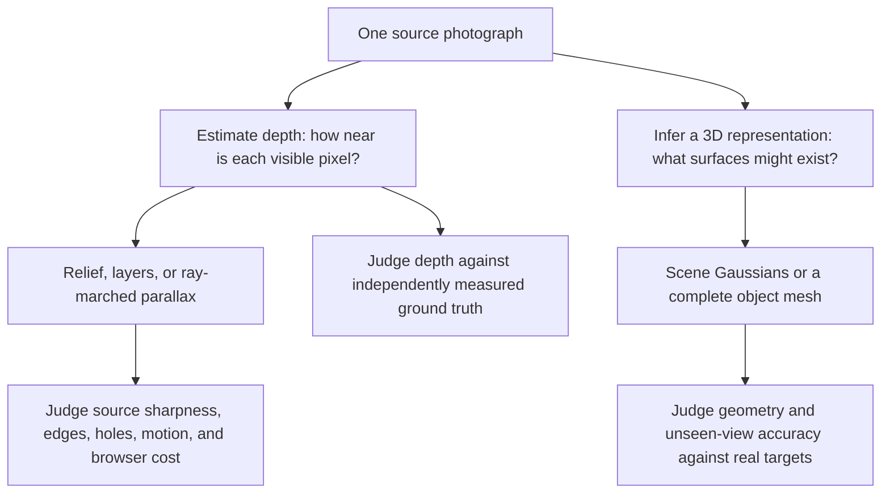
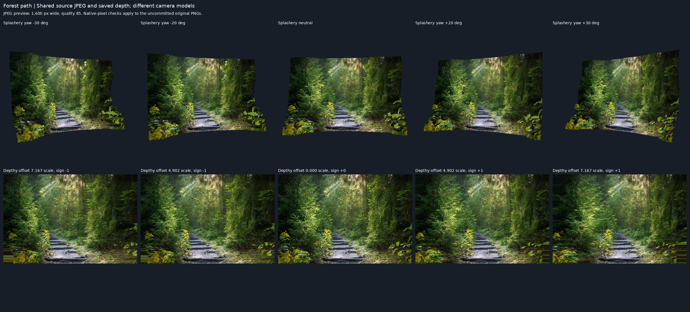

# One photograph into 3D: the landscape and a fair comparison

Written by Codex (GPT-6) for task 74, October 14, 2026. Rule check: none. Research and report
figures only; no application code or dependencies changed. Splashery's implementation is documented
at commit `e404cf36b60e7509f2cabc21dcd0f9f076fa8ef4` in the companion
[code explanation](photo-3d-explained.md). Every external source linked here was fetched and read in
this session. The [source-access record](../audits/photo-3d-explained-2026-10/sources.json) records
successes and failed attempts, redirects, sizes, and content hashes. Sources can change after this
date; this is a representative review, not proof that every product has been found.

Splashery has a strong combination for a private browser toy: source-photo sharpness, local
inference, a movable relief, hidden-color support, a reversible tap animation, and editable splats.
Other systems pursue different goals: metric geometry, learned hidden surfaces, full object meshes,
or a convenient hosted conversion. **The evidence does not establish that Splashery is best
overall.** Published research demonstrates capabilities its shallow relief does not implement, but
those publications do not benchmark against Splashery. The local comparison below tests one actual
open parallax tool on ten existing samples, with its limitations stated beside the pictures.
([implementation and sources](photo-3d-explained.md#the-complete-route),
[SHARP paper](https://arxiv.org/html/2512.10685v1),
[TripoSR README](https://raw.githubusercontent.com/VAST-AI-Research/TripoSR/main/README.md))

## Three questions that should not share one leaderboard

The division follows the outputs described by the
[Depth Anything V2 card](https://huggingface.co/depth-anything/Depth-Anything-V2-Small/raw/main/README.md),
[Depthy viewer](https://raw.githubusercontent.com/panrafal/depthy/master/app/scripts/classes/DepthyViewer.js),
[SHARP README](https://raw.githubusercontent.com/apple/ml-sharp/main/README.md), and
[TripoSR README](https://raw.githubusercontent.com/VAST-AI-Research/TripoSR/main/README.md). A
clear-looking parallax image can still have incorrect depth. A plausible object back can be
invented. A browser interface does not establish that its neural inference happens on-device.

## Depth models, including newer releases

Size means either reported parameters or a specifically identified weight artifact. A float32 size
estimate is `parameters × 4 bytes`; it excludes runtime activations and packaging. An ONNX
conversion, quantization, and native checkpoint can have very different download sizes. Browser
feasibility below is an engineering assessment from the documented graph/runtime and size, not a new
measurement of every model. “Hosted demo” means a web interface, not confirmed local inference. ONNX
Runtime's opened [WebGPU guidance](https://onnxruntime.ai/docs/tutorials/web/ep-webgpu.html)
requires the right runtime/provider and supported operators; the existence of WebGPU alone does not
make an arbitrary checkpoint work in a browser.

| Model and evidence                                                                                                                                                                                                                                                                                                            | Output, accuracy evidence, and tradeoff                                                                                                                                                                                                                                                | Size                                                                                                                                                                                                             | Code / weight terms                                                                                                                                                                                                                                                                                                                                              | Browser assessment                                                                                                                                                                           |
| ----------------------------------------------------------------------------------------------------------------------------------------------------------------------------------------------------------------------------------------------------------------------------------------------------------------------------- | -------------------------------------------------------------------------------------------------------------------------------------------------------------------------------------------------------------------------------------------------------------------------------------- | ---------------------------------------------------------------------------------------------------------------------------------------------------------------------------------------------------------------- | ---------------------------------------------------------------------------------------------------------------------------------------------------------------------------------------------------------------------------------------------------------------------------------------------------------------------------------------------------------------- | -------------------------------------------------------------------------------------------------------------------------------------------------------------------------------------------- |
| **Depth Anything V1** ([README](https://raw.githubusercontent.com/LiheYoung/Depth-Anything/main/README.md), [license](https://raw.githubusercontent.com/LiheYoung/Depth-Anything/main/LICENSE))                                                                                                                               | Relative depth; established broad-scene baseline. The V2 paper's controlled relative-depth table shows that V1 and V2 are close on several dense-depth benchmarks, despite V2's stronger fine-detail demonstrations.                                                                   | Small 24.8M, Base 97.5M, Large 335.3M parameters; Small float32 estimate 99.2 MB.                                                                                                                                | Apache-2.0 upstream license. Check the exact converted artifact separately.                                                                                                                                                                                                                                                                                      | Small is a plausible ONNX browser baseline; not rerun here. It offers little reason to replace the shipped V2 purely on age or parameter count.                                              |
| **Depth Anything V2 Small** ([card](https://huggingface.co/depth-anything/Depth-Anything-V2-Small/raw/main/README.md), [ONNX files](https://huggingface.co/api/models/onnx-community/depth-anything-v2-small/tree/main?recursive=true), [paper](https://arxiv.org/html/2406.09414v2))                                         | Relative inverse depth. V2 emphasizes detail, transparent objects, and robustness; the table below gives published numbers without claiming a universal rank.                                                                                                                          | 24.8M parameters; shipped int8 **27,258,801 bytes**. The opened ONNX listing also has fp16 49,642,442 and q4f16 19,126,267 bytes.                                                                                | Small Apache-2.0; Base/Large/Giant CC BY-NC 4.0 ([upstream README](https://raw.githubusercontent.com/DepthAnything/Depth-Anything-V2/main/README.md)).                                                                                                                                                                                                           | **Actually runs in Splashery**, WASM in a worker. Existing task-37 evidence found the smaller q4f16 download slower than int8 on that host; fewer bytes do not imply faster inference.       |
| **Depth Anything 3 Small** ([card](https://huggingface.co/depth-anything/DA3-SMALL/raw/main/README.md), [family README](https://raw.githubusercontent.com/ByteDance-Seed/Depth-Anything-3/main/README.md), [ONNX listing](https://huggingface.co/api/models/onnx-community/depth-anything-v3-small/tree/main?recursive=true)) | Relative depth and camera poses through a depth-ray representation; the family includes additional metric/GS variants, but the Small card does not claim every family capability. Authors report improved monocular/multiview performance; no new task-74 accuracy score was measured. | Small card reports 0.08B parameters. Existing task-37 ONNX artifact is **105,343,155 bytes including external data**; do not equate this conversion's bytes with a native float32 checkpoint.                    | Small Apache-2.0. Family terms vary by row in its README.                                                                                                                                                                                                                                                                                                        | Already tested in task 37 through WASM with a five-dimensional input. Needs different preprocessing and conversion from distance-like output to common inverse depth; not a model-file swap. |
| **Marigold depth v1.1; LCM v1.0** ([v1.1 card](https://huggingface.co/prs-eth/marigold-depth-v1-1/raw/main/README.md), [LCM card](https://huggingface.co/prs-eth/marigold-depth-lcm-v1-0/raw/main/README.md))                                                                                                                 | Diffusion-based affine-invariant depth. V1.1 uses DDIM, 1–50 steps, effective long side about 768; LCM v1.0 uses 1–4 steps. Ensembles can expose uncertainty. Fine detail and uncertainty are useful, but broad “better depth” claims depend on dataset and schedule.                  | v1.1 fp16 UNet **1,731,927,776 bytes** plus VAE **167,335,342 bytes**, before other components, from its [file listing](https://huggingface.co/api/models/prs-eth/marigold-depth-v1-1/tree/main?recursive=true). | Current code Apache-2.0 ([code license](https://raw.githubusercontent.com/prs-eth/Marigold/main/LICENSE.txt)); current model license OpenRAIL++-M ([model terms](https://raw.githubusercontent.com/prs-eth/Marigold/main/LICENSE-MODEL.txt)). The older LCM card explicitly says Apache-2.0. Treat these as version-specific terms, not one family-wide license. | Very large repeated-inference pipeline; not a reasonable default phone download. An offline research comparison is more practical. No browser conversion or inference was executed here.     |
| **ZoeDepth** ([README](https://raw.githubusercontent.com/isl-org/ZoeDepth/main/README.md), [paper](https://arxiv.org/html/2302.12288v1))                                                                                                                                                                                      | Metric depth: relative pretraining plus indoor/outdoor metric heads. ZoeD-M12-NK's published NYU REL is 0.077, but it is trained on NYU/KITTI and cannot be fairly ranked against zero-shot relative depth using that figure alone.                                                    | The Depth Pro paper's runtime table reports 340M parameters for its ZoeDepth baseline; float32 estimate about 1.36 GB. This is not an independently downloaded checkpoint size.                                  | MIT ([license](https://raw.githubusercontent.com/isl-org/ZoeDepth/main/LICENSE)).                                                                                                                                                                                                                                                                                | Native PyTorch path and substantial weights; an ONNX port needs operator and memory checks. A hosted demo exists in the README; local-browser inference was not verified.                    |
| **MiDaS 3.1** ([README and benchmark table](https://raw.githubusercontent.com/isl-org/MiDaS/master/README.md))                                                                                                                                                                                                                | Relative depth, trained across datasets. Compact models exchange accuracy for speed; the upstream table reports architecture-specific resolution, dataset errors, and GPU FPS.                                                                                                         | MiDaS v2.1 Small 21M; 3.1 Swin2 Tiny 42M; 3.1 BEiT Large 512 345M. Float32 estimates about 84 MB, 168 MB, and 1.38 GB respectively.                                                                              | MIT ([license](https://raw.githubusercontent.com/isl-org/MiDaS/master/LICENSE)).                                                                                                                                                                                                                                                                                 | Small models are plausible browser baselines after conversion; larger models are expensive. No new execution here. The family should not be represented by one size or one accuracy number.  |
| **Depth Pro** ([README](https://raw.githubusercontent.com/apple/ml-depth-pro/main/README.md), [paper](https://arxiv.org/html/2410.02073v2))                                                                                                                                                                                   | Metric depth and estimated focal length; strong boundary metrics. README claims a 2.25-megapixel map in 0.3 seconds on a GPU, and explicitly says released retrained weights do not exactly match the paper's model.                                                                   | Paper runtime table: 504M parameters and 1536×1536 native output; float32 estimate 2.016 GB. Existing task-37 ONNX int8 listing is about 1.009 GB.                                                               | Custom Apple sample-code terms for code and weights ([license](https://raw.githubusercontent.com/apple/ml-depth-pro/main/LICENSE)); not MIT/Apache/BSD.                                                                                                                                                                                                          | High-resolution multiscale inference is a poor default phone candidate at this size. Not installed or shipped; native GPU timing is not browser timing.                                      |

The existing [depth-engine audit](../audits/depth-engine-2026-10.md) is additional **historical
execution evidence**, not a rerun in task 74. Its controlled eight-input, 518-long-side,
single-thread WASM repeat medians were int8 V2 1,652 ms, fp16 V2 2,972 ms, q4f16 V2 2,992 ms, and
DA3 Small 2,959 ms. Its separate 41-input sweep and proxy limitations are documented there. The
candidate model cards and listings above were opened again in this session. No quality claim here
assumes a different quantization preserves accuracy exactly.

### What the published accuracy numbers actually support

In **Depth Anything V2, Table 2**, these are zero-shot **relative** depth AbsRel values; lower is
better. They use the paper's alignment, crops, evaluation, and native model variants, not
Splashery's int8 conversion or its postprocessed relief. The paper itself says the traditional
benchmarks do not fully capture V2's edge/detail advantages.
([opened paper](https://arxiv.org/html/2406.09414v2))

| Model in that table     | KITTI | NYU-D | Sintel | ETH3D | DIODE |
| ----------------------- | ----: | ----: | -----: | ----: | ----: |
| MiDaS 3.1 ViT-L         | 0.127 | 0.048 |  0.587 | 0.139 | 0.075 |
| Depth Anything V1 ViT-S | 0.080 | 0.053 |  0.464 | 0.127 | 0.076 |
| Depth Anything V2 ViT-S | 0.078 | 0.053 |  0.500 | 0.142 | 0.073 |
| Depth Anything V2 ViT-L | 0.074 | 0.045 |  0.487 | 0.131 | 0.066 |

This is direct evidence against “newer wins everywhere”: Small V2 is worse than Small V1 on Sintel
and ETH3D in this protocol, equal on NYU-D, and better on KITTI and DIODE. It also shows why one
benchmark winner should not determine the complete browser experience.

**Depth Pro, Table 2**, evaluates scale-invariant boundary accuracy under its own protocol. Its
iBims F1 values are Depth Pro **0.176**, Marigold **0.149**, Depth Anything V1 **0.127**, Depth
Anything V2 **0.111**, and ZoeDepth **0.035**; higher is better. These are that paper's chosen
models and versions, not evidence that V2 Small in Splashery scores 0.111. The table gives a
concrete reason to study boundary-aware models, while the released-model qualification above
prevents treating its score as a guarantee for a downloaded artifact.
([opened paper](https://arxiv.org/html/2410.02073v2),
[released-model qualification](https://raw.githubusercontent.com/apple/ml-depth-pro/main/README.md))

For ZoeDepth, its own Table 1 NYU score of 0.077 and the Depth Pro boundary score answer different
questions. For DA3, the Small card's broad improvement claim is an author claim; this report does
not manufacture a directly comparable table from it. Marigold's uncertainty and schedule also need a
fixed step/ensemble count before comparing runtime or accuracy.
([ZoeDepth paper](https://arxiv.org/html/2302.12288v1),
[DA3 card](https://huggingface.co/depth-anything/DA3-SMALL/raw/main/README.md),
[Marigold v1.1 card](https://huggingface.co/prs-eth/marigold-depth-v1-1/raw/main/README.md))

## One-picture 3D methods: what they actually build

| Method / sources                                                                                                                                                                                    | Representation and how it is made                                                                                                                                                        | What it can add beyond Splashery                                                                                                                                                                                     | Availability, terms, and execution here                                                                                                                                                                                                                                                                                                                                                       |
| --------------------------------------------------------------------------------------------------------------------------------------------------------------------------------------------------- | ---------------------------------------------------------------------------------------------------------------------------------------------------------------------------------------- | -------------------------------------------------------------------------------------------------------------------------------------------------------------------------------------------------------------------- | --------------------------------------------------------------------------------------------------------------------------------------------------------------------------------------------------------------------------------------------------------------------------------------------------------------------------------------------------------------------------------------------- |
| **Splashery** ([code explanation](photo-3d-explained.md))                                                                                                                                           | Relative depth is converted to an adaptive splat cloud and textured cut-aware relief, with copied far-side color. No scene fitting loop.                                                 | Private local interaction, reversible depth/Layers motion, source texture sharpness, and splat editing in one toy.                                                                                                   | MIT application; Apache-2.0 Small model. Current browser path measured below.                                                                                                                                                                                                                                                                                                                 |
| **3D Photo Inpainting** ([README](https://raw.githubusercontent.com/vt-vl-lab/3d-photo-inpainting/master/README.md))                                                                                | A layered depth image with learned color/depth inpainting becomes a textured mesh, exposing generated background for novel views.                                                        | A learned continuation of background structure instead of repeating the nearest visible donor. The hidden scene is still inferred.                                                                                   | Native Python/PyTorch/VisPy workflow. [License file](https://raw.githubusercontent.com/vt-vl-lab/3d-photo-inpainting/master/LICENSE) includes MIT project/MiDaS terms and a CC BY-NC 4.0 EdgeConnect section. Not a uniformly MIT stack. Not executed here.                                                                                                                                   |
| **Flash3D** ([official README](https://raw.githubusercontent.com/eldar/flash3d/main/README.md))                                                                                                     | Feed-forward generalizable single-image Gaussian scene reconstruction with a depth prior; the released training/evaluation setup uses RealEstate10K and layered predictions.             | Learned scene representation and occluded layers, rather than a deterministic height field.                                                                                                                          | Released code/setup uses PyTorch 2.2.2 and CUDA 11.8. No top-level license was found in the opened repository root; redistribution terms remain unconfirmed. Not executed or borrowed.                                                                                                                                                                                                        |
| **Splatter Image** ([README](https://raw.githubusercontent.com/szymanowiczs/splatter-image/main/README.md), [license](https://raw.githubusercontent.com/szymanowiczs/splatter-image/main/LICENSE))  | An image-to-Gaussians predictor for object reconstruction; its pixel-aligned predictions yield novel object views. The README offers object-specific and newer Objaverse-trained models. | Can infer an object's unseen geometry; object-centric training is a different domain from streets, forests, and interiors.                                                                                           | BSD 3-Clause code. Dataset and checkpoint terms must also be checked; README notes per-object asset terms. Native CUDA/PyTorch setup, not executed here.                                                                                                                                                                                                                                      |
| **Apple SHARP** ([README](https://raw.githubusercontent.com/apple/ml-sharp/main/README.md), [paper](https://arxiv.org/html/2512.10685v1))                                                           | Regresses metric 3D Gaussian parameters in a feed-forward network. Paper describes two layers over 768×768, approximately 1.2M Gaussians, and 702M total parameters.                     | Metric camera motion and learned nearby-view synthesis. Authors report LPIPS reductions of 25–34% and DISTS reductions of 21–43% against their strongest prior baselines; Splashery is not a baseline in that paper. | [Code](https://raw.githubusercontent.com/apple/ml-sharp/main/LICENSE) uses custom Apple terms; [model license](https://raw.githubusercontent.com/apple/ml-sharp/main/LICENSE_MODEL) limits use to noncommercial scientific research and excludes product development. Predictor supports CPU/CUDA/MPS; bundled video rendering requires CUDA. Not run here and not a shipping recommendation. |
| **TripoSR** ([README](https://raw.githubusercontent.com/VAST-AI-Research/TripoSR/main/README.md), [license](https://raw.githubusercontent.com/VAST-AI-Research/TripoSR/main/LICENSE))               | Single-image object reconstruction through a learned 3D representation followed by mesh extraction. Designed to produce a complete object, including guessed unseen sides.               | A usable object mesh for rotation, games, or fabrication, rather than a shallow scene relief. A whole photograph with many objects is a domain mismatch.                                                             | README licenses code and pretrained models under MIT. Native PyTorch; default example reports about 6 GB VRAM and under 0.5 s on A100. Those are author setup claims, not local browser observations. Not executed here.                                                                                                                                                                      |
| **Stable Fast 3D** ([README](https://raw.githubusercontent.com/Stability-AI/stable-fast-3d/main/README.md), [terms](https://raw.githubusercontent.com/Stability-AI/stable-fast-3d/main/LICENSE.md)) | Single-image mesh reconstruction with UV unwrapping and illumination disentanglement, producing texture/material-ready objects.                                                          | Mesh topology, UVs, and separated material appearance for object workflows.                                                                                                                                          | Custom Stability AI Community License, including revenue-dependent commercial terms; not MIT. README supports native CPU fallback and reports about 6 GB VRAM for default CUDA use. Not executed here.                                                                                                                                                                                        |

Open code, publicly downloadable weights, an online demo, and unrestricted reuse are four different
properties. The table names the boundary for each. No external research code, weights, generated
competitor mesh, or copyleft runtime was added to Splashery by this report.

The architectural descriptions were also checked against the opened papers:
[3D Photography](https://arxiv.org/html/2004.04727v1),
[Flash3D](https://arxiv.org/html/2406.04343v1),
[Splatter Image](https://arxiv.org/html/2312.13150v1),
[TripoSR](https://arxiv.org/html/2403.02151v1), and
[Stable Fast 3D](https://arxiv.org/html/2408.00653v1). The
[Marigold extension](https://arxiv.org/html/2505.09358v1) explains its diffusion-based depth,
normal, and intrinsic-analysis branches. A paper's publication license is distinct from the code and
checkpoint licenses in the tables; it does not grant permission to ship its weights.

## Products and open tools

Prices and service terms below are the pages observed on October 14, 2026, not permanent offers. No
sample was uploaded to a commercial service during this work. Browser inference is marked confirmed
only for the actual local browser tools inspected or run.

| Tool / opened sources                                                                                                                                                                                                                                                               | What it does                                                                                                                                                                          | Browser, free/open status, and terms                                                                                                                                                                                                                                                                                           |
| ----------------------------------------------------------------------------------------------------------------------------------------------------------------------------------------------------------------------------------------------------------------------------------- | ------------------------------------------------------------------------------------------------------------------------------------------------------------------------------------- | ------------------------------------------------------------------------------------------------------------------------------------------------------------------------------------------------------------------------------------------------------------------------------------------------------------------------------ |
| **Depthy** ([README](https://raw.githubusercontent.com/panrafal/depthy/master/README.md), [license](https://raw.githubusercontent.com/panrafal/depthy/master/LICENSE), [viewer code](https://raw.githubusercontent.com/panrafal/depthy/master/app/scripts/classes/DepthyViewer.js)) | Takes a picture plus a depth map, provides parallax, depth editing, and GIF-style exports; it can read Lens Blur depth. It does not infer depth with a modern neural model by itself. | Actual browser WebGL viewer, free/open MIT. Ran locally on ten samples with saved maps. The isolated viewer uses no hosted service; that is narrower than a claim about every feature of its original web app.                                                                                                                 |
| **DepthFlow** ([README](https://raw.githubusercontent.com/BrokenSource/DepthFlow/main/readme.md), [license](https://raw.githubusercontent.com/BrokenSource/DepthFlow/main/license.txt))                                                                                             | Ray-marched depth parallax videos with camera animations, supersampling, and FFmpeg export; can use external depth estimators.                                                        | Free local open tool, AGPL-3.0. Documented native pipeline, not a verified on-device browser converter. Not installed here; shader/code incorporation would need separate review under Splashery's library rules.                                                                                                              |
| **Immersity for Web** ([product](https://immersity.ai/for-web), [pricing](https://www.immersity.ai/pricing), [terms](https://immersity.ai/terms-conditions), [privacy](https://www.immersity.ai/privacy-policy))                                                                    | 2D-to-3D images, motion, stereo/XR-oriented outputs, and video conversion.                                                                                                            | Hosted browser service; local-only inference not established. Free page offers watermarked conversions up to 720p without commercial use; image paid plan begins at $4.99/month on the opened page. Proprietary service terms, not an open-source model/code license. Output rights and service terms require their own check. |
| **Meshy Image to 3D** ([feature](https://www.meshy.ai/features/image-to-3d), [pricing](https://www.meshy.ai/pricing))                                                                                                                                                               | Image or sketch to a complete mesh, with texturing/export features.                                                                                                                   | Hosted browser service, not verified on-device inference. Free tier advertises 100 monthly credits and CC BY 4.0 outputs; paid/private terms differ. Output CC BY does not license the underlying service code or models. Not run here.                                                                                        |
| **Tripo hosted product** ([site](https://www.tripo3d.ai/))                                                                                                                                                                                                                          | Image/text-to-mesh web app and API with object creation workflows.                                                                                                                    | Page advertises a free online entry and browser use, but that is not the MIT TripoSR repository. Current complete service/weight license and local inference are unconfirmed; no price or usage-right claim is inferred from the open research model. Not run here.                                                            |

## How to compare fairly

Run two experiments, not one blended score. First, fix the renderer and preprocessing while
replacing depth models; second, fix a common depth map and compare renderers. Full systems then get
a separate end-to-end run. Record model revision, conversion, license, source hash, input
dimensions, camera, crop, depth scaling, device, renderer, and every fallback. Training overlap and
metric-versus-relative alignment must be stated. The need for separate alignment follows from the
different relative/metric outputs described by the [V2 paper](https://arxiv.org/html/2406.09414v2)
and [ZoeDepth paper](https://arxiv.org/html/2302.12288v1).

The following is a **proposed protocol**, not a claim that all of these measurements ran:

| Measure            | Procedure and interpretation                                                                                                                                                                                                                                                                                                            |
| ------------------ | --------------------------------------------------------------------------------------------------------------------------------------------------------------------------------------------------------------------------------------------------------------------------------------------------------------------------------------- |
| Depth error        | Save raw predictions before p2–p98 normalization, edge refinement, or relief conversion. Report AbsRel, RMSE, and δ1 on a fixed valid-depth mask. For relative inverse-depth models, fit scale/shift in the correct representation on valid pixels; report that alignment explicitly. Metric models also get an unaligned metric score. |
| Edge depth         | Report boundary precision/recall/F1, thin-structure coverage, and depth-order mistakes. Use a documented pixel tolerance tied to output resolution. Adapt the [Depth Pro paper's scale-invariant boundary metrics](https://arxiv.org/html/2410.02073v2), rather than assuming whole-image depth error captures edge quality.            |
| Source fidelity    | At the original view, report registered PSNR/SSIM and line/text legibility. Fix color space, gamma, resolution, and antialiasing. Also show unregistered scores and estimated displacement; never hide geometry errors by arbitrary image warping.                                                                                      |
| Novel-view quality | Capture neutral, yaw ±20°/±30°, and pitch ±20°/±30° at Depth 0.2/0.5/1 with Layers off. Compare only with independent ground-truth target views when cameras are truly matched. Report PSNR/SSIM and, if installed, LPIPS/DISTS on a fixed target mask. A still from the source photo is not a ground-truth side view.                  |
| Holes              | Count uncovered pixels inside the actual projected photo footprint, including its boundary; show the mask and maximum fraction per sample, not only a mean. Separately count how much inferred backing is exposed. Full opaque but wrong fill must not receive a perfect quality score merely for having no clear pixels.               |
| Edge halos         | Use source-anchored edge strips and independent target views where available. Report transition width, color excursion, and displacement with anchor coverage. Inferred model depth cannot certify those anchors as geometric ground truth.                                                                                             |
| Time               | Separate image decode, model transfer/init, preprocessing, `session.run()`, geometry, upload/compile, first preview, and first stable raised frame. Report cold and warm runs, medians and tails, and the sample count.                                                                                                                 |
| Frame rate         | On physical phones and desktops, time completed GPU draws while following a fixed orbit, with warmup and at least 120 measured poses. Record buffer dimensions, power/thermal state, and asynchronous extra draws; exclude screenshot readbacks. Report mean/p95 milliseconds before translating to FPS.                                |
| Memory             | Record peak process/worker/WASM memory and GPU targets where available; separately report retained textures, meshes, and splat buffers. Download bytes and JS heap alone are not total memory.                                                                                                                                          |
| Download / privacy | Record compressed and uncompressed transfer sizes on a cold request. Check network destinations during custom-photo conversion. A hosted service must be labeled as an upload workflow, not compared as a local-only browser inference path.                                                                                            |
| Human review       | Shuffle paired renders, show motion at phone size, and ask separately about source detail, plausible depth, distracting edges, hidden fill, and comfort. Keep AI-made samples labeled and separate from real geometric ground truth.                                                                                                    |

The hole and edge procedures build on this repository's existing
[round-3 method and limitations](../audits/photo-3d-r2-2026-10.md#measurement-scope-and-limitations).
For perceptual scores, the [SHARP paper's Table 2](https://arxiv.org/html/2512.10685v1) shows
sensitivity to small image translations: matching camera and registration is part of the experiment,
not a cosmetic detail.

### Datasets and the status of task 56

| Source                                                                                                              | Use and limits                                                                                                                                                                                                                                                                                                                          |
| ------------------------------------------------------------------------------------------------------------------- | --------------------------------------------------------------------------------------------------------------------------------------------------------------------------------------------------------------------------------------------------------------------------------------------------------------------------------------- |
| [NYU Depth V2](https://cs.nyu.edu/~fergus/datasets/nyu_depth_v2.html)                                               | Indoor RGB/depth pairs; official page lists 1,449 labeled pairs and 464 scenes. Useful for indoor raw-depth evaluation, not ground-truth ±30° views for arbitrary Splashery samples. The opened page did not settle a redistribution license; keep downloads out of this PR.                                                            |
| [KITTI depth prediction benchmark](https://www.cvlibs.net/datasets/kitti/eval_depth.php?benchmark=depth_prediction) | Outdoor road scenes and valid measured-depth masks. Useful for a distinct depth domain; its website leaderboard protocol should not be mixed with NYU or arbitrary relative-depth alignment. Reuse terms and split overlap need checking before redistribution.                                                                         |
| [DIODE](https://diode-dataset.org/)                                                                                 | Indoor/outdoor measured-depth evaluation, with masks. Official page states MIT for dataset/code. Confirm actual split, valid pixels, and model training overlap before using its error as a zero-shot claim.                                                                                                                            |
| [Depth Anything V2's DA-2K description](https://arxiv.org/html/2406.09414v2)                                        | Diverse sparse depth-order pairs, useful for transparency, reflections, and difficult layouts. The paper explicitly says sparse order cannot replace precise dense depth for reconstruction. No dataset was downloaded or relicensed here.                                                                                              |
| [Task 56 brief](../codex/56-ground-truth-scenes.md)                                                                 | Requests 12+ original procedural Blender scenes. **Those delivered scenes, camera poses, and depth exports are absent from this checkout.** The brief is a plan, not existing ground truth. It should become the controlled multi-view test set once delivered.                                                                         |
| Existing Photo to 3D samples                                                                                        | Six CC0 pictures plus labeled AI-made samples stress appearance and edge behavior. Their stored `.depth` maps are model predictions, not ground truth. Never use the model's own output as a depth-accuracy target. [src/packs/photo-3d.js:519](../../src/packs/photo-3d.js#L519), [sample-generation tool](../../tools/p3d-depth.mjs). |

For task 56, save a canonical source camera and actual target-camera poses, true camera-space depth,
foreground/background masks, and clean target RGB. Include thin rails, overlapping leaves,
continuous sloped planes with painted stripes, glass, mirrors, clutter, and fine text. Surface depth
and refracted/reflected image depth need distinct evaluation rules. This is a proposed extension of
its brief, not a description of assets that already exist.

## Ten-sample local comparison

**Executed:** the actual MIT Depthy viewer and its upstream PIXI depth-perspective shader, not a
replacement parallax implementation, ran locally on all ten inputs. Depthy commit, script hashes,
picture/depth hashes, settings, and all 50 capture pairs are in the
[comparison record](../audits/photo-3d-explained-2026-10/comparison.json). The
[method appendix](../audits/photo-3d-explained-2026-10/method.md) includes the temporary harnesses
as documentation. Third-party code stays in the ignored cache and is not shipped.

The source set is all six original CC0 samples and four existing labeled AI-made hard cases: glass,
spokes, a reflection, and clutter. Both tools get the identical JPEG and the identical stored raw
depth prediction; Depthy receives a p2–p98-normalized, inverted 8-bit PNG because its shader
evaluates `1 - depthTexture.r`. Splashery retains its production cleanup and surface construction.
Thus this experiment isolates the overall rendering/conversion paths, **not just their final
fragment shaders**, and does not compare neural estimators.
([Depthy shader](https://raw.githubusercontent.com/panrafal/depthy/master/app/scripts/pixi/DepthPerspectiveFilter.js),
[normalization code](../../src/packs/photo-3d-core.js#L153))

Splashery uses Sharp picture, mid budget, Depth 0.5, Flat off, Layers off, no ground/effects,
WebGL2, and a 480×480 viewport. Its neutral and yaw −30°, −20°, +20°, and +30° views are captured
without cropping. Depthy uses quality 5, focus 0.5, no depth blur, no enlargement, no
animation/easing, and the same source aspect fitted within 480×480. Default enlargement is
deliberately disabled so its perimeter behavior is visible, and that difference from the default
viewer is recorded.
([Depthy options](https://raw.githubusercontent.com/panrafal/depthy/master/app/scripts/classes/DepthyViewer.js))

**The two tools do not have identical cameras.** Depthy's control is a signed parallax offset, not a
physical orbit angle. For each Splashery angle θ, this experiment chooses
`depthScale = 0.43 × sin(|θ|) / (1.5 × 0.02)` and offset sign ±1; 0.43 is Splashery's default relief
range, 0.02 is Depthy's scale multiplier, and 1.5 is its quality-5 shader UPSCALE. This matches a
first-order depth displacement scale in picture-height units, not perspective foreshortening, camera
intrinsics, or ground-truth view. Their neutral framing and visible pixel counts also differ. The
comparison is therefore **qualitative evidence with stated controls**, not a valid numeric ±30°
novel-view leaderboard. ([src/packs/photo-3d-core.js:436](../../src/packs/photo-3d-core.js#L436),
[Depthy viewer](https://raw.githubusercontent.com/panrafal/depthy/master/app/scripts/classes/DepthyViewer.js),
[Depthy filter](https://raw.githubusercontent.com/panrafal/depthy/master/app/scripts/pixi/DepthPerspectiveFilter.js))

Each linked figure is a **1,600-pixel-wide JPEG preview at quality 85**, resized from the original
two-row PNG sheet with Lanczos filtering. Columns follow the five signed controls above; the second
row is explicitly labeled as a displacement control rather than degrees. Four hard-case figures
remain marked AI-made. The previews are lossy and resampled, so they are for visual review, not
pixel-level scoring. No scene panel was cropped, aligned, or retouched.

The raw PNG sheets and native captures are kept in the ignored cache and are not committed in this
revision. [build.json](../audits/photo-3d-explained-2026-10/build.json) preserves the ten original
PNG hashes and dimensions; the records also retain the native capture hashes and buffer sizes.
Earlier PR history is preserved, including the original PNG publication; the revised file tree and
Pages output contain only the smaller JPEG previews.

| Input                       | Side-by-side stills                                                                    | What to inspect                                                                   |
| --------------------------- | -------------------------------------------------------------------------------------- | --------------------------------------------------------------------------------- |
| Forest path                 | [Five view pairs](../audits/photo-3d-explained-2026-10/forest.jpg)                     | Foliage depth transitions, repeated color behind leaves, and outer edges.         |
| Cobbled street              | [Five view pairs](../audits/photo-3d-explained-2026-10/street.jpg)                     | Sloped road, wall edges, and the different orbit versus displacement geometry.    |
| Still life                  | [Five view pairs](../audits/photo-3d-explained-2026-10/still-life.jpg)                 | Occluding table objects and a painting's plausible but unverified inferred depth. |
| Spiral staircase            | [Five view pairs](../audits/photo-3d-explained-2026-10/spiral-stairs.jpg)              | Thin rails, newly exposed regions, and repeating background texture.              |
| Palace staircase            | [Five view pairs](../audits/photo-3d-explained-2026-10/palace-stairs.jpg)              | Balustrades, depth compression, and side-surface foreshortening.                  |
| Wildflowers up close        | [Five view pairs](../audits/photo-3d-explained-2026-10/wildflowers.jpg)                | Thin stems, busy depth boundaries, and small foreground components.               |
| Glass jug (AI-made)         | [Five view pairs](../audits/photo-3d-explained-2026-10/cdx-hard-glass-jug.jpg)         | Glass edges and the single-depth treatment of transmitted background.             |
| Bicycle spokes (AI-made)    | [Five view pairs](../audits/photo-3d-explained-2026-10/cdx-hard-bicycle-spokes.jpg)    | Thin-spoke continuity, foreground edges, and revealed background.                 |
| Puddle reflection (AI-made) | [Five view pairs](../audits/photo-3d-explained-2026-10/cdx-hard-puddle-reflection.jpg) | Relief assigned to reflection content rather than a reflective material.          |
| Workshop bench (AI-made)    | [Five view pairs](../audits/photo-3d-explained-2026-10/cdx-hard-workshop-bench.jpg)    | Dense clutter, copied donors, and depth transitions around small tools.           |

All **100 native frames** passed the nonempty-image check (minimum 31,898 distinct RGB colors), and
all 50 Splashery captures passed the active-Sharp and fixed-buffer assertions. Each original PNG
figure region was checked byte-for-byte against its native RGBA frame before preview conversion.
Those are capture-integrity checks, not image-quality scores or claims about the published JPEG
pixels. The resized previews were separately checked for dimensions, content, and file hashes. See
the [frame record](../audits/photo-3d-explained-2026-10/frame-validation.json) and
[input/figure credits](../audits/photo-3d-explained-2026-10/credits.json).

Visual inspection supports a narrower finding than a winner: Splashery visibly turns a finite relief
with foreshortening, while Depthy retains a rectangular image through ray-based texture
displacement. At the stronger signed controls, Depthy exposes stretched horizontal bands at the
perimeter in Forest path and Bicycle spokes. Splashery still has guessed-color artifacts: the
Bicycle spokes +30° view shows a vertical green donor strip beside the basket, and fine vegetation
produces an uneven depth-shaped outer boundary. The neutral-to-turned columns make those behaviors
reviewable; different framing and camera models prevent a fair sharpness or hole-rate ranking from
these figures alone.

This run covers yaw stills on one software-rendered desktop layout. It does not establish physical
phone smoothness, pitch quality, true target-view accuracy, or superiority to modern neural 3D
methods. The eight separate budget measurements belong to the companion explanation. No
commercial-product or native-model timing is inferred from Depthy's simpler viewer.

**Other execution scope:** SHARP's documented bundled renderer, Flash3D's published setup, and
Splatter Image's renderer require CUDA, which this workspace does not provide. SHARP prediction,
TripoSR, Stable Fast 3D, Marigold, and the old inpainting pipeline were not installed or
CPU-benchmarked here. Some support CPU prediction; lack of a CUDA device is not proof they cannot
run at all. Their results remain literature evidence, not local competitors silently credited with
wins or losses. Task 37's real depth-model comparisons remain available separately. This task's
local open-tool experiment is Depthy, and every other row states its unexecuted status.

## Verdict and the three ideas to borrow

**What is special about Splashery:** the useful combination is source-textured display, cut-aware
depth geometry, a conservative animated backing, and a private editing/tap experience inside the
existing toy system. None of the opened sources establishes that depth lifting, layered support, or
photo-textured relief was invented here. The implementation's value is in how these parts work
together and preserve the original picture under a constrained browser budget.
([source explanation](photo-3d-explained.md#why-sharp-picture-looks-clear),
[3D Photo Inpainting](https://raw.githubusercontent.com/vt-vl-lab/3d-photo-inpainting/master/README.md),
[Depthy](https://raw.githubusercontent.com/panrafal/depthy/master/README.md))

**Where others are better suited:** Depth Pro and ZoeDepth provide metric depth for workflows where
distance matters; SHARP provides learned metric Gaussians and published nearby-view synthesis;
layered inpainting addresses hidden background continuity; TripoSR and Stable Fast 3D target
complete usable object meshes. Hosted products provide broader export workflows. Those capabilities
exceed this relief's scope, but their paper/demo claims do not prove cleaner output than Splashery
on these ten samples. A universal quality verdict remains unmeasured.
([Depth Pro](https://raw.githubusercontent.com/apple/ml-depth-pro/main/README.md),
[ZoeDepth](https://raw.githubusercontent.com/isl-org/ZoeDepth/main/README.md),
[SHARP](https://raw.githubusercontent.com/apple/ml-sharp/main/README.md),
[inpainting](https://raw.githubusercontent.com/vt-vl-lab/3d-photo-inpainting/master/README.md),
[TripoSR](https://raw.githubusercontent.com/VAST-AI-Research/TripoSR/main/README.md),
[Stable Fast 3D](https://raw.githubusercontent.com/Stability-AI/stable-fast-3d/main/README.md))

These are **future experiments**, not changes or shipping approvals:

1. **Better boundary evidence and a bounded depth-model trial.** First finish task 56's independent
   depth/target views, then compare V2 int8 and an exact Apache-2.0 DA3 Small artifact with frozen
   input, output representation, and physical-device budgets. Add boundary F1 and depth-order checks
   alongside holes. Keep V2 unless the complete checkpoint sample suite is no worse. DA3 is
   promising, not guaranteed: the prior WASM audit was slower, its input differs, and its Small
   card's claimed improvements need direct validation. Depth Pro's boundary metric design is
   informative even though its weights are not an approved drop-in choice.
   ([DA3 card](https://huggingface.co/depth-anything/DA3-SMALL/raw/main/README.md),
   [Depth Pro boundary evaluation](https://arxiv.org/html/2410.02073v2),
   [task-37 evidence](../audits/depth-engine-2026-10.md))
2. **An uncertainty-aware hidden-background layer.** Use the existing far-donor result as the
   privacy-preserving fallback, but explore a separate background layer that records where fill is
   weak and, offline first, compares learned inpainting with copied donors. Score revealed
   color/structure against task 56's true target views and check tap-time occlusion. The layered
   idea is transferable; the old pipeline's EdgeConnect NC terms and Marigold's model-version terms
   must not be overlooked. No license permission is inferred merely from reading a paper.
   ([3D Photo Inpainting](https://raw.githubusercontent.com/vt-vl-lab/3d-photo-inpainting/master/README.md),
   [its component licenses](https://raw.githubusercontent.com/vt-vl-lab/3d-photo-inpainting/master/LICENSE),
   [Marigold model terms](https://raw.githubusercontent.com/prs-eth/Marigold/main/LICENSE-MODEL.txt))
3. **Representation-aware modes instead of one “3D” promise.** Preserve relief for scene photos and
   source text. Evaluate a separate offline single-object mesh/Gaussian experiment for an object
   isolated against a simple background, with explicit labels for inferred backs and different
   exports. TripoSR's documented MIT code/weights make it a clearer initial object research
   candidate than adopting SHARP's research-only model into the product. Learned layered Gaussians
   are also an instructive target for a future research comparison, provided their actual checkpoint
   terms and execution costs are established first.
   ([TripoSR README](https://raw.githubusercontent.com/VAST-AI-Research/TripoSR/main/README.md),
   [SHARP model terms](https://raw.githubusercontent.com/apple/ml-sharp/main/LICENSE_MODEL),
   [Splatter Image](https://raw.githubusercontent.com/szymanowiczs/splatter-image/main/README.md))

The protected checkpoint remains the standard for any later Photo to 3D change, with per-sample
comparison and retained failures. This report provides the explanation, the source-backed options,
and one runnable comparison; ground-truth novel-view ranking and physical-device certification are
still separate work. ([checkpoint rule](photo-3d-checkpoint.md#every-later-photo-to-3d-task))
