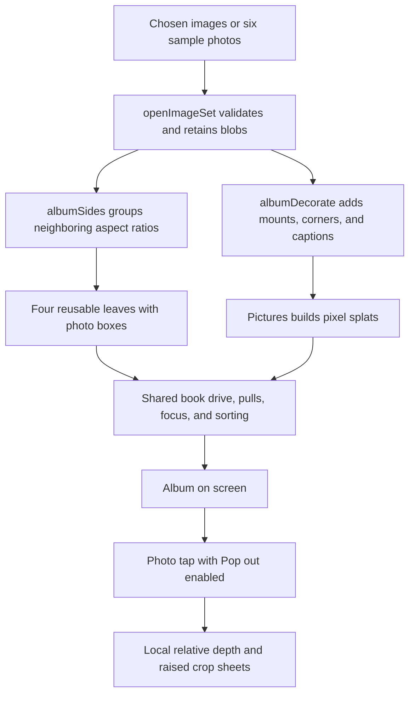

# Photo album checkpoint, October 14, 2026

Part d of [Codex task 82](../codex/82-toy-checkpoints.md). Codex documented the existing album; no
runtime code, assets, or tests change. Future rounds must compare the same photo order, covers,
views, pulls, and pop-outs against this checkpoint and keep every tested behavior and visible result
at least as good.

## Where the checkpoint lives

| What                                | Where                                                                                                                                                            | Commit                                     |
| ----------------------------------- | ---------------------------------------------------------------------------------------------------------------------------------------------------------------- | ------------------------------------------ |
| Whole repository                    | `claude/checkpoint-toys-2026-10-14`                                                                                                                              | `41b21e74e04ccca178b95ac02b4e5dc0e51b4b45` |
| Phone clips and measurement records | [codex/toy-checkpoints-d-clips](https://github.com/ryanjosephkamp/splashery/tree/44f40d515018c918ba449fe6eeb20ff3f9dd85c9/docs/audits/toy-checkpoints-d-2026-10) | `44f40d515018c918ba449fe6eeb20ff3f9dd85c9` |

Never push to, rebase, or delete the Operator's checkpoint branch. The clips branch must never be
merged. The
[album-pull clip](https://github.com/ryanjosephkamp/splashery/blob/44f40d515018c918ba449fe6eeb20ff3f9dd85c9/docs/audits/toy-checkpoints-d-2026-10/bk-album-pull.gif)
shows a short pull falling back and a longer pull committing. It uses the real renderer at 390×844,
a 1× device scale, and mid detail. The evidence-only `capture.mjs` adapter of `tools/bk-clip.mjs`
steps animation at 12 fps and waits for actual sheet builds, so these are motion evidence, not
real-time frame-rate measurements. See the
[evidence README](https://github.com/ryanjosephkamp/splashery/blob/44f40d515018c918ba449fe6eeb20ff3f9dd85c9/docs/audits/toy-checkpoints-d-2026-10/README.md)
for commands and separate phone-profile measurements.

## How it works

The catalog's `photo-album` entry selects `ALBUM_RECIPE`, exported through `RECIPES["photo-album"]`
in [`src/packs/pictures.js`](../../src/packs/pictures.js). The toy opens behind labs. Input is one
or several still images selected in the Toy tab, or an image address; the multiple-file button is
**Open photos…**. The sample is six images, in this order: sailboat, tulips, lighthouse, red barn,
seashell, and daffodils. Source and license records remain in the recipe, `CREDITS.md`, and
`tools/assets.json`; this task introduces no new assets or license determination. It does not
request a camera or microphone, and local photos are not uploaded.



1. **Open and retain pictures.** `App.openMedia()` calls `openMedia()` in
   [`src/media.js`](../../src/media.js). For an array, `openImageSet()` validates each image's bytes
   and decoded size, retains its source blob, name, and dimensions, and exposes `kind: "image"`,
   `count`, `aspect(i)`, and `draw(i, w, h)`. It keeps the last two decoded bitmaps rather than
   every image's decoded pixels. At most 200 images are allowed, with an aggregate source-byte cap
   in addition to per-image checks. A GIF inside a set is accepted through the image path as a
   still; video items are rejected. The album recipe accepts images, rather than PDF pages or a
   playing video.
2. **Group by shape.** `ALBUM_RECIPE.build()` passes media aspects into `albumSides()`. Two
   consecutive pictures wider than 1.15 are stacked top and bottom on one page side; two narrower
   than 0.87 sit left and right. Otherwise a picture occupies a page side alone. Grouping preserves
   input order and does not search ahead for a matching partner. `sides`, `kinds`, and `sideOf` map
   photo indices to physical page sides. The six sample photos fill four sides, after the empty
   cover side.
3. **Make the album.** `ALBUM_BOOK` describes a rigid side-bound cover with thick card pages.
   `buildSideBound()` is shared with Your book. Album page dimensions are 0.95×1.05 recipe units,
   card half-thickness is 0.008, and mounted photos are lifted 0.012 above the card. `albumCloth()`
   uses deterministic procedural texture for leather, linen, or scrapbook material; `albumTrim()`
   adds the corresponding cover details. This is generated kit geometry, without a captured leather
   texture or a fitted scan.
4. **Place and decorate sheets.** `ALBUM_BOXES()` defines five candidate photo boxes per leaf face:
   whole, top, bottom, left, and right. Four reused leaf slots have front and back faces.
   `BOOK.sheetsOf()` selects the occupied boxes for each page side and hides the rest.
   `albumDecorate()` copies the image, paints the lit mount color, fits the photo without changing
   its aspect, draws four triangular corners, and optionally prints its filename. The caption band
   is 13% of sheet height; the margin is 5% of its smaller dimension. Long captions are shortened
   with an ellipsis. `Pictures.build()` calls this decoration before `buildSheet()` makes `pixels`
   splats. A sheet's source canvas is copied, so captions and mount graphics do not alter the
   original file.
5. **Turn, pull, and read.** `ALBUM_RECIPE.drive()` delegates to `BOOK_RECIPE.drive()`;
   `bookLayout()`, `bookGo()`, `bookTapAt()`, and `bookView()` use the same reusable-leaf and
   single-page focus system as [Your book](your-book-checkpoint.md#how-it-works). Right and left
   taps move forward and backward, double-tapping focuses a page, and a programmatic `pics.go(n)`
   jump maps a photo to the side containing it. At the end, forward restarts. `bookDrag(ALBUM_PULL)`
   deliberately follows a finger more slowly and falls back more readily: lag 0.12 s, finish
   threshold 0.58, flick threshold 2.3 progress units/second, release slow factor 1.3, and bend
   factor 0.7. A successful pull plays the album page cue; a substantial aborted pull settles
   softly. Neighboring sheets prepare with `ahead`, and posed sorting follows the turning card.
6. **Lift a photo.** With Pop out enabled, `bk5PhotoRect()` identifies a mounted photo;
   `bk5Target()` and `pgRaise()` create its crop sheet. `albumDecorate()` receives variant `hole`
   and paints the empty mounted area while its corners and caption remain on the page. `bk5Start()`
   calls the local photo-depth worker; `pgStep()` moves the figure through preparation, rise, rest,
   return, and hole removal. It can initially rise as a flat card while depth is loading. Up to
   three photos rise independently; selecting another changes the depth slider's target. Tapping a
   raised photo returns it. Turning a page returns all raised photos first. Pop-up layers uses the
   same three sheet slots for one layered figure.
7. **Save settings.** The app serializes photo filenames and byte sizes rather than local photo
   bytes, along with options, current media page, and nondefault `toy.figures` depths. Recipients
   must reopen the pictures. A single remote image URL can travel in a link; it still needs to allow
   a CORS download. The underlying `Pictures.reorder()` API supports reordering, but the album does
   **not** enable the digital frame's `media.list` UI.

### Math and shared rendering

The layout is aspect-ratio classification followed by contain fitting. For an available box of width
iw and height ih, `albumDecorate()` chooses scale `min(iw/w, ih/h)` for the source canvas width w
and height h. Card motion uses the same circular-arc leaf model, exponential finger lag, and CPU/GPU
pose matching documented in
[Your book's page-turn math](your-book-checkpoint.md#the-page-turn-math). It is a tuned animation of
heavy paper, without a mass-and-spring material solver.

Image splats use the `pixels` detail layer over the two staggered 8-pixel base lattices in
`src/picture-splats.js`. Projected-size levels and cache limits come from `Pictures` in
`src/pictures.js`. The opened
[Gaussian splatting project page](https://repo-sam.inria.fr/fungraph/3d-gaussian-splatting/)
explains the representation; these photo sheets are sampled directly from pixels.

`estimateDepth()` in `src/packs/photo-3d-depth.js`, the `src/depth/` worker, and the vendored
quantized Depth Anything V2 Small model infer relative inverse depth only when a photo is raised.
The [opened upstream project](https://depth-anything-v2.github.io/) describes the model.
`normalizeDepth()` produces a relative map; nominal relief is one fifth of a photo's shorter side.
`pgRelief()` deepens it, with separate local-detail treatment for maps dominated by a plane.
`pgCuts()` uses the 50th and 80th depth percentiles for flat pop-up cutouts. The
[shared pop-out explanation](picture-lab-checkpoint.md#the-splat-math-and-the-pop-out) details
classification, layering, phases, and fallback. The source photo cannot provide hidden surfaces, and
a predicted depth is not a physical measurement.

### Every toy setting and media control

| Setting or action                | Default and effect                                                                                                                                                       |
| -------------------------------- | ------------------------------------------------------------------------------------------------------------------------------------------------------------------------ |
| Cover (`cover`)                  | `leather`: brown textured cover and dark pages. `linen`: blue-gray fabric and light pages. `scrapbook`: tan cover and paper, with its own trim and corners.              |
| Captions (`captions`)            | `true`; draws the filename beneath each mounted image and reserves its caption band. Turning it off gives that area to the photo.                                        |
| Reading (`reading`)              | `one` in portrait, `both` otherwise when absent in an older scene; changes focus and navigation within a spread.                                                         |
| Turn the page (`turn`)           | Pulse, ease 1.2. A tap's location selects direction; the heavy-page drag uses `ALBUM_PULL`.                                                                              |
| Pop out (`pop`)                  | Shared top-bar toggle. Enables photo taps; up to three photos can stand up, and another returns the oldest.                                                              |
| Pop-up layers (`layers`)         | Toggle. Existing photos return before one rises as separated cutout cards.                                                                                               |
| Depth slider                     | 1–5× in quarter steps for the selected raised photo; nondefault values are saved by photo index and crop box.                                                            |
| Open photos, address, and sample | Select several device images, download an image URL, or restore the six sample images. Previous and Next navigate the current media; `pics.go(n)` supports direct jumps. |
| Double-tap and zoom              | Focus/release a page, with detail rebuilt for its projected size. Reset view returns to the catalog camera.                                                              |

The album has no recipe-level Draw a box control, PDF Words panel, video player, independent
cover-color picker, or photo-order list. General viewer settings include Detail, sound, background,
tilt, and turntable. Tilt starts locked, turntable starts off, and raised photos temporarily free
the tilt. The album uses the shared book focus logic; it does not opt into the Picture lab's
Hands-on whole-object behavior.

## The files that make it up

- Album look, grouping, mounts, shared binding, actions, and pop-outs: `src/packs/pictures.js`,
  including `ALBUM_RECIPE`, `ALBUM_BOOK`, `ALBUM_STYLES`, `albumSides()`, `ALBUM_BOXES()`,
  `albumDecorate()`, `albumCloth()`, `albumTrim()`, and the book/figure helpers.
- Image opening and splat sheets: `src/media.js`, `src/loaders.js`, `src/pictures.js`,
  `src/pictures-worker.js`, and `src/picture-splats.js`.
- Leaf motion and rendered sorting: `src/kit.js`, `src/generators.js`, `src/effects.js`,
  `src/pose.js`, `src/player.js`, `src/stage.js`, `src/motion.js`, `src/camera.js`,
  `src/kernels.js`, `src/pc.js`, and `vendor/playcanvas/playcanvas.min.mjs`.
- Input and saved metadata: `src/app.js`, `src/ui.js`, and `src/state.js`.
- Optional photo depth: `src/packs/photo-3d-depth.js`, `src/packs/photo-3d-core.js`, `src/depth/`,
  `vendor/depth-anything-v2-small/`, and `vendor/onnxruntime-web/`.
- Six sample JPGs and thumbnail: `assets/toys/photo-album/`; this toy's catalog/help/sound, plan,
  and credit entries in `src/toys.js`, `src/toy-help.js`, `src/toy-sounds.js`,
  `tools/toy-plan.json`, `tools/assets.json`, and `CREDITS.md`. The page cue uses
  `assets/sounds/book-page.mp3`. The shared pack also imports `manual/pdf-edition.js`.

`tests/bk.spec.mjs` defines grouping, sample count, sheets, tap/pull behavior, focus, reading, and
visual phone/desktop captures. `tests/bk5.spec.mjs` defines album pop-outs and old scene
compatibility. `tests/pg6.spec.mjs` defines multiple raised photos, turn cleanup, layer mode, and
depths; `tests/pg6-engine.spec.mjs` covers the shared top-bar switch, slider, scene fields, and flat
cutout sampling. `tests/pic.spec.mjs`, `tests/bk5-engine.spec.mjs`, and `tests/vw.spec.mjs` define
shared sheet and viewer behavior. `tests/hh3-pictures.spec.mjs` guards the neighboring frame and the
album's exclusion from Hands-on.

## How to restore it

Begin with a clean tree and a new branch. Verify the fetched commit before applying the files:

```sh
git fetch origin main
git fetch origin claude/checkpoint-toys-2026-10-14:refs/remotes/origin/claude/checkpoint-toys-2026-10-14
git rev-parse origin/claude/checkpoint-toys-2026-10-14
git switch -c codex/restore-photo-album origin/main
git checkout origin/claude/checkpoint-toys-2026-10-14 -- src/packs/pictures.js src/media.js src/pictures.js src/pictures-worker.js src/picture-splats.js assets/toys/photo-album
```

The SHA must match `41b21e74e04ccca178b95ac02b4e5dc0e51b4b45`. Restoring the pack rolls back **Your
book, Storybook, Picture lab, and Picture frame** as well. The sample photos also supply the digital
Picture frame. Check all those toys, plus Screen and Gaussian splatting, which share picture sheets;
`media.js` also serves Page breaker and live streams. Port album-only blocks and necessary helpers
individually when later changes to siblings must be preserved.

For a depth regression, restore the exact optional dependency group listed in
[Picture lab's restore section](picture-lab-checkpoint.md#how-to-restore-it), then compare Photo to
3D, Moving photo, and Splat mirror against their own checkpoints. For a leaf or renderer regression,
inspect and restore the matching engine files together, and run the full suite, including laptop and
embed-transfer checks. Port this toy's metadata and sound entries individually; do not replace whole
shared catalogs or credit lists. Keep current tests as guards and consult the checkpoint tests for
changed expectations. Review the restore diff, repeat the phone clips, and open a draft PR. Never
merge the saved or evidence branch.

## What it does best, limits, and later rounds

Its strongest combination is recognizable cover materials, clean heavy pages that follow a finger,
aspect-aware photo grouping, mounted corners and captions, one-page reading, and independent photos
that lift out of their mounts with on-device relief. Source pixels and decorations share the same
sheet instead of a separate HTML picture overlay.

Measured checkpoint sample sizes, in displayed order:

| Image            |   Bytes |
| ---------------- | ------: |
| `sailboat.jpg`   |  68,411 |
| `tulips.jpg`     |  96,317 |
| `lighthouse.jpg` |  28,898 |
| `red-barn.jpg`   | 107,357 |
| `seashell.jpg`   | 109,240 |
| `daffodils.jpg`  | 157,632 |
| Total            | 567,855 |

The [shared limits table](picture-lab-checkpoint.md#what-it-does-best-limits-and-later-rounds) lists
all four sheet tiers and optional depth sizes. A set has at most 200 items and source bytes are
capped at 240/400/600/800 MiB by tier (four times the single-file cap); each decoded image is also
checked against 16/24/40/64 megapixels. Only two image bitmaps remain decoded in the set cache, but
all selected blobs and installed sheet data remain resident. Multiple mounted pictures, prepared
leaves, and three pop-out sheets can exceed a single sheet's budget. Phone-profile load and
active-frame records in the evidence branch use the sample; they measure cloud software rendering,
not physical-phone performance.

Single-run phone-profile measurements, October 14, 2026, using Chromium 151.0.7922.173, SwiftShader
WebGL2, 390×844 CSS pixels, device scale 2, low detail, and adaptation off, without competing
browser jobs. Sample-ready time excludes the app shell and includes matching requested sheets.
Active frame rate counts frameend events over about five wall-clock seconds with two taps and forced
rendering. It can include incomplete turns; it does not measure completed page turns per second or
physical-phone performance. No photo-depth inference ran.

| Sample ready | Active frames/s | Settled kit splats | Settled visible sheet splats |
| -----------: | --------------: | -----------------: | ---------------------------: |
|      25.02 s |            0.99 |             55,308 |                      265,999 |

Known limits: grouping considers only consecutive shapes, the page dimensions and stack thickness
are fixed, captions are filenames rather than editable text, and there is no album reordering UI. A
mixed set can contain still GIF frames, but no moving-video pages. Pop-outs have inferred relative
relief and may initially appear flat or fall back to a card on model failure. Focused turning pages
can extend beyond the reading area. The shared page-turn preparation timeout can expose a late sheet
on slow hardware. Later work could add user-controlled order and captions, clearer cold-depth
feedback, and an aggregate visible-sheet budget. Preserve sample grouping, cover materials,
short-pull return, long-pull commit, one-page focus, multiple raised photos, and v2/v3 saved scenes
when comparing.
