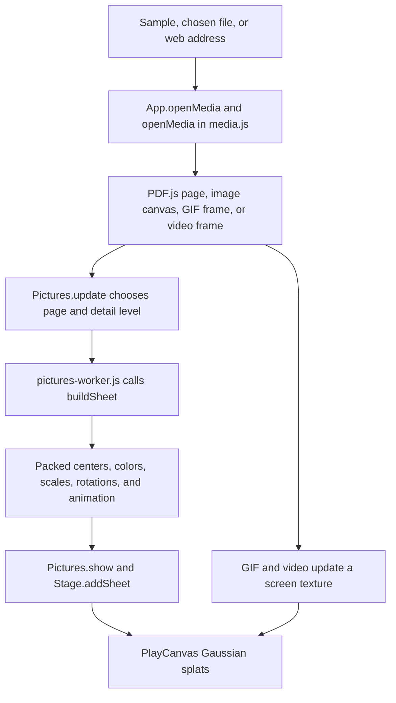

# Picture lab checkpoint, October 14, 2026

Part d of [Codex task 82](../codex/82-toy-checkpoints.md). Codex documented the existing toy; this
checkpoint changes no runtime code, assets, or tests. Later work must compare the same inputs,
views, and actions against this version and preserve its strengths.

## Where the checkpoint lives

| What                                                | Where                                                                                                                                                            | Commit                                     |
| --------------------------------------------------- | ---------------------------------------------------------------------------------------------------------------------------------------------------------------- | ------------------------------------------ |
| Whole repository, including all shared dependencies | `claude/checkpoint-toys-2026-10-14`                                                                                                                              | `41b21e74e04ccca178b95ac02b4e5dc0e51b4b45` |
| Phone clips and measurement records                 | [codex/toy-checkpoints-d-clips](https://github.com/ryanjosephkamp/splashery/tree/44f40d515018c918ba449fe6eeb20ff3f9dd85c9/docs/audits/toy-checkpoints-d-2026-10) | `44f40d515018c918ba449fe6eeb20ff3f9dd85c9` |

Never push to, rebase, or delete the Operator's checkpoint branch. The clips branch is evidence only
and must never be merged.
[Picture lab clip](https://github.com/ryanjosephkamp/splashery/blob/44f40d515018c918ba449fe6eeb20ff3f9dd85c9/docs/audits/toy-checkpoints-d-2026-10/bk-lab-taps.gif)
shows forward and backward paging at 390×844. Capture uses the real renderer and the existing
`tools/bk-clip.mjs`, with a manually advanced clock and sheet-readiness waits; playback speed is not
a frame-rate measurement. The
[evidence README](https://github.com/ryanjosephkamp/splashery/blob/44f40d515018c918ba449fe6eeb20ff3f9dd85c9/docs/audits/toy-checkpoints-d-2026-10/README.md)
records settings, commands, and validation results.

## How it works

The `picture-lab` entry in [`src/toys.js`](../../src/toys.js) selects the `pictures` pack, opens
behind the labs switch, and supplies a front-facing camera. Its recipe is `RECIPES["picture-lab"]`
in [`src/packs/pictures.js`](../../src/packs/pictures.js). It takes a PDF, a still image, an
animated GIF, or a video, from a chosen device file or a pasted web address. It requests no camera,
microphone, or location. Local files stay in the browser. An address causes a download from its
host: `readSource()` uses CORS and `credentials: "omit"`, and `checkMediaURL()` accepts HTTPS and
the local test-server exception.



1. **Open and decode.** `App.openMedia()` in [`src/app.js`](../../src/app.js) opens the source
   through [`src/media.js`](../../src/media.js), adopts it, and rebuilds the toy with its media
   metadata. `mediaKind()` identifies the type. `openPDF()` lazily imports the vendored PDF.js,
   opens the PDF's bytes, and renders requested pages to canvases. `openImage()` uses
   `createImageBitmap()` and `drawScaled()`, reducing large images in halving steps. `openGIF()`
   uses `ImageDecoder` when available, otherwise vendored omggif; `openVideo()` uses a browser video
   element and starts muted. PDF and GIF libraries load when needed.
2. **Place the page.** The recipe's `build(k)` makes a `k.sheet()` called `page`, centered at
   `[0, 0, 0]`, 2×2 recipe units, facing +Z. `Pictures.rect()` contains the source in that square
   while preserving its aspect ratio. `rect()` builds the slightly larger 2.08×2.08 gray backing
   card as flat splats at Z = −0.03. The `sharp` kernel sharpens edges; density 0.3 applies to the
   kit card, independently of the picture-sheet budget.
3. **Choose detail.** [`src/pictures.js`](../../src/pictures.js), class `Pictures`, transforms the
   sheet into toy coordinates and projects its corners in `screenWidth()`. `levelFor()` chooses
   widths on the ladder `round(128 × 2^(k/2))`, capped by the device tier and, for pictures, the
   source resolution. `update()` applies hysteresis: an existing level changes when the
   requested-to-shown ratio is above 1.3 or below 0.6, after a settling interval. `pump()`
   prioritizes visible sheets, then hidden sheets requested with `ahead`.
4. **Make splats.** `Pictures.build()` renders pixels and sends them to `buildOffThread()`.
   [`src/pictures-worker.js`](../../src/pictures-worker.js) calls `buildSheet()` in
   [`src/picture-splats.js`](../../src/picture-splats.js) and transfers the packed arrays back. If
   worker creation is unavailable, the same builder runs on the main thread. `Pictures.show()`
   installs a sheet container through the stage. An over-budget ink page is rendered and built again
   at a smaller size.
5. **Page or play.** `labTapAt()` gives left taps a backward pick and other page taps a forward
   pick. `drive()` reads every new tap through `pgTaps()`, handles a link or pop-out first, then
   wraps a PDF's page index through `pics.go()`. A video tap calls `togglePlay()`. GIF timing
   follows `Pictures.update()` and the decoded frame delays; the video pause action does not pause a
   GIF. A page change waits for raised figures to return. This lab replaces its page in place; it
   does not curl a leaf.
6. **Read and share.** `Pictures.text()` exposes a PDF text layer. `renderMediaText()` in
   [`src/ui.js`](../../src/ui.js) provides selectable words, Copy, and Find across pages; this is
   not OCR. `normalizeMedia()` in [`src/state.js`](../../src/state.js) keeps a remote URL and page
   in a scene. A local file is represented by its name and size, without its bytes; a recipient must
   reopen the file. `App.clearMedia()` returns to the sample.

### The splat math and the pop-out

`Pictures.methodFor()` selects `ink` for PDFs, `pixels` for images, and `screen` for GIFs and
videos. In `buildSheet()`:

- `pixels` puts a flat detail splat at each sampled pixel, over a coarse colored base.
- `ink` estimates paper with `paperBlocks()`: each 8×8 block averages pixels at or above its median
  lightness, dark blocks fall back to the page's common color, and two 3×3 smoothing passes join the
  blocks. Pixels differing from the interpolated paper by more than 0.075 in any normalized color
  channel get detail splats. This retains colored charts as well as text.
- Detail sigma is 0.6 pixel, base sigma is 0.45×8 pixels, and detail is lifted 0.75×8 pixels from
  the base. Two staggered base lattices and fine edge rows close gaps and sharpen the perimeter.
  These are this implementation's constants, not measured optical properties.
- `screen` stores UV coordinates in fixed geometry and samples a changing texture on the GPU.
  `uploadFrame()` updates colors without rebuilding the splats for every GIF or video frame.

The underlying representation is described by the opened
[Gaussian splatting project page](https://repo-sam.inria.fr/fungraph/3d-gaussian-splatting/). This
toy samples a flat sheet directly; it does not train a multi-view radiance field. The opened
[PDF.js API reference](https://mozilla.github.io/pdf.js/api/draft/module-pdfjsLib.html) is the
upstream source for PDF page rendering and text extraction.

`bk5Drive()`, `bk5Tap()`, `bk5Start()`, and `pgStep()` in the pack implement the shared pop-out: the
lab's whole still image is one figure, while `pdfFigures()` finds embedded PDF image boxes from
painting operators and `pdfLinks()` finds annotations. A drawn rectangle can select anything else.
Cropped sheets lift as separate parts, and `labDecorate()` draws the vacated area and shadow in the
original page. Up to three figures can stand up; a fourth returns the oldest. The phases are
`prep → rest → rise → up → fall → unhole → idle`.

For photos, `bk5Start()` crops at up to 518 pixels, calls `estimateDepth()` from
[`src/packs/photo-3d-depth.js`](../../src/packs/photo-3d-depth.js), and normalizes relative inverse
depth with `normalizeDepth()` in `photo-3d-core.js`. A dedicated worker under `src/depth/` runs the
vendored quantized Depth Anything V2 Small model and ONNX Runtime Web locally. Its opened
[upstream project page](https://depth-anything-v2.github.io/) explains the depth model; the toy uses
inferred relative relief, without a calibrated physical depth scale. No model loads merely to read
an ordinary page. `bk5IsPhoto()` uses border-color similarity to classify a PDF crop. Graphics use
`bk5Layers()` to raise contrasting shapes, with a dilation and smoothing pass, instead of running
the photo model.

`pgRelief()` normally multiplies the relief amount by the chosen depth. If `pgShape()` fits a plane
with R² > 0.9, it strengthens local detail after subtracting the plane and a wide blur, instead of
simply steepening the plane. `pgLayer()` makes flat cutout cards: photos use depth quantiles at 0.5
and 0.8; graphics use a 0.5 threshold. `buildSheet()` samples their maps nearest and keeps selected
ranges. These are illustrative cutouts, without reconstructed hidden sides.

### Every toy setting and media control

| Setting or action                  | Default and effect                                                                                                                                                                                              |
| ---------------------------------- | --------------------------------------------------------------------------------------------------------------------------------------------------------------------------------------------------------------- |
| Sample (`sample`)                  | `article`: `assets/toys/picture-lab/article.pdf`; `photo` selects `photo.jpg`. A chosen file replaces the sample.                                                                                               |
| Next page (`next`)                 | Pulse, ease 0.35. Left taps go back; right or center taps go forward, wrapping at the ends. A video tap plays or pauses.                                                                                        |
| Pop out (`pop`)                    | Toggle exposed in the top bar and remembered by the app. Turning it on enables figure taps; nothing rises automatically. Turning it off returns tapped figures.                                                 |
| Draw a box (`box`)                 | Toggle. `bk5Drag()` turns a drag into a rectangular crop to raise. A manually drawn figure can remain after Pop out is switched off.                                                                            |
| Pop-up layers (`layers`)           | Toggle. Existing figures return, and the next rises as cutout cards using the three pop-sheet slots.                                                                                                            |
| Depth slider                       | Appears for the selected raised figure. `pgSlider()` maps 0–1 to 1–5× in quarter steps; nondefault depths are saved as `toy.figures`, by page and box.                                                          |
| Double-tap and zoom                | `focusToggle()` requests a 2.08×2.08 page view; another double-tap releases it. Moving closer rebuilds the sheet with more detail.                                                                              |
| File, address, and sample buttons  | Open the accepted media, download a URL, or return to the sample. Previous and Next navigate media pages; the pictures API also supports direct page jumps. Video controls add play/pause and a time scrub bar. |
| Words on this page, Copy, and Find | Read/select/copy the PDF's existing text, and search across it. Scanned pages without text produce no words.                                                                                                    |

General Look and viewer controls live in the shared app, rather than recipe options. Detail sets the
sheet budget and pixel-ratio cap; tilt starts locked, turntable starts off, Reset view restores the
catalog camera, and the speaker button controls video sound and toy cues. This lab also advertises
`handsLevel1: true`, for the shared Hands-on whole-object interaction. Pop-outs temporarily free the
tilt so raised figures can be inspected from the side.

## The files that make it up

| Role                                           | Checkpoint files                                                                                                                                                                              |
| ---------------------------------------------- | --------------------------------------------------------------------------------------------------------------------------------------------------------------------------------------------- |
| Toy, card, actions, and pop-out logic          | `src/packs/pictures.js`                                                                                                                                                                       |
| Media decoding and limits                      | `src/media.js`, `src/loaders.js`; `vendor/pdfjs/`, `vendor/omggif/`                                                                                                                           |
| Sheet geometry, detail, cache, and packing     | `src/pictures.js`, `src/pictures-worker.js`, `src/picture-splats.js`                                                                                                                          |
| Kit and rendering integration                  | `src/kit.js`, `src/generators.js`, `src/player.js`, `src/stage.js`, `src/effects.js`, `src/pose.js`, `src/kernels.js`, `src/pc.js`, `vendor/playcanvas/playcanvas.min.mjs`                    |
| Opening, input panels, focus, and saved scenes | `src/app.js`, `src/ui.js`, `src/motion.js`, `src/camera.js`, `src/state.js`                                                                                                                   |
| Optional photo relief                          | `src/packs/photo-3d-depth.js`, `src/packs/photo-3d-core.js`, `src/depth/`, `vendor/depth-anything-v2-small/`, `vendor/onnxruntime-web/`                                                       |
| Samples and catalog metadata                   | `assets/toys/picture-lab/`, this toy's entries in `src/toys.js`, `src/toy-help.js`, `src/toy-sounds.js`, `tools/assets.json`, and `CREDITS.md`; the pack also imports `manual/pdf-edition.js` |

Behavior is defined by `tests/pic.spec.mjs` (types, URL failures, paging, links, embeds, and phone
ink), `tests/bk.spec.mjs` (media metadata, sheet preparation, and focus),
`tests/bk5-engine.spec.mjs` and `tests/bk5.spec.mjs` (PDF links, figures, crops, and relief),
`tests/pg6-engine.spec.mjs` and `tests/pg6.spec.mjs` (current multiple figures, layers, depth, and
lab pop-outs), `tests/vw.spec.mjs` (colored figures, gestures, and tilt), and
`tests/ops-text.spec.mjs` (PDF words). Fixtures live in `tests/fixtures/pic/`, `bk/`, and `bk5/`.
`tests/hh3-level1.spec.mjs` covers the lab's Hands-on capability.

## How to restore it

Start on a clean working tree; inspect the diff, preserve unrelated work, and use a new branch. The
fetch explicitly creates a local remote-tracking reference without modifying the saved branch.

```sh
git fetch origin main
git fetch origin claude/checkpoint-toys-2026-10-14:refs/remotes/origin/claude/checkpoint-toys-2026-10-14
git rev-parse origin/claude/checkpoint-toys-2026-10-14
git switch -c codex/restore-picture-lab origin/main
git checkout origin/claude/checkpoint-toys-2026-10-14 -- src/packs/pictures.js src/media.js src/pictures.js src/pictures-worker.js src/picture-splats.js assets/toys/picture-lab
```

Verify the printed SHA equals the checkpoint above. The command restores the complete shared picture
recipe and media pipeline, so it also rolls back **Your book, Photo album, Picture frame, and
Storybook**. Check those toys' files and actions before accepting it. `media.js` and the picture
engine also serve Screen and Gaussian splatting; `media.js` also serves Page breaker and live
streams. Their tests must pass. To restore only the lab recipe's behavior while preserving later
siblings, port its block and the necessary helpers from the checkpoint instead of replacing the
whole pack.

If the regression is in rendering, depth, or a library, inspect and restore the corresponding
manifest files separately. For photo relief, the exact dependency group is:

```sh
git checkout origin/claude/checkpoint-toys-2026-10-14 -- src/packs/photo-3d-depth.js src/packs/photo-3d-core.js src/depth vendor/depth-anything-v2-small vendor/onnxruntime-web
```

That group also affects Photo to 3D, Moving photo to 3D, Splat mirror, and other depth callers;
compare their own checkpoints and run their depth/relief specs. Restore PDF.js or omggif only when
they changed, retaining license files. Shared catalog/help/sound/credit entries should be ported
individually. A renderer or UI restore affects the whole toy box and requires the full suite,
including laptop and embed-transfer checks. Keep the current tests as regression guards; consult the
saved tests to understand a changed expectation instead of silently restoring them. Open a draft PR
and never merge the checkpoint branch itself.

## What it does best, limits, and later rounds

The checkpoint combines colored ink with smooth paper, sharp edges, zoom-dependent detail, streamed
page sheets, and readable PDF words. It shows ordinary images and moving media through the same
splat renderer, while reserving the depth model for explicit photo pop-outs.

Per-sheet budget parameters from `PICTURE_BUDGETS` are:

| Tier | Photo pixels | GIF/video screen | PDF ink splats | PDF width cap |
| ---- | -----------: | ---------------: | -------------: | ------------: |
| low  |      160,000 |          100,000 |        220,000 |      1,100 px |
| mid  |      320,000 |          180,000 |        420,000 |      1,600 px |
| high |      640,000 |          320,000 |        750,000 |      2,400 px |
| max  |    1,200,000 |          500,000 |      1,300,000 |      3,200 px |

These budgets are per sheet, not an aggregate guarantee. Photo and screen widths are capped using
the detail-pixel budget; base and edge splats add to the resulting count. The ink threshold triggers
one smaller rebuild, rather than a repeated hard-cap loop. `Pictures.remember()` targets
`max(600,000, budget.ink)` cached splats, but preserves currently installed sheets and at least one
cache item. The entire PDF is read into memory; bounding rendered sheets does not bound PDF parsing
or text caches. Device file caps are 60/100/150/200 MiB; decoded image limits are 16/24/40/64
megapixels, and PDF page limits are 2,000/5,000/10,000/20,000. Video file caps are
300/600/1,500/3,000 million bytes; playback also depends on browser codecs.

The saved PDF sample is **65,800 bytes**, and its photo is **269,347 bytes**, measured from the
checkpoint files. The optional depth model alone is **27,271,736 bytes**; the installed ONNX Runtime
directory totals **14,315,477 bytes**. Directory totals include support files and are not the exact
transferred payload. Phone-profile timings and active frame counts are recorded in the evidence
branch; software-rendered cloud measurements do not establish physical-phone performance. Clips
cover paging, not every media format or pop-out combination.

Single-run phone-profile measurements, October 14, 2026, using Chromium 151.0.7922.173, SwiftShader
WebGL2, 390×844 CSS pixels, device scale 2, low detail, and adaptation off, without competing
browser jobs. Sample-ready time excludes the app shell and includes matching requested sheets.
Active frame rate counts frameend events over about five wall-clock seconds with two taps and forced
rendering. It can include incomplete turns; it does not measure completed page turns per second or
physical-phone performance. No photo-depth inference ran.

| Sample ready | Active frames/s | Settled kit splats | Settled visible sheet splats |
| -----------: | --------------: | -----------------: | ---------------------------: |
|       1.93 s |           10.60 |             17,945 |                       31,997 |

Limits worth retaining in comparisons: there is no OCR, password-protected PDFs are rejected, CORS
can prevent address loading, very oblique views can expose the gap between paper and ink, and
inferred photo relief can misread a crop or arrive after the flat card has risen. A depth failure
leaves a flat figure. Later rounds could improve scan-text access, aggregate sheet budgets, mixed
PDF-page shapes, and cold pop-out feedback. Accept them only after comparing colored figures, scans,
photos, GIFs, videos, links, and saved scenes at the same phone profile.
