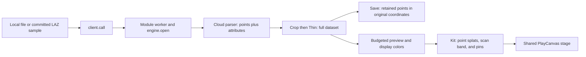

# Point clouds checkpoint, October 14, 2026

This preserves `point-clouds`, the labs-only Studio tool for lidar and other point files. Later work
must compare against this baseline, following [Photo to 3D's rule](photo-3d-checkpoint.md).

## Where the checkpoint lives

| What                                                    | Where                                                                                                                                                                                       |
| ------------------------------------------------------- | ------------------------------------------------------------------------------------------------------------------------------------------------------------------------------------------- |
| Whole repository                                        | `claude/checkpoint-toys-2026-10-14`                                                                                                                                                         |
| Immutable commit                                        | `41b21e74e04ccca178b95ac02b4e5dc0e51b4b45`                                                                                                                                                  |
| Evidence commit                                         | `a7092650d344b2eb66b15f747acf37712ae7cf05` on `codex/toy-checkpoints-e-clips`                                                                                                               |
| Phone review clip                                       | [390×844 Palace of Fine Arts scan sweep](https://github.com/ryanjosephkamp/splashery/blob/a7092650d344b2eb66b15f747acf37712ae7cf05/docs/audits/toy-checkpoints-e/point-clouds-390x844.webm) |
| Method, raw measurements, inventory, and capture script | [Clips-branch evidence](https://github.com/ryanjosephkamp/splashery/tree/a7092650d344b2eb66b15f747acf37712ae7cf05/docs/audits/toy-checkpoints-e)                                            |

Never push to, rebase, or delete the checkpoint branch. Never merge the clips branch.

## How it works

`POINT_CLOUDS` in `src/packs/viewers.js` opens local LAS, LAZ, point PLY, XYZ, PTS, or numeric
text/CSV files. It can also load one of three committed USGS lidar samples. No camera, microphone,
or live geographic feed is requested. `input.read` stores a reference to the selected file and calls
`openCloudSource`; the file remains on the device and is not embedded in a saved scene or share
link.



1. `src/viewers/client.js` starts `worker.js` lazily and sends commands to `engine.js`; array
   buffers transfer rather than being serialized as text. Node tools use the local engine fallback.
   `engine.open` dispatches to `readCloudFile` in `cloud-io.js`.
2. `readLas` handles LAS 1.0–1.4 point formats 0–10. `readLaz` uses laz-perf, loaded only for LAZ
   from `vendor/laz-perf/`. `readPointPly` handles point PLY, and `readXyz`/`readPts` scan numeric
   rows. A compressed Gaussian-splat PLY is redirected to the Splat toolkit.
3. The reader stores Float32 XYZ coordinates relative to an `origin`, preserving precision when
   survey coordinates are large. Intensity, classification, and RGB are retained where present.
   `cloudStats` records bounds, point count, attributes, density, format, disk bytes, and
   coordinate-array memory. This memory figure excludes browser, worker, and decode copies.
4. `cloudSettings` maps normalized crop sliders into a box in view axes, handles axis choice, and
   translates Thin into a multiple of the original `typicalSpacing`. `runCloudPipeline` crops first,
   then `thinCloud` retains the point closest to each occupied cube's center. These operations run
   over the whole dataset.
5. `engine.applyCloud` uses `evenPreview` to fit a separate display budget by voxel thinning and, if
   necessary, an even share. This is independent of the visitor's Thin setting. `cloudColors`
   supplies height, intensity, class, or RGB; absent attributes fall back to height. Height uses the
   full file's bounds, so crop does not change its color range; intensity uses 2nd/98th percentiles
   and a square-root brightness curve.
6. Optional `reliefShade` builds a grid of highest elevations, estimates slopes, lights them from
   the northwest, and darkens lower/edge points. It improves visual shape but is not a
   classification or terrain-reconstruction algorithm. `cloudToView` maps Z-up files to
   `[x, z, -y]`, or keeps Y-up coordinates.
7. `POINT_CLOUDS.build` centers/scales the view, emits equal round point splats sized from estimated
   spacing, draws any crop box and pins, and tags points with the `band` kind. `drive` animates a
   bright scan line across X over 2.6 seconds. It is a display effect; it does not simulate
   acquisition or change point coordinates.
8. With Measure on, `nearestDrawn` maps a picked recipe point back to view coordinates and searches
   the displayed points. Two pins give straight distance `sqrt(dx² + dy² + dz²)`, ground distance
   `sqrt(dx² + dz²)`, and rise `dy`. This measures nearest preview points, not arbitrary positions
   or hidden full-resolution points. The panel infers meter/foot labels from available CRS text; it
   does not reproject coordinates.
9. `saveCloud` exports the full retained dataset after crop/Thin in original coordinates, regardless
   of preview budget. `writeCloudFile` offers PLY, LAS 1.2, and XYZ. LAS/PLY retain millimeter-scale
   coordinate precision; XYZ is numeric text. These are point exports, not a trained Gaussian-splat
   reconstruction.

### Every setting and panel action

| Key (default)                     | What it changes                                                                                                                                                                          |
| --------------------------------- | ---------------------------------------------------------------------------------------------------------------------------------------------------------------------------------------- |
| `source` (`palace`)               | Palace of Fine Arts, Golden Gate/Fort Point, Meteor Crater, or a visitor's file.                                                                                                         |
| `color` (`height`)                | Height ramp, intensity grayscale, classification palette/legend, or file RGB; unavailable attributes fall back to height.                                                                |
| `shade` (`true`)                  | Enables the baked shaded-relief/rim adjustment.                                                                                                                                          |
| `size` (`1`)                      | Multiplies displayed point width; range 0.4–3 in steps of 0.1. Export coordinates do not change.                                                                                         |
| `measure` (`false`)               | Taps place two pins instead of the usual scan action; a third tap starts a new pair. Clear the pins removes both.                                                                        |
| `thin` (`off`)                    | Off, or one point per cube of 1.5, 3, 6, or 12 original typical spacings (`light`, `medium`, `strong`, `heavy`). Affects exported points too.                                            |
| `crop` (`false`)                  | Enables the crop box. `cropX0`, `cropX1`, `cropY0`, `cropY1`, `cropZ0`, and `cropZ1` are normalized 0–1 bounds, defaulting to 0/1, with step 0.01. Reversed bounds are sorted.           |
| `cropInvert` (`false`)            | Keeps points outside the crop instead of inside.                                                                                                                                         |
| `up` (`auto`)                     | Auto chooses Y for PLY and Z for other formats; explicit Y or Z overrides it. This rotates view axes without editing source coordinates.                                                 |
| Hidden `pinA`, `pinB`, `fileName` | Pins stored to three decimal places and a display filename. None stores the source file's bytes.                                                                                         |
| Open a point cloud                | File picker reads the selected file in memory; maximum accepted input is 300 MB for coarse-pointer devices or 1.2 GB otherwise. These limits do not guarantee sufficient decoded memory. |
| Save format and Save the points   | Exports the retained points as PLY, LAS, or XYZ via a local download.                                                                                                                    |
| Scan/Play and shared look/Detail  | Scan sweeps the bright band. Detail controls preview density, while orbit/pinch, splat scale, exposure, and background affect appearance.                                                |

`density: 3` is capped by each profile's maximum: the worker preview uses 97% of that budget, minus
400 points for decoration. The subsequent kit build can take a smaller share again. Turntable is off
by default, `pickAlpha = 0.02`, and the recipe selects the sharp kernel.

### Samples and sources

The committed LAZ files each contain 450,000 points, already reduced from their survey tiles:

| Sample                                    | File                                         |     Bytes |
| ----------------------------------------- | -------------------------------------------- | --------: |
| Palace of Fine Arts (default)             | `assets/toys/point-clouds/palace.laz`        | 3,522,038 |
| Golden Gate Bridge's south end/Fort Point | `assets/toys/point-clouds/golden-gate.laz`   | 3,568,831 |
| Meteor Crater                             | `assets/toys/point-clouds/meteor-crater.laz` | 3,635,717 |

The [USGS 3DEP lidar registry](https://registry.opendata.aws/usgs-lidar/) was opened on October 14,
2026; it describes the lidar archive and identifies the data as U.S. Government public domain. The
exact sample crops and project IDs are in `CLOUD_SAMPLES` and `tools/vwr-samples.mjs`. The direct
USGS program page returned HTTP 403 and was not independently read. Spacing, colors, shading, axis
conversion, and measurement formulas above are traced from the implementation rather than attributed
to a physical simulator.

## The files that make it up

| Role                         | Files                                                                                                                                            |
| ---------------------------- | ------------------------------------------------------------------------------------------------------------------------------------------------ |
| Recipe and panel             | `src/packs/viewers.js` (`POINT_CLOUDS`, `openCloudSource`, `cloudSettings`, `nearestDrawn`, `renderCloudPanel`, and `cloudState`)                |
| Background work              | `src/viewers/client.js`, `src/viewers/worker.js`, `src/viewers/engine.js`                                                                        |
| Point formats and operations | `src/viewers/cloud-io.js`, `src/viewers/cloud-ops.js`                                                                                            |
| Shared PLY/grid helpers      | `src/viewers/splat-io.js`, `src/viewers/splat-ops.js`                                                                                            |
| Lazy codecs and export       | `vendor/laz-perf/`, `vendor/webp/` (shared engine import, Splat toolkit's codec), `src/exports.js`                                               |
| Data and reproduction        | `assets/toys/point-clouds/`, `tools/vwr-samples.mjs`, `tools/vwr-fixtures.mjs`, `tools/vwr-clip.mjs`, `tests/fixtures/vwr/`                      |
| Behavior tests               | `tests/vwr.spec.mjs`: LAS/PLY/XYZ/PTS parsing, export round trips, crop/Thin, colors/distances, real LAZ worker loading, and two-tap measurement |

The runtime envelope includes the shell (`src/app.js`, `src/ui.js`, `src/state.js`, and
`src/camera.js`) and `src/kit.js`, `src/generators.js`, `src/player.js`, `src/motion.js`,
`src/stage.js`, `src/effects.js`, `src/kernels.js`, `src/pc.js`, and PlayCanvas 2.22.3 in
`vendor/playcanvas/`. Global records are this toy's entries in `src/toys.js`, `src/toy-help.js`,
`src/toy-sounds.js`, `src/site-toy-pages.js`, `tools/toy-plan.json`, `tools/toy-dates.json`,
`tools/assets.json`, `CREDITS.md`, and `LICENSES.md`. Keep those entries selectively.

## How to restore it

For an exact runnable copy, fetch the branch into an explicit remote-tracking ref, verify the SHA,
and create a separate worktree:

```sh
git fetch origin claude/checkpoint-toys-2026-10-14:refs/remotes/origin/claude/checkpoint-toys-2026-10-14
git rev-parse origin/claude/checkpoint-toys-2026-10-14
# Must print 41b21e74e04ccca178b95ac02b4e5dc0e51b4b45.
git worktree add -b restore-point-clouds ../restore-point-clouds 41b21e74e04ccca178b95ac02b4e5dc0e51b4b45
```

For a targeted restore from current `main`, after that check:

```sh
git fetch origin main
git switch -c restore-point-clouds-current origin/main
git checkout origin/claude/checkpoint-toys-2026-10-14 -- src/packs/viewers.js src/viewers src/exports.js vendor/laz-perf vendor/webp assets/toys/point-clouds tests/vwr.spec.mjs tests/fixtures/vwr tools/vwr-samples.mjs tools/vwr-fixtures.mjs tools/vwr-clip.mjs
```

`viewers.js` and its worker/format/grid helpers also implement the Splat toolkit. Recheck its
formats, crop, floater removal, comparison, and exports after this restore. `exports.js` serves
other download tools; check those too if it changed. The command restores both viewers' helpers,
fixtures, and codecs, but only this toy's sample assets. Compare the toolkit's current assets and
interface with the restored implementation. If common engine files changed, this targeted restore is
not necessarily the exact checkpoint: compare dependencies or use the full worktree. Run
`vwr.spec.mjs`, then `smoke`, `kit`, `unit`, scene compatibility, and embed checks as needed, and
open a draft restore PR.

## What it does best, measured limits, and later rounds

Measured on October 14, 2026, in Chromium 151.0.7922.173 with SwiftShader WebGL2, a 390×844
mobile/touch viewport, DPR 1, and `profile=low&adapt=off`. The stage canvas was 390×645 inside the
app UI. Each toy used a fresh context after app boot. Load time ends after `chooseToy`, any initial
chunk loading, and one captured frame. Rendering was measured over five seconds of requested frames
(camera turning except for the tilt-locked Powers of ten). These are single local-server,
software-renderer observations, not physical-phone FPS or internet load benchmarks. Video recording
was off during measurement.

| Load after selection | Observed asset bytes | Rendered FPS | Median / 95th-percentile frame interval |
| -------------------: | -------------------: | -----------: | --------------------------------------: |
|               1.84 s |            3,575,167 |          6.0 |                        162.4 / 211.6 ms |

The worker retained all 450,000 default sample points and displayed 111,663. Its
coordinate/attribute arrays reported 6,750,000 bytes, excluding temporary codec/buffer memory.
Observed asset responses totaled 3,575,167 bytes: the 3,522,038-byte LAZ plus the app's 53,129-byte
background flags metadata. The file has classification and intensity, but no RGB. No page errors or
failed network requests were recorded in this default-view run.

Its strength is an interactive, sharp preview of real survey points while crop, Thin, and Save
operate on the complete retained dataset. Relative coordinates reduce loss of precision for large
survey origins; exports preserve those original coordinates.

Limits: it loads whole files; LAZ decoding also allocates codec and raw-record buffers; preview
thinning can omit small features; measurement snaps to displayed points; CRS labels are limited and
no projection conversion is performed; and missing RGB/class/intensity cannot be recovered. The
automatic up-axis guess is format-based, not a survey guarantee. A failed sample/parser shows an
error and can build a gray placeholder grid; that grid is not lidar data. Browser LAZ verification
is essential because the Node-only tools cannot use the browser's LAZ loader.

Later rounds should compare all three scans, class/intensity/RGB fallbacks, crop-in/out, Thin,
two-pin measurements, and exported counts/attributes. Useful improvements are loading large files in
chunks, identifying CRS units more explicitly, and picking from a full-resolution index while
retaining the existing smooth preview. Keep the distinction between displayed and saved point counts
visible.

Keep a later change only if it is at least as good on every established measure, with the same
samples, settings, and device profile. Compare clips and rerun the behavior tests; a sharper still
alone does not establish an improvement.
