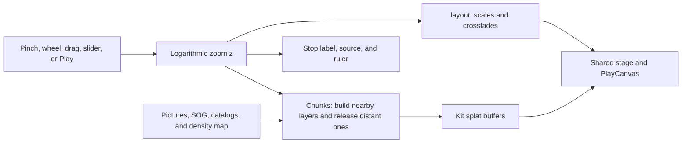

# Powers of ten checkpoint, October 14, 2026

This is the saved baseline for `powers-of-ten`, the Space shelf's labs-only zoom through
astronomical, everyday, and microscopic scales. Follow the same preservation rule as
[Photo to 3D](photo-3d-checkpoint.md): later work must compare against this version and keep its
strengths.

## Where the checkpoint lives

| What                                                | Where                                                                                                                                                                                   |
| --------------------------------------------------- | --------------------------------------------------------------------------------------------------------------------------------------------------------------------------------------- |
| Whole repository                                    | `claude/checkpoint-toys-2026-10-14`                                                                                                                                                     |
| Immutable commit                                    | `41b21e74e04ccca178b95ac02b4e5dc0e51b4b45`                                                                                                                                              |
| Evidence commit                                     | `a7092650d344b2eb66b15f747acf37712ae7cf05` on `codex/toy-checkpoints-e-clips`                                                                                                           |
| Phone review clip                                   | [390×844 zoom through seven scales](https://github.com/ryanjosephkamp/splashery/blob/a7092650d344b2eb66b15f747acf37712ae7cf05/docs/audits/toy-checkpoints-e/powers-of-ten-390x844.webm) |
| Measurement method, raw results, and capture script | [Evidence on the clips branch](https://github.com/ryanjosephkamp/splashery/tree/a7092650d344b2eb66b15f747acf37712ae7cf05/docs/audits/toy-checkpoints-e)                                 |

Never push to, rebase, or delete the checkpoint branch. The clips branch is evidence only and must
never be merged. The clip samples scales with the Zoom slider; it is not a recording of the entire
70-second Play journey.

## How it works

No file, camera, microphone, location permission, or live feed is needed. The toy loads committed
pictures, a trained SOG capture, star catalogs, and a cryo-EM map only as the zoom approaches them.
`src/powers/stops.js` fixes the target at latitude `38.888321`, longitude `-77.025649`, and names 18
stops. Their labels, sizes, and original source records are in
[the evidence ledger](../evidence/powers-of-ten.json).



`src/packs/powers-of-ten.js` exports `RECIPES`, `LAYERS`, `layout`, `journey`, `rulerFor`, and
`power`. Its `RECIPE.drive` treats `z` as the base-10 logarithm of the view height in meters. A
layer anchored at exponent `e` gets scale `10 ** (e - z)`, so one increment of `z` changes the
physical field of view tenfold. `U = 1.9` is the recipe-space reference height.

`layout` smoothsteps each layer's entry and exit, hides coarser layers beneath opaque picture
layers, and removes layers enlarged beyond 1,000×. `solidFade` compensates overlapping splats during
the ribosome transition. `drive` asks `src/chunks.js` to build layers when `-2.2 < e - z < 1.8` and
drops them outside `[-3.2, 2.8]`. Layers receive their own scale, small frontward offset, and fade;
the camera keeps its framing instead of flying across enormous coordinates.

The data becomes splats as follows:

| Scale                          | Functions and representation                                                                                                                                                                                                                                                                                                                      |
| ------------------------------ | ------------------------------------------------------------------------------------------------------------------------------------------------------------------------------------------------------------------------------------------------------------------------------------------------------------------------------------------------- |
| Galaxy                         | `buildGalaxy` maps the pixels of `real-galaxies/m83.jpg` into the galactic plane. M83 stands in for the Milky Way, at the code's adopted size and center; it is not a photograph of our galaxy from outside.                                                                                                                                      |
| Local and nearby stars         | `buildLocalStars` reads `stars-500pc.bin`; `buildNearStars` reads the nearby-star JSON. `starDots` places catalog stars, uses absolute magnitude for visual brightness and size, and uses `starColor` for an approximate temperature-to-RGB conversion. The low tier keeps 25,000 of the local catalog's brightest stars.                         |
| Solar system                   | `buildPlanets`, `buildMoon`, and `buildSunAlone` draw positions, orbit paths, markers, and textured bodies from `src/powers/sky.js`. Planet dots are visual markers, not bodies drawn at their true radii.                                                                                                                                        |
| Earth and aerial views         | `buildGlobe` samples the near hemisphere with a Fibonacci cap. `buildAerial` inverts Web Mercator and places pixels in east, north, and up coordinates on a spherical Earth. Ten aerial images span exponents 6 through 1.5 at half-decade intervals.                                                                                             |
| Garden bed                     | `buildBed` calls `loadTrained` from `src/packs/fidelity.js` on `maple-tree-lite.sog`, recenters on the crown, estimates a 2 m extent, rotates it to a top view, and thins by tier. The capture was made elsewhere and placed in this garden.                                                                                                      |
| Leaves, cells, and chloroplast | `pixelsOf`, `buildPicture`, and the `MICRO` table turn precomputed crops into flat, viewer-facing splats, with soft or round edges. These are photographs and micrographs, not reconstructions of one continuous specimen.                                                                                                                        |
| Ribosome                       | `ribosomeMap` calls `readDensity`, `readBackbone`, and `isoPointsPerVoxel` from `src/science/density.js`. `buildRibosome` draws an isosurface at the stored contour level, colors it by nearby RNA/protein chains, and blends a flattened micrograph-colored version into the colored 3D surface. Ångströms are converted to meters with `1e-10`. |

The low tier generally samples pictures at 360 pixels per side, the hemisphere at 400, and the
galaxy at 420. The garden capture allows up to 120,000 sampled splats, and the colored ribosome
about 90,000, on that tier. These are per-layer targets: multiple layers can coexist, so the global
kit budget is not a cap on the sum of all streamed chunks.

### Settings and gestures

| Setting or action               | Effect                                                                                                                                                                                                       |
| ------------------------------- | ------------------------------------------------------------------------------------------------------------------------------------------------------------------------------------------------------------ |
| Zoom slider                     | `sliderInput("zoom", v)` maps `v = 0` to `z = 21.6` and `v = 1` to `z = -7.6`. Home is `z = 0.3`. The rounded exponent in the label is not the exact continuous zoom value.                                  |
| Pinch, scroll, or vertical drag | The recipe owns zoom (`zoom: true`); logarithmic input changes `z` by four decades per natural-log unit. Movement eases with a 0.18-second time constant.                                                    |
| Tap or Play                     | Starts `journey`, a 70-second cosine-eased route from home out to the galaxy, down to the smallest stop, and back home. The shared player supplies pause/resume for a long action.                           |
| Reset view                      | Returns the zoom goal to the garden through the recipe's reset counter.                                                                                                                                      |
| Detail/device profile           | Changes picture sampling, catalog sampling, and layer budgets. Automatic adaptation is part of the shared player; the evidence fixes `profile=low&adapt=off` for comparison.                                 |
| Camera and look controls        | `tiltLock: true` and `turntable: false` keep the geographic view aligned. Shared look controls still affect rendering; the recipe uses a black backdrop, the sharp kernel, and a `render.cull` value of 0.5. |

There are no recipe `options` or custom-input controls. `CLIP.z` is a tool override, normally
`null`; it is not a visitor setting. `stopAt` chooses the nearest stop, and `rulerFor` selects a
readable 1, 2, or 5 multiple in light-years, AU, kilometers, meters, centimeters, millimeters,
micrometers, or nanometers.

### Science and sources

The coordinate calculations are explicit in `src/powers/sky.js`: equatorial/ecliptic/galactic
coordinates are rotated into east, north, and up at one fixed time, **October 7, 2026, at 12:54 p.m.
EDT**. `planetEcl` advances orbital elements and solves Kepler's equation with eight Newton
iterations. This follows
[JPL's approximate-position method and Table 1](https://ssd.jpl.nasa.gov/planets/approx_pos.html),
whose stated interval is 1800–2050. The Moon uses a truncated lunar series; the code does not claim
ephemeris precision.

[ESO's M83 image](https://www.eso.org/public/images/eso0825a/) supplies the galaxy stand-in;
[EMD-48329](https://www.ebi.ac.uk/emdb/EMD-48329) identifies the arbekacin-bound bacterial 70S
ribosome map and its fitted model. These three pages were opened on October 14, 2026. Remaining
image/catalog attribution and size evidence are preserved in `CREDITS`, `STOPS`, and the linked
evidence ledger; this checkpoint does not independently revalidate every historical source.

## The files that make it up

| Role                           | Files at the saved commit                                                                                                                                                                                                                                                                            |
| ------------------------------ | ---------------------------------------------------------------------------------------------------------------------------------------------------------------------------------------------------------------------------------------------------------------------------------------------------- |
| Recipe, stops, and coordinates | `src/packs/powers-of-ten.js`, `src/powers/stops.js`, `src/powers/sky.js`                                                                                                                                                                                                                             |
| Streaming and conversion       | `src/chunks.js`, `src/packs/fidelity.js`, `src/science/density.js`                                                                                                                                                                                                                                   |
| Toy-owned data                 | All files under `assets/toys/powers-of-ten/`                                                                                                                                                                                                                                                         |
| Shared data used here          | `assets/toys/maple-tree/maple-tree-lite.sog`, `assets/toys/real-galaxies/m83.jpg`, `assets/toys/nearby-stars/stars.json`, `assets/toys/real-worlds/earth-color.jpg`, `assets/toys/real-worlds/moon-color.jpg`, `assets/toys/cryoem-map/ribosome.vol.gz`, `assets/toys/cryoem-map/ribosome-model.bin` |
| Reproduction tools             | `tools/pot-maps.mjs`, `tools/pot-micro.mjs`, `tools/pot-stars.mjs`, `tools/pot-clip.mjs`                                                                                                                                                                                                             |
| Behavioral tests               | `tests/pot.spec.mjs` (stop evidence, sky checks, near-home loading under 8 MB, gestures, labels, endpoint loading, and Play), `tests/pot-engine.spec.mjs` (chunks, zoom ownership, framing, and rulers)                                                                                              |

The shared runtime envelope includes the shell (`src/app.js`, `src/ui.js`, `src/state.js`, and
`src/camera.js`) and `src/kit.js`, `src/generators.js`, `src/player.js`, `src/motion.js`,
`src/stage.js`, `src/effects.js`, `src/kernels.js`, `src/pc.js`, and
`vendor/playcanvas/playcanvas.min.mjs`, reached through the app/import-map shell. Registration,
help, sound, dates, and site metadata also live in `src/toys.js`, `src/toy-help.js`,
`src/toy-sounds.js`, `src/site-toy-pages.js`, `tools/toy-plan.json`, `tools/toy-dates.json`,
`CREDITS.md`, and `tools/assets.json`. Restore this toy's entries selectively; those are global
lists. All of these files are already preserved by the whole-repository checkpoint.

## How to restore it

For an exact runnable copy, fetch into an explicit remote-tracking ref (a fetch of only the branch
name may leave only `FETCH_HEAD` in a narrowly configured checkout), verify the SHA, and create a
separate restore worktree:

```sh
git fetch origin claude/checkpoint-toys-2026-10-14:refs/remotes/origin/claude/checkpoint-toys-2026-10-14
git rev-parse origin/claude/checkpoint-toys-2026-10-14
# Must print 41b21e74e04ccca178b95ac02b4e5dc0e51b4b45.
git worktree add -b restore-powers-of-ten ../restore-powers-of-ten 41b21e74e04ccca178b95ac02b4e5dc0e51b4b45
```

For a targeted restore on a new branch from current `main`, after that SHA check:

```sh
git fetch origin main
git switch -c restore-powers-of-ten-current origin/main
git checkout origin/claude/checkpoint-toys-2026-10-14 -- src/packs/powers-of-ten.js src/powers src/chunks.js src/packs/fidelity.js src/science/density.js assets/toys/powers-of-ten assets/toys/maple-tree/maple-tree-lite.sog assets/toys/real-galaxies/m83.jpg assets/toys/nearby-stars/stars.json assets/toys/real-worlds/earth-color.jpg assets/toys/real-worlds/moon-color.jpg assets/toys/cryoem-map/ribosome.vol.gz assets/toys/cryoem-map/ribosome-model.bin tests/pot.spec.mjs tests/pot-engine.spec.mjs docs/evidence/powers-of-ten.json tools/pot-maps.mjs tools/pot-micro.mjs tools/pot-stars.mjs tools/pot-clip.mjs
```

This targeted command assumes the shared runtime is compatible. Compare its changes with the
checkpoint before selectively restoring it; use the full worktree for a guaranteed exact build.
Check the maple capture, nearby stars, real galaxies, Earth/Moon toys, and Cryo-EM map after
restoring shared assets. `fidelity.js` serves trained recipes across shelves, and `density.js`
serves Cryo-EM map; changes to streaming or the runtime require broader kit and embed checks. Run
both `pot` specs, `sci3.spec.mjs` for the shared density map, and `smoke`, `kit`, `unit`, scene
compatibility, and embed tests before proposing a restore PR. Never merge the restore directly.

## What it does best, measured limits, and later rounds

Measured on October 14, 2026, in Chromium 151.0.7922.173 with SwiftShader WebGL2, a 390×844
mobile/touch viewport, DPR 1, and `profile=low&adapt=off`. The stage canvas was 390×645 inside the
app UI. Each toy used a fresh context after app boot. Load time ends after `chooseToy`, any initial
chunk loading, and one captured frame. Rendering was measured over five seconds of requested frames
(camera turning except for the tilt-locked Powers of ten). These are single local-server,
software-renderer observations, not physical-phone FPS or internet load benchmarks. Video recording
was off during measurement.

| Load after selection | Observed asset bytes | Rendered FPS | Median / 95th-percentile frame interval |
| -------------------: | -------------------: | -----------: | --------------------------------------: |
|               3.73 s |            4,248,305 |          4.6 |                        207.5 / 420.6 ms |

The 5,404 splats in the root kit are the backdrop/framing only; visible content is in streamed
chunks. Six chunks were ready near home: two aerial views, the bed, the crown, and two leaf crops.
The 4,248,305 observed asset bytes include nearby prefetched layers. This measures the garden
opening, not frame rate throughout the entire zoom route. No page errors or failed network requests
were recorded in this default-view run.

Disk sizes at the checkpoint: the garden's lite SOG is 3,883,165 bytes, the local-star binary
978,230 bytes, and the ribosome map plus model 1,366,477 bytes. The toy-owned picture/catalog
directory and shared sample sizes are enumerated in the evidence inventory. Pictures are fetched
near their scale, not all at startup; touring every stop costs more than opening at home.

Its strength is a continuous, labeled comparison of sizes with a meaningful source and ruler at each
stop. Limits are visible: aerial images come from different dates, leaves have estimated sizes, the
bed was transplanted, and the plant micrographs and bacterial ribosome do not belong to that garden
specimen. Between image resolutions it magnifies existing pixels, and the galaxy is a declared
substitute. `ribosomeData` and the trained-file cache can retain decoded data even after visible
chunks are dropped; chunk release is not a measurement of total memory release.

Later rounds should compare the garden opening, all transitions, both zoom endpoints, and the full
Play route at the same profile. Preserve lazy loading, geographic alignment, readable labels, and
the distinctions between measured data and substitutions. Possible improvements are clearer
source/date transitions, measured peak memory across a full journey, and better imagery between the
leaf and cell scales. Do not remove the substitutions' explanations to make the journey appear more
literal.

Keep a later change only if it is at least as good on every established measure, with the same
samples, settings, and device profile. Compare clips and rerun the behavior tests; a sharper still
alone does not establish an improvement.
