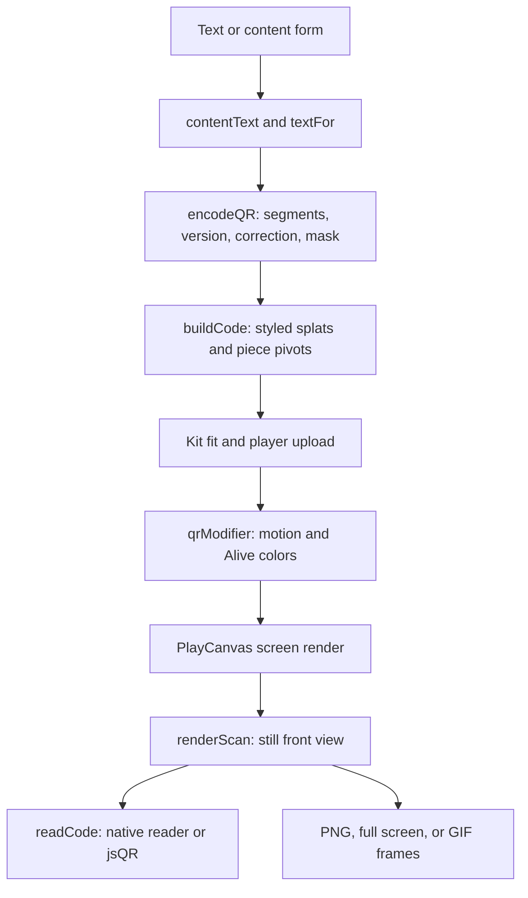

# QR code checkpoint, October 14, 2026

This saves the QR code toy (`qr-code`) as a baseline for later work: its readable splat styles,
solid-piece motions, living colors, exports, and circular sticker. It follows the
[Photo to 3D checkpoint](photo-3d-checkpoint.md). Codex task 82a documents the saved code; it does
not change the toy.

## Where the checkpoint lives

| What                               | Where                                                             | Commit                                     |
| ---------------------------------- | ----------------------------------------------------------------- | ------------------------------------------ |
| Whole repository                   | `claude/checkpoint-toys-2026-10-14`                               | `41b21e74e04ccca178b95ac02b4e5dc0e51b4b45` |
| Phone clips and measurement record | `codex/toy-checkpoints-a-clips`, `docs/studio/toy-checkpoints-a/` | `3bc16ee3e1c433abc3d6ad6aab1652899c9145ea` |

Never push to, rebase, or delete the saved checkpoint branch. The code inspected and captured for
this document is that commit. The documentation branch is `codex/toy-checkpoints-a`.

## How it works

The recipe is `RECIPES["qr-code"]` in [src/packs/qr.js](../../src/packs/qr.js). It is a labs-only
Studio toy. It takes text or a small form, with no camera, microphone, file upload, link shortener,
or remote encoding service. The pictures used to check it are rendered internally.



1. `fieldsOf()`, `optionsFor()`, and `textFor()` assemble the payload. `contentText()` in
   [src/qr/content.js](../../src/qr/content.js) makes plain text, a link, a `WIFI:` network string,
   a `MECARD:` contact, `mailto:`, `tel:`, `SMSTO:`, or `geo:` text. The forms include network name,
   password, security, and hidden-network status; contact name, phone, email, organization, and
   website; email recipient, subject, and body; phone number; message number and body; or latitude
   and longitude. Coordinates are rounded to six decimal places, and invalid ones become zero.
   Fields needing delimiters are escaped.
2. `codeFor()` calls `encodeQR()` in [src/qr/encode.js](../../src/qr/encode.js). Vendored Nayuki
   `QrSegment.makeSegments()` chooses a numeric, alphanumeric, or byte segment;
   `QrCode.encodeSegments()` chooses the smallest fitting version, adds correction codewords, and
   selects a mask. Correction may be boosted when it fits the same version: the displayed level can
   exceed the requested one. `rolesOf()` marks finder, alignment, timing, and format modules; finder
   and alignment patterns get their own solid-piece pivots.
3. `buildCode()` in [src/qr/build.js](../../src/qr/build.js) returns styled splats, the extent,
   depth, and detail per module. One recipe unit is one module: +X right, +Y up, +Z toward the
   viewer, with row zero at the top. `painter()` in [src/qr/crisp.js](../../src/qr/crisp.js)
   combines two staggered flat lattices with rings of thin splats along exposed edges. `TUNE`
   controls edge widths, spacing, and budget-dependent coarsening. Light modules share a background
   sheet; a plate sits behind it. Each moving splat carries its pivot and piece width in `params`.
4. The recipe's `build()` uses `k.reach()` and `k.cloud()`; `buildRecipe()` in `src/kit.js` fits the
   result, and `Player.buildKit()` in `src/player.js` sends it to the renderer. `density: 2` asks
   for twice the tier's usual budget, capped by that tier's maximum. At Low, the cap is 120,000
   splats. These are generated splats, not a downloaded scan or a trained reconstruction.
5. `drive()` sends the active motion, progress, tap position, and Alive phase to `qrModifier()` in
   [src/qr/field.js](../../src/qr/field.js), which supplies GLSL and WGSL programs. Modules and
   finder or alignment patterns normally move as rigid pieces. Fold moves the sheet as folded paper;
   Point cloud disperses individual splats. Motion paths are authored animations, rather than a
   measured rigid-body simulation. Sounds start with the corresponding motion.
6. `scanPose()`, `snapScanView()`, and `renderScan()` fit the code front-on using the 38° field of
   view and the Kit transform. `runCheck()` renders a 720 × 720 still, waits for sorting, and calls
   `readCode()` in [src/qr/scan.js](../../src/qr/scan.js). The browser's `BarcodeDetector` is tried
   when available; otherwise jsQR tries the image and its half-size version, including inversion.
   Success means the decoded payload equals the encoded payload. Automatic checks run after a build
   settles. `hold()` hides the capture behind a labeled still, with a 20-second release timeout. A
   successful internal check is evidence about this rendered view, not every phone.

### Every toy setting

The default payload is `https://ryanjosephkamp.github.io/splashery/`. Recipe options are saved in
scenes and share links; controls live in the scene's motion state. Hidden options have custom
controls in `renderPanel()` rather than ordinary option rows.

| Option                   | Default and choices                                                       | What changes                                                                                            |
| ------------------------ | ------------------------------------------------------------------------- | ------------------------------------------------------------------------------------------------------- |
| `kind`, `text`, `fields` | Link; default URL; empty JSON form                                        | Payload and structured content, as described above                                                      |
| `shape`                  | Square; Circle                                                            | The outer sticker extent and decoration; the encoded square stays intact                                |
| `style`                  | Classic; Dots, Rounded, Bricks, Gems, Bubbles, Neon                       | Geometry, depth, and initial color or plate preset; a selected theme keeps its colors                   |
| `ecc`                    | Auto; L, M, Q, H                                                          | Auto requests M; greater correction usually needs more modules, and boosting can raise the actual level |
| `fg`, `bg`               | `#14161c`, `#ffffff`                                                      | Code and light-sheet colors                                                                             |
| `gradient`, `fg2`        | None; Linear or Radial; `#1d4f9c`                                         | Blend the code color toward the second color                                                            |
| `eyes`, `eye`            | Same as the code; Own color; `#b3261e`                                    | Finder-pattern color                                                                                    |
| `plate`                  | Paper; Wood, Metal, None                                                  | Backing material, independent of the encoded bits                                                       |
| `back`                   | `#e8743b`                                                                 | Tile back color visible while flipping                                                                  |
| `wave`                   | `#1d4f9c`                                                                 | Alive's accent color                                                                                    |
| `alivePattern`           | Wave; Sweep, Pulse, Flowing gradient, Rainbow, Current, Charge, Scan line | Living color shader pattern                                                                             |
| `theme`                  | None                                                                      | Applies colors, gradient, eyes, wave, and tile back together; see `THEMES` in `src/qr/themes.js`        |

Themes are Sunset, Ocean, Forest, Neon, Pastel, Monochrome, Ink and paper, Candy, Autumn, Mint,
Royal, and Lava, plus flag colors for the United States, United Kingdom, Canada, Mexico, Brazil,
Argentina, France, Germany, Italy, Spain, Ireland, Netherlands, Sweden, Ukraine, Greece, India,
Japan, South Korea, China, Australia, South Africa, Nigeria, Kenya, and Jamaica. `flagTheme()` uses
a pale background, darkens module colors to the contrast target, and moves unsuitable pale colors to
Alive or tile backs. It uses colors, not flag symbols. Choosing None restores the style preset. The
Neon wall button switches between glowing light-on-dark and dark-on-light presets.

| Motion control | Duration at normal speed | Behavior                                                           |
| -------------- | ------------------------ | ------------------------------------------------------------------ |
| `assemble`     | 3.2 s                    | Pieces gather from outside and lock into place                     |
| `flip`         | 3.4 s                    | A diagonal wave turns tiles over and back                          |
| `burst`        | 3.6 s                    | Pieces scatter, tumble, land, and return                           |
| `ripple`       | 3.8 s                    | A radial wave raises and tilts tiles                               |
| `flap`         | 4.2 s                    | Rows flip like a split-flap display                                |
| `fold`         | 5.0 s                    | The right half and then the top fold and unfold                    |
| `rain`         | 4.4 s                    | Pieces rise and rain back into the grid                            |
| `knock`        | 2.8 s                    | A tap knocks nearby pieces loose; another tap starts a fresh knock |
| `cloud`        | 5.2 s                    | Individual splats disperse and regroup                             |
| `alive`        | Off by default           | Continuous living colors; selecting an Alive pattern turns it on   |
| `speed`        | 0.5 on a 0–1 slider      | Alive rate `4^(2v-1)`: 0.25×, 1×, and 4× at 0, 0.5, and 1          |

Tap or Play uses **Knock loose**, rather than Burst. The active motion ends on the exact resting
grid. Alive phase advances at `1.8 × speedOf(speed)` radians per second; electric patterns limit
brightening to preserve contrast. Scan view resets the camera. Check that it scans reads a still;
Full screen presents a still code alone and closes on tap or Escape. `savePNG()` exports a
1,600-pixel square with the quiet zone. `makeGIF()` defaults to 480 pixels at 12.5 fps, followed by
a 1.6-second still; the looping Alive export uses a complete phase cycle. Save a GIF uses the last
active motion. Record and Save splats are shared site exports in `src/exports.js`.

### Math, sources, and sharing

QR versions have `N = 17 + 4v` modules per side. The four-module quiet zone and approximate L/M/Q/H
correction figures come from the opened [QR sizing guide](https://www.qrcode.com/en/howto/code.html)
and [error-correction explanation](https://www.qrcode.com/en/about/error_correction.html). The
latter describes correction of **codewords**, not a guarantee for an arbitrary damaged area. The
opened [Nayuki library page](https://www.nayuki.io/page/qr-code-generator-library) and
[encoding walkthrough](https://www.nayuki.io/page/creating-a-qr-code-step-by-step) explain the
encoder, masks, and function patterns. `luminance()` and `contrast()` implement the linearized sRGB
luminance ratio described in the opened
[WCAG contrast explanation](https://www.w3.org/WAI/WCAG22/Understanding/contrast-minimum.html). WCAG
is the formula source; its text contrast criterion is not a QR scanning standard.

Circle is a decorated sticker around a standard square QR code. `shapeHalf()` computes radius
`ceil(sqrt(2) × (N/2 + 4) + 2) + 0.5`; `circleLayout()` deterministically picks decoration outside
the quiet zone and rejects finder-like runs. Decoration carries no extra payload. The
[circular QR audit](../audits/circular-qr-2026-10.md) records why the standard margin was retained.

`SECRET` keeps the Wi-Fi password in page memory. `shareableFields()` leaves it out of saved
options, JSON, and `#s=` links, so a recipient must enter it again. A PNG or GIF of the actual Wi-Fi
code does encode that password. Other payload fields travel in saved scenes and links. No decoding
follows the encoded URL or sends it to a server.

## The files that make it up

- Recipe and UI: `src/packs/qr.js`.
- Encoding, geometry, colors, circular shape, motion, and reading: `src/qr/encode.js`,
  `src/qr/build.js`, `src/qr/crisp.js`, `src/qr/circle.js`, `src/qr/content.js`, `src/qr/themes.js`,
  `src/qr/field.js`, and `src/qr/scan.js`.
- Libraries: `vendor/qrcodegen/qrcodegen.js`, `vendor/jsqr/jsQR.js`, and `vendor/gifenc/` for GIF
  export; their notices are in `LICENSES.md`. They remain at the checkpoint's versions.
- Shared host: `src/kit.js`, `src/player.js`, `src/stage.js`, `src/motion.js`, `src/camera.js`,
  `src/kernels.js`, `src/pc.js`, `vendor/playcanvas/`, `src/app.js`, `src/ui.js`, `src/state.js`,
  `src/codec.js`, `src/exports.js`, `index.html`, and `styles.css`.
- Catalog, help, sound, thumbnail, and credits: this toy's entries in `src/toys.js`,
  `src/toy-help.js`, `src/toy-sounds.js`, and `CREDITS.md`; `assets/toys/qr-code/thumb.webp`.
- Scene-to-QR sharing is the separate flow in `src/qr/share.js` and `src/qr/share-code.js`; PDF
  exports use the same encoder in `src/pdf-export/`.

Tests defining behavior:

| Existing test                                                                 | Contract                                                                                                                      |
| ----------------------------------------------------------------------------- | ----------------------------------------------------------------------------------------------------------------------------- |
| `tests/qr.spec.mjs`, `tests/fixtures/qr-vectors.json`                         | Encoding, content, Wi-Fi omission, all styles at phone and desktop sizes, fullscreen, GIFs, links, warnings, and lazy loading |
| `tests/qr3.spec.mjs`                                                          | Crisp edges, themes, each motion's return, Alive patterns and speed, and tap placement                                        |
| `tests/qrl.spec.mjs`                                                          | Default styles under simulated phone captures                                                                                 |
| `tests/qr4-scan.spec.mjs`, `tests/qr4-flash.spec.mjs`                         | Labeled stills and hidden scan captures                                                                                       |
| `tests/cdx-circle-qr.spec.mjs`                                                | Decoration, quiet zone, budgets, complete renders, and PNG, GIF, and scene exports                                            |
| `tests/qr4-2.spec.mjs`, `tests/qr4-2-engine.spec.mjs`, `tests/pdf-*.spec.mjs` | Sharing and PDF consumers of the encoder                                                                                      |

## How to restore it

On a clean checkout, fetch the saved branch and verify its commit before selecting files:

```sh
git fetch origin refs/heads/claude/checkpoint-toys-2026-10-14:refs/remotes/origin/claude/checkpoint-toys-2026-10-14
test "$(git rev-parse origin/claude/checkpoint-toys-2026-10-14)" = 41b21e74e04ccca178b95ac02b4e5dc0e51b4b45
git switch -c restore-qr-code origin/main
git checkout origin/claude/checkpoint-toys-2026-10-14 -- src/packs/qr.js src/qr/encode.js src/qr/build.js src/qr/crisp.js src/qr/circle.js src/qr/content.js src/qr/themes.js src/qr/field.js src/qr/scan.js vendor/qrcodegen vendor/jsqr
```

This restores the implementation, not every shared host file. Compare the host, export, catalog,
sound, and thumbnail files listed above with the checkpoint; restore changed dependencies only when
needed, and apply only this toy's entries in shared lists. For a complete, exact environment, use
`git worktree add --detach /tmp/splashery-qr-checkpoint 41b21e74e04ccca178b95ac02b4e5dc0e51b4b45`
instead of selectively replacing a newer engine.

Check Picture QR, QR from real things, QR damage lab, How a QR code works, Three QR codes in one,
and Other barcodes: they share the encoder, circle, crisp builder, or readers. Check Share → QR code
and PDF QR exports too. Restore `vendor/gifenc/` only if it changed, then check other GIF exports.
Restoring general engine files requires the broader suite. Open a draft PR; never merge the
checkpoint branch. Existing tests are a baseline, so compare changed tests with their saved versions
rather than weakening an assertion to match a regression.

## What it does best, limits, and evidence

The strength is an actual encoded code built from readable geometry, with several distinct solid
motions and a return to the same grid. The front view, quiet zone, contrast warnings, and readback
check give useful feedback before sharing.

The byte-length guard is conservative: L/M/Q/H reject above 2,953/2,331/1,663/1,273 UTF-8 bytes even
when numeric segments could theoretically pack more. Overlong input is shortened repeatedly until it
fits, with a warning; the visible code can hold only the beginning of the requested text. Depth,
large versions, low contrast, inversion, a small screen footprint, and oblique views can hurt
detection. `colorWarnings()` warns below 4:1 contrast and for some deep or inverted styles;
`modulePx()` recommends at least four pixels per module, or six for Bricks, Gems, and Neon. These
are implemented heuristics, not newly measured universal thresholds. A passing 720-pixel check does
not guarantee the current viewport scans. Animation frames need not scan until the code returns,
except the Alive loops covered by the existing tests.

Phone measurements and clips are linked in the evidence record below. Real phone hardware, physical
prints, memory including GPU allocations, and WebGPU performance were not measured.

## Every later QR code task

Compare against this commit with the same payload, settings, camera, and tier. Preserve decoded
text, the quiet zone, Wi-Fi password omission, rigid-piece motion, exports, and the final grid.
Compare Square and Circle, both Neon walls, every style, and Alive patterns with clips side by side.
Improvements worth testing include measured phone-camera reads at oblique angles, finer edges
without more splats, and better feedback when the on-screen code is too small. Keep a change only if
it is at least as good on every baseline measure.

## Evidence record

[Square clip, 390 × 844](https://github.com/ryanjosephkamp/splashery/blob/3bc16ee3e1c433abc3d6ad6aab1652899c9145ea/docs/studio/toy-checkpoints-a/qr-code-square-390x844.gif)
·
[Circle clip, 390 × 844](https://github.com/ryanjosephkamp/splashery/blob/3bc16ee3e1c433abc3d6ad6aab1652899c9145ea/docs/studio/toy-checkpoints-a/qr-code-circle-390x844.gif).
Both are silent, manually stepped GIFs: 5.0 seconds at 10 fps. They show real browser frames with
the default payload, in focus mode, at the checkpoint above. The damage clip uses
`sticker:0.24:finder:1` and then Heal. The QR code and Picture QR clips use a center tap. The
[method and reproduction script](https://github.com/ryanjosephkamp/splashery/blob/3bc16ee3e1c433abc3d6ad6aab1652899c9145ea/docs/studio/toy-checkpoints-a/README.md),
[raw measurements](https://github.com/ryanjosephkamp/splashery/blob/3bc16ee3e1c433abc3d6ad6aab1652899c9145ea/docs/studio/toy-checkpoints-a/measurements.json),
and
[capture hashes](https://github.com/ryanjosephkamp/splashery/blob/3bc16ee3e1c433abc3d6ad6aab1652899c9145ea/docs/studio/toy-checkpoints-a/sha256sums.txt)
are saved with the clips at commit `3bc16ee3e1c433abc3d6ad6aab1652899c9145ea`. This evidence branch
is never merged.

### Measured baseline

One observation per toy on Linux with Chromium 151.0.7922.173, Node v24.19.0, WebGL2 through
SwiftShader, forced Low profile, adaptation off, a 390 × 844 viewport, and device pixel ratio 1. The
regression run had finished before measurement. The engine and initial gallery were already loaded
in a fresh browser context; the toy's pack and default sample were first loads in that context.
These are software-rendering observations in a phone-sized view, not real phone performance or
statistically established timing guarantees.

| Measurement                                                   | Observed value                                        |
| ------------------------------------------------------------- | ----------------------------------------------------- |
| Toy selection call                                            | 0.322 s                                               |
| Selection through automatic check and cover release           | 3.231 s                                               |
| Default Square version and grid                               | Version 4, 33 × 33 modules                            |
| Actual default Square splats                                  | 100,947                                               |
| Allocated splat ArrayBuffers                                  | 8.32 MiB; excludes temporary, browser, and GPU memory |
| Selected QR pack, dependencies, and default sample body bytes | 461,209 bytes; excludes the loaded engine and gallery |
| Normal-view drawing canvas                                    | 390 × 645 pixels                                      |
| Active drawing during Alive wave                              | 18 frames in 2.500 s: 7.2 fps                         |
| Median / 95th percentile frame interval                       | 138.1 / 303.2 ms                                      |
| Square / Circle GIF size                                      | 0.86 / 1.29 MiB; stored only on the clips branch      |

Frame rate counts actual `Stage.frames` over about 2.5 seconds in the normal layout before focus
mode. It is separate from the GIF's manually stepped animation clock. Array bytes count distinct
buffers directly owned by `proc.ctx.buf`; they are not total memory usage. Resource entries and
viewport decode results are preserved in the raw record, with no page errors for this toy.

The actual 390 × 844 Square and Circle screenshots decoded the expected payload before the knock and
after its return. The sampled mid-knock frame did not decode; the pieces had returned and decoded
again by frame 29 (2.9 seconds). Both initial internal readback and the final viewport readback used
jsQR. The clips show the default Knock loose action, not Burst.

### Verification and record

The unchanged checkpoint passed **42 tests** in 15.2 minutes using system Chromium through
Playwright:

```sh
SPLASHERY_CHROMIUM=/usr/bin/chromium npx playwright test tests/qrs-steps.spec.mjs tests/qrs-heal.spec.mjs tests/qrs-toys.spec.mjs tests/qr5.spec.mjs tests/qrc-picture.spec.mjs tests/cdx-circle-qr.spec.mjs tests/cdx-circle-lab.spec.mjs
```

This includes real-browser renders, readbacks, and healing, plus Node tests of the array-based
encoders and correction logic. The existing specs use their own Mid profile where specified; those
results are separate from the Low measurements above. No reader was mocked. Other baseline suites
listed in this document, the full site suite, physical prints, and real phone cameras were not run.
Both documentation pre-push checks passed: `npx prettier --check .` and
`node tools/us-english.mjs --diff`. Local links, file paths, and coverage of every recipe option and
control key were checked. Tests' generated screenshots were restored; the documentation PR changes
only the three requested checkpoint files.

Made by Ryan with Codex (GPT-6), October 14, 2026. Status: implemented documentation, awaiting
review. Reused: checkpoint code, samples, libraries, and existing tests. New: this document and
browser evidence on the separate clips branch. No new shipping assets, libraries, simulations, or
product behavior. Rule check: none.
