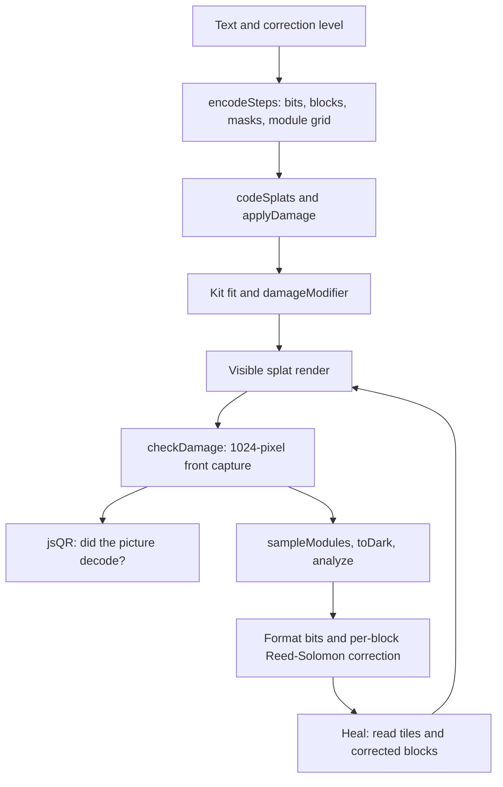

# QR damage lab checkpoint, October 14, 2026

This saves QR damage lab (`qr-damage`) as a baseline for later work: visible damage at the tapped
place, comparison of correction levels, a reader-backed meter, healing, and the circular sticker. It
follows the [Photo to 3D checkpoint](photo-3d-checkpoint.md). Codex task 82a documents the saved
implementation without changing it.

## Where the checkpoint lives

| What                               | Where                                                             | Commit                                     |
| ---------------------------------- | ----------------------------------------------------------------- | ------------------------------------------ |
| Whole repository                   | `claude/checkpoint-toys-2026-10-14`                               | `41b21e74e04ccca178b95ac02b4e5dc0e51b4b45` |
| Phone clips and measurement record | `codex/toy-checkpoints-a-clips`, `docs/studio/toy-checkpoints-a/` | `3bc16ee3e1c433abc3d6ad6aab1652899c9145ea` |

Never push to, rebase, or delete the saved checkpoint branch. The inspected code and captures use
that commit; the documentation branch is `codex/toy-checkpoints-a`.

## How it works

The recipe is `RECIPES["qr-damage"]`, the local `DAMAGE` object in
[src/packs/qr-lab.js](../../src/packs/qr-lab.js). This labs-only Studio toy takes a text payload,
damage choices, and taps. It does not take files, a camera feed, or a microphone. Its reader
examines pictures rendered by the app; the payload is not followed or sent to a server.



1. `damageCodes()` calls `encodeSteps()` in [src/qr-lab/steps.js](../../src/qr-lab/steps.js). This
   teaching encoder selects numeric, alphanumeric, or UTF-8 byte mode, chooses the version, writes
   mode and length bits, writes data, terminates and pads the stream, splits it into blocks,
   generates Reed–Solomon codewords, and interleaves them. It installs fixed patterns, follows the
   zigzag data path, tries eight masks, chooses the least-penalty mask, and writes format and
   version information. It retains the role and block origin of each module for the meter. It honors
   the requested correction level, rather than boosting it like the QR code toy.
2. In All four mode, `damageCodes()` encodes L, M, Q, and H, then re-encodes smaller versions at the
   largest version. `layoutFor()` places the codes in a 2 × 2 layout, with the same grid and damage
   coordinates in each. They share payload and geometry, but have different bits, masks, and
   correction capacities. An encoding error falls back to the site's default URL and is retained
   internally as `DM.error`; the panel does not display that error explicitly.
3. `DAMAGE.build()` makes a table, labels, and `codeSplats()` from
   [src/qr-lab/splats.js](../../src/qr-lab/splats.js). `applyDamage()` in
   [src/qr-lab/damage.js](../../src/qr-lab/damage.js) modifies splat colors, sizes, positions, or
   opacity, adds stickers, or separates torn and burned pieces. Seeded randomness makes saved damage
   repeatable. Detail tries six down to one sample per module axis to fit the tier budget. One
   recipe unit is one module, +X right, +Y up, +Z forward. `k.reach()` and `k.cloud()` fit and load
   the result through `src/kit.js` and `src/player.js`; the recipe uses the sharp kernel.
4. `tapOnCode()` selects the nearest code and converts a tap into that code's centered coordinates.
   `tapDamage()` adds 0.12 to the selected damage, up to one. Stickers and smudges land at the tap;
   `tearFrom()` chooses its nearest edge or corner; `burnFrom()` chooses its nearest corner. A
   nearby repeat tap grows the existing damage, while a new place creates another entry. In All four
   mode, that location applies to each code. The Add damage button instead uses the selected region.
5. `drive()` and `damageModifier()` in [src/qr-lab/field.js](../../src/qr-lab/field.js) animate only
   the newly added damage: a sticker lands, a torn piece falls as a piece, or burned fragments
   separate. The prior damage is kept through `DM.pendingPrev`. Tilt, Curve, and Move in time update
   the GPU geometry, with matching CPU `warpPoint()` coordinates for sampling. These are authored
   motion paths, not a material model of real paper or combustion.
6. `checkDamage()` waits for the Kit on stage, captures a 1,024 × 1,024 front view with
   `frontPose()`, and runs vendored jsQR. With four codes, it crops and reads each. The reported
   scan result means the reader returned the expected payload. Automatic checks wait for damage and
   healing to settle; a continuous wave is checked at one sampled moment.
7. Separately, `sampleModules()` in [src/qr-lab/read.js](../../src/qr-lab/read.js) averages gray
   values in disks around the **known, projected module centers**. The disk radius is
   `max(0.6, 0.22 × pixelsPerModule)`. `toDark()` uses `otsu()` to choose a threshold maximizing
   separation between two gray-value groups. `analyze()` checks finder errors, finds the nearest
   valid format word in the better of its two copies, unmasks the zigzag bits, deinterleaves bytes,
   and calls `decode()` in [src/qr-lab/rs.js](../../src/qr-lab/rs.js) on each block. The meter
   compares those bytes with the original codewords. It reports both the reader result and this
   known-grid analysis, including disagreement; a correctable block does not ensure that jsQR can
   locate the grid.
8. `heal()` saves those module readings in `DM.read`, switches `show` to `read`, and starts the
   five-second `heal` control. Wrong tiles begin red. Fixed patterns turn first, then tiles
   corrected by each block turn to their corrected colors. `drive()` requests another scan at
   completion. The demonstration restores known function patterns from the original layout; it is
   not a blind decoder reconstructing a photographed code with unknown geometry.

### Every toy setting and action

The default payload is `https://ryanjosephkamp.github.io/splashery/`. The custom panel's text box
accepts up to 300 characters. Saved options can contain more; they still face encoder limits.

| Option             | Default and choices                                         | What changes                                                                                                |
| ------------------ | ----------------------------------------------------------- | ----------------------------------------------------------------------------------------------------------- |
| `text`             | Default URL                                                 | Encoded payload, applied with Make the code                                                                 |
| `level`            | M; L, Q, H, All four side by side                           | Correction level, block capacities, version, and single or 2 × 2 layout                                     |
| `shape`            | Square; Circle                                              | Outer sticker geometry and decoration, with the same encoded square                                         |
| `tool`             | Scratch; the eleven tools below                             | Damage added by a tap or Add damage                                                                         |
| `region`           | Everywhere; A corner, The middle, A finder, The bottom edge | Region for unplaced damage; the corner is lower right and the finder is upper left                          |
| `damage`           | Empty                                                       | Serialized list `kind:amount:region:seed;…`, with optional `:x,y` for placed damage; old strings still load |
| `show`             | `damaged`; `read`                                           | Physical damage view or module readings and healing; `read` also needs this page's `DM.read`                |
| `decorationDamage` | False                                                       | Erases circular decorative dots while retaining encoded bits and the quiet zone                             |

For amount `a` from zero to one and code width `N`, the implemented tools are:

| Tool        | Effect                                                             |
| ----------- | ------------------------------------------------------------------ |
| Scratch     | Up to `round(12a)` scratches, at least one, revealing pale paper   |
| Sticker     | A pale label `0.6aN` modules wide                                  |
| Tear        | Removes a ragged edge or corner, with reach set by `0.75aN`        |
| Burn        | Removes and chars a corner, with reach set by `0.75aN`             |
| Smudge      | A gray smear roughly `0.84aN` modules long                         |
| Blur        | Scales splat width by `1 + 3a`                                     |
| Shrink      | Scales splats by `1 - 0.85a`, exposing gaps                        |
| Grow        | Scales dark splats by `1 + 2.5a`                                   |
| Jitter      | Seeded Gaussian position offsets with typical scale `0.6a` modules |
| Fade        | Opacity `1 - a`                                                    |
| Color drift | Blends code color toward pale orange by `a`                        |

| Control or panel action | Default and behavior                                                                                    |
| ----------------------- | ------------------------------------------------------------------------------------------------------- |
| `tilt`                  | 0–1 slider, initially zero; turns through up to 80° around Y                                            |
| `curve`                 | 0–1 slider, initially zero; bends across up to 200° around a vertical cylinder                          |
| `wave` / Move in time   | 0–1 slider, initially zero; moves modules up to about `0.6a` units; phase uses `t × 0.25`               |
| `drop` / Damage lands   | 1.8-second pulse, applied after adding damage                                                           |
| `heal` / Heal it        | Initially off; five-second transition through pattern and block corrections                             |
| Clear the damage        | Clears serialized damage and erased decoration, and returns to `damaged`; geometry sliders are separate |
| Erase decoration        | Circle-only button; changes only the decorative dots                                                    |
| Cover a finder          | Circle-only button; replaces damage with `sticker:0.45:finder:1`                                        |

The custom panel keeps scan verdicts, wrong-module counts, finder status, format distance, and
per-block lost/fixable counts beside the toy. Scene options carry text and damage. `DM.read` is
transient page memory, so saving `show: "read"` alone does not save the decoder's sampled arrays.
The generic scene, image, recording, and splat exports belong to `src/exports.js`; this toy has no
special PNG or GIF button.

### Math and opened sources

The opened [Nayuki encoding walkthrough](https://www.nayuki.io/page/creating-a-qr-code-step-by-step)
and [Thonky coding explanation](https://www.thonky.com/qr-code-tutorial/error-correction-coding)
explain the mode, padding, blocks, finite-field encoding, interleaving, and masks. In `rs.js`,
GF(256) uses polynomial `0x11d` and generator α = 2; `decode()` uses syndromes, Berlekamp–Massey, a
Chien search, and Forney's formula, followed by a syndrome check. With `n` correction codewords,
decoding is capped at `floor(n/2)` wrong codewords; the meter's `fixable()` also uses the table's
version-and-level adjustment. The opened
[format information explanation](https://www.thonky.com/qr-code-tutorial/format-version-information)
describes its binary polynomial encoding; `nearestFormat()` corrects up to three wrong format bits
by comparison with the valid words.

The opened [QR correction guide](https://www.qrcode.com/en/about/error_correction.html) gives the
approximate L/M/Q/H figures 7%/15%/25%/30%. These are codeword recovery figures, not promised
fractions of the visible image. A finder or the quiet zone can prevent detection even when data
blocks remain correctable. The opened [sizing guide](https://www.qrcode.com/en/howto/code.html)
requires a four-module clear margin. `src/qr/circle.js` retains it and adds data-free decoration
outside it; Circle is not a circular encoding format.

## The files that make it up

- Recipe, panel, taps, checks, and healing: `src/packs/qr-lab.js`. This file also contains How a QR
  code works and Three QR codes in one.
- Teaching encoder and decoder: `src/qr-lab/steps.js`, `src/qr-lab/rs.js`, and `src/qr-lab/read.js`;
  geometry: `src/qr-lab/splats.js`, `src/qr-lab/damage.js`, and `src/qr-lab/field.js`. The pack also
  imports `src/qr-lab/rgb.js` for its other recipe.
- Shared crisp and circular builders: `src/qr/crisp.js`, `src/qr/circle.js`, `src/qr/encode.js`, and
  `vendor/qrcodegen/`; actual image reader: `vendor/jsqr/jsQR.js`.
- Shared host: `src/kit.js`, `src/player.js`, `src/stage.js`, `src/motion.js`, `src/camera.js`,
  `src/kernels.js`, `src/pc.js`, `vendor/playcanvas/`, `src/font.js`, `src/app.js`, `src/ui.js`,
  `src/state.js`, `src/codec.js`, `src/exports.js`, `index.html`, and `styles.css`.
- This toy's catalog, help, and sounds in `src/toys.js`, `src/toy-help.js`, and `src/toy-sounds.js`,
  plus `assets/toys/qr-damage/thumb.webp`, `CREDITS.md`, and `LICENSES.md`.
- Offline studies use the same math in `tools/qrs-*.mjs`; they are evidence tools, not runtime
  dependencies.

| Existing test                                                   | Contract                                                                                                       |
| --------------------------------------------------------------- | -------------------------------------------------------------------------------------------------------------- |
| `tests/qrs-steps.spec.mjs`                                      | Teaching encoder against Nayuki, zigzag placement, format and version bits, penalties, and correction capacity |
| `tests/qrs-heal.spec.mjs`                                       | Correction within capacity, refusal beyond it, and damaged format bits                                         |
| `tests/qrs-toys.spec.mjs`                                       | Meter versus jsQR, covered-finder healing, and shared pack consumers                                           |
| `tests/qr5.spec.mjs`                                            | Tap placement, old damage strings, ripple colors, and shared sounds                                            |
| `tests/cdx-circle-lab.spec.mjs`, `tests/cdx-circle-qr.spec.mjs` | Circle controls, decoration erasure, covered finders, full circular renders, and other circle consumers        |
| `tests/qr4-flash.spec.mjs`, `tests/qrs-study.spec.mjs`          | Hidden captures and offline study behavior                                                                     |

## How to restore it

On a clean checkout:

```sh
git fetch origin refs/heads/claude/checkpoint-toys-2026-10-14:refs/remotes/origin/claude/checkpoint-toys-2026-10-14
test "$(git rev-parse origin/claude/checkpoint-toys-2026-10-14)" = 41b21e74e04ccca178b95ac02b4e5dc0e51b4b45
git switch -c restore-qr-damage origin/main
git checkout origin/claude/checkpoint-toys-2026-10-14 -- src/packs/qr-lab.js src/qr-lab src/qr/crisp.js src/qr/circle.js src/qr/encode.js vendor/qrcodegen vendor/jsqr
```

Compare other host files against the saved commit before restoring a changed shared dependency.
Apply only this toy's changed catalog, help, or sound entries. A complete exact environment is
available with
`git worktree add --detach /tmp/splashery-qr-damage-checkpoint 41b21e74e04ccca178b95ac02b4e5dc0e51b4b45`.
Do not replace a newer engine wholesale as part of a selective restore.

Check How a QR code works and Three QR codes in one, because the entire pack is restored. Check QR
code, Picture QR, QR from real things, and Other barcodes after restoring crisp, circle, encoder, or
reader files; Share → QR code and PDF exports also use the encoder. Run the tests above, compare any
changed tests with their checkpoint versions, and open a draft PR. Restoring the general engine
requires the broader suite; the checkpoint branch is never merged.

## What it does best, limits, and evidence

Its strength is connecting visible damage to a real reader result and to the particular blocks that
lose codewords. Tapped placement, repeated damage, and the block-by-block healing make that
relationship readable. All four mode compares levels under a common version and damage location.

The meter has an advantage a generic reader does not: known module centers, original bits, and the
true block layout. jsQR and the center sampler use different thresholds and samples, so their
answers can disagree. Healing restores known patterns and demonstrates correction; it cannot
guarantee recovery of arbitrary destroyed data. Tilt, curvature, and animation affect detection as
well as block errors. The 1,024-pixel front capture is not a phone camera measurement or a readback
of the current small viewport. Circle damage intentionally stays on the encoded square; decoration
erasure is a separate action. Four codes share the budget and therefore receive less detail per
code. The overlong-payload fallback and transient `show: "read"` state deserve explicit attention in
later rounds.

Phone measurements and clips are linked in the evidence record below. Real phone hardware, physical
damaged prints, WebGPU frame rate, and total memory including GPU allocations were not measured.

## Every later QR damage lab task

Compare the same payload, level, saved damage string, tap coordinates, geometry, and tier against
this commit. Keep the jsQR verdict separate from the known-grid analysis. Preserve old damage
strings, All four behavior, circular decoration independence, and solid torn-piece motion. Compare
before damage, during landing, and after healing with clips side by side. Future work could expose
the fallback payload error, show the meter's capture size more plainly, and add readings across a
complete motion cycle. Keep changes only when every baseline measure is at least as good.

## Evidence record

[Square clip, 390 × 844](https://github.com/ryanjosephkamp/splashery/blob/3bc16ee3e1c433abc3d6ad6aab1652899c9145ea/docs/studio/toy-checkpoints-a/qr-damage-square-390x844.gif)
·
[Circle clip, 390 × 844](https://github.com/ryanjosephkamp/splashery/blob/3bc16ee3e1c433abc3d6ad6aab1652899c9145ea/docs/studio/toy-checkpoints-a/qr-damage-circle-390x844.gif).
Both are silent, manually stepped GIFs: 9.0 seconds at 10 fps. They show real browser frames with
the default payload, in focus mode, at the checkpoint above. The damage clip uses
`sticker:0.24:finder:1` and then Heal. The QR code and Picture QR clips use a center tap. The
[method and reproduction script](https://github.com/ryanjosephkamp/splashery/blob/3bc16ee3e1c433abc3d6ad6aab1652899c9145ea/docs/studio/toy-checkpoints-a/README.md),
[raw measurements](https://github.com/ryanjosephkamp/splashery/blob/3bc16ee3e1c433abc3d6ad6aab1652899c9145ea/docs/studio/toy-checkpoints-a/measurements.json),
and
[capture hashes](https://github.com/ryanjosephkamp/splashery/blob/3bc16ee3e1c433abc3d6ad6aab1652899c9145ea/docs/studio/toy-checkpoints-a/sha256sums.txt)
are saved with the clips at commit `3bc16ee3e1c433abc3d6ad6aab1652899c9145ea`. This evidence branch
is never merged.

### Measured baseline

One observation per toy on Linux with Chromium 151.0.7922.173, Node v24.19.0, WebGL2 through
SwiftShader, forced Low profile, adaptation off, a 390 × 844 viewport, and device pixel ratio 1. The
regression run had finished before measurement. The engine and initial gallery were already loaded
in a fresh browser context; the toy's pack and default sample were first loads in that context.
These are software-rendering observations in a phone-sized view, not real phone performance or
statistically established timing guarantees.

| Measurement                                                   | Observed value                                        |
| ------------------------------------------------------------- | ----------------------------------------------------- |
| Toy selection call                                            | 0.439 s                                               |
| Selection through automatic check and cover release           | 1.907 s                                               |
| Default Square version and grid                               | Version 4, 33 × 33 modules                            |
| Actual default Square splats                                  | 51,450                                                |
| Allocated splat ArrayBuffers                                  | 4.56 MiB; excludes temporary, browser, and GPU memory |
| Selected QR pack, dependencies, and default sample body bytes | 479,614 bytes; excludes the loaded engine and gallery |
| Normal-view drawing canvas                                    | 390 × 645 pixels                                      |
| Active drawing during Move in time 0.3                        | 29 frames in 2.500 s: 11.6 fps                        |
| Median / 95th percentile frame interval                       | 77.4 / 249.0 ms                                       |
| Square / Circle GIF size                                      | 2.98 / 3.90 MiB; stored only on the clips branch      |

Frame rate counts actual `Stage.frames` over about 2.5 seconds in the normal layout before focus
mode. It is separate from the GIF's manually stepped animation clock. Array bytes count distinct
buffers directly owned by `proc.ctx.buf`; they are not total memory usage. Resource entries and
viewport decode results are preserved in the raw record, with no page errors for this toy.

Both clean starting viewport screenshots decoded. The covered finder prevented viewport decoding at
the sampled damaged frames. The final Square screenshot decoded after healing; the final Circle
screenshot did **not** decode at this viewport and Low tier. This is a checkpoint limitation, not a
corrected behavior in this documentation PR. The existing higher-resolution circular-render tests
passed, and this capture alone does not establish the cause of the small-view failure.

The fixed-set meter output also demonstrates why its two answers must remain separate: with
`blur:0.5:all:1`, jsQR failed while the known-center sampler found zero wrong modules; with
`sticker:0.24:finder:1`, jsQR failed while the blocks remained correctable. The browser healing test
verified a covered finder becoming readable again.

### Verification and record

The unchanged checkpoint passed **42 tests** in 15.2 minutes using system Chromium through
Playwright:

```sh
SPLASHERY_CHROMIUM=/usr/bin/chromium npx playwright test tests/qrs-steps.spec.mjs tests/qrs-heal.spec.mjs tests/qrs-toys.spec.mjs tests/qr5.spec.mjs tests/qrc-picture.spec.mjs tests/cdx-circle-qr.spec.mjs tests/cdx-circle-lab.spec.mjs
```

This includes real-browser renders, readbacks, and healing, plus Node tests of the array-based
encoders and correction logic. The existing specs use their own Mid profile where specified; those
results are separate from the Low measurements above. No reader was mocked. Other baseline suites
listed in this document, the full site suite, physical prints, and real phone cameras were not run.
Both documentation pre-push checks passed: `npx prettier --check .` and
`node tools/us-english.mjs --diff`. Local links, file paths, and coverage of every recipe option and
control key were checked. Tests' generated screenshots were restored; the documentation PR changes
only the three requested checkpoint files.

Made by Ryan with Codex (GPT-6), October 14, 2026. Status: implemented documentation, awaiting
review. Reused: checkpoint code, samples, libraries, and existing tests. New: this document and
browser evidence on the separate clips branch. No new shipping assets, libraries, simulations, or
product behavior. Rule check: none.
