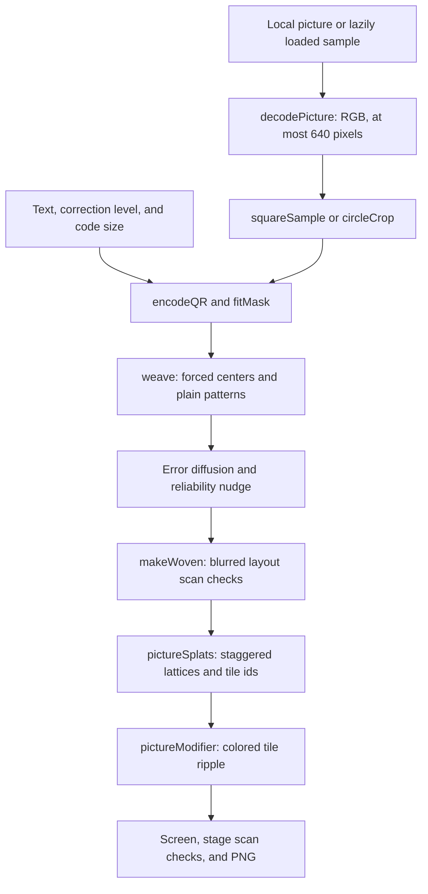

# Picture QR checkpoint, October 14, 2026

This saves Picture QR (`qr-picture`) as a baseline for later work: a recognizable picture woven into
readable QR modules, color-preserving ripple motion, local pictures, sample choices, and the
circular sticker. It follows the [Photo to 3D checkpoint](photo-3d-checkpoint.md). Codex task 82a
documents the saved implementation without changing it.

## Where the checkpoint lives

| What                               | Where                                                             | Commit                                     |
| ---------------------------------- | ----------------------------------------------------------------- | ------------------------------------------ |
| Whole repository                   | `claude/checkpoint-toys-2026-10-14`                               | `41b21e74e04ccca178b95ac02b4e5dc0e51b4b45` |
| Phone clips and measurement record | `codex/toy-checkpoints-a-clips`, `docs/studio/toy-checkpoints-a/` | `3bc16ee3e1c433abc3d6ad6aab1652899c9145ea` |

Never push to, rebase, or delete the saved checkpoint branch. The inspected implementation and
captures use that commit; the documentation branch is `codex/toy-checkpoints-a`.

## How it works

The recipe is `RECIPES["qr-picture"]`, the local `PICTURE` object in
[src/packs/qr-craft.js](../../src/packs/qr-craft.js). It is a labs-only Studio toy. Inputs are text
and a chosen sample or local image. The file picker accepts PNG, JPEG, WebP, AVIF, and GIF, subject
to the browser's decoding support. It uses no depth model, camera feed, microphone, or remote
image-processing service. A chosen bundled sample is fetched from the site's static files.



1. `loadPicture()` looks up `SAMPLES` in [src/qr-craft/samples.js](../../src/qr-craft/samples.js)
   and fetches only the selected image. `decodePicture()` uses `createImageBitmap()`, reduces the
   longer side to at most 640 pixels, and stores RGB floats from zero to one. Samples are cached in
   `PIC.pictures`; the uploaded file's decoded pixels stay in `PIC.own` in page memory.
2. `tidy()` and `makeWoven()` in [src/qr-craft/picture.js](../../src/qr-craft/picture.js) sanitize
   options, find the smallest version fitting the text, and add the chosen detail offset, capped at
   version 40. `encodeQR()` uses vendored Nayuki. Here `boost: false` keeps the requested level.
   `fitMask()` tries all eight masks and chooses the least sum of differences between data-module
   darkness and the sampled picture. It prioritizes picture agreement, rather than the normal
   encoder's mask penalty alone.
3. `squareSample()` crops the center square and averages up to 4 × 4 samples per cell. Each QR
   module becomes `k × k` picture cells. `plainModules()` keeps finders, separators, alignment,
   timing, format, and version regions plain. A central `c × c` block in every other module keeps
   its encoded dark or light bit. For Circle, `circleCrop()` first crops the portion of the image
   corresponding to the standard encoded square; the outside decoration samples the same full
   sticker image coordinates.
4. `weave()` performs serpentine error diffusion. Free cells become dark or light, and the
   quantization error goes to unvisited free neighbors with relative weights 7, 3, 5, and 1,
   renormalized when a neighbor is forced or outside the grid. The black-and-white style uses ink
   and paper colors. Color keeps the image's hue, shifting free dark cells to gray at most 0.25 and
   free light cells to at least 0.78. Forced picture centers target gray 0.1 or 0.9; fixed patterns
   remain plain ink and paper. Thus a colored center retains its bit without losing its picture hue.
5. The reliability nudge estimates how a soft camera samples each center. `cellWeights()` uses
   normalized Gaussian cell weights with σ = 0.28 modules. `localThreshold()` combines mid-gray with
   a local 5 × 5 module mean. `marginAt()` gives a margin of `0.2a` up to contrast 0.6, then rises
   from 0.12 to 0.5 as contrast reaches one; zero contrast disables this initial nudge. Modules too
   close to, or across, their threshold get additional free cells forced to the correct bit. The
   cells giving the largest reading improvement for the least picture change go first. Up to four
   nudge rounds rerun diffusion.
6. With a reader available, `makeWoven()` tests the rasterized layout at eight and four pixels per
   module, blurred by σ = 0.2 and 0.3 modules. It increases margin by 0.02 for up to 16 steps,
   bounded by 0.5, until those checks pass. This can make the result more code-like than the raw
   Contrast option suggests. `rasterize()` averages subpixel samples and `gaussBlur()` models soft
   focus; these checks are simulations, not a real phone capture.
7. `pictureSplats()` makes the colored lattice, quiet zone, and underlay. Two staggered layers cover
   the encoded area without module-boundary seams. Dark splats sit 0.004 modules ahead of light ones
   to avoid depth ties, and are slightly narrower; boundary samples avoid dark dots bleeding over
   neighboring light cells. It tries three, two, then one splat sample per cell axis within the
   budget. Circle coarsens paper and decoration first and throws a clear error if complete encoded
   geometry still cannot fit. `k.reach()` and `k.cloud()` fit the toy through the Kit and player,
   using a sharp kernel and `density: 2`. At Low, the cap is 120,000 splats. One recipe unit is one
   QR module; +X is right, +Y up, and +Z forward.
8. `checkPicture()` runs `checkWoven()`, measures contrast, then `renderFront()` captures the actual
   splats at 720 pixels. Smoothed copies are read by jsQR at eight and four pixels per module. If
   the layout passes but the splats fail, the automatic stage nudge can rebuild with 0.04 extra
   margin, to approximately 0.12 extra, and check again. `hold()` keeps a labeled still over the
   scanning view, with a 30-second release timeout. The panel reports layout checks and actual
   rendered-stage checks separately.
9. `PICTURE.action.at()` records the tap, and `drive()` sends the ripple progress and origin to
   `pictureModifier()` in [src/qr-craft/field.js](../../src/qr-craft/field.js). Each module's tile
   lifts and tilts as a solid piece, carrying its picture colors throughout the 3.6-second pulse.
   The recipe requests continuous rendering only while the ripple is active. This is a halftone
   surface animated as tiles, not recovered 3D geometry from the picture.

### Every toy setting and action

The default text is `https://ryanjosephkamp.github.io/splashery/`; the custom panel's text field
allows up to 300 characters. Hidden `text` is controlled by that panel.

| Option or action       | Default and choices                                              | What changes                                                                            |
| ---------------------- | ---------------------------------------------------------------- | --------------------------------------------------------------------------------------- |
| `text` / Make the code | Default URL                                                      | Encoded payload                                                                         |
| `shape`                | Square; Circle                                                   | Sticker extent, image cropping, decoration, and splat budget allocation                 |
| `picture`              | Felt farm (AI-made); all `SAMPLES`, or Your own picture          | Source pixels; only the selected sample is fetched                                      |
| Open your own picture  | Local file picker                                                | Replaces the in-memory picture and selects `own`                                        |
| `contrast`             | 0.5; 0–1 in steps of 0.05                                        | Initial reliability margin; higher values sacrifice picture detail for clearer bits     |
| `center`               | Small (a third); Medium (three sevenths), Big (three fifths)     | `k,c` pairs `(3,1)`, `(7,3)`, `(5,3)`; the forced square's width within a module        |
| `level`                | H; L, M, Q                                                       | Correction capacity and smallest fitting QR version, with no boosting                   |
| `style`                | Color; Black and white (dithered)                                | Hue-preserving color halftone or ink-and-paper cells                                    |
| `size`                 | Bigger (more detail); As small as it fits, Biggest (most detail) | Adds 4, 0, or 8 versions to the smallest fitting version                                |
| `turn` / Send a ripple | 3.6-second pulse                                                 | Colored tile ripple originating at the tap; Play starts at the center                   |
| Make it scan           | Available when a check fails                                     | Searches for the nearest scanning combination of contrast, center, and correction level |
| Save a PNG             | 1,600 pixels                                                     | Front-on rendered splats with the quiet zone, including circular extent when selected   |

The center fractions are **widths**, not forced area percentages. `closestScanning()` considers at
most 40 candidates, with contrast increases of 0.1 and larger centers or higher levels. It sorts
them by cost `contrastSteps + 2.5 × centerSteps + 3 × levelSteps`. `makeItScan()` applies only
contrast, center, and level from the winner; it does not switch the picture or code size. After the
rebuild, the stage must still pass its own scan checks.

`SAMPLES` contains four AI-made Studio pictures, four earlier Photo to 3D pictures, and 24 task-54
pictures from `src/qr-craft/codex-pictures.js`. The AI-made choices are labeled beside their picker
and credit. `CREDITS.md` and `tools/assets.json` hold the existing provenance. The default is
`ai-farm`; this task adds no image or changes any license.

Recipe options travel in scenes and links, but uploaded pixels do not. Opening a saved `own` choice
without that page's pixels shows an explanatory error and can build a plain code; reopen the picture
or choose a sample. Overlong text also produces an error and falls back to the site's default URL.
Generic recordings, GIFs, scene exports, and saved splats use the shared export system; PNG is the
toy's own specialized export.

### Math and opened sources

The QR grid, finite-field correction, and masks come from the opened
[Nayuki library page](https://www.nayuki.io/page/qr-code-generator-library) and
[encoding walkthrough](https://www.nayuki.io/page/creating-a-qr-code-step-by-step). The opened
[QR sizing guide](https://www.qrcode.com/en/howto/code.html) specifies a four-module quiet zone;
[its correction guide](https://www.qrcode.com/en/about/error_correction.html) explains L/M/Q/H as
approximate codeword recovery, not guaranteed recoverable image area.

The code credits **Halftone QR codes**, Chu, Chang, Lee, and Mitra, 2013. Its
[opened bibliographic record and abstract](https://api.crossref.org/works/10.1145%2F2508363.2508408)
describe machine-readable visual QR codes with a learned pattern dictionary. Splashery uses the
simplified, explicitly inspectable center constraints, error diffusion, and nudge described above;
this checkpoint does not claim to reproduce that paper's full method. The primary project page could
not be retrieved during this task, so its detailed algorithm was not independently verified.
Diffusion weights, Gaussian weights, and threshold details here are read from the implementation.

`measure()` reports the relative-luminance ratio of mean dark versus light module colors and a fixed
ink-to-paper center reference, plus a gray gap between free picture cells. The center reference is
not a measurement of every hue-preserving center. The formula follows the opened
[WCAG contrast explanation](https://www.w3.org/WAI/WCAG22/Understanding/contrast-minimum.html). Mean
module contrast is not the worst local contrast and is not a universal QR scan guarantee. Circular
decoration is outside the clear margin and carries no encoded data; `shapeHalf()` and
`circleLayout()` are shared with the other QR toys.

## The files that make it up

- Recipe, picture loading, splat conversion, checks, PNG, and UI: `src/packs/qr-craft.js`. This pack
  also contains QR from real things and Other barcodes.
- Halftone layout and samples: `src/qr-craft/picture.js`, `src/qr-craft/samples.js`, and
  `src/qr-craft/codex-pictures.js`; motion: `src/qr-craft/field.js`. Pack imports also include
  `src/qr-craft/pieces.js`, `src/qr-craft/barcodes.js`, and `src/qr-craft/glyphs.js`.
- Shared builders and encoder: `src/qr/encode.js`, `src/qr/crisp.js`, and `src/qr/circle.js`;
  `vendor/qrcodegen/` and `vendor/jsqr/jsQR.js`. Other barcodes additionally uses
  `vendor/zxing-js/`; it is not the Picture QR encoder.
- Sample files: `assets/toys/photo-3d/ai/{farm,wave,mushrooms,arch}.jpg`,
  `assets/toys/photo-3d/{wildflowers,still-life,spiral-stairs,forest}.jpg`, and the 24 files under
  `assets/toys/qr-picture/codex/` named by `QR_PICTURES`.
- Shared host: `src/kit.js`, `src/player.js`, `src/stage.js`, `src/motion.js`, `src/camera.js`,
  `src/kernels.js`, `src/pc.js`, `vendor/playcanvas/`, `src/app.js`, `src/ui.js`, `src/state.js`,
  `src/codec.js`, `src/exports.js`, `index.html`, and `styles.css`.
- This toy's entries in `src/toys.js`, `src/toy-help.js`, `src/toy-sounds.js`, `CREDITS.md`, and
  `tools/assets.json`; `assets/toys/qr-picture/thumb.webp`; library notices in `LICENSES.md`.

| Existing test                                             | Contract                                                                                                                  |
| --------------------------------------------------------- | ------------------------------------------------------------------------------------------------------------------------- |
| `tests/qrc-picture.spec.mjs`                              | Centers and patterns, sample readbacks, contrast, nearest scanning layout, stage, PNG, and return after a tap             |
| `tests/qr4-craft.spec.mjs`                                | Color halftone, image agreement, mask selection, shared crisp geometry, samples, and both picture styles                  |
| `tests/qr5.spec.mjs`                                      | Picture colors retained throughout ripple motion                                                                          |
| `tests/cdx-pics.spec.mjs`                                 | Sample records, labels, five payloads, laziness, credits, and browser scans                                               |
| `tests/cdx-circle-qr.spec.mjs`                            | Large circular codes, budgets, missing local files, payload fallback, complete rendered reads, and shared circle behavior |
| `tests/qr4-scan.spec.mjs`, `tests/qr4-flash.spec.mjs`     | Checking before reveal and capture without visible flashing                                                               |
| `tests/qrc-build.spec.mjs`, `tests/qrc-barcodes.spec.mjs` | Neighboring recipes in the restored pack                                                                                  |

## How to restore it

On a clean checkout:

```sh
git fetch origin refs/heads/claude/checkpoint-toys-2026-10-14:refs/remotes/origin/claude/checkpoint-toys-2026-10-14
test "$(git rev-parse origin/claude/checkpoint-toys-2026-10-14)" = 41b21e74e04ccca178b95ac02b4e5dc0e51b4b45
git switch -c restore-qr-picture origin/main
git checkout origin/claude/checkpoint-toys-2026-10-14 -- src/packs/qr-craft.js src/qr-craft src/qr/encode.js src/qr/crisp.js src/qr/circle.js vendor/qrcodegen vendor/jsqr assets/toys/qr-picture/codex
git checkout origin/claude/checkpoint-toys-2026-10-14 -- assets/toys/photo-3d/ai/farm.jpg assets/toys/photo-3d/ai/wave.jpg assets/toys/photo-3d/ai/mushrooms.jpg assets/toys/photo-3d/ai/arch.jpg assets/toys/photo-3d/wildflowers.jpg assets/toys/photo-3d/still-life.jpg assets/toys/photo-3d/spiral-stairs.jpg assets/toys/photo-3d/forest.jpg
```

If restoring sample bytes, compare their records in `tools/assets.json` and `CREDITS.md` with the
saved commit and restore matching entries, including labels, hashes, and provenance. Compare other
host and library files before replacing a changed dependency; restore `vendor/zxing-js/` only when
its pack consumer requires it. Apply only this toy's catalog, help, or sound entries. For an exact
environment use
`git worktree add --detach /tmp/splashery-picture-qr-checkpoint 41b21e74e04ccca178b95ac02b4e5dc0e51b4b45`.

Check QR from real things and Other barcodes because the complete pack is restored. Shared crisp,
circle, encoder, and reader files also affect QR code, QR damage lab, How a QR code works, and Three
QR codes in one, as well as Share → QR code and PDF exports. The eight reused Photo to 3D pictures
affect Photo to 3D and other consumers of those sample files. Run the tests above, compare modified
tests with their saved versions, and open a draft PR. Restoring general engine files needs the
broader suite. Never merge the checkpoint branch.

## What it does best, limits, and evidence

Its strength is placing picture detail in the free cells while keeping readable centers and plain QR
patterns, then retaining those colors as the tiles move. The default has a bold, labeled sample,
correction level H, and more modules for picture detail. Both layout simulation and actual splat
readback inform the result.

Readability and picture fidelity compete. Auto-nudging, larger centers, stronger correction, or a
larger version can change the look, density, or build cost. Lower detail tiers coarsen the splat
lattice. Large Circle codes can exceed the available budget and be refused. A successful front-on
check at eight or four pixels per module does not guarantee that the small current viewport, a
tilted phone, a printed halftone, or a frame mid-ripple reads. Uploaded pixels remain transient, and
their source image cannot be recovered from a saved scene alone. The default URL fallback on
overlong text differs from the QR code toy's prefix fallback.

Phone measurements and clips are linked in the evidence record below. Real phone cameras, printed
stickers, WebGPU frame rate, and total memory including GPU allocations were not measured.

## Every later Picture QR task

Compare identical source pixels, payload, shape, center, correction, code size, contrast, and tier
against this commit. Compare picture visibility and decoded payload together, including both picture
styles, the quiet zone, PNGs, missing uploads, and large Circle budgets. Watch the whole ripple side
by side to ensure tile colors survive it. Future work could measure physical prints, reduce low-tier
coarsening without losing modules, and report the effective nudge more clearly. Keep a change only
when every baseline measure is at least as good.

## Evidence record

[Square clip, 390 × 844](https://github.com/ryanjosephkamp/splashery/blob/3bc16ee3e1c433abc3d6ad6aab1652899c9145ea/docs/studio/toy-checkpoints-a/qr-picture-square-390x844.gif)
·
[Circle clip, 390 × 844](https://github.com/ryanjosephkamp/splashery/blob/3bc16ee3e1c433abc3d6ad6aab1652899c9145ea/docs/studio/toy-checkpoints-a/qr-picture-circle-390x844.gif).
Both are silent, manually stepped GIFs: 5.0 seconds at 10 fps. They show real browser frames with
the default payload, in focus mode, at the checkpoint above. The damage clip uses
`sticker:0.24:finder:1` and then Heal. The QR code and Picture QR clips use a center tap. The
[method and reproduction script](https://github.com/ryanjosephkamp/splashery/blob/3bc16ee3e1c433abc3d6ad6aab1652899c9145ea/docs/studio/toy-checkpoints-a/README.md),
[raw measurements](https://github.com/ryanjosephkamp/splashery/blob/3bc16ee3e1c433abc3d6ad6aab1652899c9145ea/docs/studio/toy-checkpoints-a/measurements.json),
and
[capture hashes](https://github.com/ryanjosephkamp/splashery/blob/3bc16ee3e1c433abc3d6ad6aab1652899c9145ea/docs/studio/toy-checkpoints-a/sha256sums.txt)
are saved with the clips at commit `3bc16ee3e1c433abc3d6ad6aab1652899c9145ea`. This evidence branch
is never merged.

### Measured baseline

One observation per toy on Linux with Chromium 151.0.7922.173, Node v24.19.0, WebGL2 through
SwiftShader, forced Low profile, adaptation off, a 390 × 844 viewport, and device pixel ratio 1. The
regression run had finished before measurement. The engine and initial gallery were already loaded
in a fresh browser context; the toy's pack and default sample were first loads in that context.
These are software-rendering observations in a phone-sized view, not real phone performance or
statistically established timing guarantees.

| Measurement                                                   | Observed value                                        |
| ------------------------------------------------------------- | ----------------------------------------------------- |
| Toy selection call                                            | 1.366 s                                               |
| Selection through automatic check and cover release           | 3.698 s                                               |
| Default Square version and grid                               | Version 9, 53 × 53 modules                            |
| Actual default Square splats                                  | 120,000                                               |
| Allocated splat ArrayBuffers                                  | 9.89 MiB; excludes temporary, browser, and GPU memory |
| Selected QR pack, dependencies, and default sample body bytes | 699,964 bytes; excludes the loaded engine and gallery |
| Normal-view drawing canvas                                    | 390 × 645 pixels                                      |
| Active drawing during ripple                                  | 18 frames in 2.500 s: 7.2 fps                         |
| Median / 95th percentile frame interval                       | 148.5 / 282.9 ms                                      |
| Square / Circle GIF size                                      | 3.27 / 3.04 MiB; stored only on the clips branch      |

Frame rate counts actual `Stage.frames` over about 2.5 seconds in the normal layout before focus
mode. It is separate from the GIF's manually stepped animation clock. Array bytes count distinct
buffers directly owned by `proc.ctx.buf`; they are not total memory usage. Resource entries and
viewport decode results are preserved in the raw record, with no page errors for this toy.

The default Square layout and actual stage passed both eight- and four-pixel-per-module checks. Its
effective margin was 0.12, although the initial Contrast 0.5 margin is 0.10. Measured mean module
contrast was 3.60:1; the displayed fixed ink/paper center reference was 18.38:1, and the free-cell
gray gap was negative, so some picture cells crossed between dark and light ranges. These are layout
statistics, not guarantees for every local patch.

Both Square and Circle starting and final viewport screenshots decoded the payload. The sampled
Square ripple frame also decoded, while the corresponding Circle ripple frame did not. The color
remained visible in the inspected moving frames; the ripple ends on the same picture code.

### Verification and record

The unchanged checkpoint passed **42 tests** in 15.2 minutes using system Chromium through
Playwright:

```sh
SPLASHERY_CHROMIUM=/usr/bin/chromium npx playwright test tests/qrs-steps.spec.mjs tests/qrs-heal.spec.mjs tests/qrs-toys.spec.mjs tests/qr5.spec.mjs tests/qrc-picture.spec.mjs tests/cdx-circle-qr.spec.mjs tests/cdx-circle-lab.spec.mjs
```

This includes real-browser renders, readbacks, and healing, plus Node tests of the array-based
encoders and correction logic. The existing specs use their own Mid profile where specified; those
results are separate from the Low measurements above. No reader was mocked. Other baseline suites
listed in this document, the full site suite, physical prints, and real phone cameras were not run.
Both documentation pre-push checks passed: `npx prettier --check .` and
`node tools/us-english.mjs --diff`. Local links, file paths, and coverage of every recipe option and
control key were checked. Tests' generated screenshots were restored; the documentation PR changes
only the three requested checkpoint files.

Made by Ryan with Codex (GPT-6), October 14, 2026. Status: implemented documentation, awaiting
review. Reused: checkpoint code, samples, libraries, and existing tests. New: this document and
browser evidence on the separate clips branch. No new shipping assets, libraries, simulations, or
product behavior. Rule check: none.
