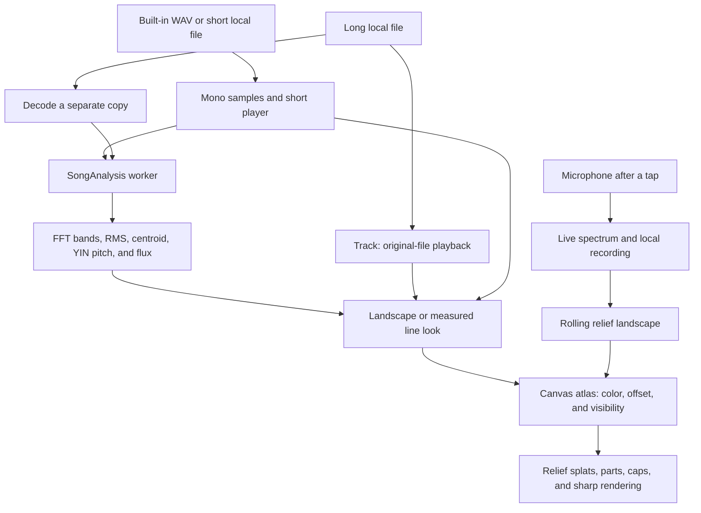

# Song landscape checkpoint, October 14, 2026

This preserves the labs toy `song-landscape` for Codex task 82c. Codex (GPT-6) prepared the
documentation, measurements, and clips without changing the implementation.

## Where the checkpoint lives

| What                                | Where                               | Commit                                     |
| ----------------------------------- | ----------------------------------- | ------------------------------------------ |
| Whole repository                    | `claude/checkpoint-toys-2026-10-14` | `41b21e74e04ccca178b95ac02b4e5dc0e51b4b45` |
| Phone clips and measurement records | `codex/toy-checkpoints-c-clips`     | `b7c044e9c7da9d3481a8fa59b46a0a8dbd977fd8` |

Never push to, rebase, or delete the Operator's checkpoint branch. The clips branch is evidence only
and must never be merged.
[Saved source](https://github.com/ryanjosephkamp/splashery/tree/41b21e74e04ccca178b95ac02b4e5dc0e51b4b45).

[390×844 clip](https://github.com/ryanjosephkamp/splashery/blob/b7c044e9c7da9d3481a8fa59b46a0a8dbd977fd8/docs/audits/toy-checkpoints-c/song-landscape.mp4)
shows the default Live landscape starting on an empty plain and growing with the sample tune. It is
silent and uses a stepped simulation clock at 10 frames per second; it is not a playback latency or
physical-phone performance measurement. See the
[evidence record](https://github.com/ryanjosephkamp/splashery/blob/b7c044e9c7da9d3481a8fa59b46a0a8dbd977fd8/docs/audits/toy-checkpoints-c/README.md)
for its method and the separate real-time measurements.

## How it works

The toy turns measured sound into a 3D visualization: frequency runs across, time runs along, and
relative spectral level sets height. The ridges represent spectral bands, not physical hills. The
recipe `SONG_LANDSCAPE` is exported as `RECIPES["song-landscape"]` in `src/packs/studio.js`.
`src/toys.js` supplies its labs gate and home camera: yaw 0.3, pitch 0.8, and distance 3.9. Orbit
and tilt are enabled, with a pitch range of 0.05–1.35 radians. There is no camera, video, image, or
external live-data input.



### Input and playback paths

`prepare()` loads `assets/toys/song-landscape/sample.wav` once via `readBytes()` and `parseWav()`.
It is a generated, CC0, 20-second, 22,050 Hz, mono, 16-bit tune made by
`tools/make-song-sample.mjs`: 882,044 bytes on disk and 441,000 decoded samples. `parseWav()` is a
narrow reader for this PCM sample; uploaded files use browser decoders instead.

`input.read()` accepts browser-supported audio up to `MAX_BYTES = 400e6`, first reading metadata
through `Track.ready` when available. A file longer than `SHORT = 30` seconds gets an object URL and
`Track`, which plays the original file through an HTML audio element while measurement proceeds
separately. A shorter file goes through `decodeSound()` using `OfflineAudioContext` at 44,100 Hz,
mixes its channels with `toMono()`, and requires at least 0.5 s of sound.

`playStep()` plays short sounds through an `AudioBufferSourceNode` and the site's sound gain. When
sound is disabled it advances a visual clock instead. Long files use `Track.time()`, which smooths
coarse element updates and subtracts reported output and base latency. `route()` connects that
element to the speaker/volume controls when sound is enabled; otherwise it is muted, and the picture
can still advance. A browser that requires another user gesture marks `Track.blocked`; the next tap
can start playback.

`analysisFor()` creates or reuses `SongAnalysis` for the current song. Long files are decoded for
analysis at 44,100 Hz, or 32,000 Hz when longer than 720 s. MP3 is recognized by `mp3Frames()` in
`src/packs/song-mp3.js` and decoded in roughly 30-second pieces, with four warm-up frames and
encoder-delay alignment. Other formats decode whole. Neither playback nor analysis uploads the file;
a shared scene can name a custom input, but cannot restore its local bytes in another browser.

### What the analysis measures

`src/packs/song-worker.js` reserves the mono sample array and feature storage, measures chunks of 50
frames (two seconds), and prioritizes the playhead through `SongAnalysis.focus()`. `makeAnalyser()`
and `analyzeFrames()` in `src/packs/song-analysis.js` implement:

| Feature                         | Calculation and use                                                                                                                                                                                                                                                                                                    |
| ------------------------------- | ---------------------------------------------------------------------------------------------------------------------------------------------------------------------------------------------------------------------------------------------------------------------------------------------------------------------- |
| Spectrum (`bands`)              | Radix-2 FFT from `studio-audio.js`, 4,096 samples, periodic Hann window, amplitude scale `2 / sum(window)`. Every 40 ms, pool the largest magnitude in each of 104 logarithmic bands from 40 to 16,000 Hz; interpolate where a band is narrower than an FFT bin. Levels are `20 log10(magnitude)` with a −80 dB floor. |
| Six broad bands (`six0`–`six5`) | Sum squared magnitudes between 40, 150, 400, 1,000, 2,500, 6,000, and 16,000 Hz, then take `10 log10(power)`. These drive the six ribbons.                                                                                                                                                                             |
| RMS (`rms`)                     | Mean sample energy over the 40 ms hop, converted to dB with a +3.01 dB sine-reference adjustment. Drives tube radius and the worker landscape's side envelope.                                                                                                                                                         |
| Centroid (`centroid`)           | Power-weighted mean frequency between 40 and 16,000 Hz. Drives tube color as spectral brightness.                                                                                                                                                                                                                      |
| Fundamental (`f0`)              | YIN on samples decimated to approximately 11 kHz, a 512-sample window, and a roughly 60–1,000 Hz search. Unvoiced or very quiet frames return zero. Tube pitch falls back to centroid.                                                                                                                                 |
| Flux (`flux`)                   | Positive changes in log-compressed spectral magnitudes from the previous frame. Stored as onset information; it is not a separate selectable look.                                                                                                                                                                     |

The windowed time-frequency interpretation is described by
[Julius O. Smith's STFT chapter](https://ccrma.stanford.edu/~jos/sasp/Short_Time_Fourier_Transform.html).
YIN comes from [de Cheveigné and Kawahara](https://pubmed.ncbi.nlm.nih.gov/12002874/). The code's
band layout, thresholds, reference levels, and visual normalization are implementation choices. They
do not measure room sound-pressure level, identify instruments, or transcribe notes. At 44,100 Hz,
the FFT window spans about 92.9 ms despite the 40 ms feature interval; adjacent measurements
overlap. The built-in sample's 22,050 Hz rate has an 11,025 Hz Nyquist limit, so its nominal 16 kHz
display range does not create additional high-frequency information.

### From measurements to splats

There are three important build paths; the short whole-song path is not the browser's default.

1. **Default browser Live landscape, and long songs:** `buildR2()` uses `buildLandscapeLong()` from
   `src/packs/song-looks.js`. It creates an atlas of three relief splats per time-frequency cell, a
   side envelope, a floor, a marker, and 48 loudness caps.
   `nt = max(40, min(1600, floor(k.count × 0.33 / (nf × 3))))`; width is 2 recipe units, peak height
   0.75, and length is `min(8, 1.2 + 0.08 × duration)`. `landscapeHeights()` pools measured frames
   into slots by maximum band level, normalizing over 45 dB below the loudest measured band.
   `drawLandscapeLong()` writes each cell's colors, height offsets, and visibility to the atlas. Its
   wall splats sit at 60% and 20% of the top height. Unmeasured slots are hidden. In Live, only
   heard slots show, and `liveOffset()` slides the growing land back from a fixed front marker. In
   Whole, measured slots show throughout, and the marker moves along the song. `driveR2()` follows
   the playback clock, moves parts, updates caps, and requests pose sorting as the landscape slides.
   The side "waveform" in this worker path is a normalized RMS envelope, not the original
   sample-by-sample waveform.
2. **Ribbons, Tube, Lines, and Mesh:** `buildLook()` and `drawLook()` in `song-looks.js` make
   narrow, oriented relief splats. Ribbons widen and bend with each broad band's level; Tube's
   radius follows RMS, its tilt follows pitch, and its color follows centroid. Lines show band
   levels frame by frame; Mesh adds connections in time. `slotFrames()` and `slotValues()` select
   recent frames in Live or pool the whole song into budget-limited slots. Live generally keeps up
   to six seconds, with Lines capped at 75 slots (three seconds) and Mesh at 60 (2.4 seconds). Whole
   caps Lines at 120, Mesh at 100, and Tube at 180 slots. `lookMotion()` moves the gate in Whole;
   Live keeps it fixed. These views use measured data and smoothing, not random geometry.
3. **Short Whole landscape, or builds without Worker:** `landscapeData()` calls `landscapePlan()`
   and `spectrogram()` from `studio-audio.js` before building static cells. It uses 12 bands per
   octave (six at very small budgets), up to 40 slices per second and 1,600 slices, and up to eight
   analysis windows per slice. Heights use `DB_RANGE = 45`. The short Whole path builds up to four
   splats per cell and a sample-derived side envelope. Its moving marker and body offset follow
   `playStep()`. Node recipe builds use this fallback, so a pure Node test does not demonstrate the
   browser's growing Live landscape.

Screen atlases hold colors on the left and signed offsets plus visibility on the right.
`src/effects.js` implements relief offsets, `src/motion.js` calls recipe drive, and `src/player.js`
and `src/stage.js` connect textures, sorting, parts, and rendering. The recipe uses density 1.5 and
`kernel: "sharp"` from `src/kernels.js`.

### Microphone and recording

Use my microphone calls `start()` in `src/live/live.js` only after the user taps and grants
permission. `startAnalyser()` in `src/live/mic.js` captures through a silenced AudioWorklet and an
`AnalyserNode`. `liveSongBuild()` always builds the rolling relief landscape, including when a line
look was selected; it does not make live microphone ribbons or a tube. `liveSongDraw()` displays 128
bands and 150 rows at 30 rows per second, about five seconds. `bandLevels()` reads the live
spectrum. Heights use a 36 dB range with an exponent of 1.5; the recent top falls at 6 dB per second
and never below −50 dB. This differs from file analysis.

Unlike the two Chladni toys, Song landscape **records while its microphone is on**, as its input
panel explains. `MicRecorder` in `src/packs/song-record.js` copies newly captured samples into page
memory, capped at 600 s. On stopping, `finish()` supplies a recording; at least 0.5 s becomes the
displayed song. A long recording plays from an in-memory WAV and `Track`; a short one uses the short
player. `transport.playRecording()` starts it, and `transport.saveRecording()` uses `wavBlob()` and
`saveBlob()` to download a mono 16-bit WAV only after Save is tapped. Closing the page loses the
recording; there is no server storage. At 48 kHz, 600 s of float samples alone occupies 115,200,000
bytes, before the final concatenated array or WAV copies.

### Every toy setting and control

| Setting or control                           | Default and effect                                                                                                                                                                             |
| -------------------------------------------- | ---------------------------------------------------------------------------------------------------------------------------------------------------------------------------------------------- |
| Color follows (`look`)                       | `pitch`: rainbow across frequency. `loudness` colors the land by height. `ribbons`, `tube`, `lines`, and `mesh` select the measured geometries described above.                                |
| View (`view`)                                | `live`: opens on a plain and grows as heard; line looks display recent history. `whole` shows the whole measured song with a moving marker/gate. The microphone remains a rolling landscape.   |
| Background (`backdrop`)                      | `paper`: a cream card for the four line looks. `none` omits it. It does not change the ordinary landscape's floor or the global stage background.                                              |
| Song (`song`) and Song name (`songName`)     | Hidden scene fields, default `sample` and empty name. `custom` selects the local opened file; `recording` selects the retained microphone recording. They do not embed audio bytes in a scene. |
| Tap / Play (`play`)                          | Toggles song playback. A long file starts inside the gesture via `action.onAct()`; drive follows its clock.                                                                                    |
| Open a song                                  | Opens and analyzes local audio, subject to the 400 MB cap, minimum short-file duration, and browser codec support.                                                                             |
| Start over, Play/Pause, seek, and Live/Whole | `transport` in `studio.js`, rendered by `songTransport()`, controls the song clock and view. A view/look rebuild of the same song preserves its playback position and play intent.             |
| Use / Stop my microphone                     | Starts live display and recording, or stops capture and makes the recording available.                                                                                                         |
| Play back / Save the recording               | Plays the retained recording or downloads its WAV; available after microphone capture stops.                                                                                                   |

Global speaker and volume control sound output. Orbit, tilt, and zoom control the camera.
Auto/High/Max detail and the labs Detail slider change the budget and thus visual time detail; they
do not increase the analysis hop rate. Forced low tier requests 90,000 splats with density 1.5;
emitted count depends on the selected path. Low tier caps pixel ratio at 1.5.

## The files that make it up

- Recipe, input, playback integration, and microphone landscape: `src/packs/studio.js`.
- Measured shapes: `src/packs/song-looks.js`.
- Audio analysis and playback: `src/packs/studio-audio.js`, `song-analysis.js`, `song-worker.js`,
  `song-stream.js`, `song-mp3.js`, and `song-record.js` in that directory.
- Sample: `assets/toys/song-landscape/sample.wav`, generated by `tools/make-song-sample.mjs`.
  Preserve its source and CC0 credit in `CREDITS.md` and the recipe's `credits`.
- Live input and relief construction: `src/live/live.js`, `mic.js`, `analysis.js`,
  `capture-worklet.js`, `panel.js`, and `relief.js` in that directory.
- Other imports of the same pack: `src/packs/chladni-sand.js`, `chladni-colors.js`, and
  `chladni-3d.js`; the last exports Sound in a box.
- Shared rendering: `src/kit.js`, `src/noise.js`, `src/generators.js`, `src/player.js`,
  `src/motion.js`, `src/effects.js`, `src/stage.js`, `src/kernels.js`, `src/pc.js`, and
  `vendor/playcanvas/`. Shared UI/audio output: `src/app.js`, `src/ui.js`, `src/sound.js`, and
  `src/voices.js`. Registry/help/plan entries are in `src/toys.js`, `src/toy-help.js`, and
  `tools/toy-plan.json`.

`tests/sts.spec.mjs` defines sine, chirp, silence, band, budget, sample, custom-file, and build
behavior. `tests/sng.spec.mjs` covers Live versus Whole and scrolling/caps. `tests/live2.spec.mjs`
covers pitch and RMS, chunk-order consistency, MP3 alignment, long-file playback, line looks, and
timing at the now mark. `tests/live2-engine.spec.mjs` checks relief axis 3, in-gesture action, and
file caps. `tests/live3.spec.mjs` covers transport, view, tilt, microphone recording, playback, and
WAV saving. `tests/lv7.spec.mjs` checks the current empty plain, growth as heard, Whole display,
sharp kernel, density, and smooth envelope. `tests/live.spec.mjs`, `tests/live-engine.spec.mjs`,
`tests/live2-engine.spec.mjs`, and `tests/hl1.spec.mjs` provide additional shared input/rendering
coverage. Older Node assertions about fade and caps apply to the fallback path, not a proof of the
default worker path.

## How to restore it

`studio.js` also contains Chladni plate and imports Sound in a box. Restore a matching pack:

```sh
git fetch origin main claude/checkpoint-toys-2026-10-14
git switch -c restore-song-landscape origin/main
git checkout origin/claude/checkpoint-toys-2026-10-14 -- \
  src/packs/studio.js src/packs/studio-audio.js src/packs/song-looks.js \
  src/packs/song-analysis.js src/packs/song-worker.js src/packs/song-stream.js \
  src/packs/song-mp3.js src/packs/song-record.js src/packs/chladni-sand.js \
  src/packs/chladni-colors.js src/packs/chladni-3d.js \
  assets/toys/song-landscape/sample.wav
```

Confirm the fetched branch's SHA with `git rev-parse origin/claude/checkpoint-toys-2026-10-14`; it
must match the checkpoint above. Use that SHA in the checkout if an immutable restore is needed.
Inspect the diff, and recover only this toy's entries if shared registry/help/credit files changed.
Keep current entries for other toys.

Check **Chladni plate and Sound in a box** after the shared pack restore, including input,
transport, note changes, pause, and colors. Run the listed specs and compare the saved clip.
Exercise a short WAV, a long MP3, all six looks, both views, speaker off/on, seek, and a generated
microphone recording followed by WAV saving. Check real microphone capture separately. Restore
`src/live/` only if that subsystem caused the regression; then also check Room echo meter, Splat
mirror, Moving photo to 3D, and live-input permission/stop behavior. Shared renderer/Kit/shader
restores need every kit toy and the full suite. The vendored renderer is part of the
whole-repository checkpoint; do not overwrite all vendor files for an audio-only regression. Open a
draft restore PR, and never merge the checkpoint or clips branch itself.

## What it does best, measurements, and known limits

Preserve the default empty plain becoming an audible-time landscape, with pause stopping its motion,
and Whole making the measured song visible at once. The four line looks offer different views of
real audio features, and long files can play while their pictures are measured.

One observation on October 14, 2026: Chromium 151.0.7922.173 on cloud Linux, WebGL2 with ANGLE
SwiftShader, 390×844 viewport, device pixel ratio 1, `profile=low`, and `adapt=off`. The normal UI
left a 390×645 drawing canvas. The browser context was fresh; the starter toy loaded before
selecting this toy. Sound was off, input was the default, and there was no CPU throttling. Load
figures are local-server timings, not Internet load times. Frame rate counts `stage.frames` during
roughly three wall-clock seconds after the action, rather than scheduled animation callbacks. This
single sample has no statistical or physical-phone claim.

| Measure                                                                | Observed value               |
| ---------------------------------------------------------------------- | ---------------------------- |
| Starter page ready                                                     | 2.881 s                      |
| Selection through `app.chooseToy()`                                    | 0.738 s                      |
| Requested low-tier budget / emitted splats                             | 90,000 / 49,297              |
| Drawn frames / wall-clock window                                       | 26 / 3.007 s                 |
| Draw rate during the action                                            | 8.6 frames/s                 |
| Encoded response bodies beginning after selection, through observation | 1,515,071 bytes (1479.6 KiB) |
| Page errors during the measurement                                     | None                         |

The response total includes shared pack modules and any overlapping page requests; it is not an
exclusive toy download size. Full resource names and states are in the
[measurement JSON](https://github.com/ryanjosephkamp/splashery/blob/b7c044e9c7da9d3481a8fa59b46a0a8dbd977fd8/docs/audits/toy-checkpoints-c/measurements.json).

The default worker landscape had 95 visual time slots × 104 bands, about 0.211 s per slot for the
20-second sample, despite the 40 ms analysis hop. Worker analysis completed in 0.856 s in this
observation, with no analysis error. The clip shows eight simulated seconds of growth; the real-time
measurement used the short player with audio disabled.

Whole and Live pool long songs into finite visual slots. They cannot retain every transient, and
relative-height normalization can change as a louder segment is analyzed. Stereo is mixed to mono
for measurement, so phase cancellation can hide content even while the original file plays in
stereo. YIN estimates one fundamental, and has a limited range; it does not separate chords. The FFT
tradeoff limits resolution at low frequency despite fine logarithmic bands. Unusual low-sample-rate
inputs and uncommon MP3 layouts need broader codec tests.

MP3 piece decoding prevents a single long decode, but memory is not duration-bounded: the worker
still reserves the full mono array and feature arrays. Other formats decode whole. Recording also
makes multiple sample/WAV copies, and can miss samples if the page stops draining its microphone
ring for longer than the ring holds. Browser autoplay and output-latency reporting vary. The short
muted player's visual clock depends on rendering updates, so very slow drawing can lag wall time;
the saved clip's stepped clock is not evidence of real playback synchronization. The microphone uses
its own rolling-landscape path even when a line look or Whole is selected. Real microphone quality,
physical-phone frame rate, and audible output were not measured here.

Later rounds could bound long-file memory, improve stereo and low-rate analysis, add true live line
looks, and strengthen audio-clock tests on phones. Compare the default growth, every look and view,
seek/pause, short and long files, recordings, and input privacy against this checkpoint before
keeping a change. Keep the generated sample and old scene selectors usable.

Every later task must compare itself with this checkpoint, keep every protected behavior at least as
good, and improve its target measure. Revert a change that makes a checkpoint behavior worse;
compare the clips beside each other before keeping it.

Rule check: none.
