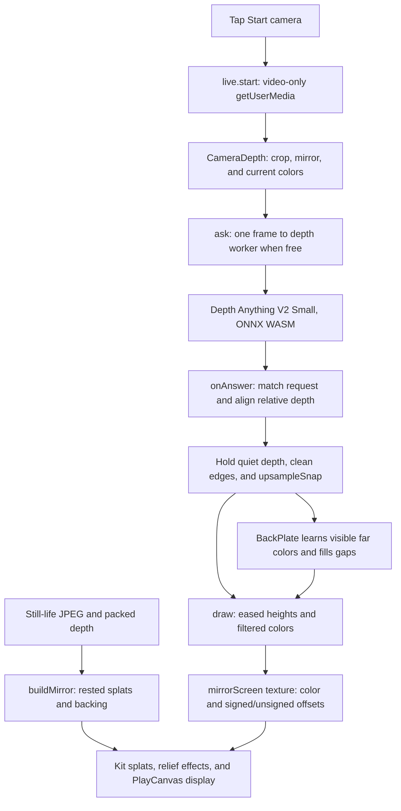

# Splat mirror checkpoint, October 14, 2026

This preserves `splat-mirror` at the shared toy checkpoint: live camera colors on a splat relief,
with stabilized estimated depth and a learned background behind the foreground. Before Start camera,
it shows a bundled still life with baked depth.

## Where the checkpoint lives

| What                                          | Where                                                                                                                                                                   | Commit                                     |
| --------------------------------------------- | ----------------------------------------------------------------------------------------------------------------------------------------------------------------------- | ------------------------------------------ |
| Whole repository                              | `claude/checkpoint-toys-2026-10-14`                                                                                                                                     | `41b21e74e04ccca178b95ac02b4e5dc0e51b4b45` |
| Phone clips, measurements, and capture script | [`codex/toy-checkpoints-b-clips`](https://github.com/ryanjosephkamp/splashery/tree/64ac873c03d84c05c10a8e291682d002282e7ba7/docs/evidence/toy-checkpoints-b-2026-10-14) | `64ac873c03d84c05c10a8e291682d002282e7ba7` |

Never push to, rebase, or delete the shared checkpoint branch. The clips branch is evidence only and
must never be merged.
[Phone clip](https://github.com/ryanjosephkamp/splashery/blob/64ac873c03d84c05c10a8e291682d002282e7ba7/docs/evidence/toy-checkpoints-b-2026-10-14/splat-mirror-390x844.mp4)
uses Chromium's fake camera with the repository's generated turning mannequin, not a real person or
physical camera. It uses the real vendored depth worker.

## How it works

The recipe is `SPLAT_MIRROR`, exported as `RECIPES["splat-mirror"]` in
[`src/packs/live.js`](../../src/packs/live.js). Its main implementation is
[`src/live/relief.js`](../../src/live/relief.js).



1. **No live input until a tap.** `prepare()` loads `assets/toys/photo-3d/still-life.jpg` and
   `.depth`, using `photo-3d.js::decodePhoto()` and `unpackDepth()`. The credit is recorded in
   `SPLAT_MIRROR.credits` and `CREDITS.md`; this task did not independently revalidate its source
   page. `src/live/panel.js` renders Start camera over the stage. Its click calls
   `src/live/live.js::start("camera")`, which requests video, **not microphone audio**, preferring
   640×480 at up to 30 fps.
2. **Camera orientation and lifecycle.** `videoFor()` creates a muted inline video element. The
   front-facing camera is mirrored; the environment camera is not. `switchCamera()` requests the
   other camera from a tap, then stops the old stream. `stop()` ends tracks and clears the video;
   `release()` and `keepOnly()` end a source when its toy owners leave. The Live pill also has Stop.
   A denied or missing camera gets `LiveError` text; the sample remains usable.
3. **Grid and geometry.** `buildMirror()` calls `mirrorGrid()` with about 80% of the Kit budget when
   a backing is included, and that function uses another 80%, capped at 140,000 foreground cells.
   The grid is 4:3; camera colors are center-cropped to that shape. The recipe has density 1.5, no
   turntable, a width of two recipe units, and maximum lift `0.9 × depth`. The still image's splats
   rest at their estimated depths, with signed offsets toward flat, so sorting follows the displayed
   surface. Live splats begin on a plane and take their depth displacement from the screen texture.
   A coarser backing and dark frame are separate splats.
4. **One inference request at a time.** `CameraDepth.ask()` captures the frame when the worker is
   free, rounds model dimensions to multiples of 14, and associates an ID, crop, source dimensions,
   colors, and capture time with it. `requestVideoFrameCallback()` avoids re-estimating the same
   presented frame. `onAnswer()` rejects mismatched or invalid results. The worker serializes
   messages and uses `src/depth/engine.js::createDepthEngine()` with the vendored quantized model
   and ONNX Runtime **WASM**, with RGB mean/std normalization.
   [Depth Anything V2](https://depth-anything-v2.github.io/) describes the model; the temporal
   filters below are Splashery's own. Depth is relative, not meters.
5. **Stability before edges.** `relativeAlignment()` fits scale and shift to pixels whose colors
   stayed similar, with a second outlier-rejecting pass. `onAnswer()` keeps one
   second/98th-percentile range; a large scene-color change without correspondence can reset it.
   `holdDepth()` holds quiet cells exactly once still, and requires three successive answers on the
   same side for a large quiet jump. Visible motion clears the hold. This avoids accumulating noise
   or votes from alternating guesses, but can delay a depth change without a corresponding color
   change.
6. **Clean, color-guided edges.** Depth processing is limited to the smaller of 60,000 cells and
   about `0.75 × depthSide²`, rather than the full color grid. `smoothSurface()`, `snapEdges()`,
   `edgeBand()`, and `tidyBand()` keep gentle surfaces smooth and large jumps distinct.
   `upsampleSnap()` interpolates within a surface, choosing the color-matching side at an edge. It
   uses the colors belonging to the request, not colors from a later camera frame. Fine-grid hold
   counters and elapsed quiet time keep the enlarged depth stable.
7. **Learned backing.** `BackPlate.learn()` admits far cells clear of the near foreground's guarded
   outline and averages known wall color/depth over answers. `fillHoles()` and `rowFill()`
   approximate unseen wall colors. `BackPlate.draw()` limits the backing to the near foreground's
   footprint and caps it behind the foreground depth. This fills disocclusion holes when turned, but
   cannot know what is actually hidden; it may repeat or smear nearby background colors.
8. **Display and Look.** `CameraDepth.draw()` filters sensor color noise, eases depth toward its
   accepted target, and packs color and depth into the halves of the `mirrorScreen` canvas.
   `reliefGrid()` assigns relief parameters; `src/effects.js` displaces splats on the GPU and
   PlayCanvas sorts/composites them. `drive()` sets `MIRROR.gain = depth × (1 − flat)`; tapping
   flattens or raises the relief without moving the whole picture. `hologram()` tints cyan and adds
   background lines and an outline, keeping decoration off the main face region. It is a display
   effect, not a physical hologram. If the depth worker fails, the status says why, and the camera
   picture can remain flat.
9. **Recording.** When supported, the camera panel offers Record, Stop, and Save through
   `src/live/record.js::StageRecorder`. An explicit Record captures the stage canvas in memory for
   up to 30 seconds, choosing supported MP4 or WebM. Save downloads the chosen recording. This
   records the rendered view, not a hidden raw-camera recording, and requests no microphone. Nothing
   is uploaded or persisted automatically.

### Every toy setting

| Control or saved key        | Default         | What changes                                                                                |
| --------------------------- | --------------- | ------------------------------------------------------------------------------------------- |
| Depth, `depth`              | 0.5             | 0–1 in steps of 0.05; strength of the relative-depth relief, also over the stage.           |
| Look, `look`                | `plain`         | Plain colors or `hologram`, cyan tint, background lines, and outline.                       |
| Flatten the picture, `flat` | 0               | Tap toggles flat/raised; the toggle eases at 1.4 and keeps live colors moving.              |
| Start / Stop camera         | Off             | Requests/releases the camera from a tap; off returns to the still sample.                   |
| Switch camera               | Front preferred | Changes front/rear source and whether colors/depth are mirrored; shown when available.      |
| Record / Stop / Save        | Not recording   | Captures and optionally downloads the displayed canvas when browser recording is supported. |

The shared Detail/profile control changes the splat budget. `buildMirror()` chooses the camera depth
tier by the actual recipe count: above 200,000 is high, above 90,000 is mid, otherwise low. Thus a
density-1.5 mid recipe can use the high depth size. `DEPTH_SIDE` lists low/mid/high/max as
140/196/252/308, but this recipe does not select max through that count-based branch. Orbit and zoom
change the view; neither reconstructs additional viewpoints. Saved scenes retain settings, not
camera permission or live frames. Splat exports cannot reproduce the stream or the live texture; use
a picture/video export for the displayed view.

## The files that make it up

| Layer                              | Files at the checkpoint                                                                                                                                                                                                     |
| ---------------------------------- | --------------------------------------------------------------------------------------------------------------------------------------------------------------------------------------------------------------------------- |
| Recipe and records                 | `src/packs/live.js`, its entries in `src/toys.js`, `src/toy-help.js`, and `src/toy-sounds.js`                                                                                                                               |
| Camera, stabilization, and backing | `src/live/relief.js`, `src/live/live.js`, `src/live/panel.js`, and `src/live/record.js`                                                                                                                                     |
| Inference                          | `src/live/depth-worker.js`, `src/depth/`, `src/packs/photo-3d-core.js`, and its helpers under `src/photo3d/`; `vendor/depth-anything-v2-small/` and `vendor/onnxruntime-web/`                                               |
| Sample decoding                    | `src/packs/photo-3d.js`, `assets/toys/photo-3d/still-life.jpg`, and `assets/toys/photo-3d/still-life.depth`; provenance in `tools/assets.json` and `CREDITS.md`                                                             |
| Shared engine                      | `src/app.js`, `src/ui.js`, `src/player.js`, `src/kit.js`, `src/generators.js`, `src/motion.js`, `src/effects.js`, `src/kernels.js`, `src/stage.js`, `src/camera.js`, `src/exports.js`, `src/pc.js`, and vendored PlayCanvas |

Behavior tests: `tests/live.spec.mjs` and `tests/live-engine.spec.mjs` (permission and source
lifecycle), `tests/live3.spec.mjs` and `tests/live3-engine.spec.mjs` (still sorting, camera,
recording, hologram, and Live pill), `tests/live5.spec.mjs` and `tests/live6.spec.mjs` (edges and
background occlusion), `tests/lv7.spec.mjs` (generated-camera stability and sharpness),
`tests/cdx-mir.spec.mjs` (alignment, hold, request freshness, and occlusion),
`tests/lv8-dial.spec.mjs` (Depth slider), and `tests/cdx-depth*.spec.mjs` (shared inference).
`tools/cdx-mir-camera.mjs`, `tools/lv7-mannequin.mjs`, and `tools/lv7-mirror-measure.mjs` generate
and measure synthetic camera evidence; they do not test physical-camera behavior.

## How to restore it

From a clean checkout, verify the fetched hash against the full checkpoint above:

```sh
git fetch origin main
git fetch origin refs/heads/claude/checkpoint-toys-2026-10-14:refs/remotes/origin/claude/checkpoint-toys-2026-10-14
git rev-parse origin/claude/checkpoint-toys-2026-10-14
git switch -c restore-splat-mirror origin/main
git checkout origin/claude/checkpoint-toys-2026-10-14 -- \
  src/packs/live.js src/live/relief.js src/live/live.js src/live/panel.js src/live/record.js \
  src/live/depth-worker.js src/depth src/packs/photo-3d.js src/packs/photo-3d-core.js src/photo3d \
  assets/toys/photo-3d/still-life.jpg assets/toys/photo-3d/still-life.depth \
  vendor/depth-anything-v2-small vendor/onnxruntime-web
git diff --cached --stat
```

Check **Photo to 3D, Moving photo to 3D, Room echo, Song landscape, Chladni plate, Sound in a box,
Sound lab, Sound recorder, and Screen** after restoring shared photo/depth, live lifecycle, panel,
or recording files. Find any further source consumers with
`rg 'live/live|live/panel|live/record|live/relief' src`. `live.js` the pack also registers Moving
photo and Room echo; keep their dependency interfaces compatible. Copy only this toy's entries from
shared catalogs and credit records, preserving later entries for others. Review renderer changes
separately rather than resetting shared engine files. For the complete exact snapshot, use
`git worktree add --detach /tmp/splashery-mirror-checkpoint 41b21e74e04ccca178b95ac02b4e5dc0e51b4b45`.

Run the listed tests with `SPLASHERY_CHROMIUM=<existing Chromium>`, compare the checkpoint test
copies when assertions changed, and check the still sample, Start/Stop, denied permission, both
Looks, flatten/raise, camera switching, record/save, toy changes, quiet scenes, motion, and
occlusions before a draft PR. Add a real front/rear-camera phone check: a fake stream cannot verify
camera permissions, exposure, thermal behavior, or mobile recording support.

## What it does best, measured limits, and later rounds

The strongest behavior is an immediate live color picture with shallow depth, stable quiet surfaces,
and a backing that reduces holes during a small turn. Camera color and inferred depth are
asynchronous. Hidden surfaces are guessed; hair, similar foreground/background colors, low light,
and fast motion can expose misaligned edges, holds, or ghosts. The camera is cropped to 4:3, and the
relief cannot give a full view around a person or object.

| Measure                                                  | Observed result                                      |
| -------------------------------------------------------- | ---------------------------------------------------- |
| Toy selection to ready                                   | 5.49 s                                               |
| Rendered frames in measured window                       | 18 in 6.013 s                                        |
| Rendered rate                                            | 2.99 fps                                             |
| Median / 95th-percentile frame interval                  | 315.9 / 744.3 ms                                     |
| Viewport / stage drawing buffer                          | 390×844 / 390×645                                    |
| Start camera to three accepted depth answers             | 1.16 s                                               |
| Foreground grid / model long side                        | 423×317 / 252                                        |
| Last reported inference time                             | 507.6 ms                                             |
| Depth answers / rejected results at measurement snapshot | 3 / 1; not a sustained depth-update-rate measurement |
| Model / WASM files on disk                               | 27,258,801 / 14,239,897 bytes (41.50 MB combined)    |
| Still JPEG / depth files                                 | 376,283 / 507,652 bytes                              |

This is one unthrottled cloud run at 390×844, touch/mobile browser identity, DPR 1, forced mid
profile, and WebGL2/SwiftShader, with a generated 320×240, 15 fps dummy stream. Render rate counts
`postrender` events during a six-second window before capture. The worker was real, but the camera
was synthetic; these are not physical-phone or real-camera rates. The last inference time covers
model execution alone, not capture-to-screen latency. Main-document resource body totals in the
evidence omit worker downloads: the model and WASM payload must be counted separately. Startup, tab
memory, capture latency, and prolonged physical-camera use were not comprehensively benchmarked.

Later rounds should compare static drift, edge lag, low-light behavior, scene changes,
rejected-answer recovery, and learned-wall ghosts using the existing dummy clips plus real phones.
Every later change must beat this checkpoint in both Looks, preserve permission/Stop/recording
behavior and saved settings, and keep a change only when it is at least as good on every measure.
