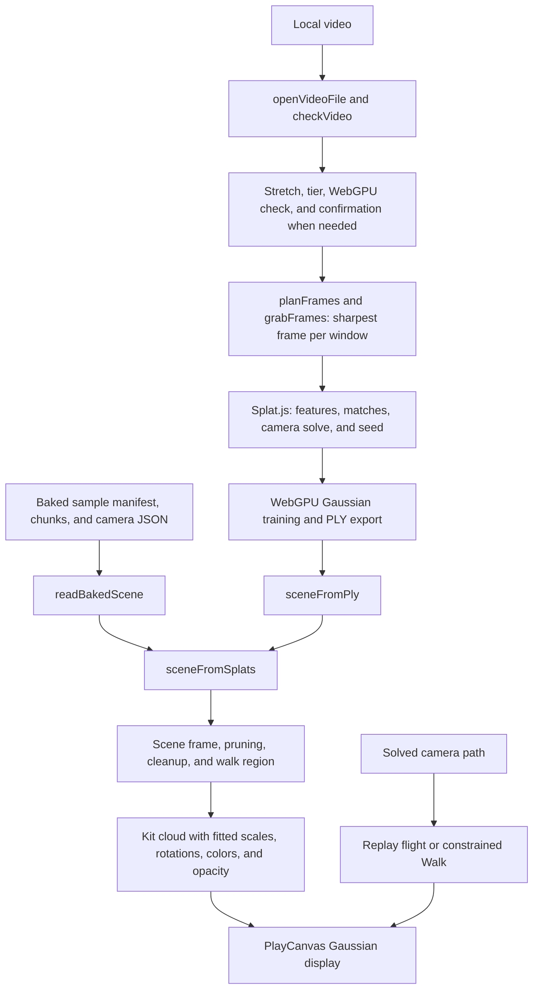

# Video to 3D checkpoint, October 14, 2026

This preserves `video-3d` at the shared toy checkpoint. A local video of a mostly static scene is
converted into a 3D Gaussian scene using multiple camera views. Bundled scenes are already trained,
so exploring them requires no browser training.

## Where the checkpoint lives

| What                                          | Where                                                                                                                                                                   | Commit                                     |
| --------------------------------------------- | ----------------------------------------------------------------------------------------------------------------------------------------------------------------------- | ------------------------------------------ |
| Whole repository                              | `claude/checkpoint-toys-2026-10-14`                                                                                                                                     | `41b21e74e04ccca178b95ac02b4e5dc0e51b4b45` |
| Phone clips, measurements, and capture script | [`codex/toy-checkpoints-b-clips`](https://github.com/ryanjosephkamp/splashery/tree/64ac873c03d84c05c10a8e291682d002282e7ba7/docs/evidence/toy-checkpoints-b-2026-10-14) | `64ac873c03d84c05c10a8e291682d002282e7ba7` |

Never push to, rebase, or delete the shared checkpoint branch. The clips branch is evidence only and
must never be merged.
[Phone clip](https://github.com/ryanjosephkamp/splashery/blob/64ac873c03d84c05c10a8e291682d002282e7ba7/docs/evidence/toy-checkpoints-b-2026-10-14/video-3d-390x844.mp4)
shows the default baked scene and Replay flight, with a small view turn. It does not demonstrate a
new video being trained.

## How it works

The recipe is `VIDEO_3D`, exported as `RECIPES["video-3d"]` in
[`src/packs/video3d.js`](../../src/packs/video3d.js).



1. **Input and suitability.** `openVideoFile()` accepts a local browser-playable video (`video/*`,
   MP4, M4V, MOV, or WebM), with the shared input panel's default 40,000,000-byte cap, and checks a
   few frames with `src/video3d/suitability.js::checkVideo()`, and keeps the `File` in memory.
   Container names do not guarantee codec support. `trainVideo()` reassesses a changed stretch,
   checks `webgpuStatus()`, and shows a Start/Cancel decision on a phone or when the suitability
   verdict is not `promising`. No camera or microphone permission is requested, and no video is
   uploaded.
2. **Frame selection.** `frames.js::planFrames()` clamps Start/Length to the video and spreads
   sampling windows within the tier's frame cap. `extract.js::grabFrames()` tests three candidate
   times in each window and keeps the sharpest according to `frames.js::sharpness()`, the variance
   of a grayscale Laplacian. `fitSide()` bounds resolution. `panoSafeCrop()` trims frames close to
   2:1 to about 1.9:1, avoiding Splat.js's panorama interpretation.
3. **Camera solve.** `run.js::videoTo3D()` dynamically imports `vendor/splatjs/src/session.js`,
   calls `createSession()`, `load()`, and `solve()`, and requires at least three solved cameras.
   Features and matches establish corresponding scene points; camera poses and points are jointly
   refined. The [COLMAP tutorial](https://colmap.github.io/tutorial.html) explains structure from
   motion and the need for overlap and texture; the implementation here is vendored Splat.js. One
   failed solve is retried with `RELAXED_SFM`, then `solveMessage()` gives actionable failure
   advice.
4. **Gaussian fitting.** `seed()` initializes splats, and the WebGPU trainer adjusts positions,
   scales, rotations, opacity, and color across the views. `refineEvery` scales with the run, and
   growth stops at 80% of training steps. The custom trainer uses spherical-harmonic degree 0. The
   original
   [3D Gaussian Splatting paper and project](https://repo-sam.inria.fr/fungraph/3d-gaussian-splatting/)
   describe anisotropic Gaussian scene optimization and alpha compositing; Splashery's tier limits
   and cleanup are local choices. The card reports stage times, progress, and an estimated time
   left. Phone-safe runs use short bursts, pause while hidden, and stop after eight minutes, keeping
   the trained result. Stop before training aborts; during training, Finish now retains the result.
5. **Samples and tiers.** `loadSample()` loads the selected BKD1 manifest via
   `video3d/baked.js::readBakedScene()`, `src/baked.js::loadBaked()`, and `splatAt()`, plus camera
   JSON. `tiers.js::phoneSample()` and `sampleBudget()` cap phone samples at 60,000 splats unless an
   explicit High/Max choice opts into desktop detail. A 390-pixel viewport alone does not identify a
   phone; mobile browser identity matters. Phone and desktop tiers are independently fitted scenes,
   not just different prefixes of one fitted cloud. The default `liberty` manifest records 59,857
   phone splats in 968,499 compressed bytes and 177,901 desktop splats in 2,869,129 bytes. All six
   scene IDs are `liberty`, `edinburgh`, `adjara`, `lihula`, `toolse`, and `poltsamaa`.
6. **Coordinates and cleanup.** `sceneFromPly()` uses `readSplatPly()`; `sceneFromSplats()` calls
   `sceneFrame()`, `splatsInFrame()`, `toyCamera()`, `pruneSplats()`, and `cleanScene()`.
   World-to-camera poses use `Xc = R X + t`, so the camera center is `-Rᵀt`. The toy transforms
   cameras and splats together. Walk uses the affine frame. Ordinary orbit scenes can contract the
   far field; calibrated photometric bakes preserve their fitted geometry. Cleanup removes faint,
   invalid, near-camera, unsupported, or elongated ray artifacts, with guards that preserve fitted
   broad surface Gaussians. Source-derived sky color may become a dome. Cleanup is heuristic, not
   recovered hidden geometry.
7. **Display.** `build()` emits up to 98% of the Kit budget, preserving each splat's three scales,
   quaternion, color, and opacity. Near and outer clouds share the camera frame; calibrated geometry
   avoids unit-ball contraction. The recipe uses density 1.6, a Gaussian kernel, culling off, native
   DPR within the stage's cap, and adaptive resolution off. A steeper sharp kernel would change the
   fitted Gaussian overlaps. This toy does not use the photo depth model or Sharp picture relief.
8. **Navigation and export.** `flight.js::makeFlight()` interpolates the solved path and lets
   drag/zoom add an offset during Replay flight. Turning replay off pauses at the current position;
   continuing resumes, and the completed path can return home. Original video and available sound
   follow flight time. `walk.js::mountWalk()` and `region.js::buildWalkRegion()` constrain movement
   near captured supported space, with keyboard/touch movement, drag-to-look, and Back to start.
   This is a heuristic boundary, not a collision-complete scene. `progressCard().done()` offers Save
   as PLY for a custom result. The PLY does not contain the video, audio, or solved flight metadata.
   Scene JSON retains options, not the custom training result; reopen and rebuild a local video.

### Every toy setting

| Control or saved key               | Default                | What changes                                                                                                                     |
| ---------------------------------- | ---------------------- | -------------------------------------------------------------------------------------------------------------------------------- |
| Move around, `navigation`          | `orbit`                | Turn/zoom or Walk inside the filmed area; changes scene framing and navigation.                                                  |
| Scene, `source`                    | `liberty`              | One of six baked scenes or `custom`.                                                                                             |
| Start (s), `start`                 | 0                      | 0–300 in one-second steps; beginning of the training stretch, clamped to the file.                                               |
| Length, `length`                   | `10`                   | 5, 10, 20, or 40 seconds; training stretch, limited by remaining video.                                                          |
| Frames a second, `rate`            | `3`                    | 2, 3, 4, or 6 candidate windows per second, further limited by the tier cap.                                                     |
| Setting, `setting`                 | `auto`                 | Phone-safe on a detected phone; otherwise device profile. Explicit Phone-safe, Standard, or High changes custom training limits. |
| Show the original, `original`      | `off`                  | Flat sample/local video in step with flight; not guaranteed aligned with a freely walked view.                                   |
| Replay flight, `replay`            | 0                      | Tap toggles the solved camera path; drag/zoom can offset it.                                                                     |
| Start / Cancel / Finish now / Hide | Progress card          | Confirm, abort, finish current fitting early, or hide the card.                                                                  |
| Save as PLY                        | Finished custom result | Downloads the trained cloud on the device.                                                                                       |
| Walk pads/keys and Back to start   | Walk only              | Movement within the supported region, view direction, and reset.                                                                 |
| `videoName`                        | Empty, hidden          | Name shown for a local video; does not store its contents.                                                                       |

Shared Detail/profile selection controls baked-scene budget. Shared sound controls audibility;
Replay uses the driver's elapsed-time or audio clock. Changing Start, Length, Rate, or Setting
invalidates a custom run's cache; those controls do not retrain baked samples.

| Training tier | Frame cap | Frame/feature/training long sides | Training steps | Splat cap |
| ------------- | --------: | --------------------------------- | -------------: | --------: |
| Phone-safe    |        16 | 480 / 480 / 320                   |          1,200 |    30,000 |
| Low           |        20 | 480 / 480 / 360                   |          1,500 |    60,000 |
| Mid           |        32 | 640 / 640 / 480                   |          3,000 |   120,000 |
| High          |        60 | 960 / 960 / 720                   |          7,000 |   250,000 |
| Max           |        90 | 1,280 / 960 / 960                 |         12,000 |   350,000 |

Low and Max are engine/tool tiers, not separate choices in the toy's Setting menu. The baked scenes'
offline fitting settings can differ from these browser limits.

## The files that make it up

| Layer                          | Files at the checkpoint                                                                                                                                                                  |
| ------------------------------ | ---------------------------------------------------------------------------------------------------------------------------------------------------------------------------------------- |
| Recipe and records             | `src/packs/video3d.js`, its entries in `src/toys.js`, `src/toy-help.js`, and `src/toy-sounds.js`                                                                                         |
| Video preparation and training | `src/video3d/run.js`, `frames.js`, `extract.js`, `suitability.js`, `panel.js`, and `guide.js`; `vendor/splatjs/`                                                                         |
| Reading and cleanup            | `src/video3d/ply.js`, `baked.js`, `scene.js`, `cleanup.js`, `tiers.js`, `samples.js`, and `src/baked.js`                                                                                 |
| Navigation and credit          | `src/video3d/flight.js`, `walk.js`, `region.js`, `credit.js`, `src/compare.js`, `src/camera.js`, and `src/exports.js`                                                                    |
| Sample data and provenance     | Entire `assets/toys/video-3d/`: BKD1 tiers, manifests, camera JSON, and original comparison clips; `tools/assets.json`, `CREDITS.md`, and `LICENSES.md`                                  |
| Shared engine                  | `src/app.js`, `src/ui.js`, `src/player.js`, `src/kit.js`, `src/generators.js`, `src/motion.js`, `src/effects.js`, `src/kernels.js`, `src/stage.js`, `src/pc.js`, and vendored PlayCanvas |

Behavior tests are `tests/v3d.spec.mjs` (frames, PLY, transforms, lazy trainer, WebGPU failure,
replay, and phone confirmation), and the `tests/cdx-v3d*.spec.mjs` family (walk, cleanup, camera
calibration, renderer, compressed sample tiers, clarity, registration, CPU/native tooling, and
handoff). The BKD1 format and loader are covered by `tests/bkd-format.spec.mjs` and
`tests/bkd.spec.mjs`. See `docs/lab/VIDEO3D.md` and the reports under `docs/audits/` for prior
rounds; prior report numbers are not fresh measurements from this task.

## How to restore it

From a clean checkout, verify the fetched hash against the full checkpoint above:

```sh
git fetch origin main
git fetch origin refs/heads/claude/checkpoint-toys-2026-10-14:refs/remotes/origin/claude/checkpoint-toys-2026-10-14
git rev-parse origin/claude/checkpoint-toys-2026-10-14
git switch -c restore-video-3d origin/main
git checkout origin/claude/checkpoint-toys-2026-10-14 -- \
  src/packs/video3d.js src/video3d src/baked.js src/compare.js \
  assets/toys/video-3d vendor/splatjs
git diff --cached --stat
```

The shared BKD1 loader also serves baked recipes, including Baked demo; Compare serves Photo to 3D
and Moving photo to 3D. Check those toys and all consumers found by `rg 'loadBaked|splatAt' src`
before shipping a restore. Keep sample manifests, chunks, and camera JSON together; mixing them can
misalign geometry and replay. Restore only this toy's entries from shared catalogs and credit
records. Review shared camera/renderer interfaces separately if they changed. For the entire exact
snapshot, use
`git worktree add --detach /tmp/splashery-video-checkpoint 41b21e74e04ccca178b95ac02b4e5dc0e51b4b45`.

Run the named test families with `SPLASHERY_CHROMIUM=<existing Chromium>`, check all six samples on
phone and desktop tiers in both navigation modes, replay, compare, and PLY export, and exercise
custom-video success, failure, cancel, and Finish now on a WebGPU-capable device. Inspect checkpoint
test copies when current assertions have changed, and open a draft PR; never merge the checkpoint or
evidence branch.

## What it does best, measured limits, and later rounds

It provides actual multiview geometry, a replayable camera path, and a local PLY result. Baked
scenes are useful even without WebGPU. Good custom footage needs translation, overlapping detail,
and a mostly static scene. Pure rotation, blank surfaces, water, blur, and independently moving
objects can fail the solve or leave floaters. Walk cannot recover areas the cameras never saw.
Browser training quality and time vary with the device; phone-safe caps deliberately trade detail
for bounded work. PSNR shown during training is not a guarantee of novel-view quality.

| Measure                                 | Observed result                                           |
| --------------------------------------- | --------------------------------------------------------- |
| Toy selection to ready                  | 3.96 s                                                    |
| Rendered frames in measured window      | 24 in 6.001 s                                             |
| Rendered rate                           | 4.00 fps                                                  |
| Median / 95th-percentile frame interval | 210.1 / 305.8 ms                                          |
| Viewport / stage drawing buffer         | 390×844 / 390×645                                         |
| Phone source / displayed scene splats   | 59,857 / 58,242 after cleanup; sky added separately       |
| Camera poses                            | 51                                                        |
| Phone BKD1 payload                      | 968,499 compressed bytes (0.97 MB), before JSON and shell |

This is one unthrottled 390×844 touch/mobile cloud run, mobile browser identity, DPR 1, forced mid
profile, and WebGL2/SwiftShader. Readiness starts after page-shell readiness at `chooseToy()`.
Render rate counts `postrender` events for six seconds during Replay flight before clip capture. The
software-renderer rate is not a physical-phone result. The sample's existing offline training
statistics in `video3dState()` are provenance, not a new training benchmark. Main-document resource
body totals in the evidence include the shell and omit worker resource timing; they are not complete
wire transfer. Custom WebGPU training time, power, temperature, and real-phone performance were not
measured.

Later rounds should compare held-out views, thin edges, cleanup losses, frame selection, and safe
walking boundaries on real phones, while retaining matched phone/desktop manifests and camera paths.
Every later change must compare all six samples and custom-video behavior with this checkpoint,
preserve credits and saved links, and keep a change only when it is at least as good on every
measure.
