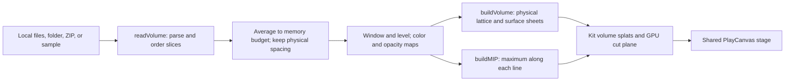

# Volume viewer checkpoint, October 14, 2026

This preserves `volume-viewer`, the labs-only Studio viewer of CT, MRI, and microscopy voxel data.
Later work must compare against this baseline using
[Photo to 3D's preservation rule](photo-3d-checkpoint.md).

## Where the checkpoint lives

| What                                               | Where                                                                                                                                                                                         |
| -------------------------------------------------- | --------------------------------------------------------------------------------------------------------------------------------------------------------------------------------------------- |
| Whole repository                                   | `claude/checkpoint-toys-2026-10-14`                                                                                                                                                           |
| Immutable commit                                   | `41b21e74e04ccca178b95ac02b4e5dc0e51b4b45`                                                                                                                                                    |
| Evidence commit                                    | `a7092650d344b2eb66b15f747acf37712ae7cf05` on `codex/toy-checkpoints-e-clips`                                                                                                                 |
| Phone review clip                                  | [390×844 walnut cut sweep and gar sample](https://github.com/ryanjosephkamp/splashery/blob/a7092650d344b2eb66b15f747acf37712ae7cf05/docs/audits/toy-checkpoints-e/volume-viewer-390x844.webm) |
| Method, raw results, inventory, and capture script | [Clips-branch evidence](https://github.com/ryanjosephkamp/splashery/tree/a7092650d344b2eb66b15f747acf37712ae7cf05/docs/audits/toy-checkpoints-e)                                              |

Never push to, rebase, or delete the checkpoint branch. Never merge the clips branch.

## How it works

`VIEWER` in `src/packs/volume-viewer.js` opens committed walnut/gar scans or files the visitor
chooses: DICOM slices (several files, a folder, ZIP, or multi-frame file), NIfTI, TIFF stacks, and
raw numeric volumes. No camera, microphone, or remote medical-data feed is requested. `openFiles`
reads the selected bytes locally, and `volumeFor` caches decoded samples. A custom volume is held
only in memory; scene options cannot restore the file's bytes, and selecting `custom` without an
open file falls back to the walnut with an explanatory note.



### Reading and coordinates

`src/volume/read.js` provides `readVolume`, `readNifti`, `parseRawForm`, and the internal TIFF,
DICOM, ZIP, and raw readers. It detects format from bytes and filenames, expands gzip/ZIP, skips
directory indexes/unrelated files, and selects a supported dataset. Unlike Point clouds, this recipe
does not send parsing to `src/viewers/worker.js`; it reads and builds through async JavaScript on
the page.

| Format | Implemented path and limits                                                                                                                                                                                                                                                                                                                                                                                                                  |
| ------ | -------------------------------------------------------------------------------------------------------------------------------------------------------------------------------------------------------------------------------------------------------------------------------------------------------------------------------------------------------------------------------------------------------------------------------------------- |
| DICOM  | `loadDicomParser` loads `vendor/dicom-parser/dicomParser.min.js` lazily. `parseDicomFile` reads pixels, rescale slope/intercept, spacing, orientation, and positions. `readDicom` selects the largest matching series and sorts frames along the slice normal, falling back to instance order. Implicit/explicit little-endian, explicit big-endian, and RLE Lossless are handled; unsupported JPEG-family compression is named and refused. |
| NIfTI  | `readNifti` reads NIfTI-1/2 headers in either byte order, dimensions, datatype, spacing, scale/intercept, and sform/qform direction. It displays only the first volume of a time series. Gzip is expanded before parsing. RGB values become luminance.                                                                                                                                                                                       |
| TIFF   | `tiffPages`, `tiffPage`, and `readTiffs` read classic multi-page TIFF or named slices, uncompressed, LZW, Deflate, or PackBits, and use ImageJ spacing where available. BigTIFF is recognized but refused.                                                                                                                                                                                                                                   |
| Raw    | `parseRawForm`/`readRaw` need columns, rows, slices, scalar type, byte order, voxel spacing, and header skip. Values become the same normalized volume structure as other formats.                                                                                                                                                                                                                                                           |

`assemble` block-averages large volumes while reading them into a Float32Array: at most 4,000,000
voxels on coarse-pointer devices, or 8,000,000 otherwise. `shrinkFactors` chooses integer reductions
with physical spacing in mind; spacing grows with those factors so the object's physical dimensions
remain consistent. Input-byte limits (600 MB coarse-pointer, 2 GB otherwise) apply before this
reduction, and decompression may still require substantial temporary memory.

DICOM LPS and NIfTI RAS directions are mapped toward the toy's right, up, and front axes. `viewAxes`
snaps each input direction to the closest unused cardinal axis; it does not retain an arbitrary
oblique affine. DICOM uses typical spacing when gaps are uneven and reports that approximation.
Missing spacing is substituted and noted where the reader can detect it. `placer` in
`src/volume/view.js` centers voxel indices and multiplies by millimeter spacing. `spacingOverride`
lets the visitor correct original voxel sizes while respecting reduction.

### From values to splats

`volumeStats` uses a 2,048-bin histogram and two Otsu thresholds to separate background,
intermediate material, and denser material. Its internal `otsu` routine selects the split maximizing
`background_count * foreground_count * (background_mean - foreground_mean)²`; this formula is
visible directly in the code. `presetWindow` uses those thresholds for non-HU scans. For data marked
as Hounsfield units, the code's windows are bone `[300, 1500]`, soft tissue `[-160, 240]`, and full
`[max(min, -500), max]`. `windowFor` converts custom normalized level and width into a numeric
window; `wl` gives width and center for the facts panel.

`buildViewer` dispatches to `buildVolume` or `buildMIP`. `buildVolume` chooses a physical lattice
pitch for the budget, samples values trilinearly with `sampleAt`, and keeps material above the
window's lower bound. Values above the upper bound saturate rather than disappearing. It adds small
lateral jitter to suppress grid lines, uses nearby maxima for surface color, and bakes
gradient-based lighting. In the interior it keeps every third sheet along the cut direction, or
every fifth for slice mode; the outer surface remains sampled between sheets. This spends more of
the same budget on clear cut faces. Splats are round or stretched toward the next sheet; slice
splats are flattened.

`buildMIP` computes the maximum voxel value along the selected axis, then draws a flat, physically
proportioned splat picture facing the viewer. It is a maximum-intensity projection, not a sum of
attenuation as in an X-ray image.

`driveVolume` sends `out.volume` to the shared volume shader in `src/effects.js` through
`src/motion.js`. Drag changes the cut position continuously. A five-second `sweep` pulse moves the
cut down and back; `slice` keeps one thin slab. The cut face has a warm glow. `describe` reports
original dimensions/spacing, numeric range, window, emitted splat count, sampling pitch, and reader
notes. `VOLUME_STATE` exposes this state to tools and tests.

### Every setting and panel action

| Key (default)                    | What it changes                                                                                                                                                                                |
| -------------------------------- | ---------------------------------------------------------------------------------------------------------------------------------------------------------------------------------------------- |
| `source` (`walnut`)              | Walnut, gar, or the visitor's decoded custom volume.                                                                                                                                           |
| `view` (`volume`)                | 3D volume splats, or `mip` maximum-intensity picture. Drag/cut sweep and thin slab do not alter the MIP.                                                                                       |
| `preset` (`full`)                | `bone`, `soft`, `full`, or `custom` window. Tap steps bone → soft → full → bone; from the default full view the next is bone.                                                                  |
| `level` (`0.5`), `width` (`0.5`) | Custom window center and width as fractions of the numeric range; center 0–1, width 0.01–1, step 0.01. Used only for `custom`.                                                                 |
| `colors` (`bone`)                | Bone and tissue, CT gray (`gray`), Hot metal (`hot`), Cool (`cool`), or Night vision (`green`). Changes a display transfer function, not tissue labels.                                        |
| `opacity` (`solid`)              | Opaque material with softened edges, or `layers` where low-window values are faint. Applies to the 3D volume, not the MIP.                                                                     |
| `cut` (`front`)                  | Front to back, top down, or side to side. Chooses both the volume cut/sheet axis and MIP projection axis.                                                                                      |
| `slice` (`false`)                | One thin sheet at the cut. With the cut at its initial endpoint, the slice starts in the middle.                                                                                               |
| `spacing` (blank)                | Three positive millimeter voxel sizes; blank uses the file's. Invalid text leaves file spacing in use.                                                                                         |
| Hidden `fileName`, `uid`         | Name and custom-file revision counter; no saved voxel bytes.                                                                                                                                   |
| Open a volume / folder           | Reads multiple files, a directory, or an archive locally. The input accepts `.dcm`, `.dicom`, `.ima`, `.nii`, `.gz`, `.zip`, `.tif`, `.tiff`, `.raw`, `.bin`, `.img`, `.vol`, and `.dat`.      |
| Raw form                         | Size; uint8/int8/uint16/int16/uint32/int32/float32/float64; little/big endian; spacing (default `1 1 1` mm); header bytes (default `auto`). Read it as raw retries the previously opened file. |
| Tap, Play, and vertical drag     | Tap rebuilds with the next preset (`step`); Play invokes `sweep`; drag moves the cut. Cut position persists across presets of the same volume.                                                 |
| Shared Detail/camera/look        | Profile changes sampling budget; orbit/pinch, splat scale, exposure, and background change the view. `density: 2`, `kernel: "sharp"`, and `turntable: false` are recipe defaults.              |

### Samples and scientific sources

The walnut is `assets/toys/walnut-ct/walnut.vol.gz` (501,633 bytes), an 8-bit WCT1 volume read by
`walnutVolume`; the gar is `assets/toys/volume-viewer/gar.nii.gz` (1,361,785 bytes). The walnut is
shared with the imaging toys. The gar preparation is in `tools/vol-gar.mjs`.

Zenodo's API verified both records' titles and CC BY 4.0 licenses on October 14, 2026:
[CWI's cone-beam walnut collection](https://zenodo.org/api/records/2686726) and
[Brian Metscher's gar micro-CT collection](https://zenodo.org/api/records/19021581). The DOI landing
pages returned HTTP 403; record metadata, not new source-volume downloads, was checked. The files
here are reduced derivatives, not full-resolution originals.

[NIfTI-1's field documentation](https://nifti.nimh.nih.gov/nifti-1/documentation/nifti1fields/) and
[DICOM's VOI LUT/window module](https://dicom.nema.org/medical/dicom/current/output/chtml/part03/sect_C.11.2.html)
were also opened. They describe the source formats; the supported subset and all approximations
above are determined by this implementation. This checkpoint does not assert conformance to every
part of either standard. Window ranges, Otsu choices, gradient lighting, and lattice construction
are the viewer's display algorithms.

## The files that make it up

| Role                                  | Files                                                                                                                                                           |
| ------------------------------------- | --------------------------------------------------------------------------------------------------------------------------------------------------------------- |
| Recipe, input panel, and cut behavior | `src/packs/volume-viewer.js`                                                                                                                                    |
| Readers and rendering construction    | `src/volume/read.js`, `src/volume/view.js`                                                                                                                      |
| Lazy DICOM library                    | `vendor/dicom-parser/` (dicom-parser 1.8.21; 32,147-byte JavaScript file)                                                                                       |
| Data                                  | `assets/toys/walnut-ct/walnut.vol.gz`, `assets/toys/volume-viewer/`                                                                                             |
| Preparation and review tools          | `tools/vol-gar.mjs`, `tools/vol-fixtures.mjs`, `tools/vol-shot.mjs`, `tools/vol-clip.mjs`, `tests/fixtures/vol/`                                                |
| Behavior tests                        | `tests/vol.spec.mjs`: formats, ordering, orientation, rescaling, reduction, errors, windows, spacing, MIP, budgets, tap/drag/sweep, and browser file inputs     |
| Shared shader behavior                | `tests/img-engine.spec.mjs`: volume cut/window behavior in WebGL2/WGSL and unchanged non-volume rendering; `tests/img.spec.mjs`: shared walnut/imaging behavior |

The shared runtime includes the shell (`src/app.js`, `src/ui.js`, `src/state.js`, and
`src/camera.js`) and `src/kit.js`, `src/generators.js`, `src/player.js`, `src/motion.js`,
`src/stage.js`, `src/effects.js`, `src/kernels.js`, `src/pc.js`, and PlayCanvas 2.22.3 under
`vendor/playcanvas/`. The app's shared file-input UI also participates. The toy's global entries are
in `src/toys.js`, `src/toy-help.js`, `src/toy-sounds.js`, `src/site-toy-pages.js`,
`tools/toy-plan.json`, `tools/toy-dates.json`, `tools/assets.json`, `CREDITS.md`, and `LICENSES.md`.
Restore only its entries in those shared lists.

## How to restore it

For the complete exact baseline:

```sh
git fetch origin claude/checkpoint-toys-2026-10-14:refs/remotes/origin/claude/checkpoint-toys-2026-10-14
git rev-parse origin/claude/checkpoint-toys-2026-10-14
# Must print 41b21e74e04ccca178b95ac02b4e5dc0e51b4b45.
git worktree add -b restore-volume-viewer ../restore-volume-viewer 41b21e74e04ccca178b95ac02b4e5dc0e51b4b45
```

For a targeted restore on a new branch from current `main`, after that SHA check:

```sh
git fetch origin main
git switch -c restore-volume-viewer-current origin/main
git checkout origin/claude/checkpoint-toys-2026-10-14 -- src/packs/volume-viewer.js src/volume vendor/dicom-parser assets/toys/walnut-ct/walnut.vol.gz assets/toys/volume-viewer tests/vol.spec.mjs tests/fixtures/vol tools/vol-gar.mjs tools/vol-fixtures.mjs tools/vol-shot.mjs tools/vol-clip.mjs
```

The walnut file also serves Walnut CT and How CT works in `src/packs/imaging.js`; recheck them and
`img.spec.mjs` if that data is restored. The volume kind in `effects.js` and `motion.js` is shared
with imaging recipes, and a common-engine rollback affects all kit toys. The targeted command leaves
those engine files in place: compare any later changes before selectively restoring them, or use the
full worktree for exact reproduction. Run `vol.spec.mjs` and `img-engine.spec.mjs`, and broader
`smoke`, `kit`, `unit`, scene compatibility, and embed checks after changing shared runtime. Open a
draft restore PR; never merge directly.

## What it does best, measured limits, and later rounds

Measured on October 14, 2026, in Chromium 151.0.7922.173 with SwiftShader WebGL2, a 390×844
mobile/touch viewport, DPR 1, and `profile=low&adapt=off`. The stage canvas was 390×645 inside the
app UI. Each toy used a fresh context after app boot. Load time ends after `chooseToy`, any initial
chunk loading, and one captured frame. Rendering was measured over five seconds of requested frames
(camera turning except for the tilt-locked Powers of ten). These are single local-server,
software-renderer observations, not physical-phone FPS or internet load benchmarks. Video recording
was off during measurement.

| Load after selection | Observed asset bytes | Rendered FPS | Median / 95th-percentile frame interval |
| -------------------: | -------------------: | -----------: | --------------------------------------: |
|               1.26 s |              501,633 |          3.2 |                        333.0 / 606.2 ms |

The default walnut used 113×115×142 source voxels at 0.3 mm spacing, produced 119,635 splats at
about 0.377 mm pitch, and used a histogram-derived window of about 77.1–255. Its sample transfer was
501,633 bytes. This measures only the default walnut view, not large custom volumes or every
cut/opacity mode. No page errors or failed network requests were recorded in this default-view run.

Its strength is preserving physical voxel spacing while drawing clear surfaces, cut faces, thin
slices, and maximum-intensity pictures within a device budget. The default low-tier budget is
120,000 splats after `density: 2` meets the profile cap; this is distinct from the 4-million voxel
decoding limit. The panel gives source dimensions as well as the rendered count and pitch.

Limits: block averaging discards detail; orientation snaps to cardinal axes; uneven DICOM spacing
uses the median; source time series and multiple series are reduced to one displayed volume;
JPEG-compressed DICOM and BigTIFF are not supported; and custom scans must be reopened after a
reload. Parsing, decompression, and lattice construction can temporarily pause the page. Color
presets are display choices, not segmentation or calibrated tissue identification.

In the targeted run of `pot`, `sci`, `sci3`, `sci3-engine`, `vwr`, and `vol` specs (excluding
screenshot-only tests), 95 tests passed and the browser DICOM/NIfTI import workflow failed. It timed
out after selecting the DICOM series because the facts panel remained on the walnut; the UI reported
`IM0000.dcm is empty.` The reader/format fixture tests passed. This was observed with unchanged
checkpoint code; no source or test fix is included in this documentation task. A recheck after ten
passing shared-engine tests reproduced the same failure. See the evidence branch for both logs.

Later rounds should compare both samples under every preset, all three cut axes, thin-slice and MIP
views, supported file fixtures, and unsupported-file messages. Useful improvements are a worker for
parsing/building, full oblique orientation, better peak-memory measurements, and repair of the
reproduced empty-file browser import failure. Preserve the sharper interior sheets and physical
proportions, and do not claim improved scan resolution from a sharper display.

Keep a later change only if it is at least as good on every established measure, with the same
samples, settings, and device profile. Compare clips and rerun the behavior tests; a sharper still
alone does not establish an improvement.
