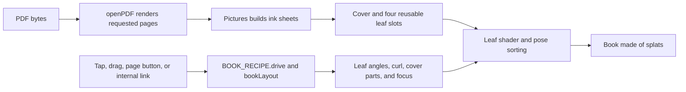

# Your book checkpoint, October 14, 2026

Part d of [Codex task 82](../codex/82-toy-checkpoints.md). Codex documented the existing PDF book;
no runtime code, assets, or tests change. Future work must compare against this version with the
same PDFs, styles, views, and actions, keeping changes only when they preserve or improve every
tested behavior and visible result.

## Where the checkpoint lives

| What                                | Where                                                                                                                                                            | Commit                                     |
| ----------------------------------- | ---------------------------------------------------------------------------------------------------------------------------------------------------------------- | ------------------------------------------ |
| Whole repository                    | `claude/checkpoint-toys-2026-10-14`                                                                                                                              | `41b21e74e04ccca178b95ac02b4e5dc0e51b4b45` |
| Phone clips and measurement records | [codex/toy-checkpoints-d-clips](https://github.com/ryanjosephkamp/splashery/tree/44f40d515018c918ba449fe6eeb20ff3f9dd85c9/docs/audits/toy-checkpoints-d-2026-10) | `44f40d515018c918ba449fe6eeb20ff3f9dd85c9` |

Never push to, rebase, or delete the Operator's saved branch. Never merge the clips branch. The
[one-page clip](https://github.com/ryanjosephkamp/splashery/blob/44f40d515018c918ba449fe6eeb20ff3f9dd85c9/docs/audits/toy-checkpoints-d-2026-10/bk-one-page.gif)
shows Your book at 390×844. The evidence-only `capture.mjs` adapter of `tools/bk-clip.mjs` uses
`tests/fixtures/bk/booklet.pdf` for the book, `reading: "one"`, a 1× device scale, the mid detail
tier, and a manually stepped 12-fps clock. It waits for the real sheet builds between frames; the
clip demonstrates motion rather than real-time throughput. Commands, source identity, and separate
phone-profile measurements are in the
[evidence README](https://github.com/ryanjosephkamp/splashery/blob/44f40d515018c918ba449fe6eeb20ff3f9dd85c9/docs/audits/toy-checkpoints-d-2026-10/README.md).

## How it works

`src/toys.js` routes `your-book` to `BOOK_RECIPE`, exported as `RECIPES["your-book"]` in
[`src/packs/pictures.js`](../../src/packs/pictures.js). It is a labs toy with a fixed initial
camera, no automatic turntable, and locked tilt. Input is a chosen PDF or a pasted PDF address. No
camera or microphone is requested. The default is the current Tinkerer's Manual, selected by
`MANUAL_PDF` imported from [`manual/pdf-edition.js`](../../manual/pdf-edition.js). At this
checkpoint that is `manual/tinkerers-manual-85d32b96193ea275.pdf`.



1. **Open the PDF.** `App.openMedia()` and `openMedia()` use the shared pipeline documented in
   [Picture lab's checkpoint](picture-lab-checkpoint.md#how-it-works). `openPDF()` in
   [`src/media.js`](../../src/media.js) uses vendored PDF.js, with evaluation and XFA disabled, to
   render only requested page canvases. Its text, link, and figure APIs read the PDF's text layer,
   annotations, and image-painting operators. Local files remain on the device; a URL is downloaded
   with CORS and omitted credentials.
2. **Build the binding.** `BOOK_RECIPE.build()` picks `BOOK_STYLES`, calls `bookResume()`, and sets
   page height to 1 recipe unit. Width follows the PDF's first-page aspect, clamped to 0.4–2.2 times
   the height. `buildSideBound()` creates covers, page blocks, spine or spiral, and sheet
   definitions; `buildStapled()` creates top-bound paper instead. `rect()` and `boxFaces()` use
   dense flat splats and fine edge bands for clean solid surfaces. A hardcover cover rotates as a
   rigid part; paperback and magazine covers also flex.
3. **Reuse leaves.** For side-bound books, page 0 is on the front cover. Leaf j carries pages
   `2j − 1` and `2j` in slot `j % 4`. Spread K shows the preceding leaf's back on the left and the
   current leaf's front on the right. `bookLayout()` enables the necessary sheets and requests
   neighboring sheets hidden with `ahead`; page count does not create a matching number of sheet
   entities. Stapled paper gives each sheet one page and turns it over the top. `Pictures.pump()`
   builds visible sheets before prepared ones, at projected screen detail using `buildSheet()`'s
   `ink` method.
4. **Turn and settle.** `bookTapAt()` checks figures and links before navigation. A right-page tap
   goes forward and a left-page tap goes back; a closed cover opens wherever it is tapped. On
   top-bound paper, the top quarter goes back. `BOOK_RECIPE.drive()` consumes the tap queue,
   `bookGo()` selects the destination, and `bookLayout()` emits `out.leaves`, `out.parts`, and
   `out.sheets`. Tapped turns wait for requested sheets, with a **0.2-second** maximum initial wait
   in the current code. The older Books handoff's 1.5-second figure is historical. Figures standing
   up return before a page turn. At the end, a forward tap closes/restarts the book. Previous, Next,
   and a programmatic `pics.go(n)` jump also drive the spread state.
5. **Pull a real sheet.** `bookDrag(BOOK_PULL)`, wrapped by `bk5Drag()`, turns pointer travel into a
   spine angle using `acos()` and the radius of the grabbed point. A closed cover uses normalized
   horizontal travel. `pullV()` follows the target with exponential lag
   `v += (target − v) × (1 − exp(−dt / lag))`. A short pull falls back; passing halfway or flicking
   faster than 1.6 progress units/second finishes it. `BOOK_PULL` uses lag 0.035 s, finish threshold
   0.5, slow factor 1, and bend factor 1. Release uses cubic easing rather than a rigid-body physics
   simulation. Page sounds fire once when a drag commits; a partial pull that falls back produces a
   soft settle cue.
6. **Focus and resume.** `bookFocus()`, `bookView()`, `bookStep()`, and `landSide()` implement
   double-tap page focus and Reading: One page. In that mode, forward can first move from the left
   page to the right within a spread, then turn the leaf. `out.view` asks the shared player and
   camera to frame that page. Portrait windows default to one-page reading; landscape windows
   default to both. `bookResume()` preserves the page when style or reading changes rebuild the same
   media, keyed by media name and count.
7. **Read, follow links, and lift figures.** `bookDecorate()` marks valid links and paints the holes
   beneath lifted figures. `bk5Pick()` dispatches an internal destination to a PDF page, or calls
   `Pictures.openLink()` for HTTP, HTTPS, or mailto. The app shows the address and requires the
   reader to open it; a web tab cannot access back through the opener. The Words panel extracts
   existing PDF text for selection, Copy, and Find. `bk5Start()` and `pgStep()` provide the same
   three-figure, photo-depth, graphic-card, drawn-box, and layer behavior described in
   [Picture lab](picture-lab-checkpoint.md#the-splat-math-and-the-pop-out). Saved scenes keep media
   URLs or local-file metadata, page index, and chosen figure depths; they do not contain the chosen
   PDF's bytes.

### The page-turn math

The leaf shader in [`src/effects.js`](../../src/effects.js), mirrored by `posePass()` in
[`src/pose.js`](../../src/pose.js), treats a leaf as a circular arc. For distance s from the spine,
rotation a, and curl c, the tangent angle is `psi = a + c × s`. Its displacement in the page plane
is:

```text
x = (sin(psi) − sin(a)) / c
y = (cos(a) − cos(psi)) / c
```

For curl near zero, it uses the stable flat-sheet limit `x = s × cos(a)`, `y = s × sin(a)`. Normals
and splat orientation follow the tangent, so paper bends coherently as a sheet. These equations and
`easeTurn()` are the recipe's animation model, not a claim about the elastic properties of real
paper. The spine axis is −Y for side-bound books.

Splat sorting must match the pose on screen. `Player.leafUniform()` supplies angles and curl;
`Player.resortPose()` applies `posePass()` to CPU sort centers. The recipe requests `out.resortPose`
every second frame during an active turn and for three landing frames. This prevents a turned cover
or page back from drawing through the wrong face. The
[opened Gaussian splatting project page](https://repo-sam.inria.fr/fungraph/3d-gaussian-splatting/)
provides context for the representation; this book is generated from PDF rasters and kit geometry.
The [opened PDF.js API reference](https://mozilla.github.io/pdf.js/api/draft/module-pdfjsLib.html)
describes its PDF rendering and text extraction dependency. Photo pop-outs use the
[opened Depth Anything V2 project](https://depth-anything-v2.github.io/); their relative depth is
inferred locally, without calibrated dimensions or unseen backs.

### Every toy setting and media control

| Setting or action                    | Default and effect                                                                                                                                                                           |
| ------------------------------------ | -------------------------------------------------------------------------------------------------------------------------------------------------------------------------------------------- |
| Style (`style`)                      | `hardcover`: rigid board. `paperback`: flexible card; `magazine`: thinner card and stronger curl; `stapled`: top-bound single sheets; `spiral`: side-bound pages with a coil and gutter gap. |
| Cover color (`color`)                | `#2f4b6e`; colors the applicable cover surfaces.                                                                                                                                             |
| Reading (`reading`)                  | `one` in portrait, `both` otherwise when absent from an older scene. Selects focused single-page navigation or whole-spread viewing.                                                         |
| Turn the page (`turn`)               | Pulse, ease 1.2; forward/backward pick depends on the tap location. Dragging supplies continuous page progress.                                                                              |
| Pop out (`pop`)                      | Shared top-bar toggle; enables figure taps. Nothing rises merely because it is switched on. Up to three independent figures can stand up.                                                    |
| Draw a box (`box`)                   | Toggle; drag a crop to raise content not detected as an embedded PDF picture.                                                                                                                |
| Pop-up layers (`layers`)             | Toggle; returns existing figures and splits the next into flat cutout cards.                                                                                                                 |
| Depth slider                         | Selects 1–5× inferred relief, in quarter steps, for the last selected raised figure. Values above 1 are stored in `toy.figures`.                                                             |
| PDF input and sample                 | Open a file/address, or return to the current manual. Previous and Next control reading; internal links and `pics.go(n)` can jump to a page.                                                 |
| Words on this page, Copy, and Find   | Access the existing PDF text layer and search across pages; no OCR.                                                                                                                          |
| Double-tap, zoom out, and Reset view | Focus a page, release focus, or return to the catalog view. Page detail rebuilds as projected size changes.                                                                                  |

Shared viewer settings also control Detail, background, sound, tilt, and turntable. The recipe
starts still with tilt locked; a raised figure temporarily frees it. Style-specific sounds come from
`PAGE_SOUNDS` and the sampled page-turn audio, with procedural fallback cues.

## The files that make it up

- Recipe, bindings, turns, focus, decorations, and figures: `src/packs/pictures.js`.
- Media, sheet generation, and caching: `src/media.js`, `src/loaders.js`, `src/pictures.js`,
  `src/pictures-worker.js`, `src/picture-splats.js`, and `vendor/pdfjs/`.
- Leaf deformation and sorting: `src/kit.js`, `src/generators.js`, `src/effects.js`, `src/pose.js`,
  `src/player.js`, `src/stage.js`, `src/motion.js`, `src/camera.js`, `src/kernels.js`, `src/pc.js`,
  and `vendor/playcanvas/playcanvas.min.mjs`.
- Input, text, link confirmation, and scenes: `src/app.js`, `src/ui.js`, and `src/state.js`.
- Optional photo pop-out: `src/packs/photo-3d-depth.js`, `src/packs/photo-3d-core.js`, `src/depth/`,
  `vendor/depth-anything-v2-small/`, and `vendor/onnxruntime-web/`.
- Default book: `manual/pdf-edition.js` and `manual/tinkerers-manual-85d32b96193ea275.pdf`.
  `assets/toys/your-book/thumb.webp` is its catalog preview. Sounds are
  `assets/sounds/your-book-hardcover.mp3`, `your-book-paperback.mp3`, and `your-book-magazine.mp3`,
  with their records in `src/sound-credits.js`.
- Metadata: this toy's entries in `src/toys.js`, `src/toy-help.js`, `src/toy-sounds.js`,
  `tools/toy-plan.json`, and the relevant credit/license records.

`tests/bk.spec.mjs` defines all styles, long-PDF streaming, page shape, turn direction, short and
long pulls, sorting, page focus, one-page reading, and phone/desktop screenshots.
`tests/bk5.spec.mjs` and `tests/bk5-engine.spec.mjs` define links, crops, relief, and compatibility.
`tests/pg6.spec.mjs` and `tests/pg6-engine.spec.mjs` define current multiple pop-outs, layers, depth
persistence, and turn cleanup. `tests/pic.spec.mjs`, `tests/vw.spec.mjs`, and
`tests/ops-text.spec.mjs` cover shared media, colored PDF figures, gestures, and words.
`tests/sndc.spec.mjs` checks style-specific sounds. `tests/hh3-storybook.spec.mjs` guards the
storybook that inherits this recipe, and `tests/cdx-manual-pdf.spec.mjs` guards the default manual
edition. Test PDFs live in `tests/fixtures/bk/`, `pic/`, and `bk5/`.

## How to restore it

Use a clean new branch, inspect the diff, and verify the fetched SHA before restoring:

```sh
git fetch origin main
git fetch origin claude/checkpoint-toys-2026-10-14:refs/remotes/origin/claude/checkpoint-toys-2026-10-14
git rev-parse origin/claude/checkpoint-toys-2026-10-14
git switch -c codex/restore-your-book origin/main
git checkout origin/claude/checkpoint-toys-2026-10-14 -- src/packs/pictures.js src/media.js src/pictures.js src/pictures-worker.js src/picture-splats.js
```

The SHA must be `41b21e74e04ccca178b95ac02b4e5dc0e51b4b45`. The pack restore also changes
**Storybook, Photo album, Picture frame, and Picture lab**. The shared media engine also affects
Screen and Gaussian splatting; `media.js` also serves Page breaker and live streams. Compare those
before accepting a restore. Port the book block and necessary helpers individually when later
sibling changes need to be retained.

Restore the matching default edition only if restoring the sample itself is intended:

```sh
git checkout origin/claude/checkpoint-toys-2026-10-14 -- manual/pdf-edition.js manual/tinkerers-manual-85d32b96193ea275.pdf
```

That changes the edition pointer used elsewhere by the manual; run its PDF navigation tests. For a
leaf-rendering regression, restore the matching engine files from the manifest after reviewing their
later changes, including `effects.js`, `pose.js`, and `player.js` together. For a depth regression,
use the dependency-group command in
[Picture lab's restore section](picture-lab-checkpoint.md#how-to-restore-it), and compare Photo to
3D, Moving photo, and Splat mirror too. Retain vendor license files and port shared
catalog/help/sound entries individually. Keep current tests; use checkpoint tests to investigate
changed expectations. A renderer, input, or UI rollback requires the full suite, including the
laptop and embed-transfer checks. Open a draft PR; do not merge the saved branch.

## What it does best, limits, and later rounds

The checkpoint makes a PDF feel like a coherent book: distinct bindings, solid covers, continuous
page pulls, clean posed sorting, useful one-page reading, working PDF links, selectable words, and
figure pop-outs. Four leaf slots bound rendered page geometry as a book gets longer. The PDF parser
still receives the complete file, and text/link/figure caches can grow with visited pages, so total
memory is not independent of document size.

The checkpoint manual is **7,792,711 bytes**, measured from disk; the paired edition pointer names
the first 16 characters of its SHA-256. Clips use the smaller controlled booklet fixture, not a
substitute measurement of the manual. The shared per-sheet budgets, media limits, and optional model
sizes are listed in
[Picture lab's limits](picture-lab-checkpoint.md#what-it-does-best-limits-and-later-rounds).
Separate low-tier phone-profile timing records use the actual default manual; their software
renderer does not measure a physical phone or establish a target frame rate.

Single-run phone-profile measurements, October 14, 2026, using Chromium 151.0.7922.173, SwiftShader
WebGL2, 390×844 CSS pixels, device scale 2, low detail, and adaptation off, without competing
browser jobs. Sample-ready time excludes the app shell and includes matching requested sheets.
Active frame rate counts frameend events over about five wall-clock seconds with two taps and forced
rendering. It can include incomplete turns; it does not measure completed page turns per second or
physical-phone performance. No photo-depth inference ran.

| Sample ready | Active frames/s | Settled kit splats | Settled visible sheet splats |
| -----------: | --------------: | -----------------: | ---------------------------: |
|      14.29 s |            1.71 |             55,572 |                      119,355 |

Known limits: page shape follows the first page and a clamped aspect, page-block thickness does not
increase as reading progresses, a fine band can show beneath a turning leaf near the spine, and
focused turning leaves can extend beyond the reading area. The 0.2-second preparation timeout can
start motion before every sheet is ready on a slow device. There is no OCR, password prompt, or
automatic repair for blocked URL downloads. PDF image boxes and the photo/graphic heuristic are not
semantic layout understanding. Pop-out depth is relative and can fail, leaving a flat card.

Later rounds could improve mixed-page geometry, slow-device turn preparation, whole-document memory
accounting, and pop-out readiness feedback. Compare the five styles, portrait and landscape reading,
internal and web links, a short/long PDF pair, partial and committed pulls, multiple figures, and
old v2/v3 scenes before accepting a change.
