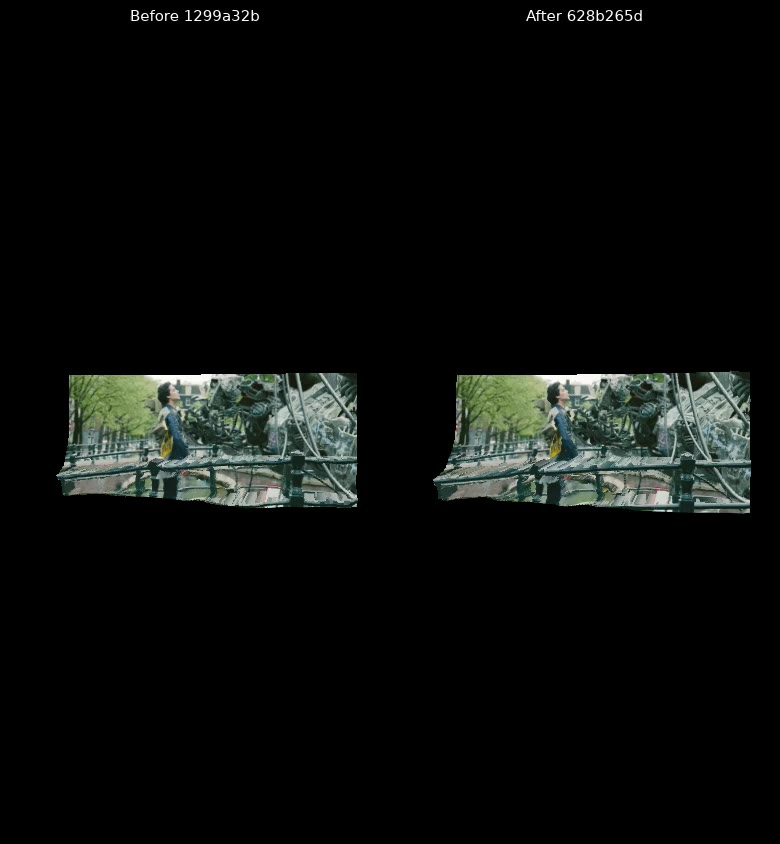
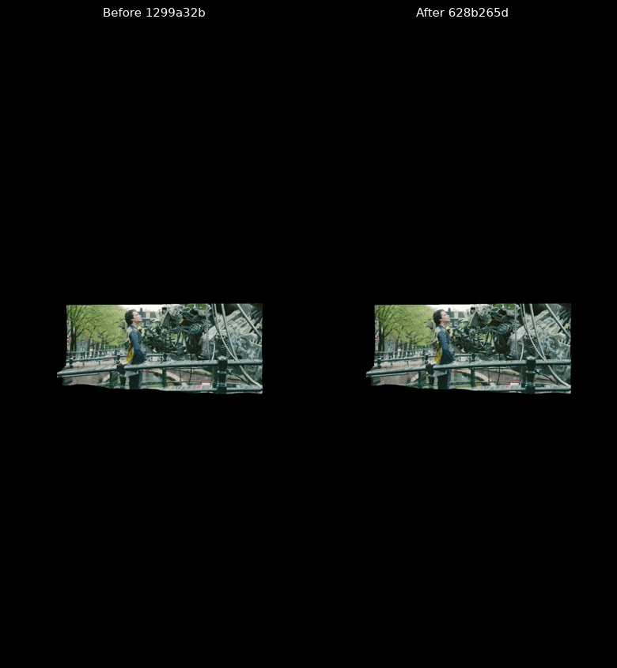
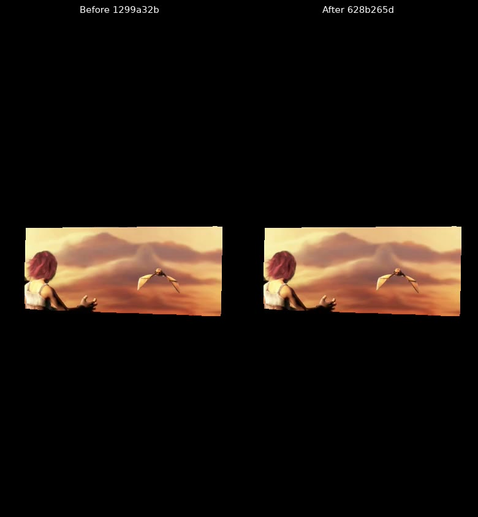
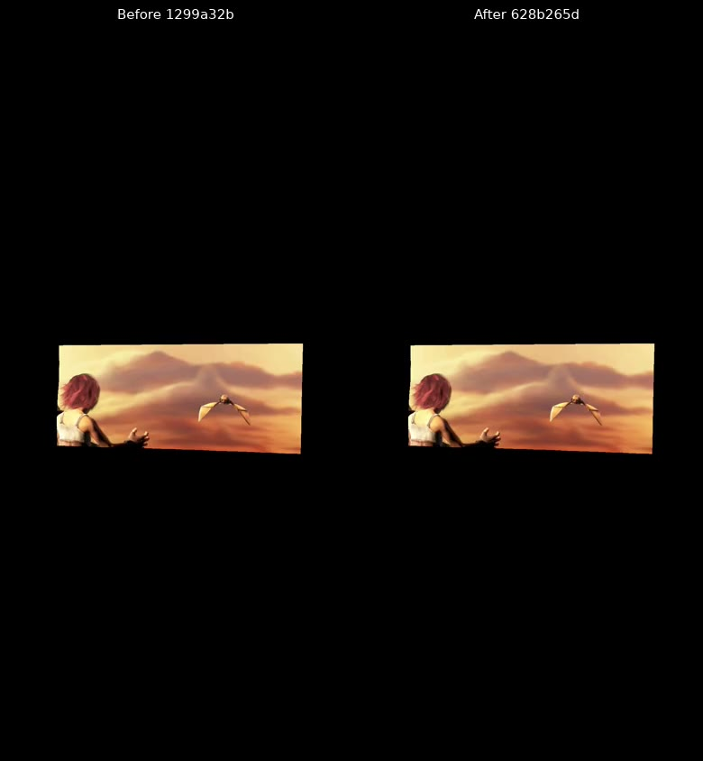

# Calibration comparisons

Made by Ryan with Codex (GPT-6), October 16, 2026. Four silent paired films compare `1299a32b`
(left) with `628b265d` (right), using the same corrected six-second input and main `0b6f4bf26` UI.
Phone uses the low profile at 390 × 844; desktop uses the mid profile at 1440 × 900. Each side is
fitted without cropping into a 390 × 808 picture area, with a 36-pixel label. The pair is 780 × 844.

Every film shows all 96 source pictures at 16 fps. These fixed source-clock captures show quality,
not live playback speed. Pixel checks sample eight poses per version: zero detected holes, edge
specks, and browser errors. Full depth-sequence metrics, source hashes, input hashes, and
raw-picture hashes are in the [manifest](manifest.json). The encoded movies are derived from the raw
pictures; the raw PNG sequences are not included. Capture and encoding programs are retained beside
the evidence.

The comparison baseline is the earlier review head, not main. Phone Bridge's large flips fall from
4.04 to 3.12 per 1,000; height jitter falls from 0.01198 to 0.01147, while surface-cut share rises
from 0.03786 to 0.07271. Desktop Bridge's large flips fall from 1.15 to 0.95, and cut share falls
from 0.04231 to 0.03621; height jitter rises from 0.00385 to 0.00432. All values and Sintel's
results remain in the manifest. These pairs do not establish universal temporal gains against main.

## Films and credit

All four movies and posters retain **CC BY 3.0**, Blender Foundation. Source pages and the
[license](https://creativecommons.org/licenses/by/3.0/) were checked on October 16, 2026. The
changes are a six-second reconstruction from the shipped sheets, a 3D relief render, and a labeled
comparison export. The existing Tears of Steel people and size exceptions retain
[the prior approval](https://github.com/ryanjosephkamp/splashery/pull/560#issuecomment-6130226869).

Tears of Steel: [source and sharing](https://mango.blender.org/sharing/).

Sintel: [source and sharing](https://durian.blender.org/sharing/).

