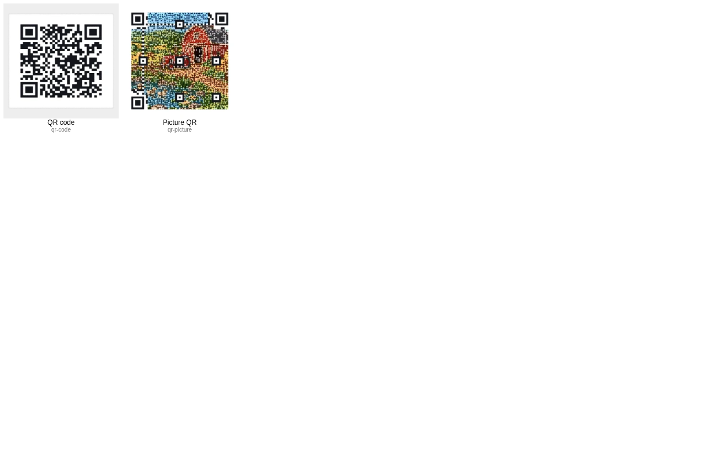

# Picture QR fit review

Made by Ryan with Codex (GPT-6), October 14–15, 2026. This is the task 80 clips branch; never merge
it.

44 screenshots: 36 finished-code frames, four crop editors, and four option panels. Each finished
code passed its built-in check and all three readers after resizing the actual render to 390 px. The
[machine-readable record](cdx-qr-fit-review.json) retains the options and check results. The
[audit](../../docs/audits/picture-qr-fit-2026-10.md) contains the complete qualification tables and
limitations.

The uploaded-photo fixture is the existing approved CC0 wildflowers sample in
`assets/toys/photo-3d/wildflowers.jpg`; no new source image is introduced.

| View                           | Phone 390×844                                                 | Desktop 1440×900                                               |
| ------------------------------ | ------------------------------------------------------------- | -------------------------------------------------------------- |
| qr-code-square-eyes-style      | [Open](cdx-qr-fit-qr-code-square-eyes-style-390x844.png)      | [Open](cdx-qr-fit-qr-code-square-eyes-style-1440x900.png)      |
| qr-code-square-eyes-square     | [Open](cdx-qr-fit-qr-code-square-eyes-square-390x844.png)     | [Open](cdx-qr-fit-qr-code-square-eyes-square-1440x900.png)     |
| qr-code-square-eyes-rounded    | [Open](cdx-qr-fit-qr-code-square-eyes-rounded-390x844.png)    | [Open](cdx-qr-fit-qr-code-square-eyes-rounded-1440x900.png)    |
| qr-code-circle-eyes-style      | [Open](cdx-qr-fit-qr-code-circle-eyes-style-390x844.png)      | [Open](cdx-qr-fit-qr-code-circle-eyes-style-1440x900.png)      |
| qr-code-circle-eyes-square     | [Open](cdx-qr-fit-qr-code-circle-eyes-square-390x844.png)     | [Open](cdx-qr-fit-qr-code-circle-eyes-square-1440x900.png)     |
| qr-code-circle-eyes-rounded    | [Open](cdx-qr-fit-qr-code-circle-eyes-rounded-390x844.png)    | [Open](cdx-qr-fit-qr-code-circle-eyes-rounded-1440x900.png)    |
| qr-code-circle-border-wide     | [Open](cdx-qr-fit-qr-code-circle-border-wide-390x844.png)     | [Open](cdx-qr-fit-qr-code-circle-border-wide-1440x900.png)     |
| qr-code-circle-border-thin     | [Open](cdx-qr-fit-qr-code-circle-border-thin-390x844.png)     | [Open](cdx-qr-fit-qr-code-circle-border-thin-1440x900.png)     |
| controls-qr-code               | [Open](cdx-qr-fit-controls-qr-code-390x844.png)               | [Open](cdx-qr-fit-controls-qr-code-1440x900.png)               |
| qr-picture-square-eyes-style   | [Open](cdx-qr-fit-qr-picture-square-eyes-style-390x844.png)   | [Open](cdx-qr-fit-qr-picture-square-eyes-style-1440x900.png)   |
| qr-picture-circle-eyes-style   | [Open](cdx-qr-fit-qr-picture-circle-eyes-style-390x844.png)   | [Open](cdx-qr-fit-qr-picture-circle-eyes-style-1440x900.png)   |
| qr-picture-circle-eyes-square  | [Open](cdx-qr-fit-qr-picture-circle-eyes-square-390x844.png)  | [Open](cdx-qr-fit-qr-picture-circle-eyes-square-1440x900.png)  |
| qr-picture-circle-eyes-rounded | [Open](cdx-qr-fit-qr-picture-circle-eyes-rounded-390x844.png) | [Open](cdx-qr-fit-qr-picture-circle-eyes-rounded-1440x900.png) |
| qr-picture-circle-border-wide  | [Open](cdx-qr-fit-qr-picture-circle-border-wide-390x844.png)  | [Open](cdx-qr-fit-qr-picture-circle-border-wide-1440x900.png)  |
| qr-picture-circle-border-thin  | [Open](cdx-qr-fit-qr-picture-circle-border-thin-390x844.png)  | [Open](cdx-qr-fit-qr-picture-circle-border-thin-1440x900.png)  |
| controls-qr-picture            | [Open](cdx-qr-fit-controls-qr-picture-390x844.png)            | [Open](cdx-qr-fit-controls-qr-picture-1440x900.png)            |
| qr-picture-square-crop-before  | [Open](cdx-qr-fit-qr-picture-square-crop-before-390x844.png)  | [Open](cdx-qr-fit-qr-picture-square-crop-before-1440x900.png)  |
| qr-picture-square-crop-after   | [Open](cdx-qr-fit-qr-picture-square-crop-after-390x844.png)   | [Open](cdx-qr-fit-qr-picture-square-crop-after-1440x900.png)   |
| crop-editor-square             | [Open](cdx-qr-fit-crop-editor-square-390x844.png)             | [Open](cdx-qr-fit-crop-editor-square-1440x900.png)             |
| qr-picture-circle-crop-before  | [Open](cdx-qr-fit-qr-picture-circle-crop-before-390x844.png)  | [Open](cdx-qr-fit-qr-picture-circle-crop-before-1440x900.png)  |
| qr-picture-circle-crop-after   | [Open](cdx-qr-fit-qr-picture-circle-crop-after-390x844.png)   | [Open](cdx-qr-fit-qr-picture-circle-crop-after-1440x900.png)   |
| crop-editor-circle             | [Open](cdx-qr-fit-crop-editor-circle-390x844.png)             | [Open](cdx-qr-fit-crop-editor-circle-1440x900.png)             |

Regenerated default thumbnail contact sheet:

The owner's visual marks are still required before the implementation PR can merge. Rule check:
none.
