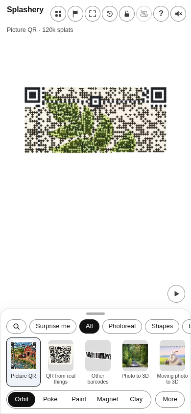
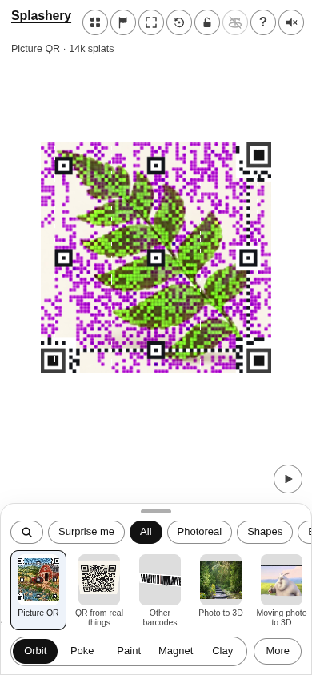
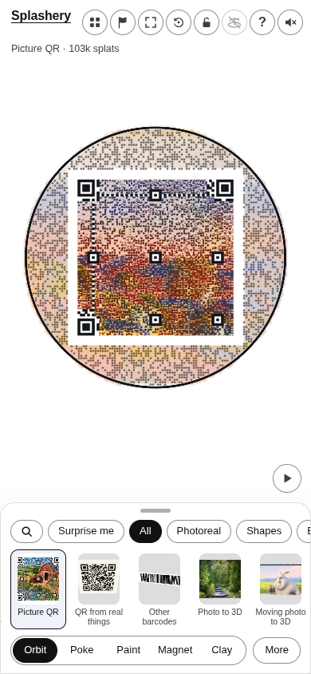
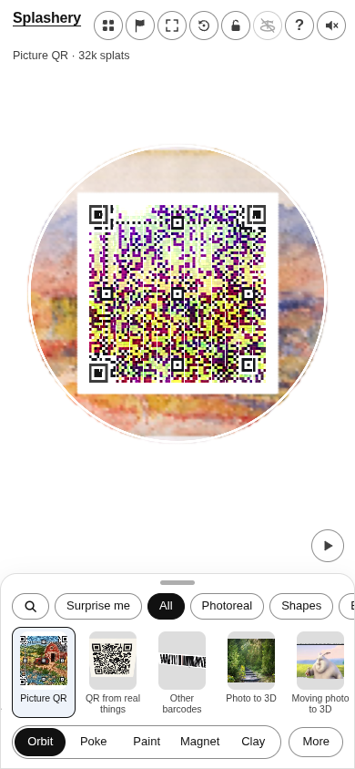
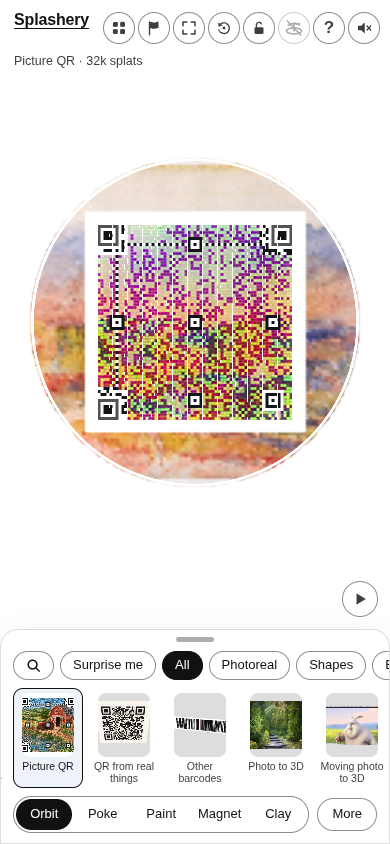

# Slow retry controls · Codex (GPT-6)

[All pictures](../README.md)

These native phone screenshots use the same source and payload for each row. The complete initial
run, including the museum Circle reader failure, is preserved. The final failure-first forecast
changes rejection order; its two accepted 720-pixel RGBA images match the full-retry forecast
exactly. These images illustrate output, not timing. Source credits remain in
[CREDITS](../../../../CREDITS.md).

## cdx-qr-ai-fern · payload 8 · square

| Frozen main                                                  | Before retry forecast                                | Full retry forecast                                                                  | Failure-first retry forecast                                                         |
| ------------------------------------------------------------ | ---------------------------------------------------- | ------------------------------------------------------------------------------------ | ------------------------------------------------------------------------------------ |
|  | No native shot saved; the numerical row is retained. |  |  |

## met-459968 · payload 8 · circle

| Frozen main                                              | Before retry forecast                                                         | Full retry forecast                                                              | Failure-first retry forecast                                                     |
| -------------------------------------------------------- | ----------------------------------------------------------------------------- | -------------------------------------------------------------------------------- | -------------------------------------------------------------------------------- |
|  |  |  |  |

## October 15–16 review pass

[Near-limit fallback PNGs and Winter fir comparison](review-pass/README.md).
