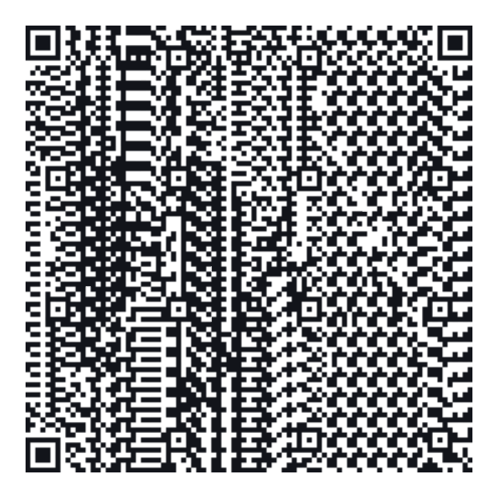
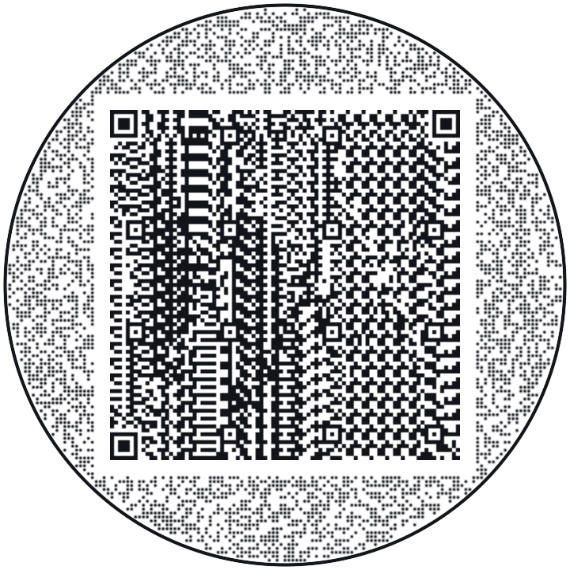
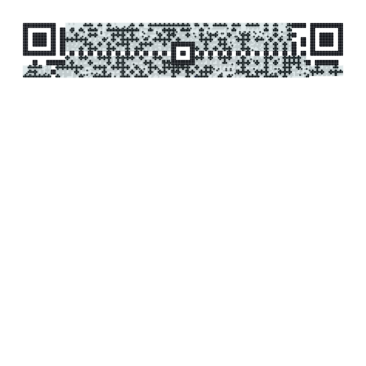
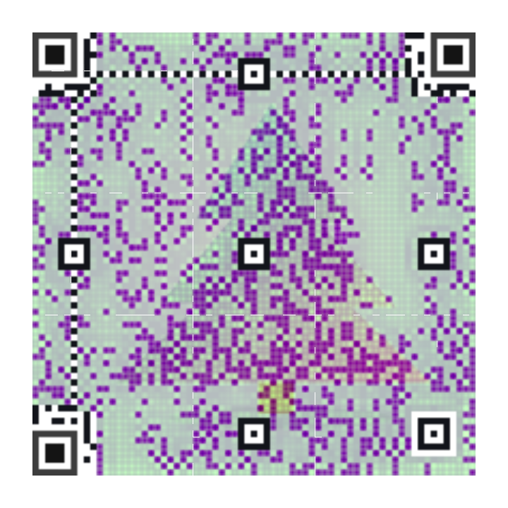

# October 15–16 review diagnostics

[All review diagnostics](../README.md)

[Original serial/parallel verification PNGs](qualification-equivalence/README.md)

These actual 720-pixel PNG exports use a 299-character synthetic link, one character below the input
limit. Most detail selects its checked black-and-white Standard fallback within the 20-second
decision bound. Both codes decode with jsQR and zxing-cpp at 8 and 4 pixels per module, with blur of
0, 0.2, and 0.3 modules: 24 reader attempts across the two codes. These long-link tests use a front
view; the separate fixed ten-payload corpus supplies the perspective and brightness matrix.

The source picture is the existing labeled AI-made farm sample. Its source credit remains in
CREDITS. Renders made by Ryan with Codex (GPT-6).

## square

## circle

## Winter fir: the metric's blank-area limitation

These are the actual 720-pixel captures of Winter fir (soft), Square, payload 9. Main leaves most of
the frame blank, which earns a high SSIM on this low-contrast source despite failing the readers.
The metric remains fixed. Most detail draws a complete code and has lower RGB error; the individual
SSIM loss is retained even though the ten-payload picture mean improves.

| Main                                          | Most detail                                            |
| --------------------------------------------- | ------------------------------------------------------ |
|  |  |

| Mode   | Phone SSIM | Print SSIM | Phone RGB RMSE | Print RGB RMSE | Independent reads |
| ------ | ---------: | ---------: | -------------: | -------------: | ----------------: |
| main   |     0.6734 |     0.6717 |         0.3004 |         0.3025 |              0/48 |
| detail |     0.2818 |     0.2696 |         0.1794 |         0.1875 |             48/48 |
