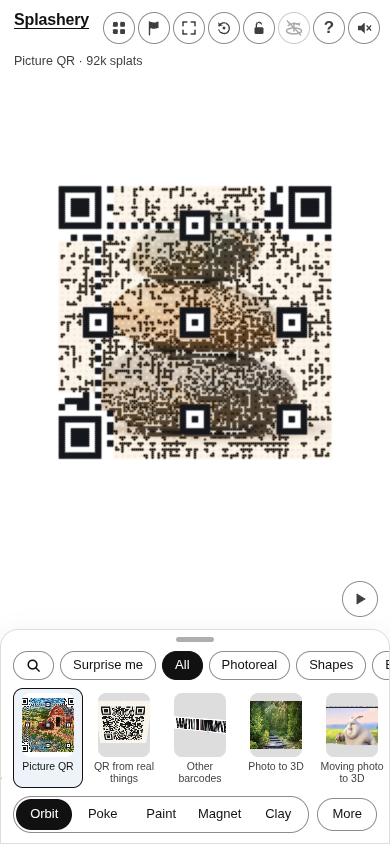
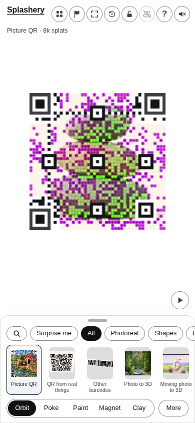
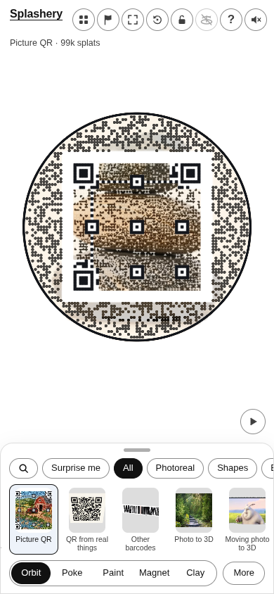
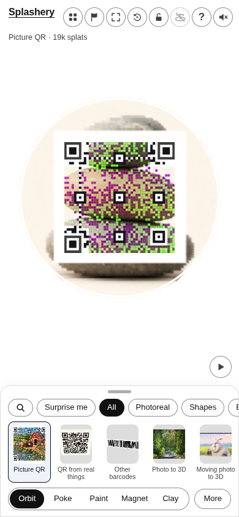

# Stacked stones (AI-made)

[All pictures](../README.md)

Source:
[Ryan, the owner of Splashery (made with an AI image tool)](https://github.com/ryanjosephkamp/splashery/blob/main/CREDITS.md).
Rendered by Ryan with Codex (GPT-6); source credits remain in [CREDITS](../../../../CREDITS.md).

Source pixels used by the measure. The toy takes a central crop; Circle uses a smaller central crop
for its encoded square.

## Square

Mean SSIM over 10/10 payloads: phone 0.1940 → 0.3087; print 0.1869 → 0.3007.

| Main · Standard                                                           | Most detail                                                                    |
| ------------------------------------------------------------------------- | ------------------------------------------------------------------------------ |
|  |  |

## Circle

Mean SSIM over 10/10 payloads: phone 0.2228 → 0.3855; print 0.1436 → 0.3430.

| Main · Standard                                                           | Most detail                                                                    |
| ------------------------------------------------------------------------- | ------------------------------------------------------------------------------ |
|  |  |
