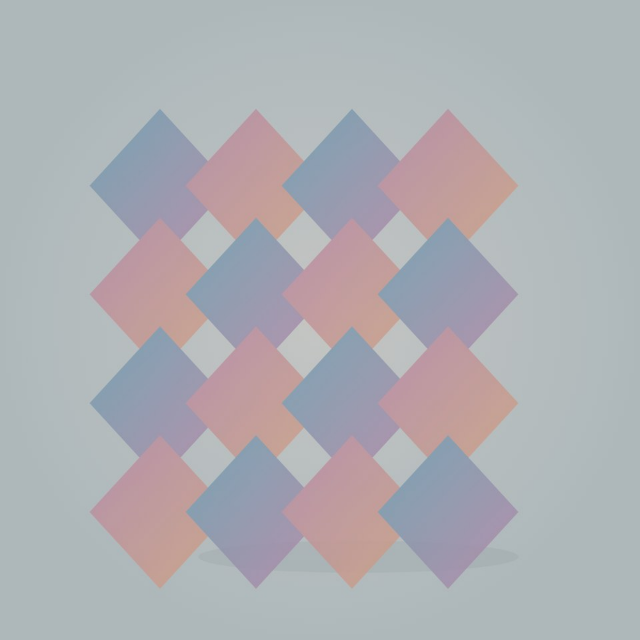
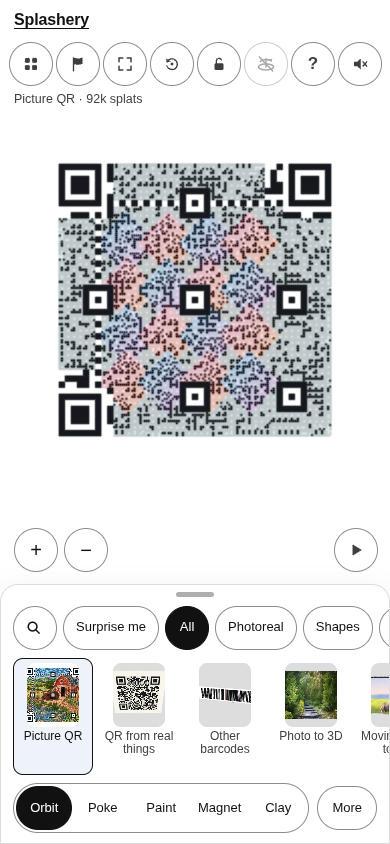
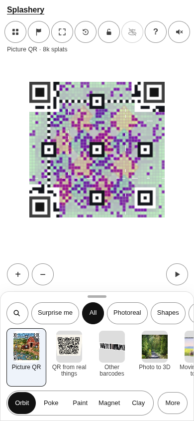
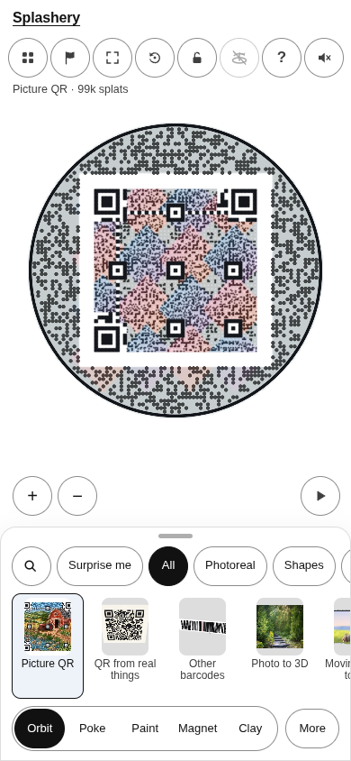
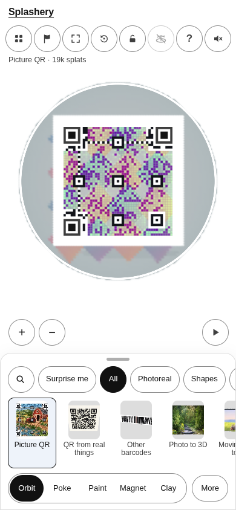

# Mosaic diamonds · soft (code-made, CC0)

[All pictures](../README.md)

Source:
[Made by Ryan with Codex (GPT-6)](https://github.com/ryanjosephkamp/splashery/blob/main/tools/cdx-qr-themes-art.mjs).
Rendered by Ryan with Codex (GPT-6); source credits remain in [CREDITS](../../../../CREDITS.md).

Source pixels used by the measure. The toy takes a central crop; Circle uses a smaller central crop
for its encoded square.

## Square

Mean SSIM over 10/10 payloads: phone 0.2372 → 0.3154; print 0.2313 → 0.3053.

| Main · Standard                                                         | Most detail                                                                  |
| ----------------------------------------------------------------------- | ---------------------------------------------------------------------------- |
|  |  |

## Circle

Mean SSIM over 10/10 payloads: phone 0.1357 → 0.3501; print 0.0700 → 0.2970.

| Main · Standard                                                         | Most detail                                                                  |
| ----------------------------------------------------------------------- | ---------------------------------------------------------------------------- |
|  |  |
