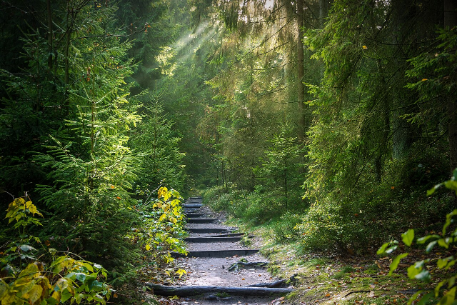
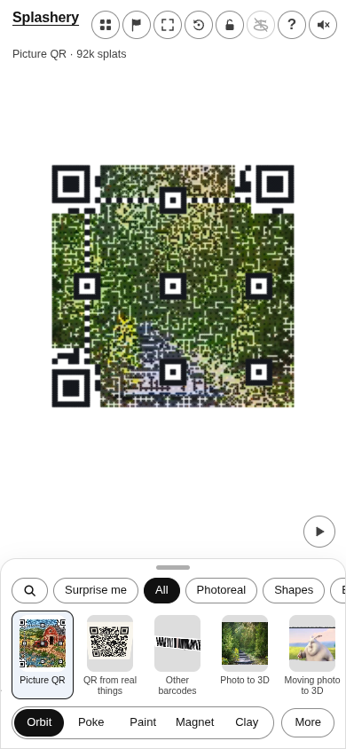
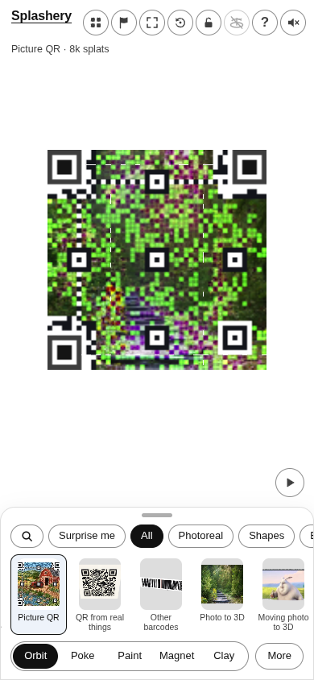
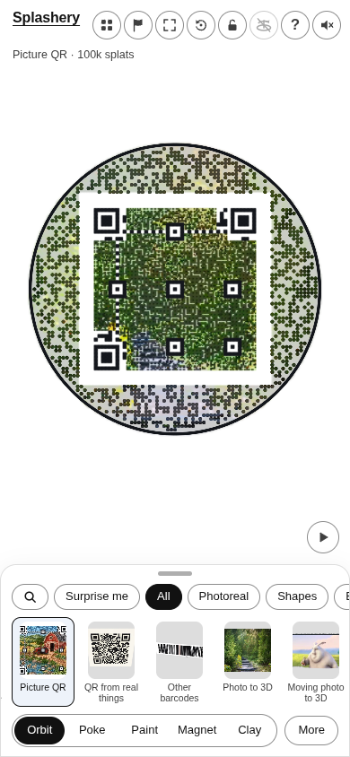
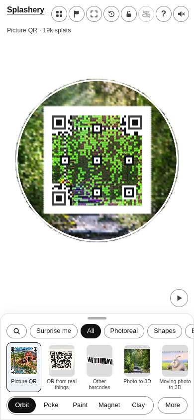

# A forest path

[All pictures](../README.md)

Source: [Seaq68 (from Pixabay, 2017)](https://commons.wikimedia.org/wiki/File:Forest_Away_Path.jpg).
Rendered by Ryan with Codex (GPT-6); source credits remain in [CREDITS](../../../../CREDITS.md).

Source pixels used by the measure. The toy takes a central crop; Circle uses a smaller central crop
for its encoded square.

## Square

Mean SSIM over 10/10 payloads: phone 0.1363 → 0.3934; print 0.1270 → 0.3873.

| Main · Standard                                         | Most detail                                                  |
| ------------------------------------------------------- | ------------------------------------------------------------ |
|  |  |

## Circle

Mean SSIM over 10/10 payloads: phone 0.2554 → 0.3938; print 0.1848 → 0.3519.

| Main · Standard                                         | Most detail                                                  |
| ------------------------------------------------------- | ------------------------------------------------------------ |
|  |  |
