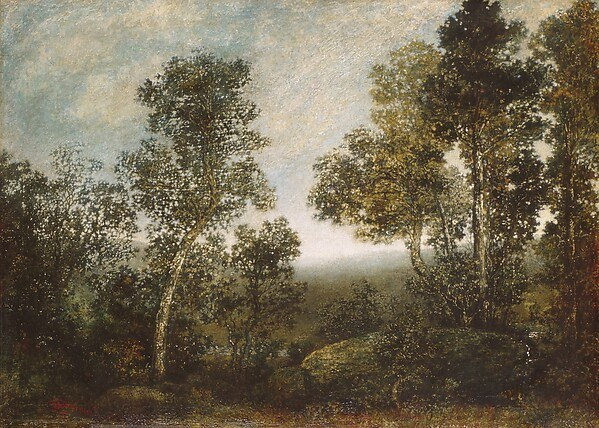
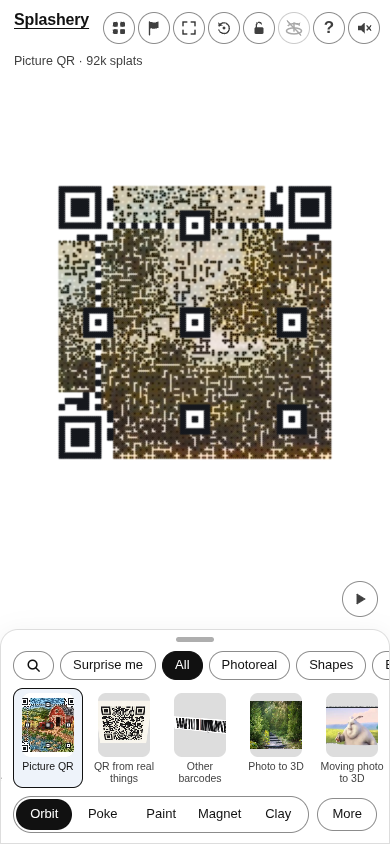
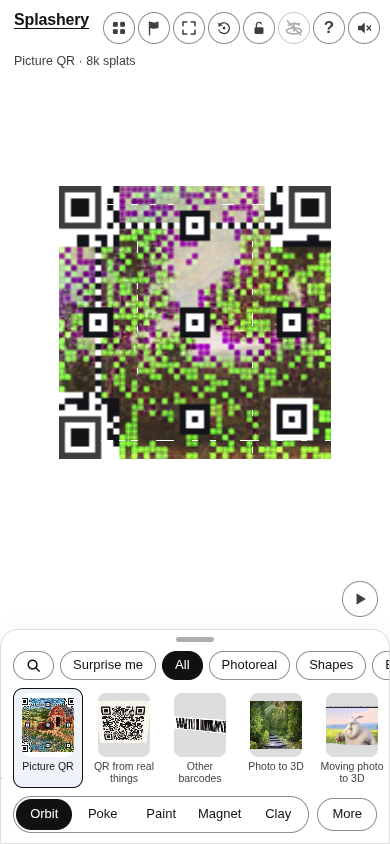
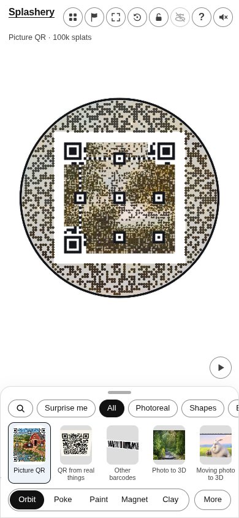
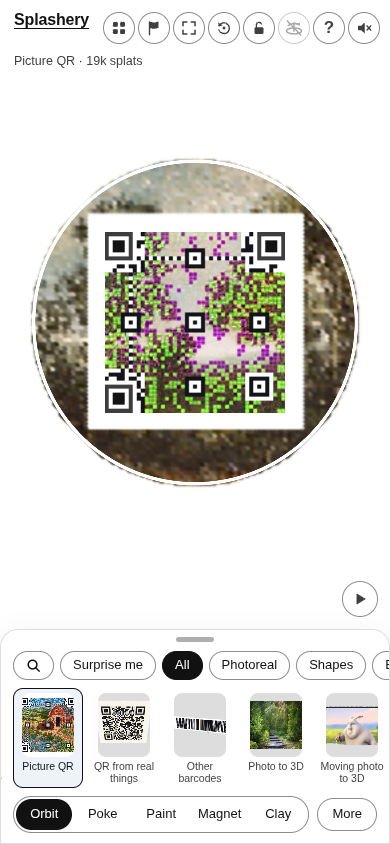

# Landscape

[All pictures](../README.md)

Source: [Ralph Albert Blakelock](https://www.metmuseum.org/art/collection/search/10181). Rendered by
Ryan with Codex (GPT-6); source credits remain in [CREDITS](../../../../CREDITS.md).

Source pixels used by the measure. The toy takes a central crop; Circle uses a smaller central crop
for its encoded square.

## Square

Mean SSIM over 10/10 payloads: phone 0.1484 → 0.3658; print 0.1379 → 0.3585.

| Main · Standard                                            | Most detail                                                     |
| ---------------------------------------------------------- | --------------------------------------------------------------- |
|  |  |

## Circle

Mean SSIM over 10/10 payloads: phone 0.2717 → 0.4079; print 0.2005 → 0.3774.

| Main · Standard                                            | Most detail                                                     |
| ---------------------------------------------------------- | --------------------------------------------------------------- |
|  |  |
