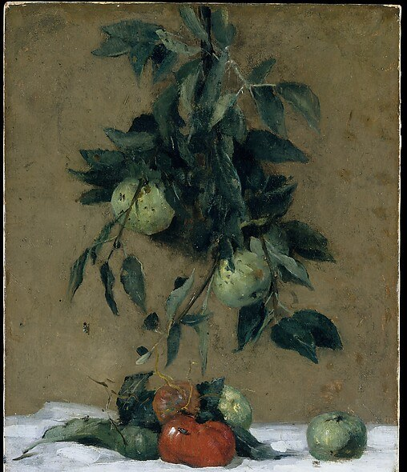
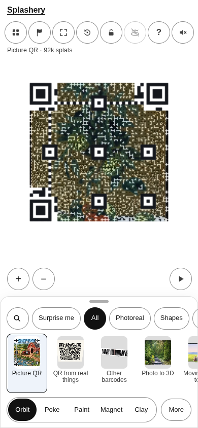
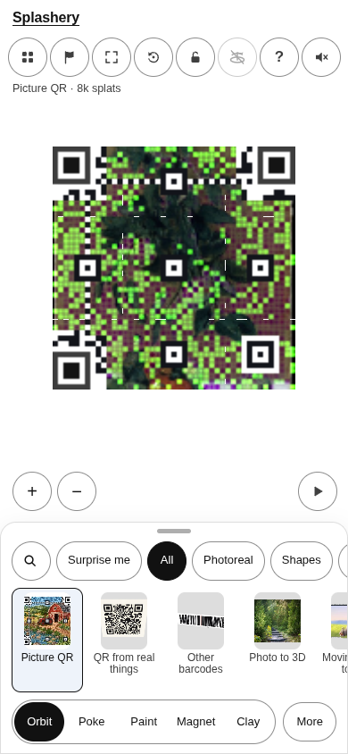
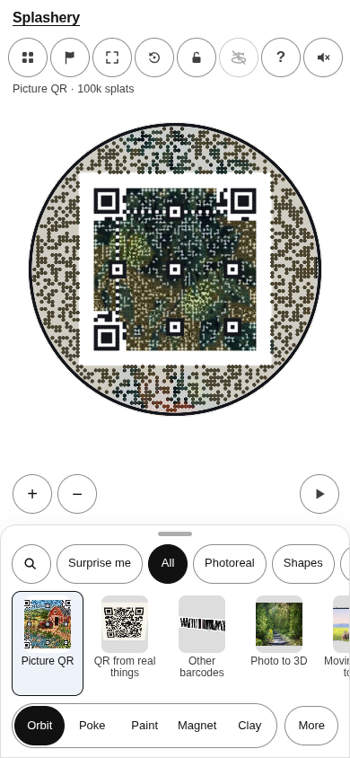
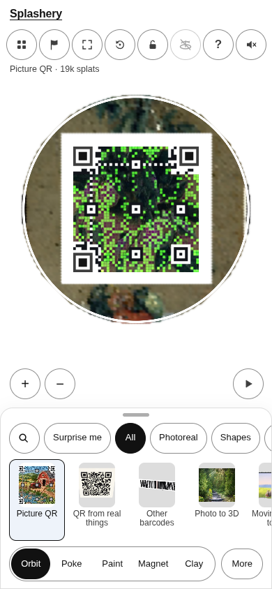

# Fruit

[All pictures](../README.md)

Source: [Julian Alden Weir](https://www.metmuseum.org/art/collection/search/13181). Rendered by Ryan
with Codex (GPT-6); source credits remain in [CREDITS](../../../../CREDITS.md).

Source pixels used by the measure. The toy takes a central crop; Circle uses a smaller central crop
for its encoded square.

## Square

Mean SSIM over 10/10 payloads: phone 0.1537 → 0.3901; print 0.1450 → 0.3819.

| Main · Standard                                            | Most detail                                                     |
| ---------------------------------------------------------- | --------------------------------------------------------------- |
|  |  |

## Circle

Mean SSIM over 10/10 payloads: phone 0.2032 → 0.4109; print 0.1356 → 0.3696.

| Main · Standard                                            | Most detail                                                     |
| ---------------------------------------------------------- | --------------------------------------------------------------- |
|  |  |
