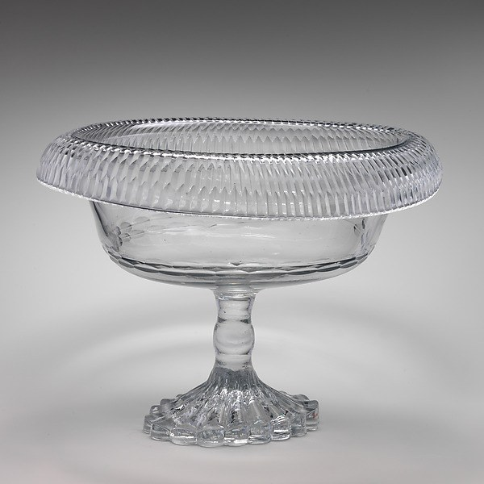
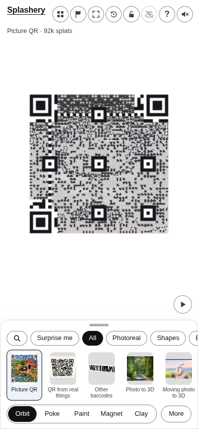
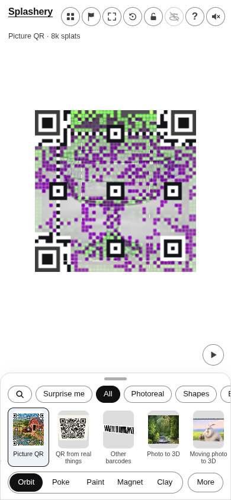
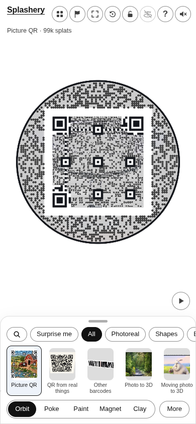
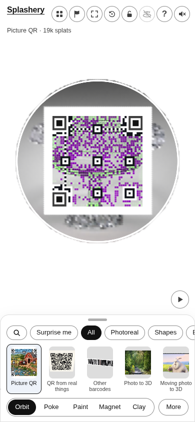

# Fruit bowl

[All pictures](../README.md)

Source:
[Unknown maker (The Metropolitan Museum of Art)](https://www.metmuseum.org/art/collection/search/196651).
Rendered by Ryan with Codex (GPT-6); source credits remain in [CREDITS](../../../../CREDITS.md).

Source pixels used by the measure. The toy takes a central crop; Circle uses a smaller central crop
for its encoded square.

## Square

Mean SSIM over 10/10 payloads: phone 0.2234 → 0.3144; print 0.2172 → 0.3071.

| Main · Standard                                             | Most detail                                                      |
| ----------------------------------------------------------- | ---------------------------------------------------------------- |
|  |  |

## Circle

Mean SSIM over 10/10 payloads: phone 0.1753 → 0.3730; print 0.1319 → 0.3452.

| Main · Standard                                             | Most detail                                                      |
| ----------------------------------------------------------- | ---------------------------------------------------------------- |
|  |  |
