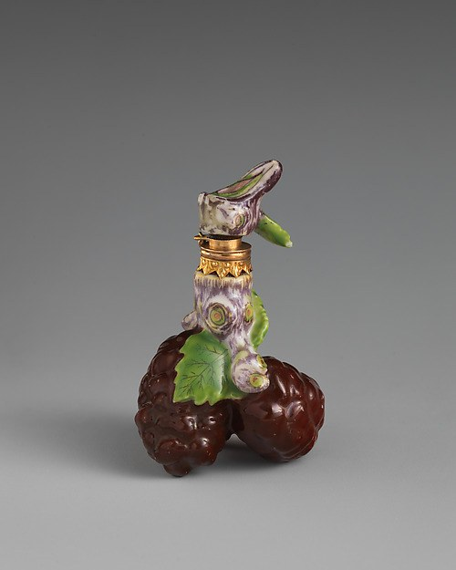
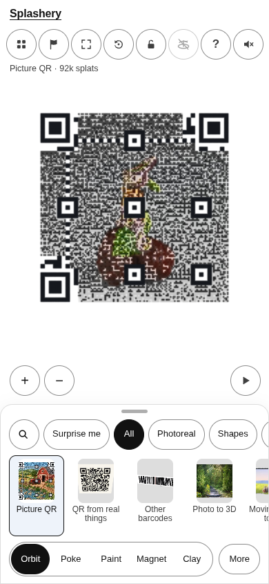
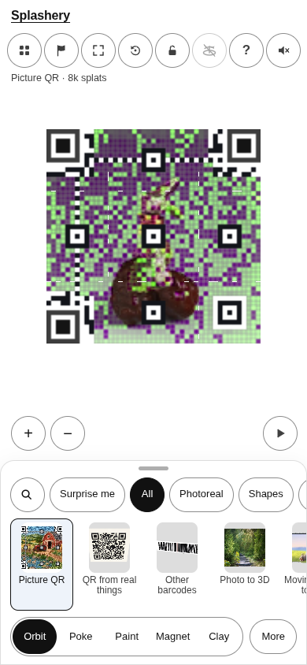
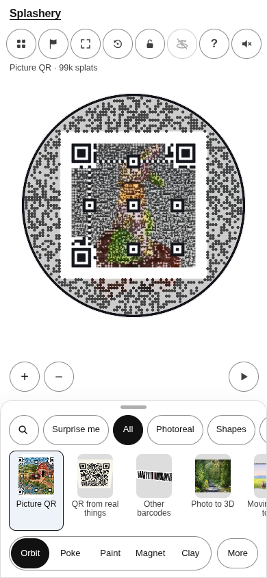
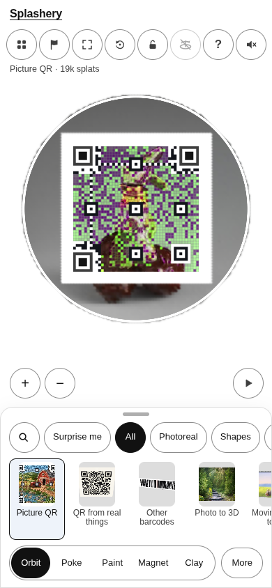

# Fruit cluster

[All pictures](../README.md)

Source: [Chelsea Porcelain Manufactory](https://www.metmuseum.org/art/collection/search/203455).
Rendered by Ryan with Codex (GPT-6); source credits remain in [CREDITS](../../../../CREDITS.md).

Source pixels used by the measure. The toy takes a central crop; Circle uses a smaller central crop
for its encoded square.

## Square

Mean SSIM over 10/10 payloads: phone 0.2123 → 0.3118; print 0.2056 → 0.3019.

| Main · Standard                                             | Most detail                                                      |
| ----------------------------------------------------------- | ---------------------------------------------------------------- |
|  |  |

## Circle

Mean SSIM over 10/10 payloads: phone 0.2222 → 0.3890; print 0.1453 → 0.3423.

| Main · Standard                                             | Most detail                                                      |
| ----------------------------------------------------------- | ---------------------------------------------------------------- |
|  |  |
