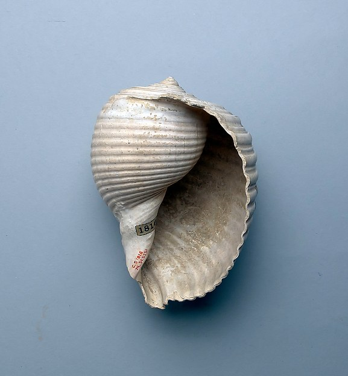
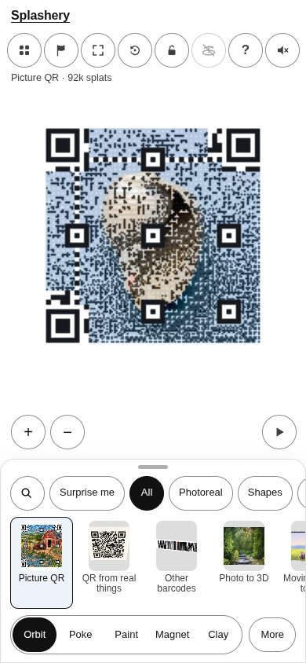
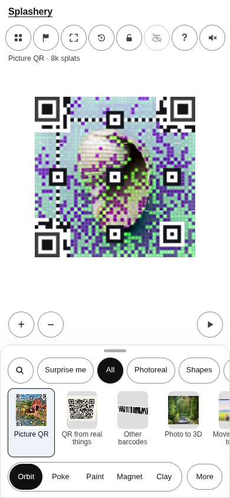
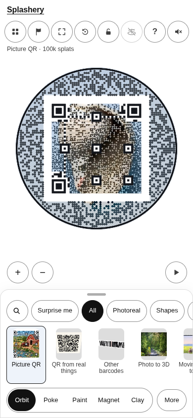
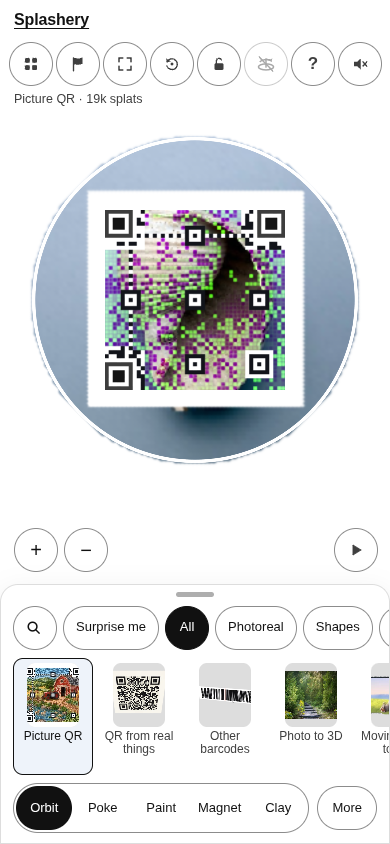

# Shell

[All pictures](../README.md)

Source:
[Unknown maker (The Metropolitan Museum of Art)](https://www.metmuseum.org/art/collection/search/244130).
Rendered by Ryan with Codex (GPT-6); source credits remain in [CREDITS](../../../../CREDITS.md).

Source pixels used by the measure. The toy takes a central crop; Circle uses a smaller central crop
for its encoded square.

## Square

Mean SSIM over 10/10 payloads: phone 0.2107 → 0.3382; print 0.2040 → 0.3294.

| Main · Standard                                             | Most detail                                                      |
| ----------------------------------------------------------- | ---------------------------------------------------------------- |
|  |  |

## Circle

Mean SSIM over 10/10 payloads: phone 0.2533 → 0.4443; print 0.1743 → 0.4089.

| Main · Standard                                             | Most detail                                                      |
| ----------------------------------------------------------- | ---------------------------------------------------------------- |
|  |  |
