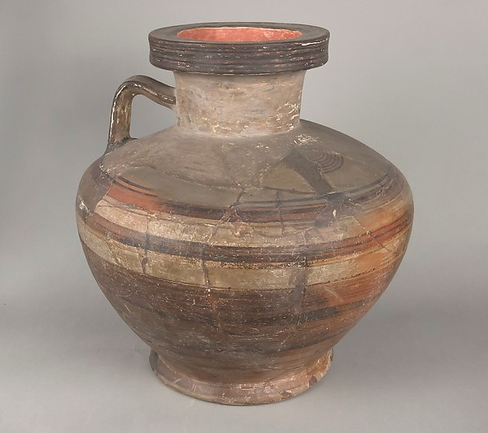
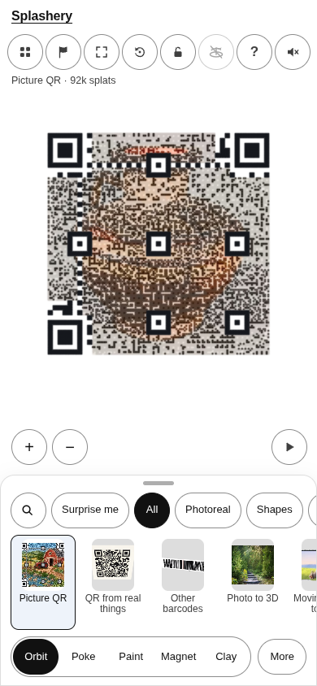
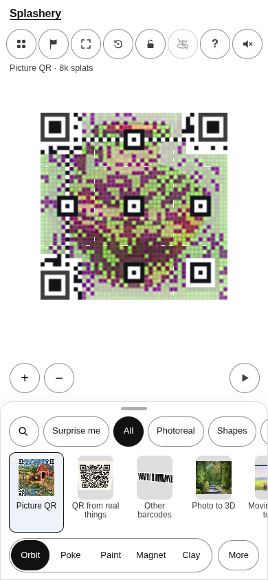
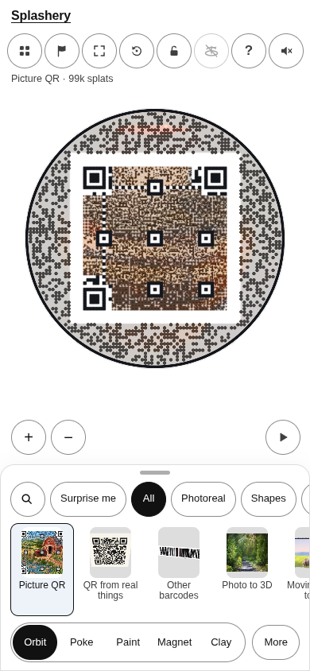
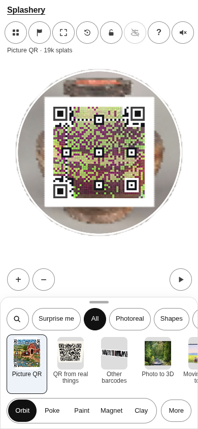

# Vase

[All pictures](../README.md)

Source: [East Greek/Sardis, Lydian](https://www.metmuseum.org/art/collection/search/249072).
Rendered by Ryan with Codex (GPT-6); source credits remain in [CREDITS](../../../../CREDITS.md).

Source pixels used by the measure. The toy takes a central crop; Circle uses a smaller central crop
for its encoded square.

## Square

Mean SSIM over 10/10 payloads: phone 0.2006 → 0.3492; print 0.1907 → 0.3394.

| Main · Standard                                             | Most detail                                                      |
| ----------------------------------------------------------- | ---------------------------------------------------------------- |
|  |  |

## Circle

Mean SSIM over 10/10 payloads: phone 0.2215 → 0.3757; print 0.1325 → 0.3294.

| Main · Standard                                             | Most detail                                                      |
| ----------------------------------------------------------- | ---------------------------------------------------------------- |
|  |  |
