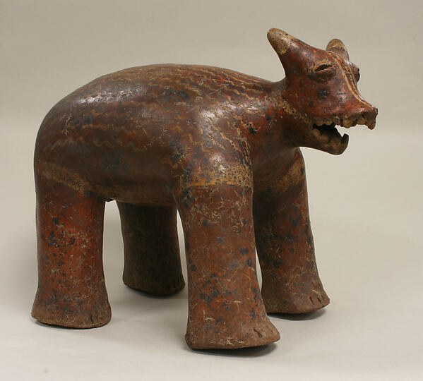
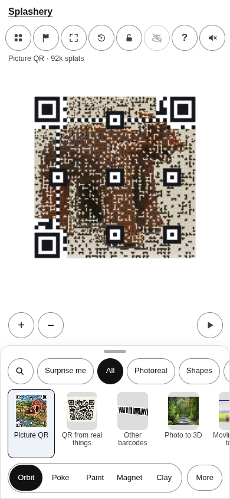
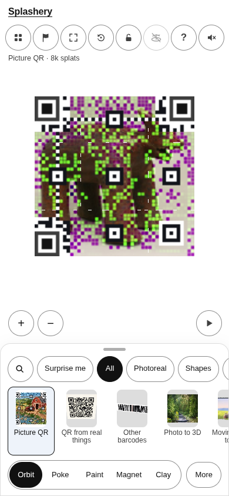
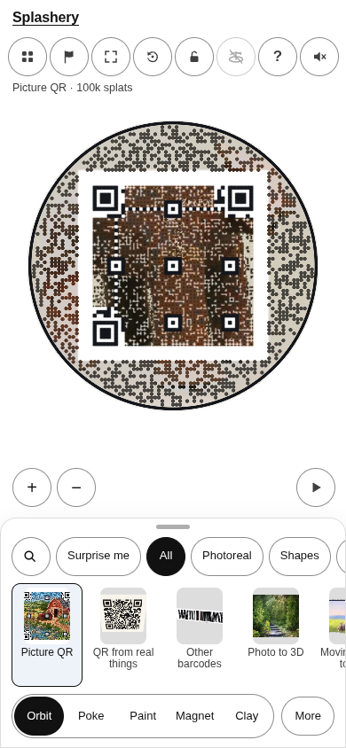
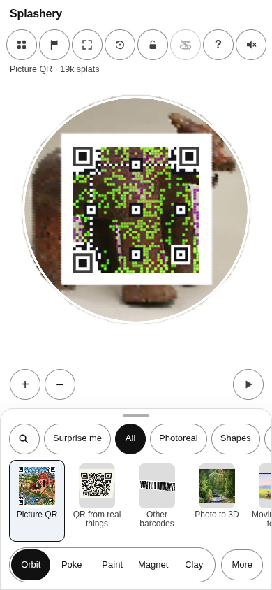

# Animal

[All pictures](../README.md)

Source: [Nayarit](https://www.metmuseum.org/art/collection/search/312624). Rendered by Ryan with
Codex (GPT-6); source credits remain in [CREDITS](../../../../CREDITS.md).

Source pixels used by the measure. The toy takes a central crop; Circle uses a smaller central crop
for its encoded square.

## Square

Mean SSIM over 10/10 payloads: phone 0.1933 → 0.3863; print 0.1851 → 0.3780.

| Main · Standard                                             | Most detail                                                      |
| ----------------------------------------------------------- | ---------------------------------------------------------------- |
|  |  |

## Circle

Mean SSIM over 10/10 payloads: phone 0.1975 → 0.3876; print 0.1322 → 0.3471.

| Main · Standard                                             | Most detail                                                      |
| ----------------------------------------------------------- | ---------------------------------------------------------------- |
|  |  |
