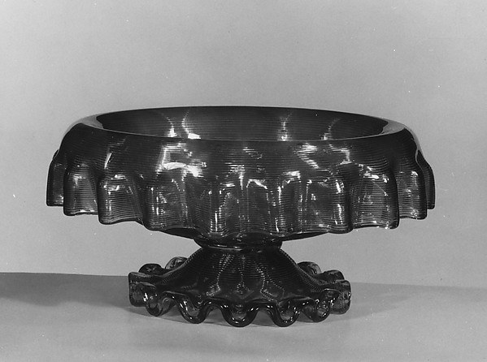
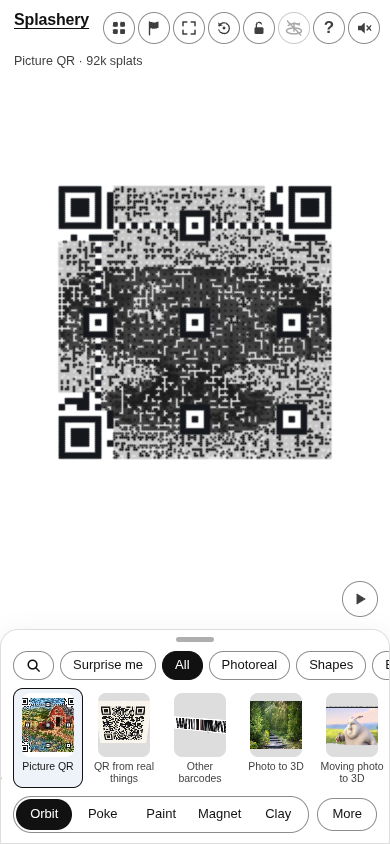
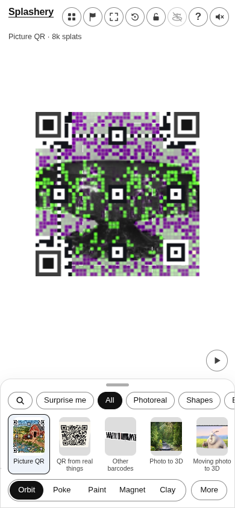
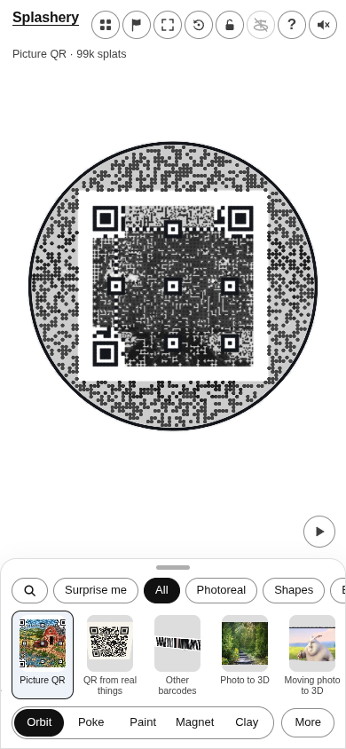
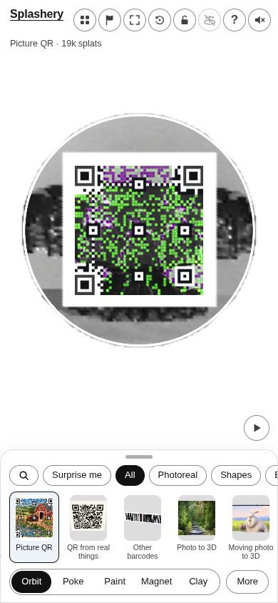

# Fruit Bowl

[All pictures](../README.md)

Source: [Boston & Sandwich Glass Company](https://www.metmuseum.org/art/collection/search/3845).
Rendered by Ryan with Codex (GPT-6); source credits remain in [CREDITS](../../../../CREDITS.md).

Source pixels used by the measure. The toy takes a central crop; Circle uses a smaller central crop
for its encoded square.

## Square

Mean SSIM over 10/10 payloads: phone 0.1680 → 0.3489; print 0.1604 → 0.3407.

| Main · Standard                                           | Most detail                                                    |
| --------------------------------------------------------- | -------------------------------------------------------------- |
|  |  |

## Circle

Mean SSIM over 10/10 payloads: phone 0.2448 → 0.3889; print 0.1789 → 0.3483.

| Main · Standard                                           | Most detail                                                    |
| --------------------------------------------------------- | -------------------------------------------------------------- |
|  |  |
