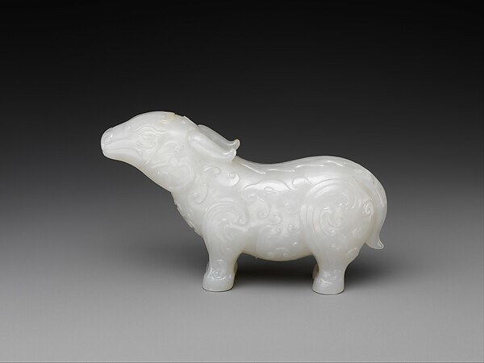
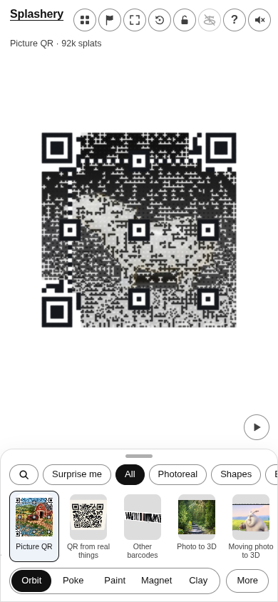
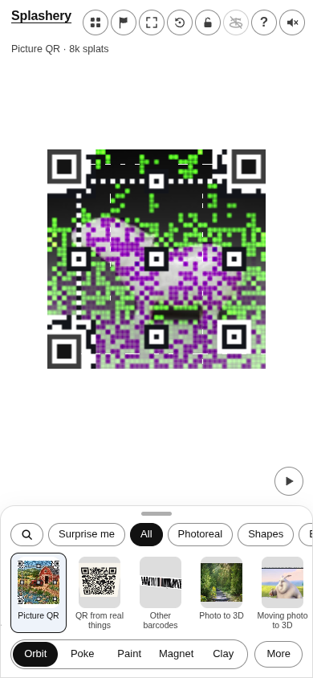
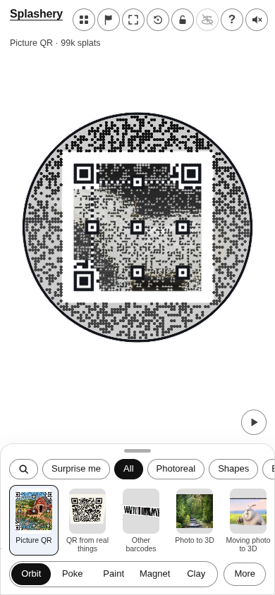
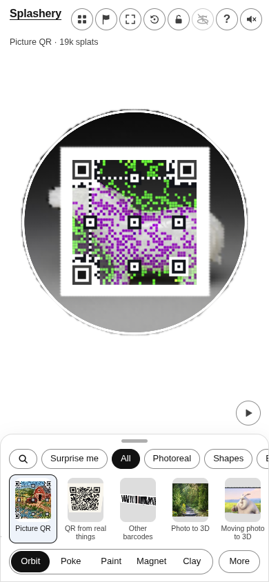

# Fantastic animal

[All pictures](../README.md)

Source: [China](https://www.metmuseum.org/art/collection/search/42138). Rendered by Ryan with Codex
(GPT-6); source credits remain in [CREDITS](../../../../CREDITS.md).

Source pixels used by the measure. The toy takes a central crop; Circle uses a smaller central crop
for its encoded square.

## Square

Mean SSIM over 10/10 payloads: phone 0.2049 → 0.2778; print 0.1985 → 0.2696.

| Main · Standard                                            | Most detail                                                     |
| ---------------------------------------------------------- | --------------------------------------------------------------- |
|  |  |

## Circle

Mean SSIM over 10/10 payloads: phone 0.1580 → 0.3329; print 0.1005 → 0.2922.

| Main · Standard                                            | Most detail                                                     |
| ---------------------------------------------------------- | --------------------------------------------------------------- |
|  |  |
