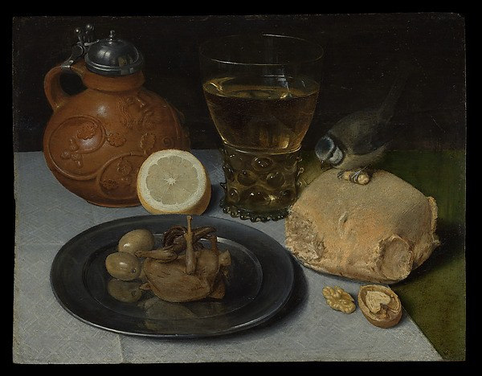
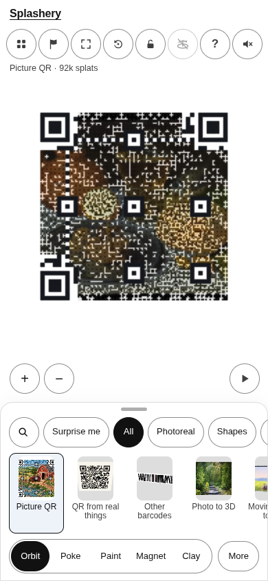
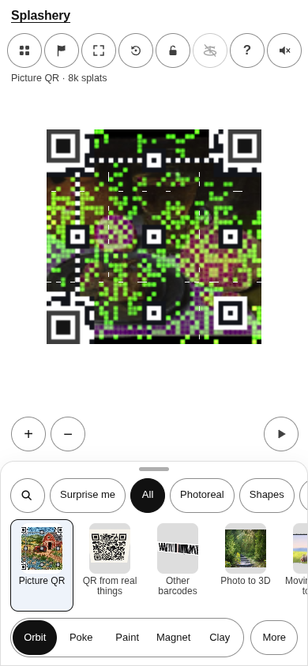
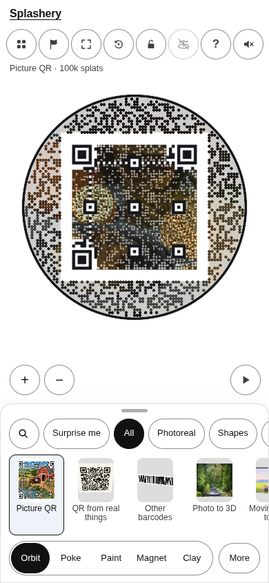
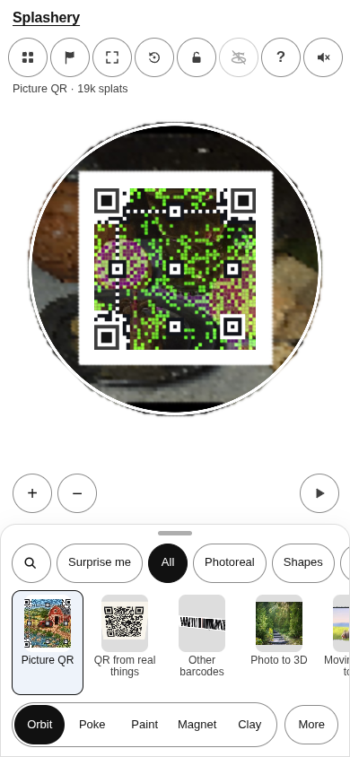

# Still Life

[All pictures](../README.md)

Source: [Georg Flegel](https://www.metmuseum.org/art/collection/search/436305). Rendered by Ryan
with Codex (GPT-6); source credits remain in [CREDITS](../../../../CREDITS.md).

Source pixels used by the measure. The toy takes a central crop; Circle uses a smaller central crop
for its encoded square.

## Square

Mean SSIM over 10/10 payloads: phone 0.1149 → 0.3498; print 0.1072 → 0.3422.

| Main · Standard                                             | Most detail                                                      |
| ----------------------------------------------------------- | ---------------------------------------------------------------- |
|  |  |

## Circle

Mean SSIM over 10/10 payloads: phone 0.1851 → 0.3786; print 0.1192 → 0.3434.

| Main · Standard                                             | Most detail                                                      |
| ----------------------------------------------------------- | ---------------------------------------------------------------- |
|  |  |
